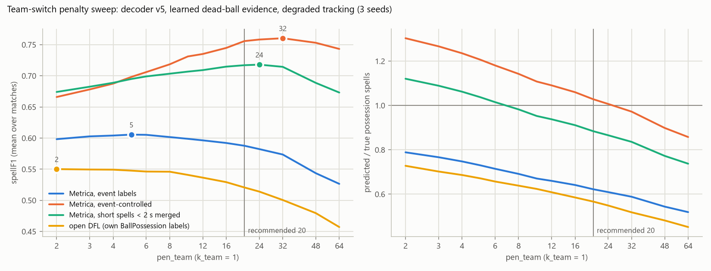

# MTAH 2027 — çalışma raporu: yapılanlar, sonuçlar, kararlar

Projenin **tek** fikir / deneme / sonuç belgesi. 25 Ekim 2026'da `docs/DENEMELER.md`, `docs/FIKIRLER.md`,
`reports/ANALIZ_RAPORU.md`, `reports/metrica_calibration.md`, `reports/sim_ball_dropout.md` ve `reports/whistle_eval.md`
burada birleştirildi. İçerik aynen korundu; yalnız başlık düzeyleri, iç referanslar ve tablo boşlukları uyarlandı.
`reports/` altında yalnız betiklerin ham toplu çıktıları (txt / json / png) kaldı.

**Yeni deneme nasıl eklenir:**
1. §3'teki "Tek tek denemeler" tablosunun **sonuna** bir satır: ne (betik), sonuç (toplu sayılar), karar (✅ / ❌ / ≈ / bilgi).
2. Anlatım gerekiyorsa §4'ün sonundaki son turun altına; yeni bir tursa tarihli yeni bir "Tur N" başlığıyla.
3. Model, gönderim ya da skorlar değiştiyse §1'deki özet güncellenir.

Veri politikası: yalnız toplu istatistik. Ham satır, kare bazlı çıktı, video karesi yok; belge hiçbir yerde yayınlanmaz.

İçindekiler: 1. Özet · 2. Kalıcı kurallar ve tuzaklar · 3. Deneme günlüğü · 4. Fikir havuzu ve tur kayıtları ·
Ek A İlk analiz ve baseline'lar · Ek B Metrica kalibrasyonu · Ek C Simülatörde top kaybı · Ek D Hakem düdüğü

## 1. Özet — şu anki durum (4 Kasım 2026)

**Görev.** BAR-ATH maçının 199,319 karesinin her birine H / A / D etiketi (X: cevap yok). Sıralama, tam maçın gizli
etiketleri üzerinde spellF1 ile yapılıyor (possession spell'leri, IoU 0.3–0.7); eşitlikte macroF1. Son teslim 17 Kasım
2026: CSV + dosyayı birebir yeniden üreten herkese açık repo (verisiz) + kısa teknik doküman. Teslimden önce geri bildirim
yok; elimizdeki göstergeler public 5 dakika (17 spell) ve dış veri setleri.

**Şu anki model: v18 = v17'de ölü top kanıtı kurallar + yayın + 0.5 × öğrenilmiş ölü top modeli** (`src/model_v18.py`,
`models/dead_base_v3.txt`; turlar 40–41, 4 Kasım; varsayılan kullanıcı kararı). **Gönderim: `submissions/candidate_v18.csv`**
(MD5 b6101389…), `src/make_submission.py`'nin varsayılanı; iki çalıştırmada ve boş önbellekten temiz dışa aktarımda (87 dosya, ~151 sn) birebir aynı; resmî doğrulayıcı "Valid". Sınır zamanlaması (DT) yok, doğrulayıcı v17'deki gibi. Açık setlerdeki
"kurallar" yayın işaretini içermediği için BAR-ATH'ınkini küçümsüyordu; SC'nin gerçek görüntü bayrağı DFL / Metrica'ya nakledilince
(`src/exp_deadmix.py`), doğrulayıcı öncesi, v17'nin tarifine göre: DFL evctrl 0.685 → 0.782, DFL-trk 0.665 → 0.761, Metrica
0.768 → 0.837, SC evctrl / faz / pp 0.642 / 0.605 / 0.599 → 0.702 / 0.659 / 0.653 (her maçta artı); birincil pişmanlık +0.097 (%90
[+0.087, +0.107]). BAR-ATH'ta (etiketsiz) v17'den karelerin %6.95'i farklı, ölü pay 0.493 → 0.451, ölü bölüm 117 → 109,
possession 208, gizli sınıf tahmini ölü F1 0.864 → 0.886; kazanç BAR-ATH'ta doğrudan ölçülemiyor. **Uyarı (tur 42):** PFF'in 64 maçlık bağımsız testinde v17'nin ölü top tarifi önde (+0.012); teşhis sürüyor. **v17** = v16'da kısa
possession uzmanı C1 yerine J1 (`src/model_v17.py`, `models/kpu_j1/`,
`models/short_verifier_{ins,del}_j1m25s.txt`; tur 37, 4 Kasım; `--model model_v17 --out …`, MD5
55dfc082…); iki çalıştırmada, `cache/v17` silinip yeniden hesaplanınca ve boş
önbellekten temiz dışa aktarımda (86 dosya, ~63 sn) birebir aynı; resmî doğrulayıcı "Valid". J1 = C1'in on hedef kurallı
açık maçta (DFL evctrl, Metrica ctrl; Metrica'nın yapışık topuna 0.8 m gürültü) ince ayarı. C1'e göre aynı girdide DFL
evctrl +0.0020 / +0.0017, Metrica +0.0059 / +0.0051, birincil pişmanlık +0.0059, en kötü koruma DFL-trk −0.0050. BAR-ATH'ta
(etiketsiz) v16'dan karelerin %0.43'ü farklı, possession 207 → 208. `--model model_v16 --out …` v16'yı (MD5 c89208a3…) yazar.
v16 = v15 + ölü top sınırlarının öğrenilmiş ölü top modeliyle zamanlanması (`src/model_v16.py`,
`src/dead_timing.py`, `models/dead_base_v3.txt`; tur 29, 3 Kasım).
v15 = v14'ün karışımı (%50 v10 + %50 paylaşılan BiGRU) ile kısa possession uzmanı C1'in kontrol olasılığı
(%75 / %25) + bu tabanda, hedef kurallı etiketlerle eğitilmiş kısa possession doğrulayıcısı (`src/model_v15.py`, tur
23–25); `--model model_v15` (MD5 6081216b…), v14 `--model model_v14` (MD5 5e7363fc…), v13 `--model model_v13` (MD5
ed8ad739…) ve v10
`--model model_v10` (MD5 ca20c5b6…) ile aynen üretiliyor. Düdüklü sürüm (`candidate_v10w.csv`, `--params '{"wh_bonus": 30}'`) önerilmiyor:
tek dayanağı public pencereydi.
1. **Ölü top mu, canlı mı:** v3 kuralları. Oyuncu temposu (±1 ve ±3 sn; hakeme tepki gecikmesi için 1.5 sn ileriye
   bakılıyor); top çizgi dışında mı, 1 sn'den uzun görünmüyor mu, duruyor mu, hızlı mı; hizalanmış yayın görüntüsünden
   tekrar / yakın çekim ve canlılık ipuçları. Yayının topu taktik topun boşluklarını dolduruyor.
2. **Takım (H/A):** LightGBM, kare başına "top ev sahibinde" olasılığı. Eğitim: açık DFL (7 maç, kendi possession bayrağı)
   + 3 Metrica örnek maçı (kontrollü possession; her maç 2 DFL maçı ağırlığında). İkisi de `sim.V3` ile BAR-ATH'ın otomatik
   takibine benzetiliyor. Özellikler: topa yakınlık, baskı altında kontrol (C6), kendi yarı saha, duran top dizilimi /
   takım şekli / hareketi (c145), topsuz takım etkileşimleri (`src/bfree.py`). Oyuncu kimliği yok, hepsi takım düzeyinde.
   v14'te bu olasılık paylaşılan BiGRU'nun (Alperen; açık DFL + PFF, `models/bigru_dfl_pff_v1`, üç tohumun ortalaması)
   olasılığıyla eşit ağırlıkta karıştırılıyor (tur 17b). v15'te bu karışım %75, kısa possession uzmanı C1'in kontrol
   olasılığı %25 ağırlıkla birleşiyor (madde 6). Olasılıklar ±1 sn (±25 kare) logit ortalamasıyla yumuşatılıyor.
3. **Decoder:** her devre için ayrı Viterbi. Takım değişimi cezası 12, ölü top cezası 30; en az 8 kare possession, 50 kare
   ölü top; 7 sn'den kısa bir possession'ı bitirmeye süre kısaldıkça artan ek maliyet (B2: 175 kare, 48).
4. **Düdük (yalnız v10w):** taktik videonun sesinde, iki santra düdüğünden yapılan şablonla hakem düdüğü aranıyor. Model
   ölü topa bir düdükten sonraki 3 sn içinde geçiyorsa geçiş düdük anına çekiliyor.
5. **Kısa possession doğrulayıcısı (tur 15; v14'te karışımın üstünde, tur 17):** decoder'ın bastırdığı ≥0.5 sn'lik ters takım dönüşleri ("ekle") ve
   çözülmüş <4 sn possession'lar ("sil") iki LightGBM sınıflandırıcısıyla yeniden değerlendiriliyor
   (`src/short_verifier.py`; v14: `models/short_verifier_{ins,del}_g_blend50.txt`, yalnız açık veriden; DFL satırlarının
   BiGRU marjı maç-dışı BiGRU'dan). Kanıt yalnız aday
   aralığından: top görünürlüğü / hızı / havada payı, topa en yakın oyuncunun takımı ve mesafesi, dokunuşlar, topu tutan
   farklı oyuncular ve en uzun tutma, çekişme, derinlik, takım merkezlerinin tepkisi, son duruştan beri süre, komşu
   possession süreleri, takım olasılığının (v14'te karışımın) marjları ve paylaşılan BiGRU'nun marjı. Ekleme p ≥ 0.65; silme p < 0.35 (kareler komşu
   possession'ı tutan takıma geçer, iki duruş arasında hiç). v14'te BAR-ATH'ta karelerin %0.17'si, 6 bölge
   değişiyor (karışımın çözümü 211 → 216 possession; v13'te %0.19, 203 → 214). v15'te uzman da adaylara ve
   özelliklere katılıyor (madde 6), DFL ve SC satırları hedef kuralla etiketli (`models/short_verifier_*_c1m25s.txt`).
6. **Kısa possession uzmanı C1 (v15; tur 23–25, `src/short_specialist.py`, `models/kpu_c1/`):** topun çevresine bakan
   takip modeli (top durumu + her takımdan topa en yakın 5 oyuncu, 25 fps; ortak MLP + çift yönlü GRU), yalnız açık
   PFF'in 64 maçında, PFF'in insan etiketli olaylarının resmî "kontrollü possession" okumasıyla
   (`gradient.controlled_reading`) eğitildi; DFL / Metrica / SC / BAR-ATH'ı hiç görmedi. Çıktıları takım başına kontrol,
   kontrolü alma / kaybetme ve ayrı bir dokunuş başlığı. Kullanım: (a) canlı-normalize kontrol olasılığı takım
   olasılığına %25 (yumuşatma ve decoder'dan önce); (b) doğrulayıcıya 8 özellik; (c) çekişmeli anlarda kendi ekleme
   adayları (θ 0.7). Doğrulayıcının eğitim etiketleri her kaynakta hedef kuralda: Metrica ctrl, DFL evctrl, SC evctrl
   (`skillcorner.evctrl_labels`). BAR-ATH'ta tek uzman tohumu (20261102): gönderim, değerlendirilen yapılandırmalardan
   biri birebir. BAR-ATH'ta (etiketsiz) uzman v14'ün takım kararıyla %94.3 uyumlu (dış setlerde %91.4–95.5); v15 v14'ten
   karelerin %0.92'sinde farklı (158 bölge, medyan 0.1 sn), 216 → 207 possession, < 4 sn 19 → 13.
7. **Ölü top sınırlarının zamanlaması (v16; tur 29):** madde 1'in kuralları hangi bölümlerin ölü olduğuna karar
   veriyor; her duruş ve yeniden başlama, öğrenilmiş ölü top modelinin (yalnız açık DFL; kendi top durumu, `sim.V3`,
   takip özellikleri) kendi çözümündeki aynı türden en yakın sınıra taşınıyor, ±2 sn içinde ve arada başka sınır
   yoksa (son adım). BAR-ATH benzeri ölü topla dış setlerde: DFL evctrl +0.016, Metrica +0.005, SC +0.003,
   SoccerTrack (tasarımda kullanılmadı) +0.005. BAR-ATH'ta 233 sınırdan 110'u taşınıyor (duruşların %87'si geç yöne,
   medyan +18 kare; yeniden başlamalar dengeli, medyan +3), karelerin %1.07'si; possession (207) ve ölü bölüm (118)
   sayısı aynı.

Kapalı seçenekler: v11 (dokunuş özellikleri), v12 (dokunuşa göre geçiş kolaylığı), `po_lam` (yalnız oyunculara dayalı
ölü top), `clean_ball` (ATD'nin tahminle doldurduğu top karelerini atmak).

**Skorlar — dış setler** (spellF1, öğrenilmiş D / gerçek D; her maç eğitimden dışarıda; v10 = 3 LightGBM tohumunun
ortalaması; v13 / v14 / v15 = aynı üç tohum × 2 doğrulayıcı tohumu, her maçı görmemiş doğrulayıcı; BiGRU DFL'de
maç-dışı; v15'te her v10 tohumu bir uzman tohumuyla eşli; tur 17 ve 25, `src/exp_kpu.py eval`). 2 Kasım'dan beri karar
kuralı (§2, kullanıcı kararı): hedef kuralın bağlamlarında (Metrica ctrl, DFL evctrl; öğrenilmiş / gerçek D) en kötü
durum pişmanlığı ≥ 0.005 düşmeli, korumalar (DFL-trk, SC faz / pp) −0.01'den kötü olmamalı. v15 birincil bağlamlarda
pişmanlığı v14'e göre **0.0126** düşürüyor (%90 [+0.0048, +0.0238], P(≥ 0.005) 0.95); en kötü koruma SC pp −0.001.
(Eski kuralla, 10 bağlamda: v13 0.0165 → v14 0.0039.)

| Set | v10 | v13 (BAR-ATH koşulu) | v14 | **v15** | v15 − v14 |
|---|---|---|---|---|---|
| DFL-evctrl (7 maç, hedef kural) | 0.782 / 0.808 | 0.777 / 0.803 | 0.785 / 0.809 | **0.796 / 0.821** | +0.011 / +0.013 |
| Metrica-ctrl (3 maç, hedef kural) | 0.823 / 0.882 | 0.823 / 0.882 | 0.828 / 0.888 | **0.836 / 0.894** | +0.009 / +0.006 |
| DFL-trk (7 maç) | 0.769 / 0.798 | 0.764 / 0.792 | 0.770 / 0.794 | **0.784 / 0.809** | +0.015 / +0.015 |
| SkillCorner faz (20 maç) | 0.597 / 0.759 | 0.608 / 0.770 | 0.620 / 0.780 | **0.625 / 0.785** | +0.005 / +0.006 |
| SkillCorner oyuncu possession | 0.592 / 0.748 | 0.606 / 0.763 | 0.620 / 0.773 | 0.619 / 0.773 | −0.001 / −0.001 |
| SkillCorner evctrl (bilgi; hedef kural, tur 25) | — | — | 0.657 / 0.823 | **0.670 / 0.838** | +0.013 / +0.016 |
| SoccerTrack evctrl (bilgi; 8 maç, hiçbir bileşen görmedi, tur 28) | — | — | 0.700 / 0.815 | **0.723 / 0.843** | +0.023 / +0.028 |

SoccerTrack v2 (tur 28): bağımsız test; top olaylardan yeniden kurulduğu için mutlak skorlar iyimser, fark eşli maç
bazında (evctrl 7/8 ve 8/8 maçta v15 önde; sağlayıcı durumunda da +0.032 / +0.035, 8/8).

Süreye göre (tur 25 dökümü; hedef kural, öğrenilmiş D): v15'in kazancı yanlış kısa ve orta spell'lerin azalmasından.
Tahmin edilen < 4 sn spell'lerin isabeti DFL 0.56 → 0.62, Metrica 0.59 → 0.62, SC 0.36 → 0.40; gerçek kısa
possession'ların yakalanması değişmedi (0.51 → 0.49, 0.45 → 0.46, 0.28 → 0.28); < 2 sn olanların ~%75'i kaçıyor.

Öğrenilmiş D: ölü topu model kendisi buluyor (dış setlerde yayın yok, öğrenilmiş ölü top modeli kullanılıyor). Gerçek D:
ölü top doğru veriliyor, yalnız takım kararı ölçülüyor. BAR-ATH'a en yakın set Metrica: aynı sağlayıcı, aynı possession mantığı.

**Skorlar — public 5 dakika** (resmi skorlayıcı; köşeli parantezde 1000 bootstrap ile %90 aralık). Yalnız hattın doğru
çalıştığını gösterir, sürüm seçmez:

| Model | spellF1 | macroF1 |
|---|---|---|
| Resmi baseline (smooth50; tam maçta 0.243) | 0.326 [0.21–0.45] | 0.621 |
| v5 | 0.566 [0.36–0.76] | 0.901 |
| v7 | 0.652 [0.43–0.81] | 0.924 |
| **v10** | **0.667 [0.44–0.83]** | **0.932** |
| v10w | 0.667 [0.44–0.83] | 0.939 |

v10 public'te canlı/ölü F1 0.98, canlı karelerde takım doğruluğu 0.95; 17 gerçek spell'e karşı 10 spell üretiyor (kaçanlar
kısa top kayıpları). Tam maçta 203 possession, 118 ölü top bölümü, %49 ölü pay (etiketsiz; literatürle uyumlu).
v13 public penceredeki hiçbir kareyi değiştirmiyor; hat kontrolü v10'unkiyle aynı. v13 tam maçta 214 possession
(canlı dakika başına 4.00; v10 3.79), 4 sn altı pay %13 (v10 %8). v14 tam maçta 216 possession (karışımın çözümü 211),
118 ölü top bölümü, %49.6 ölü pay, ev sahibi payı 0.61; v13'ten karelerin %0.76'sı farklı. v14'ün public skoruna karar
sürecinde bakılmadı; dosya resmî doğrulayıcıdan geçiyor. v15 tam maçta 207 possession (< 4 sn 13; v14 19), 118 ölü top
bölümü, %49.9 ölü pay, ev sahibi payı 0.61; v14'ten karelerin %0.92'si farklı. v15'in public skoruna bakılmadı.


**27 Ekim, tur 13:** yerel çalışma GitHub'daki iki ortak commit ile birleştirildi; v10 MD5'si ve paylaşılan BiGRU
CSV SHA256'sı birebir doğrulandı, 52 test geçti. Altı sabit karışım, üç eşli eğitim tohumu ve sabit toplulukla dış
veride ölçüldü (216 skor hücresi). %75 BiGRU / %25 v10 **olasılık** karışımı, ardından ±25 logit yumuşatma:
üç tohum ortalamasında SC faz +0.0216 / +0.0195, SC pp +0.0295 / +0.0263; Metrica +0.0009 / +0.0015.
SC farklarının eşli maç-bootstrap %95 aralıkları pozitif; Metrica'nın yalnız üç maçında aralıklar sıfırı kapsıyor.
Altı bağlamdaki en kötü pişmanlık v10 0.0390 → bu aday 0.0101; logit %75 0.0082 ile 0.005 beraberlik sınırı içinde.
Daha basit olasılık karışımı **sonraki doğrulama adayıdır**. DFL maç-dışı BiGRU doğrulaması yok; varsayılan **v10 kalır**.
Kullanıcı 27 Ekim'de ara istedi; çalışan iki kendi CPU işi durduruldu. Ayrıntı: §4 Tur 13.

**29–30 Ekim, tur 14–15:** kullanıcı önce "son modelde kısa possession sorunu var mı?" diye sordu (tur 14: evet, en
büyük kayıp havuzu), sonra literatür taraması, farklı açılardan teşhis ve çözecek en sağlam yeteneği istedi. Üç web
araştırması, dört teşhis ve iki yetenek denendi; sınırları yeniden konumlandırma ❌, kısa possession doğrulayıcısı ✅.
Doğrulayıcı 3 v10 tohumu, 2 ölü top kanalı, 2 doğrulayıcı tohumu ve komşu eşiklerle ölçüldü; DFL'de BiGRU marjı
kullanılmadığı için DFL geçerli bir dış test. Varsayılan v13 oldu. Ayrıntı: §4 Tur 15.

**30 Ekim, tur 17 / 17b:** kullanıcı PFF'ye Drive kısayoluyla erişim verdi. Colab'da (T4, ~1 sa) paylaşılan BiGRU'nun
tarifiyle DFL maç-dışı BiGRU eğitildi (7 maç × 3 tohum). %75 karışım + doğrulayıcı DFL-trk'de v13'ün gerisinde kaldı
(❌). v13'ün doğrulayıcısı DFL'de de BAR-ATH'taki gibi BiGRU marjını görünce DFL'de 0.006–0.012 kaybediyor; tur 15'in
DFL skoru marjsız bir v13'ü ölçmüş. Tur 13'ün önceden sabitlenmiş ızgarasında .5 + doğrulayıcı on bağlamın hepsinde bu
v13'ün önünde; en kötü pişmanlık 0.0165 → 0.0039 (bootstrap P(fark ≥ 0.005) 0.94). Varsayılan **v14** oldu. Ayrıntı:
§4 Tur 17.

**2 Kasım, tur 22–25:** kullanıcı kısa possession'lara özel, yalnız orada devreye giren bir yetenek istedi. Hazır video
modeli (T-DEED) BAR-ATH yayınında müdahale / bloğu görmedi (❌, tur 22). PFF'in insan etiketli dokunuşlarıyla eğitilmiş,
topun çevresine bakan uzman (tur 23) doğrulayıcının AUC'sini her sette artırdı ama spellF1'e az döndü. Kök neden etiket
kuralıydı: kaynaklar maç başına 12–135 oyun içi kısa possession sayıyor, resmî tanım kontrollü possession (Metrica ctrl,
DFL evctrl). PFF ve SC etiketleri aynı okumaya çekildi, uzman bu kuralla yeniden eğitildi (C1, tur 24), karar kuralı
kullanıcıyla hedef kurala göre sonuçlardan önce yeniden yazıldı. C1'in kontrol olasılığı takım olasılığına %25 katılınca
(24c) ve SC satırları da hedef kurala çekilince (25) birincil pişmanlık 0.0126 düştü → varsayılan **v15**. Ayrıntı: §4
Tur 22–25.

**Model zinciri** (ayrıntı §3'teki "Modeller" tablosunda):
- v1–v4 (20 Ekim): kurallar + en kısa süreli Viterbi. v3'ün canlı/ölü kuralları bugün de kullanılıyor.
- v5: DFL'de öğrenilmiş takım olasılıkları. v6: hakem düdüğü.
- v7 (22 Ekim): `sim.V3` ile eğitim, C6 + own_half + c145 özellikleri, B2 decoder, ceza 12.
- v8: Metrica maçları eğitime. v9: topsuz özellikler + ±1 sn yumuşatma.
- v10 (23 Ekim): Metrica ağırlığı 2 (25–30 Ekim arası gönderim). v11 / v12: dokunuş seçenekleri, v10'a eşit (≈).
- v13 (30 Ekim): v10 + kısa possession doğrulayıcısı (tur 15–17 arası gönderim).
- v14 (30 Ekim): %50 v10 + %50 BiGRU karışımı + karışımın doğrulayıcısı (30 Ekim–2 Kasım arası gönderim).
- **v15 (2 Kasım): v14 + kısa possession uzmanı C1 (%25 karışım, doğrulayıcıya özellik ve aday) + hedef kurallı
  doğrulayıcı etiketleri — varsayılan.**

**Neler işe yaradı** (dış setlerde; ayrıntılar §3–§4):
- Simülatör hatasının bulunması: `sim.V2`'nin her kareye bağımsız gürültüsü hızları ikiye katlıyordu (adversarial
  validation, AUC 1.000). Pürüzsüz gürültülü `sim.V3` ile düzeldi; öncesindeki bütün öğrenilmiş modeller bozuk hızlarla
  eğitilmişti.
- Baskı altında kontrol özellikleri (C6): ilk tutarlı kazanç (DFL-trk +0.0085, Metrica +0.006).
- Duran top dizilimi / takım şekli / hareketi (c145): +0.007…+0.013.
- B2 yumuşak en kısa possession süresi: Metrica +0.009, DFL-trk +0.013. Birleşimi v7: DFL-trk ve Metrica +0.016,
  SkillCorner +0.017.
- **Eğitim verisi (en büyük adım):** Metrica maçlarını eğitime katmak (v8), topsuz özellikler + ±1 sn yumuşatma (v9),
  Metrica ağırlığı 2 (v10). v10, v7'yi sekiz bağlamın hepsinde geçiyor (bootstrap P 0.95–1.00; tohum, ceza ve stres
  testlerine dayanıklı).
- Ölü topta yayın görüntüsü ipuçları (v3; public canlı/ölü F1 0.97).
- **Kısa possession doğrulayıcısı (v13, tur 15):** v10'un kendi kısa kararlarını aday aralığındaki izleme kanıtı ve
  BiGRU marjıyla yeniden değerlendirmek: SC +0.010…+0.015, DFL-trk +0.005, Metrica ±0.001; en kötü pişmanlık
  0.019 → 0.004.
- **BiGRU karışımı (v14, tur 17b):** %50 LightGBM + %50 paylaşılan BiGRU ve karışımın kendi adaylarında eğitilmiş
  doğrulayıcı: BAR-ATH koşulundaki v13'e göre SC +0.010…+0.014, Metrica +0.005…+0.006, DFL +0.002…+0.008; en kötü
  pişmanlık 0.0165 → 0.0039.
- **Etiket kuralını hizalamak (tur 24–25):** resmî tanımın (kontrollü possession) olay okumasını PFF'e ve SC'ye
  uygulamak, doğrulayıcının DFL / SC satırlarını bu kuralla etiketlemek. SC hizalaması tek başına Metrica'yı +0.002 →
  +0.009 taşıdı (3/3 oyun).
- **Kısa possession uzmanı C1 (v15, tur 24c–25):** PFF'te hedef kuralla eğitilmiş top çevresi modelinin kontrol
  olasılığını %25 karışıma katmak (DFL evctrl +0.004 → +0.011); v15 toplamda birincil pişmanlık −0.0126.

**Neler işe yaramadı** (hepsi ≤ +0.003 ya da eksi):
- Decoder hileleri: B1 / B4 / B5 / B6 / G1 / G2, el değişimi modeli, kısa possession doğrulama, yeniden başlama muafiyeti,
  gecikme düzeltmesi, konsensüs, varış yerine göre rampa, mücadele anına özel decoder.
- Daha güçlü öğreniciler: tek başına BiGRU (−0.04…−0.10; karışımda işe yarıyor), zamansal yığınlama, büyük LightGBM, extra-trees, monoton kısıt, topluluklar.
- Yeni özellikler: rol farkındalığı (DFL −0.013…−0.015), oyuncu düzeyinde kontrolcü (yalnız SkillCorner'da artı), mücadele
  sonucu özellikleri, dokunuş özellikleri (v11, ≈).
- Eğitim / etiket varyantları: SkillCorner'ı eğitime katmak (Metrica her seferinde −0.006…−0.009), DFL trk etiketi, yumuşak
  hedefler, top kaybı ve mücadele karelerine ×3 ağırlık, test maçında kendi kendine eğitim.
- Top ve video: kusursuz top izi bile < +0.02; hazır WASB ve YOLO11s ince ayarı yetmedi; video pas pilotu v7 düzeyinde;
  ATD top temizliği dış setlerde desteklenmedi; kusursuz konum ≈ +0.005.
- Ölü top alternatifleri (öğrenilmiş harman, yalnız oyunculara dayalı model) ve Smart Tagging'i takım kanıtı yapmak.
- Yeni gözlemler (tur 11): yayın kamerasının kadrajı (BAR-ATH'ta v10-emin karelerde AUC 0.95, ama SkillCorner'da gerçek
  etiketle birleştirme her ayarda −0.014…−0.13, sahte değişim vetosu olarak da −0.0005…−0.038), spiker adları (dakikada
  5.5, %87'si ev sahibi, zayıf) ve top yüksekliği (DFL'nin gerçek yüksekliğiyle bile −0.005…−0.010).
- Tur 15: decoder'ın değişimlerini az yumuşatılmış kanıtın değişim noktasına taşımak (her yerde −0.001…−0.003) ve
  "oyunu başlatan takım topa son dokunmamıştır" kuralıyla duruş öncesi kısa spell aramak (isabet %4–19).
- Tur 17: %75 BiGRU karışımı (DFL maç-dışı ölçülünce karışım DFL-trk'de −0.014…−0.020; doğrulayıcıyla bile pişmanlık
  farkı < 0.005).
- Tur 22–24: hazır video modeli (T-DEED, Team-BAS) müdahale / bloğu görmüyor; PFF'in kendi kuralıyla eğitilmiş S1 / S2
  uzmanları ≈ +0.002; uzmanın değişim tepelerine sınır oturtma ve denetimli sınır regresyonu (korunan kısa spell'leri
  bozuyor).

**Dersler:**
- Simülasyon içi CV simülasyon hatasını göremez; her yeni bozulma BAR-ATH'a karşı adversarial validation ile kontrol edilir.
- Public pencere sürüm seçemez (v10'un aralığı 0.44–0.83). Kararlar dış setlerde en kötü durum pişmanlığıyla verilir; fark
  0.005'ten küçükse mevcut ya da basit olan kalır.
- Her aday en az 3 tohumda ölçülür: v10'un kendisi tohumlar arasında DFL'de ±0.004 oynuyor.
- Bir girdi bir sette eksik bırakılarak ölçülürse o set, modelin gönderimde çalıştığı koşulu ölçmez: v13'ün DFL
  ölçümünde BiGRU marjı yoktu; marj görününce DFL'de −0.006…−0.012 (tur 17b).
- Kare doğruluğu artıp spellF1 düşüyorsa çıktı genellikle zıplıyordur; reddetmeden önce yumuşatmayla denenir.
- Kalan kayıp 4 sn'den kısa oyun içi top kaybı spell'lerinde (özellikle ikili mücadeleler) ve bunların aynası olan yanlış
  değişimlerde. Mücadele anlarında takip verisi v10'un kullandığından çok az fazla bilgi taşıyor; kusursuz konum bile
  ≈ +0.005. Bu havuzu ancak yeni bir gözlem açabilir: topa kimin dokunduğu (video).
- Tur 15: kısa spell'lerin %59–75'i duruşa bitişik, yalnız %25–41'i oyun içi. Ayrılabilirlik modelin kendi
  adaylarıyla ölçülmeli: gerçek aralıklarla ölçülen AUC (0.94–0.96) gerçek sınırları sızdırıyor, dağıtılabilir ölçümde
  oyun içi ekleme DFL / Metrica'da 0.67–0.75. Kazancı taşıyan yeni bilgi BiGRU'nun marjı; o olmadan doğrulayıcı DFL'de
  kaybettiriyor. Literatür de aynı sınırı gösteriyor: iskelet verisi ve sensörlü topla bile ayak düellosunda son
  dokunuş %65–75 doğru.
- Yeni bir ipucunun modelin emin olduğu karelerdeki uyumu, değerinin ölçüsü değildir (kamera kadrajı: AUC 0.95, ama
  birleştirme kaybettirdi). Değer, modelin belirsiz olduğu anlarda ve gerçek etiketle ölçülür; BAR-ATH'a özgü bir gözlem
  ancak aynı türden gözlemi taşıyan bir dış sette doğrulanabiliyorsa benimsenir.
- Kaynakların possession kuralı en çok kısa possession'larda ayrışıyor (maç başına oyun içi kısa 12–135). Hedefle aynı
  kuralda etiketlenmemiş veri kısa possession'larda yanlış şeyi öğretiyor: önce kural hizalanır, sonra model (tur 24–25).

**BAR-ATH'ın kullanımı (24 Ekim denetimi):**
- Takım modeli, eğitim verisi, özellikler, yumuşatma ve decoder dış setlerde seçildi.
- Ölü top kuralları (v2/v3, 20 Ekim) public pencereye bakılarak kuruldu: ölü top bölümlerinde oyuncu hızı, hakeme tepki
  gecikmesi, yayın görüntüsünün geçersizliği; hız kaydırması public canlı/ölü F1 ile tarandı. İki öğrenilmiş alternatif
  public'te kaybettiği için reddedildi.
- Düdük: şablon BAR-ATH videosunun sesinden; eklenme kararı ve "yalnız model geç kaldıysa" kuralı public'e bakılarak verildi.
- Simülatör: BAR-ATH'ın etiketsiz tam maç istatistiklerine göre ayarlandı (canlı/ölü ayrımı için GT değil, v5 tahminleri).
- **Kurallar güncellendi** (resmî repo f8f2629, 23 Ekim; 26 Ekim'de çekildi): public 5 dakika "eğitim verisi değil, ayar
  seti değil" (yalnız hat kontrolü); BAR-ATH'ta elle etiket hiçbir amaçla yok; maç hakkında insan üretimi veri (olay
  verisi, düzeltilmiş takip) yok; başka maçların verisi serbest. Bu yüzden public'e bakılarak kurulan ölü top sabitleri
  dış veride yeniden türetilmeli.
- Kurallar (eski yerel kopya, son commit 15 Ekim): yasak olanlar elle üretilmiş etiketlerle gönderim, gizli tam maç etiketleri
  ve yeniden üretilemeyen dosya. Yayınlanan 5 dakika ve test videosu girdi olarak serbest. EVALUATION.md public pencerenin
  sürüm seçmek için kullanılmamasını öğütlüyor; ölü top kuralları ve düdük bu öğüde aykırı, teknik dokümanda açıkça yazılmalı.

**Açık konular:**
- ~~Varsayılanı düdüksüz `candidate_v10.csv` yapmak~~ → 25 Ekim'de yapıldı (kullanıcı kararı; `make_submission.py`
  varsayılanı model_v10, MD5 ca20c5b6… doğrulandı).
- Teslimin sağlamlaştırılması (25 Ekim, kullanıcı: seçenek 3): yeniden üretim temiz kopyada doğrulandı (§3); takım
  modeli `models/v10_team.txt` olarak repoda (yalnız açık veriden eğitilmiş; varsayılan çalıştırma yalnız verilen veriyle
  ~1 dk); `requirements.txt` sürümleri sabitli; teknik doküman taslağı `docs/TECHNICAL_DOCUMENT.md` (İngilizce; takım
  adı / üyeler / repo adresi boş); herkese açık repo içeriği `tools/export_public.py` ile ayrı klasöre çıkarılıyor
  (`docs/RAPOR.md` ve `reports/` dahil değil). Herkese açık repo henüz açılmadı; yerel commit ve birleştirme 27 Ekim’de yapıldı, push için kullanıcı onayı gerekiyor.
- Video ile dokunuş tespiti (topa kim dokundu): yerelde hazır model yok. Adaylar (tur 11 araştırması): SoccerNet 2025
  Team-BAS baseline'ı (47 MB; takımlı pas / top sürme), kendi takibimizle etiketlenen "topa sahip oyuncu" görüntü
  sınıflandırıcısı, yayın karesinde top + forma rengi. Hepsinde aynı engel: yayın videosu taşıyan etiketli bir dış set
  olmadan doğrulanamıyor (SoccerNet verisi NDA ister). Elle etiketleme reddedildi.
- Eğitim verisi: SoccerTrack v2 (10 tam saha maç, Hugging Face onayı gerekiyor; topu olaylardan yeniden kurulmuş, top
  özellikleri etiketi sızdırır → yalnız topsuz özelliklerle).
- Teslim için herkese açık repo gerekiyor (şu an özel; veri, cache ve submissions gitignore'lu). Repo açılmadan önce bu
  belge BAR-ATH sayıları açısından gözden geçirilmeli. Teknik dokümanda kaynaklar: Metrica Sports sample data,
  IDSSE / open DFL (CC BY 4.0), SkillCorner open data (MIT).
- Tur 9–12 çalışması `541b79e` ile korundu; Alperen’in `a3b3070` / `39fd4de` commit’leri `de5d862` ile birleştirildi. Çalışma dalı `codex/rounds9-13-integration`; özel repoya push'lar kullanıcı onayıyla (son: 2 Kasım, v15).
- **v13 ve herkese açık repo (tur 15):** v13 paylaşılan BiGRU ağırlıklarını (`models/bigru_dfl_pff_v1`) kullanıyor ve
  bunlar dışa aktarım listesinde. Ağırlıkların eğitiminde PFF / Gradient Dünya Kupası 2022 verisi var; kendi README'leri
  erişimin sağlayıcının koşullarıyla alındığını söylüyor. ~~Yayım izni teyit edilmeli~~ → kullanıcı 30 Ekim'de PFF
  izninin olduğunu teyit etti; ağırlıklar herkese açık repoda kalabilir. `requirements.txt` artık torch 2.11.0 istiyor.
- **Tur 15'ten sonraki kaldıraçlar:** PathCRF (topsuz, fiziksel aktarım kısıtlı CRF; kod ve ağırlıklar açık ama ağırlıklar
  bütün DFL'de eğitilmiş, Colab'da maç-dışı yeniden eğitim gerekir) ikinci bağımsız kanıt olarak; ELASTIC ile kare
  hassas eşlenmiş DFL olaylarından kontrol etiketi (indirme boyutu sorulmalı); R-8 kısa spell'e tavanlı ağırlık
  (CPU, denenmedi); "D-bölme" (birleşmiş komşuları kurtarmak için 1 karelik D) — metriğe yönelik, canlı kareye D
  yazıyor; denemeden önce kullanıcı kararı gerekir.

## 2. Kalıcı kurallar ve tuzaklar

- **Karar kuralı (2 Kasım, kullanıcı kararı, tur 24):** birincil bağlamlar hedef kuralınkiler, yani resmi "kontrollü
  possession" okuması: Metrica ctrl ve DFL evctrl (her biri öğrenilmiş ve gerçek ölü topla). Yeni bir model bunların en
  kötü durum pişmanlığını ≥ 0.005 düşürmeli. SC faz / pp ve DFL-trk maç başına 2–3 kat fazla kısa possession sayıyor;
  yalnız koruma: hiçbiri 0.01'den fazla kaybetmemeli. Gerekçe: maç başına oyun içi kısa possession Metrica ctrl 12, DFL
  evctrl 13, DFL-trk 16, SC faz 26, SC pp 37, PFF (eski kural) 54, DFL native 135; eşit ağırlıklı pişmanlık hedef
  kurala hizalanan modelleri SC yüzünden cezalandırıyordu.
- **Veri hiçbir bulut LLM'e gösterilmez** (T&C). Scriptler sadece toplu istatistik basar; video karesi, ham satır,
  ses, ham veri grafiği yok. Analiz raporları Artifact olarak yayınlanmaz.
- **Public pencerede parametre ayarlamayın.** Resmi örnek: smooth125 public'te kazanıyor, tam maçta kaybediyor.
  Bizde de v1'de ceza seçimi public'e göre yapılınca iyimser çıktı (0.525*).
- **Hız kanalı m/s** (XML "kph" diyor). **Top hız kanalı çöp** (corr −0.10) → konumdan türet.
- **ATD frame_id − 1 = video karesi.** Kendi parse'ımızla resmi baseline'lar birebir üretildi (hizalama doğru).
- **Broadcast hizası:** 1. yarı `tactical = broadcast + 4014`, 2. yarı `+ 26920` (top eşleşmesiyle; takım
  merkezleriyle denendi → başarısız, çünkü broadcast sadece görünen oyuncuları içeriyor).
- **Simülasyonu simülasyon içi CV ile doğrulamayın.** DFL-CV / Metrica eğitim ile testi aynı bozulmadan
  geçirir; bozulma gerçekçi değilse (V2'deki her-kare gürültü gibi) bunu göremez. Her yeni bozulmayı
  `src/exp_advval.py` (BAR-ATH'a karşı adversarial validation) ve kinematik istatistiklerle kontrol edin.
- **Skor birleştirmede ±e/2 hatası:** `S[H]=a/2+e/2, S[A]=a/2−e/2` en iyi canlı duruma |e|/2 bedava bonus verir,
  D payını bozar. Doğrusu `S[H]=a/2+log p_H`, `S[A]=a/2+log p_A` (log p ≤ 0).
- **Takım kanıtı sıfır-toplamlı olmalı:** v1'de takım kanıtı canlı durumları da ödüllendirince duran topta
  topun yanında duran oyuncu "canlı H" ürettirdi.
- Google Drive "Kota aşıldı": klasörü **zip olarak indirmek** çalıştı; tek dosya / "kopya oluştur" videoda çalışmadı.
  Yerleşik tarayıcı paneli kapatılınca indirme iptal oluyor.
- **Her aday en az 3 LightGBM tohumunda / model örneğinde ölçülür** (tur 9): tek örnekteki maç bootstrap'ı ve stres
  testleri kazancı abartabiliyor; v10'un kendisi tohumlar arasında DFL'de ±0.004 oynuyor.
- **Kare doğruluğunu artırıp spellF1'i düşüren fikirler** çoğu zaman yalnız daha zıplayan çıktı verir; reddetmeden önce
  ±25 kare logit yumuşatmayla denenir (tur 9).
- **Karar kuralı:** dış setlerde (DFL-trk, Metrica-ctrl, SkillCorner; öğrenilmiş ve gerçek D) en kötü durum pişmanlığı;
  fark 0.005'ten küçükse mevcut / basit olan kalır. Ayrıntı §4'te "Karar protokolü: parametre seçimi (22 Ekim)".
- **BAR-ATH'a bakarak karar verilmez** (public pencere dahil); BAR-ATH yalnız akıl sağlığı kontrolü ve etiketsiz tanı
  içindir. Geçmişte BAR-ATH'a bakılarak verilen kararlar §1'deki 24 Ekim denetiminde listelendi.

## 3. Deneme günlüğü

Amaç: aynı hataları tekrarlamamak. Her yeni denemede buraya bir satır ekleyin (tarih, ne, sonuç, karar).
Skorlar: public = ilk 5 dk (17 possession, spellF1 bootstrap aralığı ~0.27–0.62 → tek başına karar verdirmez).
"Vekiller" = `src/proxy.py` (Smart Tagging duran top / takım uyumu, top-dışarı kapsaması) + tam maç sayıları.

### Modeller (kronolojik)

| # | Ne | Public macroF1 / spellF1 | Tam maç | Karar |
|---|---|---|---|---|
| resmi | en yakın oyuncu + çoğunluk oyu | 0.621 / 0.326 | 594 poss | taban |
| v1 | kural kanıtı + min-süreli Viterbi | 0.709 / 0.525* | 214 | ceza public'e göre seçildi → güvenilmez |
| v2 | canlı/ölü (a) ve takım (e) ayrı; sıfır-toplamlı takım | 0.816 / 0.448 | 234, %48 D | ✅ yapı doğru |
| v3 | v2 + broadcast geçerliliği/canlılığı + broadcast topu ile boşluk doldurma + kamera uyuşmazlığı ağırlığı + hız penceresi 1.5 sn ileri | 0.878 / 0.459 | 221, 113 D seg | ✅ canlı/ölü F1 0.972 |
| v4 | olay tabanlı takım takibi (kontrol epizodları, teyit kuralları) | 0.84 / 0.39–0.47 | 206–266 | ❌ v3'ü geçmedi, bırakıldı |
| DFL-saf | DFL'de eğitilen LightGBM ölü-top + takım, BAR-ATH'a doğrudan | 0.74–0.75 / 0.37–0.42 | %54 D | ❌ ölü-top alan farkı (F1 0.880) |
| **v5** | v3 canlı/ölü + DFL LightGBM takım olasılıkları, pen_team 8 | **0.901 / 0.566** | 261, 119 D seg, %50 D | ✅ **mevcut baseline** |
| v6 | v5 + düdük şablonu (D başlangıcını öne çekme) | 0.908 / 0.566 | aynı | ✅ küçük, düşük riskli; henüz varsayılan değil |
| **v7** (aday) | v3 canlı/ölü + **sim V3** ile eğitilen takım modeli (own_half düzeltmesi + baskı altında kontrol C6 + dizilim/şekil/hareket c145) + **B2 yumuşak min. dekoder**, pen 12 | **0.924 / 0.652** [0.43–0.81] | 227 poss (~4.3/dk), 118 D seg | ✅ simülasyonda eşli +0.016 (DFL-trk 7/7, Metrica-ctrl 9/9); `submissions/candidate_v7.csv`; varsayılan yapılması kullanıcı onayında |
| v8 | v7 + 3 Metrica örnek maçı takım modelinin eğitiminde (kontrollü etiket) | 0.930 / 0.667 | 208 poss, 118 D seg | ✅ dış setlerde v7'den iyi (A2) |
| v9 | v8 + topsuz takım etkileşim özellikleri + ±1 sn logit yumuşatma | 0.932 / 0.667 | 206 poss, 118 D seg | ✅ v7'ye göre her dış sette artı |
| **v10** | v9 + Metrica ağırlığı 2 | **0.932 / 0.667** (düdüklü v10w 0.939 / 0.667) | 203 poss, 118 D seg, %49 D | ✅ **önerilen varsayılan** (23 Eki) |
| v11 | v10 + top dokunuşu olay özellikleri | 0.933 / 0.681 | 202 poss, 118 D seg | ≈ seçenek (3 tohumda v10'a eşit) |
| v12 | v10 + dokunuşa göre geçiş kolaylığı (yalnız decoder) | 0.931 / 0.667 | 205 poss, 118 D seg | ≈ seçenek (5 model örneğinde ≤ +0.002) |

Public sütunu yalnız bilgi içindir (17 spell, aralık ~0.4); v7'den itibaren sürümler dış setlerle seçildi.

### Dış veri

- IDSSE/Open DFL (7 maç, CC BY): ölü-top istatistikleri çok benzer; possession bayrağı GT'den ~2× sık dönüyor.
- Metrica örnek (3 maç, kaynak belirtilmeli), SkillCorner open data (20 maç, MIT; tur 4'ten beri doğrulama seti,
  `src/skillcorner.py`; kaynak belirtilmeli).
- WASB futbol ağırlıkları (MIT) — top tespiti için.

### Açık sorular (eski, 20–22 Ekim)

- ~~pen_team 8 mi 20 mi?~~ → **dış doğrulamayla karara bağlandı (22 Eki, v7 + B2):** GT'ye benzeyen dört dış set
  (DFL-trk, Metrica-ctrl, SkillCorner öğrenilmiş D, SkillCorner gerçek D) üzerinde en kötü durum pişmanlığı
  (en iyiye uzaklık) pen 4: 0.0127, **8: 0.0068**, **12: 0.0016**, 20: 0.0017 → **pen 12** (v7 varsayılanı). Tam maç
  possession hızı pen 12'de 4.26/canlı dk (hedef ~3.8–4.2; simülasyonda en iyi tahmin/GT oranı 0.9–1.0). Public
  pencere pen 4–32 arasında birebir aynı skoru veriyor → karar verdiremez. Kaynakların eskiden farklı değer
  göstermesi konvansiyon farkıydı (DFL native sık döner → düşük ceza; kontrollü konvansiyonlar → yüksek) ve standart
  dekoderin dik eğrisiydi; B2 eğriyi düzleştirdi.
- Top tespiti: hazır WASB yetmiyor; ATD sözde-etiketleriyle ince ayar (doğal çözünürlükte karolar) Colab'da yapılacak. *Sonra (21–24 Ekim): YOLO11s ince ayarı val mAP50 ~0.08'de takıldı; kusursuz top izi bile < +0.02, kusursuz konum ≈ +0.005 kazandırıyor → video top tespiti ertelendi.*

### Tek tek denemeler (yeni satırlar tablonun sonuna)

| Deneme | Sonuç | Karar |
|---|---|---|
| "Son yakın takım" kuralları (R 0.75–3 m, k 1–25 kare) | takım doğruluğu ~%85–87'de tavan | tek başına yetmez |
| Oracle (public): canlı/ölü mükemmel / takım mükemmel | 0.461→0.473 / 0.461→0.889 | darboğaz takım kararı |
| Hız penceresini ileri kaydırma (0–50 kare) | alive/dead F1 0.962→0.974 (50); 37 seçildi (fiziksel gerekçe) | ✅ |
| Kamera uyuşmazlığı (>2.5 m) ile takım kanıtını zayıflatma | macroF1 +0.012 | ✅ v3'te |
| Basit bant-tonalite düdük detektörü (`whistle.py`) | tüm maçta lift ~1 (tribün ıslıkları) | ❌ |
| PANNs CNN14 AudioSet "Whistle" (3 varyant) | lift 1.0–1.9, santraları kaçırıyor | ❌ |
| Santra düdüğü şablonu ile arama (`whistle_ref.py`) | D başl. ±1 sn lift 3.2 (p=4e-4); santraları 5./9. sırada buluyor | ✅ v6 |
| Düdük bonusunu her düdüğe vermek | D segmenti 119→160, spellF1 düşüyor | ❌ sadece "v5 geç kaldıysa" |
| Sınır yakalama (snapping) DFL'de | ±0.003 | ❌ gereksiz |
| DFL bozulma simülasyonu v1 (canlı %12, ölü %70 kayıp) | çalışıyor; ölü boşluklar canlıya taşıyordu | ✅ `sim.V2` (opt-in): boşluklar yeniden başlamada kesiliyor (canlı %6.6, ölü ~%70); varsayılan değişmedi; pen_team önerisi (20) değişmedi |
| Metrica örnek maçları kalibrasyonu | "kontrollü possession" konvansiyonu GT'ye uyuyor; pen_team 20 öneriliyor (8 public'te daha iyi) | ⏳ elle etiketle karar verilecek |
| Kamera merkezi top vekili | medyan 23.6 m hata | ❌ |
| Takım merkezleriyle broadcast hizalama | tutarsız | ❌ → top ile çözüldü |
| WASB (futbol, hazır) tam kare 1920×1080→512×288, sıfır-atış (600 kare) | 40 px içinde **%0**, medyan hata 548 px; top 2–3 px'e iniyor | ❌ tam kareyi küçültme |
| WASB hazır, topu içeren **doğal çözünürlükte** 512×288 kırpıntı (oracle konum) | medyan 33 px, 10 px içinde %28; çok yanlış pozitif (kafa/tozluk) | ❌ ince ayar şart |
| WASB vs ATD zaman/uzay ofseti | en iyi 0/+1 kare (hizalı); WASB merkezi ATD'nin ~5–7 px **yukarısında** (ATD = topun zemin noktası) | sözde-etiket y'sini ~6 px yukarı kaydır |
| CPU hızı (24 çekirdek) | WASB çıkarımı ~0.16 sn/üçlü → tüm maç ~3 sa (örtüşmesiz üçlü, tek ölçek); ince ayar CPU'da pratik değil | GPU (Colab) |
| sim.V2 ile yeniden eğitilen takım modeli + v5 (pen_team 8/12/20) | public spellF1 0.542/0.552/**0.578**, macroF1 ~0.89–0.90; tam maç 277/258/236 poss; v5 ile kare uyumu %98 | aday: **v2 model + pen 20** (Metrica'nın önerisiyle tutarlı, public'i de cezalandırmıyor); karar elle etiketle |
| sim.V2 ile ölü-top LightGBM | DFL CV'de iyi (0.980), BAR-ATH public'te hâlâ zayıf (0.766) | ❌ kurallar kalıyor |
| YOLO11s ince ayar (ATD sözde-etiketleri, 640 doğal karolar, 16k+5.6k kırpıntı) | 18 epoch'ta val mAP50 ~0.08'de takıldı | ❌ durduruldu (ağırlık `cache/ball_yolo/train/weights/last.pt`) |
| **Top izinin değeri (GPU'suz, DFL CV, eşli)**: oyun içi top eksikliği %6.5 → %3.3 → %0 | takım doğruluğu 0.8914 → 0.8933 → 0.8942; spellF1 (pen20) 0.558 → 0.563 → 0.568; ayarlı 0.587 → 0.597 → 0.606 | ❌ mükemmel top bile <+0.02 → **video top tespiti ertelendi**; darboğaz top izi değil |
| ATD kısa boşluk doldurma şüphesi | 27–128 karelik boşluk sadece 1; ~%3 görünür kare olağandışı pürüzsüz, orada iki kamera farkı 1.22 m (normal 0.74 m) | ATD kısa boşlukları tahminle dolduruyor; sözde-etiket kullanılırsa pürüzsüz koşular + boşluk kenarları çıkarılmalı |
| Resmi skorlayıcı, public 5 dk, 1000 bootstrap (21 Eki) | v6 0.908/0.566 [0.36–0.76]; v5 0.901/0.566 [0.36–0.76]; v5 pen20 0.885/0.448 [0.21–0.65]; v3 0.878/0.459; resmi 0.621/0.326 [0.21–0.45] | v5/v6 resmi baseline'dan net iyi; v5 / v5-pen20 / v6 farkları güven aralığı içinde |
| Dikkat sinyalleri (oyuncu hareketi topa dönük mü) DFL'de ölü top ayrımı | AUC: hız 0.929 → hız+dikkat 0.944 (doğrusal), 4 pencere + LightGBM 0.974 (hız tek başına 0.950) | ✅ umut verici; v5'e eklenmesi bekliyor |
| **Ortak CPU düzeneği** `src/bench.py` (21 Eki): DFL-CV (7 maç), DFL **trk** (takipten kontrollü possession: 240 spell/maç, 4.56/canlı dk), Metrica-ctrl (3 maç × 3 tohum), BAR-ATH public + tam maç | V2 tabanı: DFL-trk 0.756 (pen 48), Metrica-ctrl 0.808 (pen 32), DFL-native 0.592 (pen 4) | ✅ fikirler bununla ölçülüyor (§4) |
| Takım modelini trk (kontrollü) etiketle eğitmek (A1) | kare doğruluğu ↑ (0.903→0.915), spellF1 ≈/↓ (0.756→0.749; Metrica 0.808→0.802) | ❌ tek başına; dekoder cezası aynı işi yapıyor |
| Smart Tagging faz takımı / set piece (F1, F2) | public'te etiket %76 vs v5 %85; çelişkide etiket %25 haklı; set piece başlangıcı restarttan ~5 sn önce | ❌ değersiz / zayıf |
| **Adversarial validation (E1)**: bozulmuş DFL vs BAR-ATH | AUC 1.000 — **simülasyon hatası**: her-kare bağımsız gürültü hızları 2× şişiriyordu (medyan 3.7 vs 1.95 m/s); ayrıca `own_half_frac` NaN hatası | ✅ `sim.V3` (pürüzsüz gürültü), `feat_fix.own_half`; **tüm öğrenilmiş modeller bozuk hızlarla eğitilmişti** |
| sim.V3 ile ölü-top LightGBM | BAR-ATH public ham canlı F1 0.915 (V2: 0.766) | ✅ artık kullanılabilir ikinci sinyal (kurallar 0.974) |
| sim.V3 ile takım modeli + v5 | public pen 8: 0.579 / 0.905 / takım 0.934 (V2 0.529 / 0.898 / 0.925); trk modeli 0.579 / 0.908 / 0.938, 4.22 poss/dk | ✅ aday; DFL/Metrica simülasyon içi olduğu için V2–V3 farkını göremiyor |
| Kurallar + öğrenilmiş ölü-top harmanı (N1, V3) | DFL/Metrica'da kurallar zayıf (broadcast yok; canlı/ölü 0.88 vs 0.98); BAR-ATH public: canlı/ölü F1 0.974→0.965, macroF1 0.901→0.873 (w=0.25); ölü payı eşitlenince de düşüş | ❌ v3 kuralları kalıyor |
| native + trk topluluğu (N3) | DFL-trk +0.005, Metrica-ctrl +0.003, events −0.02 | ≈ |
| Top kaybı çevresine ×3 örnek ağırlığı (N9) | DFL-native +0.018 (7/7), Metrica-events +0.009; DFL-trk −0.003, Metrica-ctrl +0.0025; public macroF1 0.912 | ≈ GT konvansiyonuna yaramıyor |
| `own_half` NaN düzeltmesi (N4) | DFL-trk +0.004, Metrica-ctrl +0.006, public aynı | ✅ ilkeli, tutuluyor |
| **Baskı altında kontrol özellikleri (C6, `src/feat_ctrl.py`)** | eşli: DFL-trk +0.0085 (6/7), DFL-native +0.012 (6/7), Metrica-ctrl +0.006 (7/9), events 0; public pen 8 0.594 / 0.900 | ✅ ilk tutarlı kazanç; birleşime alınacak |
| Public hata analizi (`src/err_spells.py`) | top kaybı spell'lerinin 3/12'si doğru (simülasyonda %66–80); kaçanlar kısa ve iki takım da topa yakın | darboğaz: baskı altındaki kısa possession'lar |
| Dekoder fikirleri B1/B4/B5/B6/G1/G2 (alt ajan) | hepsi ≤ +0.002 | ❌ |
| **B2 yumuşak min. possession süresi** | V3: Metrica-ctrl +0.009 (9/9), DFL-trk +0.013; native/events'te −0.03…−0.05 | ✅ v7'de (kontrollü konvansiyon tercihi) |
| Özellik grupları c1–c5 (alt ajan) | c145 en iyi (+0.007…+0.013, pen 32–48); c2, c3 ≈ 0 | ✅ c145 v7'de |
| Birleşim + B2 (sentez) | DFL-trk +0.016 (7/7), Metrica-ctrl +0.016 (9/9) | ✅ v7 |
| **SkillCorner 20 maç, alan dışı doğrulama** (DFL'de eğitilen modeller, `src/exp_sc.py`) | mutlak ~0.57–0.58 (BAR-ATH public düzeyi); v7 (birleşim+B2) +0.0167 (15/20), c145+B2 +0.0178 (17/20), own_half+C6+B2 +0.0159 (17/20) | ✅ v7 bağımsız veride de doğrulandı |
| SC gerçek D ile (oracle) takım karşılaştırması | v7 0.582 → 0.746 (fark ölü-top modelinin SC'ye taşınamaması); v7 +0.0137 (17/20), c145+B2 +0.0125, own_half+C6 ±0.001 | ✅ v7 en iyi; C6'nın SC katkısı takım tarafında değil |
| SC'yi eğitime katmak (A3b) | SC alan içi +0.025 (18/20), Metrica −0.005, BAR-ATH public aynı | ≈ v7 DFL ile kalıyor |
| B2 parametre taraması (64 ayar) | düz plato; (175, 64, 8) +0.002 düzeyi, BAR-ATH'ta fark yok | ✅ varsayılan (175, 48, 12) kalıyor |
| Dokunuş dedektörü sabit eşikle | DFL 38, SC 24, BAR-ATH 14 dokunuş/canlı dk → alan farkı | ⚠️ eşik dokunuş oranına uyarlanmalı (C7'de yapıldı) |
| Zamansal yığınlama (N20) | DFL-trk −0.005, Metrica −0.006, SC-oracle −0.010 | ❌ |
| Geçişleri kaydırmak (SC, Metrica) | her kaydırma kaybettiriyor; SC'de yeniden başlamayı 0.5 sn kaydırmak −0.012…−0.023 | ❌ zamanlama hizalı |
| BAR-ATH ölü-top yaklaşımı SC'de (N21) | kurallar + 0.5 × öğrenilmiş: SC +0.038 (20/20); BAR-ATH'ta public macroF1 düşüyor | ≈ SC'de taktik kamera yok; BAR-ATH'ta benimsenmedi |
| v7 + hakem düdüğü (N24, `wh_bonus` 30) | public macroF1 0.9244 → 0.9314, canlı/ölü F1 0.9788 → 0.9819, spellF1 aynı; karelerin %0.1'i değişiyor | ✅ küçük, düşük riskli; `candidate_v7w.csv` (yalnız BAR-ATH'ta ölçülebilir) |
| Takım modeli hiperparametreleri (N23: yavaş öğrenme, büyük ağaç, düzenlileştirme, her kare) | hepsi v7 varsayılanının ±0.005'i içinde, tutarlı kazanan yok | ≈ varsayılan kalıyor |
| **Oracle merdiveni + hata bütçesi** (`src/exp_oracle.py`) | kusursuz ölü top +0.022/+0.057/+0.164, restart takımı +0.006…+0.014, zamanlama +0.005…+0.007, kaçan <4 sn possession'lar +0.040…+0.111, sahteler +0.050…+0.086 (DFL-trk/Metrica/SC) | ✅ fikir sırası buna göre |
| Gecikme düzeltmesi (fikir 1) | bulunan değişimlerde medyan +1…+3 kare; resmi medyan 0 | ❌ potansiyel yok |
| El değişimi modeli + zamana bağlı ceza (fikir 2) | AUC 0.88–0.95 ama spellF1 +0.001…+0.003 (iyimser seçimle) | ≈ |
| Kısa possession doğrulama (fikir 3) | ekleme adaylarının %4–9'u gerçek, eklemek kaybettiriyor; silme ±0.003 | ≈/❌ |
| Restart spell'lerini B2'den muaf tutmak (fikir 4 yan dalı) | −0.001…−0.010 | ❌ |
| Görünürlüğe göre sıcaklık (7) / konsensüs (10) | ±0.003 / etkisiz | ≈ / ❌ |
| BiGRU takım modeli, Colab T4 (11) | gerçek D ile −0.04…−0.10 | ❌ |
| sim.V4 ön yumuşatma (N26) | SC +0.004, Metrica −0.004, BAR-ATH yapışkanlık aynı | ≈ |
| **ATD uydurma top karelerini temizlemek (8)** | iki kamera farkı 1.66 m vs 0.75 m; public 0.652 → 0.696, takım 0.948 → 0.968; SC'de dış doğrulama yok | ✅ seçenek (`clean_ball`), varsayılan değil |
| Oyuncu düzeyinde kontrolcü, SkillCorner player possession denetimli (R-1, tur 7; `src/ctrl_model.py`) | SC 5-fold AUC 0.988, ilk-1 0.946; ham karışım her sette −0.002…−0.11 | ❌ |
| Kontrolcü: sınırlı karışım / takım modeline özellik (`src/exp_ctrl2.py`) | SC +0.003…+0.006 (13–18/20) ama DFL-trk +0.000 / −0.008 (1/7), Metrica −0.001…−0.003; BAR-ATH'ta karışım possession hızını 4.26 → 4.50 çıkarıyor | ❌ alan dışına taşınmıyor |
| Kısa possession kapsama teşhisi | <4 sn spell'lerin %87–94'ünde v7 doğru takımı en az bir karede gösteriyor; kontrolcü yalnız %19–37'sinde emin, canlı dakikada 0.6–1.2 yanlış emin koşu; SC kısa spell'lerinde oyuncu kontrol süresi medyan 0 sn | ders: sorun görmek değil ayırt etmek |
| Topu k karede bir görmek (`src/exp_ballrate.py`, kullanıcı sorusu: kare kare mi aralıklı mı) | 0.2–0.4 sn ±0.004 (tek sette artı, maçların yarısı); 0.6 sn −0.001…−0.013; 1 sn −0.007…−0.025; 2 sn −0.012…−0.043; 10 sn −0.025…−0.109 (öğrenilmiş D en çok) | ❌ kare kare en iyisi; aralık yalnız hesap tasarrufu |
| Rol farkındalığı, numarasız (`src/roles.py`, `src/exp_role.py`; kullanıcı fikri) | rol çıkarımı metadata'ya karşı DFL %84.5 (hat %87.5), SC %75; v7'ye 16 rol özelliği: kare takım doğruluğu her sette +0.001…+0.005, spellF1 SC +0.008…+0.011 (13–17/20) ama DFL-trk −0.013…−0.015 (1/7), Metrica −0.004…−0.006 | ❌ |
| Rol modeli için pen_team yeniden seçimi (`src/exp_role_pen.py`) | en kötü durum pişmanlığı: v7 pen 12 0.0115 (en iyi), rol modeli en iyi pen 16 / 32: 0.0126–0.0131 (DFL-trk'te en iyi cezada bile −0.012) | ❌ v7 kalıyor |
| **Video pilotu: pas / top sürme olayları** (2023 SoccerNet BAS birincisi, tek fold, Colab T4; `colab/bas_pilot.py`, `src/bas_eval.py`) | public (bilgi): pas takımı tepe anında 0.77, 0.24 sn önce 0.94–0.95 (v7 0.94; ayrışma 5–7, olay 3–4 / v7 2–3); top sürme 0.88 (v7 0.93); tam maçta v7 ile uyum 0.83 | ≈ v7 düzeyinde, üstünlük kanıtı yok; dış doğrulama yok → entegre edilmedi |
| Olay çapası kâhini (`src/exp_anchor.py`; gerçek paslar → sınırlı kanıt) | β=4: kusursuz +0.016…+0.037, pilota benzer +0.007…+0.020, kötü ≈0…+0.013 (iyimser: etiketler aynı olaylardan) | ✅ tavan küçük ama pozitif |
| Pilot çapaları BAR-ATH'ta (`src/anchor_barath.py`) | possession hızı 4.26 → 4.61 / 4.90 dk⁻¹; public (bilgi) β=2 aynı, β=4 −0.039; temiz topla −0.015 / −0.056; çapalar v7 ile %17 çelişiyor | ❌ varsayılan değil |
| **Temiz topun dış testi** (`sim.V5` uydurma top %3, `src/exp_fab.py`) | uydurmanın maliyeti ≤ −0.003; temizlemek DFL −0.003 / −0.001, Metrica −0.009 / 0.000, SC ±0.001; uydurmayla eğitmek de kazandırmıyor | ❌ dış veride desteklenmiyor → önerilen varsayılan v7 / v7w (v7cw değil) |
| Topsuz etkileşim özellikleri (tur 9, `src/bfree.py`) | kare doğruluğu +0.001…+0.004; spellF1 SC +0.009…+0.014, Metrica −0.005…−0.007, DFL −0.003 / +0.001 | ❌ |
| Düzenleme kâhini (`src/exp_edit.py`) | ham-olasılık adayları kısa spell'lerin %7–10'unu kapsıyor; kâhin ekleme +0.017…+0.029, kâhin silme +0.040…+0.061 | ders: havuz silmede |
| Silme fayda puanlayıcısı (`src/exp_edit2.py`) | LODO öğrenilmiş D: +0.006 / +0.001 / +0.005; gerçek D adaylarıyla Metrica −0.004, SC −0.005…−0.007 | ❌ ölü top kaynağına bağımlı |
| **A2: Metrica (ctrl) eğitime** (`src/exp_a2.py`, `src/model_v8.py`) | dışarıda bırakılan maçlarda DFL-trk +0.010 / +0.014, Metrica +0.004 / +0.005, SC faz +0.009 / +0.008, SC pp +0.003 / 0.000; pişmanlık 0.0067 (pen 12) vs v7 0.0112; BAR-ATH public (bilgi) 0.652 → 0.667, macroF1 0.930 | ✅ **v8** (`candidate_v8.csv`, `candidate_v8w.csv`) |
| **v9: A2 + topsuz özellikler + ±1 sn logit yumuşatma** (`src/exp_combo.py`, `src/model_v9.py`) | v7'ye göre DFL +0.008 / +0.012, Metrica +0.007 / +0.009, SC +0.017 / +0.016, pp +0.011 / +0.009; bootstrap %5 alt sınır her yerde > 0; tohumlara dayanıklı | ✅ |
| **v10: v9 + Metrica ağırlığı 2** (`src/model_v10.py`) | iki tohum ortalaması DFL +0.011 / +0.018, Metrica +0.008 / +0.011, SC +0.015 / +0.013, pp +0.009 / +0.006; ağırlık 3 her yerde daha kötü | ✅ **önerilen varsayılan** (`candidate_v10.csv`, `candidate_v10w.csv`) |
| SC'yi eğitime katmak (pp ya da kontrollü etiket) / ikinci bozulma kopyası / ±2 sn özellikleri / ölçekleme / bf_feats2 | Metrica her zaman −0.006…−0.009 / ≈ / DFL −0.008 / ≈ / ≈ | ❌ |
| DFL trk etiketiyle eğitim (A1 yeniden) / sınır ağırlığı | trk: kare +0.01…+0.016, spellF1 −0.005…−0.022 (ceza seçimiyle de); sınır: karışık | ❌ |
| Logit yumuşatma teşhisi (`src/exp_smooth.py`) | topsuz özellikler + ±25 kare: her sette + (DFL +0.003 / +0.005, Metrica +0.004 / +0.006, SC +0.011…+0.012); v7 kendisi ±0.001 | ders: kare kazancı zıplamayla kayboluyordu |
| **Yalnız oyunculara dayalı ölü top** (`src/podead.py`; sınırlı füzyon) | dışarıda (öğrenilmiş D temeli) her sette + (DFL +0.001…+0.003, Metrica +0.004…+0.005, SC +0.004…+0.014; pişmanlık 0.008 vs 0.022); BAR-ATH public canlı/ölü F1 0.979 → 0.968–0.974, spellF1 −0.000…−0.052 | ❌ varsayılan değil (seçenek `po_lam`) |
| v10 dayanıklılığı (bootstrap, tohum, ceza / B2 yeniden seçimi, stres V5 / V4, sıfırdan yeniden eğitim) | v10 − v7 bootstrap P(>v7) 0.95–1.00; ceza 12 / B2 (175, 48) korunuyor; V5'te DFL +0.017 / +0.021, Metrica +0.011 / +0.012; V4'te +0.010 / +0.009, +0.012 / +0.012; MD5 aynı | ✅ |
| Büyük LightGBM / bağlama göre yumuşatma / DFL mikro birleştirme / ayna TTA / kontrolcü özellikleri v10 düzeninde (`src/exp_ctrlv10.py`) | pişmanlık berabere / sabit ±25 en iyi / ±0.002 / birebir aynı / Metrica −0.004 / −0.001, SC +0.002…+0.004 | ❌ |
| Öğrenilmiş zamansal yığınlayıcı v10 üstünde (`src/exp_stack10.py`; çok ölçekli logit özetleri, ölü top girdisi yok) | v10'a göre DFL −0.007 / −0.008 (w0), −0.003 / −0.004 (w12); Metrica −0.001…−0.003; SC ±0.002; kazancın %93'ü ham…±12 pencerelerden | ❌ (N20 gibi: kare hedefi çıktıyı keskinleştiriyor) |
| Yumuşatma çekirdeği: Gauss / üçgen / medyan / ±4–8 kare kaydırma (`src/exp_kernel.py`) | pişmanlık kutu ±25 0.0022 = üçgen ±35; diğerleri 0.0024–0.0099; kutu + ham / ±6 karışımı 0.0014–0.0044 (v10 0.0013) | ❌ v10'un kutusu korunur |
| BAR-ATH alan kayması tanısı (`src/exp_domain.py`) | topsuz sütunlar kaymıyor (mutlak kayma ≤ 0.10); en büyük kayma oyuncu sayısı (+0.67 IQR) ama v10'da payı %0.02; alan AUC BAR-ATH 0.917, SC 0.931 | bilgi: eyleme dönük uyumsuzluk yok |
| Yumuşak takım hedefleri (±12 kare H payı, çapraz entropi; `src/exp_v10var.py`) | v10'a göre DFL −0.003…−0.008, Metrica 0.000…−0.004, SC ±0.001 | ❌ |
| Metrica eğitim etiketleri kontrol eşiği 2 sn / 0.5 sn (V10_KEEP) | 2 sn: DFL −0.006, Metrica −0.005…−0.006, SC −0.003…−0.008; 0.5 sn: DFL −0.004 / −0.005, Metrica −0.001, SC −0.000…−0.004 | ❌ 1 sn en iyi |
| v10'u ön yumuşatılmış DFL@V4 ile eğitmek (`src/exp_v4train.py`) | V3 testinde DFL −0.010, Metrica −0.003…−0.005, SC −0.001…−0.003; V4 testinde de Metrica −0.002…−0.003 | ❌ |
| v10 hata dökümü (`src/exp_errbins.py`) | Metrica gerçek D: 0–2 sn geri çağrım 0.38, 2–4 sn 0.63; kaçırılan 291'in 168'i duruşa bitişik (en çok "duruşla biten" 86) | bilgi |
| Varış yerine göre B2 rampası (duruşa çıkışta f × ramp; `src/exp_b2d.py`) | f < 1 öğrenilmiş D ile her yerde −0.003…−0.013; pişmanlık f 1 en iyi | ❌ |
| extra_trees (v10 düzeninde) | DFL −0.002 / −0.000, Metrica −0.001, SC ≈ | ≈ |
| Gecenin modellerinden topluluk (`src/exp_ens.py`) | en iyi v10 + kontrolcülü v10: pişmanlık 0.0021 vs 0.0028, Metrica −0.002 / −0.000 | ≈ v10 tek model |
| Monoton kısıt (kendi kontrol payı +1) | DFL −0.004 / −0.003, Metrica −0.004 | ❌ |
| **Top dokunuşu olay özellikleri** (`src/touch.py`, `src/exp_touch.py`, `src/model_v11.py`) | v10'a göre DFL −0.001 / −0.000, Metrica +0.002 / +0.002, SC +0.002 / +0.004, pp +0.001; bootstrap P(>v10) 0.47–0.91 (anlamlı değil); V5 testi Metrica +0.001, DFL −0.004; V4 testi Metrica +0.006, SC pp −0.003; tohum 1: Metrica +0.002 / −0.001, SC +0.001…+0.005; tohum 2: DFL +0.005 / +0.002, Metrica ±0.000, SC −0.001…−0.002; üç tohum ortalaması DFL +0.002 / −0.000, Metrica +0.001 / +0.000, SC +0.000…+0.002; BAR-ATH karelerin %0.75'i değişiyor, public (bilgi) 0.682 vs 0.667 | ≈ → seçenek **v11** (`candidate_v11.csv`, `candidate_v11w.csv`); varsayılan v10 |
| Dokunuş özellikleri v2 (16 sütun) | DFL +0.003 / +0.001, Metrica −0.001 / +0.002, SC pp −0.004 / −0.003 | ❌ |
| DFL dokunuşlarını V4 toptan almak (TOUCH_DFL=v4) | DFL −0.003 / −0.002, Metrica +0.000 / +0.002, SC +0.000 / +0.003 | ❌ |
| v10 / v11 toplulukları (ENS_SET=touch) | pişmanlık v11 0.0016 = v11 iki tohum; v10 + v11 0.0041 | ❌ tek v11 |
| Takip dokunuşları dekoder çapası (`src/exp_tanchor.py`) | v10 + β 0.5: DFL +0.003, Metrica +0.002, SC ±0.000; v11 + çapa kötü (çift sayım) | ≈ (v11 ile aynı büyüklük) |
| Dokunuşla zamana bağlı geçiş maliyeti (`src/exp_tswitch.py`) | v10 + λ 8: DFL +0.003 / +0.003, Metrica +0.003 / +0.003, SC ±0.001; pişmanlık 0.0036 vs 0.0059 | ≈ hafif + → `src/exp_tcombo.py` |
| v12 = v10 + dokunuşla geçiş kolaylığı λ 8 ±6 (`src/exp_tcombo.py`, `src/exp_boot3.py`, `src/model_v12.py`) | tohum-0 v10'da V3 / V5 / V4'ün 24 bağlamında ≥ −0.001, DFL / Metrica +0.003 (bootstrap destekli); **beş model örneği ortalamasında** Metrica +0.002 / +0.0015 (4/5 artı), DFL +0.001 / +0.000, SC ≈ 0; BAR-ATH karelerin %0.16'sı | ≈ seçenek (`candidate_v12w.csv`); varsayılan v10w |
| v12 inceltmeleri: doğrulanmış kazanmalar / asimetrik pencere (`src/exp_tswitch2.py`) | v12'ye göre −0.002…+0.001 | ≈ v12 kalır |
| Test maçında kendi kendine eğitim (`src/exp_selftrain.py`; güven 0.9, ağırlık 1 maç) | kare +0.000…+0.001; spellF1 DFL −0.001 / −0.002, Metrica −0.003 / −0.002, SC −0.002…−0.000 | ❌ |
| Ölü kareleri atlayan yumuşatma (`src/exp_dsmooth.py`; canlı ağırlıklı / D'de bölünmüş) | v10'a göre her bağlamda ±0.001; pişmanlık v10 0.0006 | ≈ |
| v10 için geniş B2 ızgarası (D0 75–250, c 0–96) | pişmanlık en iyi (250, 24) 0.0098, mevcut (175, 48) 0.0119; Metrica'da mevcut ayar en iyi | ≈ mevcut korunur |
| BAR-ATH yapışkanlık tanısı (`src/exp_sticky.py`) | ham / ±25 işaret değişimi dk başına BAR-ATH 6.6 / 2.7, Metrica 6.1 / 2.8, DFL 9.1 / 4.0, SC 8.8 / 3.8; v10 her sette gerçek hızın 0.93–0.94'ü | bilgi: BAR-ATH Metrica gibi davranıyor; tahmini gerçek hız ≈ 4.1 / dk |
| v10 hata dökümü 2 (`src/exp_err10.py`, tur 10) | tek başına kâhin (gerçek D) DFL / Metrica / SC: kaçırılan <4 sn spell'leri ekleme +0.079 / +0.061 / +0.134, sahte spell'leri silme +0.073 / +0.030 / +0.065, zamanlama ≤ +0.006; BAR-ATH public kısa ekleme +0.275, sahte silme 0; kaçırmaların %53–56'sı yanlış takım, %39–42'si birleşme; top kaybıyla başlayan spell geri çağrımı 0.63–0.82 (public 4/12), yeniden başlamayla 0.82–0.91 (public 4/4); kare hatalarının %40–52'si gerçek değişimin ±1 sn'sinde; Metrica'da ikili mücadeleden doğan top kayıpları 0.70–0.75 | bilgi: hedef oyun içi kısa top kayıpları ve yanlış değişimler |
| Mücadele kâhini (`src/exp_contest.py oracle`; iki takım da topa ≤ 3 m, canlı karelerin %28–34'ü) | mücadele karelerinde takım logiti doğruya tam çekilince +0.071…+0.108, yarı yol +0.046…+0.077, dörtte bir +0.027…+0.046 | bilgi: havuz büyük |
| Mücadele anına özel kod çözücü (`src/exp_contest.py decode`; geçiş kolaylığı / yakınlık cezası / zayıf süre rampası / dar yumuşatma; 20 varyant × 3 tohum) | 8 bağlam ortalaması ≤ +0.0014; Metrica 0…−0.002; zayıf rampa Metrica −0.002…−0.010 | ❌ |
| Mücadele karelerine ×3 eğitim ağırlığı (`src/exp_contest.py train`, tohum 0) | DFL −0.004 / −0.0035, Metrica −0.0016 / −0.0005, SC −0.002…+0.0015 | ❌ |
| Mücadele sonucu özellikleri ana modelde (`src/duel.py`, `src/exp_duel.py`, tohum 0) | DFL −0.006 / −0.008, Metrica −0.0002, SC +0.002…+0.003 | ❌ |
| Mücadele uzmanı (yalnız mücadele kareleriyle eğitim, mücadelede v10'un yerine; `DUEL_SPEC=1`, 3 tohum) | DFL +0.002 / +0.001, Metrica +0.0005 / −0.0009 (gerçek D 0/3), SC +0.001…+0.004; mücadeledeki kısa spell kare doğruluğu +0.007…+0.018 | ≈ (eşik altı, Metrica nötr) |
| Kusursuz konum testi (`src/exp_clean.py`, varyant `v3p0`: V3 maskeleri, konum gürültüsü / paralaks yok; eğitim + test, tohum 0) | gerçek D spellF1 DFL +0.0045, Metrica +0.0063, SC −0.002 / −0.004; mücadeledeki kısa spell kare doğruluğu 0.63–0.65 → 0.69–0.70 | bilgi: konum hassasiyetinin tavanı ≈ +0.005; video ancak dokunuş bilgisiyle anlamlı |
| Yayın sesinde konuşma payı (`src/exp_audio.py`, PANNs, tur 11) | yayında değerlendirilen sürenin %87'sinde konuşma, taktik videoda %1; ASR dili İngilizce | bilgi: spiker var → ad tespiti (B1) mümkün |
| **Yayın kamerasının kadrajı, "önde boşluk"** (`src/exp_framing.py`, fikir E6, etiketsiz) | v10'un emin karelerinde ev / deplasman AUC 0.952 (top hızı sabit 0.97–0.99, top konumu sabit 0.94–0.97); medyan +9.4 / −7.3 m; canlı karelerin %88'inde var; kadraj v10'un değişiminden ~1.7 sn önce dönüyor | ✅ güçlü yeni gözlem; birleştirme testi aşağıda |
| Kamera görüntüsü modeli (`src/camera.py fit`; v10'un emin karelerinden, yarı yarı çapraz) | AUC 0.982 (δ 0), 0.979 (δ 25), 0.966 (δ 50) | bilgi |
| Kamera ipucu SkillCorner'da gerçek etiketle (`src/camera_sc.py truth`; köşe izdüşümleri) | üst köşeler %91 karede kırpılmış → görüntünün orta çizgisi topun derinliğinde; AUC tüm canlı 0.756, v10-emin karelerde ~0.8 (BAR-ATH aynı tanımla 0.909); kamera gerçek değişimden ~1.8 sn önce dönüyor; kısa gerçek spell'lerin %61'inde o takıma dönüyor (yanlış alarm tabanı %27) | bilgi: ipucu SkillCorner'da daha zayıf |
| **Kamera ipucunu v10'a eklemek, SkillCorner'da gerçek etiketle** (`src/camera_sc.py eval`; BAR-ATH tarifi etiketsiz: kamera modeli v10'un emin karelerinden; 9 ayar × 3 tohum × öğrenilmiş / gerçek D × faz / pp) | her ayarda kayıp: w 0.5 −0.014…−0.019, w 1 −0.026…−0.070, w 1.5 −0.09…−0.13; tohumların çoğunda 0/20 kazanma; maç maç kazanç ipucunun gücüyle ilişkisiz (korelasyon −0.10; AUC 0.90–0.92 olan maçlar da −0.06…−0.10); spell sayısı 4264 → 4569 (gerçek 5092) ama kare doğruluğu 0.919 → 0.911 | ❌ kadraj değişimlerde topun gidiş yönüne göre dönüyor ve ~2 sn öncü: uzun spell'lerde v10'un zaten bildiğini söylüyor, belirsiz anlarda yanlış yerde spell üretiyor |
| Spiker adları (`colab/asr_whisper.py` + `src/commentary.py`; faster-whisper large-v3, İngilizce yayın) | 17,775 kelime; canlı oyunda 5.5 ad / dk, %87'si ev sahibi (v10'da ev sahibi payı 0.61); adın takımı v10 ile %73 (ev) / %78 (deplasman, yalnız 37 ad) uyuşuyor; v10 değişimlerinde yeni takımın adı [−1, +3] sn içinde %19 (rastgele pencerede herhangi bir ad %31) | ❌ seyrek, ev sahibine yanlı, zamanlaması bulanık; kaldıraç değil |
| Kamera vetosu: kadrajın karşı çıktığı kısa v10 spell'lerini silmek (`src/camera_sc.py veto`; < 4 / < 8 sn, τ 0.5–2, 3 tohum, SkillCorner gerçek etiket) | her ayarda kayıp: < 4 sn −0.0005…−0.0075, < 8 sn −0.009…−0.038 | ❌ |
| Top yüksekliği kâhini (`src/exp_height.py`; DFL'nin gerçek top yüksekliği, SC'nin kestirimi, Metrica yok; v10 tarifi + 7 yükseklik sütunu, tohum 0) | DFL −0.006 / −0.010 (2/7), Metrica −0.006 / −0.005, SC faz −0.001 / +0.001, pp +0.004 / +0.005; sütunların kazanç payı 0.002 | ❌ kusursuz yükseklik bile kaldıraç değil → iki kameradan yükseklik kestirmeye gerek yok |
| **Yeniden üretim testleri** (25 Ekim, seçenek 3; temiz kopya, boş `cache/`, veri bağlantıyla) | (1) bütün kod, açık veriden simülasyon + eğitim dahil: 7 dk, MD5 ca20c5b6… aynı; (2) takım modeli `models/v10_team.txt` olarak kaydedildi (2.85 MB, yalnız açık veriden): yüklenen modelle olasılık farkı 0; (3) herkese açık dosya seti (`tools/export_public.py`, 48 dosya), açık veri olmadan, yalnız verilen veriyle: ~70 sn, MD5 aynı; (4) aynı sette `MTAH_RETRAIN=1` ile sıfırdan eğitim: 7 dk, model dosyası bayt bayt aynı (MD5 83830ab3…), gönderim MD5 aynı | ✅ gönderim yeniden üretilebilir |
| R12-1 gözetimli kamera ikinci aşaması (`src/camera_sc.py stage2`; SkillCorner, maç dışarıda, faz etiketiyle eğitim, 3 tohum) | kameralı: faz +0.0004…+0.0050 (öğrenilmiş D), +0.0034…+0.0089 (gerçek D; 13–14/20); pp −0.006…−0.015. Kamerasız eşi her yerde −0.004…−0.020 (yeniden keskinleşme + etiket türüne kayma) → kameranın kendi katkısı kamerasız eşe göre faz +0.009…+0.018, pp +0.004…+0.006 | ≈ / ❌ v10'a göre karışık; marjinal katkı ayrıca test ediliyor |
| R12-2 Metrica'yı ham olay etiketiyle eğitmek (`COMBO_MCONV=events`, tohum 0) | v10'a göre DFL-trk −0.006 / −0.007, Metrica −0.006 / −0.004, SC faz +0.001 / +0.001, SC pp +0.008 / +0.009 | ❌ BAR-ATH'a en yakın iki sette kayıp |
| DFL olay senkronu (`src/dfl_events.py`) ve yeni bağlam DFL-evctrl | olayların %66–86'sı oyuncu–top yakınlığıyla kareye oturuyor (bazı maçlarda olay zamanı ~1–2 sn kayık); evctrl: DFL bayrağının spell'i yeni takım içinde kontrol olayı (pas, şut, kaleci tutuşu, duran top ya da ≥ 1 sn sonra herhangi bir olay) gösteriyorsa kalıyor → maç başına ~230 spell (public GT hızı ~4.2 / dk), trk ile %96 aynı. v10 (3 tohum) DFL-evctrl 0.781–0.783 / 0.807–0.809, v7 0.760 / 0.783 | ✅ yeni, olay tabanlı (GT'ye benzer) değerlendirme bağlamı; `exp_a2.SETS`'e eklendi |
| R12-3b DFL'yi olay tabanlı kontrollü etiketle (evctrl) eğitmek (`COMBO_DFLCONV=evctrl`, tohum 0) | v7'ye göre (±25): DFL-trk −0.006 / −0.003, Metrica −0.006 / −0.002, SC faz ≈ 0, SC pp −0.020 / −0.022, DFL-evctrl +0.009 / +0.008 (v10: +0.023 / +0.026) | ❌ her yerde v10'dan kötü; ders yine: model sık dönen etiketle eğitilir, kontrollü kuralı decoder taşır |
| Önbellekteki ~35 adayı DFL-evctrl'de yeniden puanlamak (`src/exp_evctrl.py`) | v10 3 tohum ortalaması 0.7820 / 0.8082; öne çıkan: dokunuş v2 +0.008 / +0.006 (tur 9'da SC pp yüzünden reddedilmişti), DFL tau0.4 +0.002 / +0.001; DFL trk ile eğitim −0.022 | bilgi: dokunuş v2 yeni tohumlarla doğrulanıyor (seçim yanlılığına karşı) |
| **Ekip arkadaşının BiGRU topluluğu** (Alperen Aydın, GitHub commit a3b3070, 26 Ekim; v7 özellikleri üzerinde BiGRU, DFL + 64 PFF World Cup maçı, 3 tohum, eşit ağırlık; onun raporlarındaki sayılar bizim bench'imizde, v7 referansı birebir tutuyor) | bizim v10'a göre (öğrenilmiş / gerçek D): SC pp +0.041 / +0.040, SC faz +0.025 / +0.022 (20/20 maç), Metrica-ctrl −0.017 / −0.018; DFL karşılaştırılamıyor (bütün DFL eğitimde); BAR-ATH public 0.772 vs 0.667 (karar için kullanılamaz: yeni kurallar). En kötü durum pişmanlığı bu altı bağlamda BiGRU 0.018, v10 0.041 | ≈ güçlü aday; karar dış veriyle, ideal olarak v10 + BiGRU birleşimi test edilerek (modelleri ve PFF verisi yalnız onun makinesinde) |
| Alperen: üç kapı deneyi (24 Eki; `src/exp_data_gate.py`) | DFL 2→7 maç Metrica 0.8022→0.8147, SC pp 0.5792→0.5829; temas vekilleri Metrica −0.0254, SC +0.0269 | ≈ / ❌; ayrıntılı kayıt aşağıda |
| Alperen: PFF 64 maç (24 Eki; `src/exp_pff.py`) | DFL+PFF, SC pp +0.0084; Metrica-ctrl ≈ 0; ham top, smoothed top hariç | ≈ tek başına genel yükseltme değil |
| Alperen: dengeli TCN / BiGRU (24 Eki; `src/exp_seq_pff.py`) | tek tohum SC pp 0.6265 / 0.6284, Metrica-ctrl 0.8168 / 0.8120 | bilgi; üç tohum kontrolü esas |
| Alperen: üç tohum kaynak dengesi (24 Eki; `src/exp_seed_balance.py`) | SC pp normal/dengeli LGB 0.5911/0.5930, TCN/BiGRU 0.6243/0.6308; Metrica-ctrl dengeli LGB 0.8173, BiGRU 0.8024 | güçlü SC adayı; evrensel kazanç yok |
| Alperen: BAR-ATH hat kontrolü ve eşit topluluk (25 Eki) | 3 model olasılık ortalaması; dosya resmî doğrulamadan geçti; public yalnız bilgi | bilgi; seçimde kullanılmaz |
| Alperen: dış veri eşit BiGRU topluluğu (25 Eki; `src/exp_external_ensemble.py`) | v7'ye göre SC pp +0.0507 (%95 +0.0436…+0.0586), faz +0.0405; Metrica-ctrl −0.0076 | güçlü fakat Metrica'da üstün değil |
| Alperen: iç ayrımda dengeli LGB + BiGRU harmanı (25 Eki; `src/exp_hybrid.py`) | 2 DFL + 12 PFF seçiminde saf BiGRU 0.6947, %75/%25 0.6828 | ❌ o LGB ile karışım; v10 bu deneyde yok |
| Alperen: kontrollü DFL etiketiyle BiGRU (25 Eki; `src/exp_controlled_dfl.py`) | Metrica-ctrl 0.8071→0.8176; SC pp 0.6336→0.5778 (20/20 kayıp) | ❌ native etiket korunur |
| R13 entegrasyon ve yeniden üretim (27 Eki; `src/reproduce_shared_bigru.py --device cpu`) | tur 9–12 `541b79e`, ortak merge `de5d862`; v10 MD5 ca20c5b6… ve BiGRU SHA256 f4a4b865… birebir; üç ağırlık hash'i ve 52 test geçti; `-I` import yolu düzeltildi | ✅ yerel commit; push yapılmadı |
| R13 v10 + paylaşılan BiGRU, 6 sabit karışım, 3 eşli tohum (`src/exp_shared_blend.py`) | %75 BiGRU olasılık karışımı + ±25 yumuşatma: SC faz +0.0216 / +0.0195, pp +0.0295 / +0.0263; Metrica +0.0009 / +0.0015; en kötü pişmanlık 0.0390→0.0101 (logit %75 0.0082, eşik içinde); önceki altı BiGRU topluluk skoru birebir doğrulandı | ✅ güçlü dış aday; DFL LOMO yok, varsayılan v10 korunur |
| Dokunuş v2 doğrulama, tohum 1 (`TOUCH_V=2 LGB_SEED=1 src/exp_touch.py`) | DFL-evctrl −0.0005 / −0.0029; trk +0.0001 / −0.0061; Metrica +0.0030 / −0.0017; SC pp −0.0017 / −0.0002; tohum 2 eğitiminde kullanıcı ara istedi, nihai olasılık dosyası oluşmadı | ❌ ilk taramadaki kazanç tohum 1'de tekrarlanmadı; 3-tohum özeti henüz yok |
| Kamera artık katkısının ölçek dayanıklılığı (`src/camera_sc.py robust`) | core/norm varyantlarının 3 tohum için 6 LOMO olasılık önbelleği tamamlandı; değerlendirme kullanıcı isteğiyle durduruldu, nihai toplu skor tablosu çıkmadı | bekliyor; mevcut önbelleklerle yeniden skorlanacak |
| Klasör temizliği (29 Ekim, kullanıcı isteği) | kullanılmayan 131.6 GB, kalıcı silinmeden `C:\Users\omen\Desktop\barcahackathon_arsiv_20261029` klasörüne taşındı (arşivi kullanıcı siler). Taşınanlar: ana simülasyon (v3) dışındaki varyantların girdi ve özellik önbellekleri (v2, v3b*, v3p0, v3s2, v4, v5, v5c); v10'un kullanmadığı eski özellik sürümleri (`base` kaldı); biten ya da reddedilen deneylerin önbellekleri (TTA, rol, kontrolcü, mücadele, oyuncu ölü top, top hızı, yükseklik vb.); ses, düdük ve spiker transkripti; YOLO / WASB ağırlıkları; eski aday CSV'ler; elle etiketleme araçları (commit e310d05). Kontrol: gönderim MD5 ca20c5b6… aynı, v10 / BiGRU / kamera / dokunuş v2 önbellekleri yerinde, testler 52/52 | bilgi: stres testleri (V4 / V5) ya da eski varyantlar gerekirse önbellekleri yeniden üretilir (bench kendisi kurar) |
| **Kısa possession teşhisi: v10 ve tur 13 karışımı** (`src/exp_short.py`, 29 Eki, kullanıcı sorusu; v10 3 tohum, %75 BiGRU olasılık karışımı 3 eşli tohum, dış setler, öğrenilmiş / gerçek D, B2 rampası c 48 / 24 / 0; BAR-ATH yalnız etiketsiz, public skoru hesaplanmadı; `reports/short14/`) | <4 sn gerçek spell'ler tüm spell'lerin %18–33'ü. v10 (öğrenilmiş D) bunların DFL-trk'ta %37'sini, Metrica'da %41'ini, SC faz / pp'de %18 / %17'sini buluyor (>8 sn: %78–95); Metrica'da 0–1 sn 0.05, 1–2 sn 0.22, 2–4 sn 0.50. v10 kısa spell'leri gerçekte olanın 0.35–0.78 katı kadar üretiyor (öğrenilmiş D ile <1 sn hiç yok); kaybedilen kredinin %36–47'si (gerçek D %44–55) kısa spell'lerden; kaçanları kâhinle eklemek +0.060…+0.167, sahte kısa spell'leri silmek +0.012…+0.026. Kısa gerçek spell'lerin %71–84'ünde ±25 olasılık karelerin çoğunda doğru takımı gösteriyor, ama uzun spell'lerin içinde canlı dk başına 1.0–1.6 kez ≥0.5 sn yanlış dönüş var (gerçek kısa spell 0.8–1.7/dk). Rampayı gevşetmek DFL'de −0.005…−0.036, Metrica'da −0.0005…−0.012; yalnız SC pp'de artı (en çok +0.010). Karışım kısa spell'i düzeltmiyor: Metrica'da <4 sn geri çağrım +0.02…+0.03, isabet −0.06…−0.08; SC kazancı 2–16 sn kovalarında, <2 sn'de yok. BAR-ATH (etiketsiz): v10 203 spell, <2 sn %0, <4 sn %8; karışım 218 spell, %0 / %7 | bilgi: kısa possession en büyük kayıp havuzu; decoder bu kanıtla optimumda, darboğaz kanıtın ayırt ediciliği (tur 14). Varsayılan değişmedi |
| Kısa spell türleri (`src/exp_short_kinds.py`, tur 15; v10 ve karışım, 3 tohum) | <4 sn gerçek spell'lerin %25–41'i oyun içi (rakip–kısa–rakip), %59–75'i duruşa bitişik. v10 geri çağrımı (öğrenilmiş / gerçek D): oyun içi DFL 0.21 / 0.21, Metrica 0.24 / 0.26, SC 0.14 / 0.14; duruştan sonra 0.52–0.58 / 0.58–0.66 (SC 0.31 / 0.49; görülme %89–100, yanlış takım kareleri %5–21); duruştan önce 0.10–0.35 / 0.22–0.43 (karelerin %37–63'ü önceki takımda); iki duruş arası 0.17–0.71 / 0.77–0.89. Karışım oyun içinde +0.04…+0.07 | bilgi |
| Kısa spell zamanlaması (`src/exp_short_timing.py`) | bulunan kısa spell'ler gerçeğinden geniş: duruştan sonrakilerin bitişi medyan +16…+31 kare geç, oyun içindekiler 10–36 kare erken başlayıp 9–26 kare geç bitiyor; >4 sn spell'lerde sapma medyan 0; kısa spell'lerin türe göre %18–42'si bulundu ama IoU < 0.5 | bilgi |
| Gerçek kısa spell / sahte dönüş ayrılabilirliği (`src/exp_short_angles.py`, `src/exp_short_cands.py`) | gerçek aralıklarla maç-dışı AUC 0.94–0.96 (sızıntılı: gerçek sınır ve duruş zamanı); v10'un kendi adaylarıyla ekleme AUC DFL 0.67 / Metrica 0.71 / SC 0.85, silme 0.81 / 0.87 / 0.92–0.94; oyun içi kısa spell'lerin yalnız %25–44'ine olumlu aday ulaşıyor; en ayırt edici gözlemler v10 ve BiGRU marjları, aday süresi, aday takımın topa en yakın mesafesi, top tutma, çekişme | bilgi |
| Duruş mantığı: oyunu başlatan takım topa son dokunmamıştır (`src/exp_short_stop.py`) | taç çizgisi duruşlarının %52–57'sinde gerçek son possession oyunu başlatan takımın (top rakibe çarpıp çıkıyor; kural son dokunuşu söyler, son kontrolü değil); kaçırılan duruş öncesi spell'leri işaretleme isabeti %4–19 | ❌ |
| Sınırları yeniden konumlandırma (`src/exp_refine.py`; decoder spell'lerin varlığına karar verir, her takım→takım değişimi ±2 sn içinde az yumuşatılmış kanıtın değişim noktasına taşınır) | ham / ±6 / ±12, tümü / yalnız kısa: 6 varyantın hepsi 10 bağlamın hepsinde −0.001…−0.003 (pişmanlık 0.0026–0.0030); gecikme takım modelinin özellik pencerelerinden de geliyor | ❌ |
| **Kısa possession doğrulayıcısı → v13** (`src/exp_verify.py`, `src/short_verifier.py`, `src/model_v13.py`; 3 v10 tohumu × 2 ölü top kanalı × 2 doğrulayıcı tohumu, 30 maçta maç-dışı, 10 bağlam) | strict (ekle p ≥ 0.65, sil p < 0.35, BiGRU marjlı): DFL-trk +0.004…+0.0055, DFL-evctrl +0.000…+0.0015, Metrica −0.002…+0.004 (aralıklar sıfırı kapsıyor), SC faz +0.010…+0.011, SC pp +0.014…+0.017; en kötü pişmanlık v10 0.019–0.021 → 0.0037–0.0040; komşu eşikler 0.6/0.4 ve 0.7/0.3 benzer; BiGRU'suz strict 0.012; eşik 0.5/0.5 Metrica'da −0.002…−0.006; yalnız silme SC'de ≈ 0. Gönderim yapılandırması (iki ölü top kanalının adayları birleşik eğitim): 0.019 → 0.004. BAR-ATH (etiketsiz): 203 → 214 possession, karelerin %0.19'u, public pencerede değişen kare yok; MD5 ed8ad739…, iki çalıştırma ve boş önbellekten temiz dışa aktarım aynı; testler 57/57 | ✅ v13 varsayılan |
| Literatür taraması (tur 15; 3 web ajanı, yalnız genel problem tanımı, veri yok) | PathCRF (KDD 2026; topsuz; fiziksel aktarım kısıtlı Viterbi / CRF ile olay F1 65 → 73 → 76), ELASTIC (olay–takip eşleme ±2 karede %88–96), Link & Hoernig kontrol tanımları, Wang 2025 (iskelet + sensörlü topla bile ayak düellosunda son dokunuş %65–75), Bauer & Anzer (karşı pres sinyalleri ilk 1–3 sn); segment uzunluğuna göre F1 veren bir TAS çalışması yok; öneriler MBR / yapısal kalibrasyon / semi-CRF eğitimi / kısa spell ağırlığı | bilgi; ayrıntı §4 Tur 15 |
| Doğrulayıcı v2: literatürden yeni ipuçları (`src/exp_verify.py` build2 / trainpool2 / eval2, tur 16; v13 ile aynı adaylar, gönderim yapılandırması, 3 v10 tohumu) | eklenenler: aday başladıktan sonraki 1–2 sn'de iki takımın ileri hızı, topun gerisindeki rakipler, topa baskı ve kalabalık (Bauer & Anzer); top görünmüyorken son görüldüğü noktaya iki takımın uzaklığı, hareket eden topun 0.5 sn sonraki düşme noktasındaki takım ("ışınlanma yok", PathCRF); güçlü kanıtın en uzun süresi, en yüksek marj; spell'in duruşla başlayıp bitmesi, sonraki duruşa süre, spell içindeki dönüş yoğunluğu. AUC değişmedi (ekleme DFL 0.71–0.73 / Metrica 0.69–0.72 / SC 0.85). v13'e göre spellF1: DFL −0.001…−0.003, Metrica −0.000…−0.003, SC +0.000…+0.002; pişmanlık v13 0.0015, v2 0.0028, 0.7/0.3 eşikli v2 0.0019; BiGRU'suz v2 DFL'de −0.007 / −0.008. v13 aynı adaylarla birebir yeniden üretildi | ❌ (≈) v13 kalır |
| Karışım + doğrulayıcı (`src/exp_verify.py` build3 / trainpool3 / eval3, tur 16; tur 13'ün %75 BiGRU olasılık karışımının çözümü üzerinde v13'ün doğrulayıcısı; Metrica ve SC, 6 bağlam, 3 tohum; DFL yok) | v10'a göre (öğr. / gerçek D): karışım Metrica +0.001 / +0.002, SC faz +0.022 / +0.020, SC pp +0.030 / +0.026; karışım + doğrulayıcı Metrica −0.000 / +0.000, SC faz +0.026 / +0.024, SC pp +0.035 / +0.033. v13'e göre karışım + doğrulayıcı Metrica +0.000 / +0.001, SC +0.014…+0.020 (aralıklar > 0). 6 bağlamda pişmanlık v10 0.035, v13 0.020, karışım 0.007, karışım + doğrulayıcı 0.001 | bilgi: en güçlü aday; BiGRU DFL'de doğrulanamadığı için terfi yok — DFL maç-dışı BiGRU eğitimi (PFF gerekli) sıradaki adım |
| DFL maç-dışı BiGRU (`src/exp_bigru_lomo.py`, `colab/run_bigru_lomo.sh`; Colab T4, paylaşılan BiGRU'nun tarifi, 7 maç × 3 tohum, PFF kullanıcının Drive'ından; tur 17) | iş ~1 sa (21 katman × ~67 sn); dışarıda tutulan maçta native etiket kare doğruluğu 0.881–0.931 (ort. 0.908). DFL canlı karelerde BiGRU v10'dan zayıf: doğruluk 0.901–0.907 / log kaybı 0.217–0.233, v10 0.912–0.913 / 0.202; hizalama doğru (±2 kare içinde tepe); v10–BiGRU uyumu %94.3; tohum 0'da ağırlık .25 log kaybını 0.2030 → 0.2018 indiriyor, .75 0.2148'e çıkarıyor | bilgi |
| %75 karışım + doğrulayıcı, 10 bağlam (`src/exp_verify.py` build4 / trainpool4 / eval4, tur 17; DFL'de maç-dışı BiGRU hem karışımda hem doğrulayıcı marjında; 3 v10 tohumu × 2 doğrulayıcı tohumu) | v13'e göre (öğr. / gerçek D; doğrulayıcı tohumu 0, 1): DFL-trk −0.009 / −0.013, −0.011 / −0.016 (aralıklar < 0, 0–2/7 maç), DFL-evctrl −0.001…−0.004, Metrica +0.003…+0.004, SC faz +0.011…+0.013, SC pp +0.014…+0.017; karışım tek başına DFL-trk −0.014…−0.020. En kötü pişmanlık v13 0.0164 / 0.0165, aday 0.0130 / 0.0162 | ❌ fark < 0.005; %75 DFL'de fazla |
| v13'ü BAR-ATH'taki koşulda ölçmek (`src/exp_blend_weight.py` build13 / trainpool13, tur 17b; doğrulayıcı tur 15'teki gibi eğitiliyor, dışarıda tutulan DFL maçı maç-dışı BiGRU marjıyla puanlanıyor) | DFL kararlarının %47–51'inde olasılık > 0.05 oynuyor; v13 DFL-evctrl −0.006 / −0.007, DFL-trk −0.011 / −0.012 (aralıklar ≤ 0, 1–2/7 maç); Metrica / SC olasılıkları birebir yeniden üretildi | bilgi: tur 15'in DFL skoru marjsız bir v13'ü ölçüyordu |
| Karışım ağırlığı ızgarası + doğrulayıcı, 10 bağlam (`src/exp_blend_weight.py`, tur 17b; tur 13'ün önceden sabitlenmiş .25 / .5 / .75 olasılık ızgarası, her ağırlık kendi adayları ve kendi birleşik maç-dışı doğrulayıcısıyla; 3 v10 tohumu × 2 doğrulayıcı tohumu; pişmanlık farkına eşli maç bootstrap'ı) | .5 + doğrulayıcı, BAR-ATH koşulundaki v13'e göre: DFL-evctrl +0.008 / +0.005, DFL-trk +0.006 / +0.002, Metrica +0.005 / +0.006, SC faz +0.012 / +0.010, SC pp +0.014 / +0.011 (SC aralıkları > 0). 7 aday içinde en kötü pişmanlık: v13 0.0165, .25 0.0220, .25 + d 0.0114, .5 0.0114, **.5 + d 0.0039**, .75 0.0124, .75 + d 0.0077; v13 − (.5 + d) = 0.0126, bootstrap %90 [+0.004, +0.015], P(≥ 0.005) 0.94; ikili 0.0140, P 0.99; doğrulayıcı tohumları ayrı ayrı 0.0039 / 0.0038. Tur 15 bakışıyla (marjsız v13): .5 + d yine en düşük (0.0099 vs 0.0165; ikili 0.0041), DFL-trk −0.006 / −0.010 | ✅ v14 varsayılan |
| v14 gönderimi (`src/model_v14.py`, `models/short_verifier_{ins,del}_g_blend50.txt`) | MD5 5e7363fc…: iki çalıştırma, doğrulayıcının sıfırdan eğitimi (model dosyaları bayt bayt aynı) ve boş önbellekten temiz dışa aktarım (69 dosya, veri ve resmî repo yalnız bağlantıyla, ~66 sn) aynı; resmî doğrulayıcı "Valid"; v13 / v10 MD5'leri değişmedi; testler 59/59. BAR-ATH (etiketsiz): karışımın çözümü 211 → doğrulayıcıyla 216 possession (karelerin %0.17'si, 6 bölge); v13'ten karelerin %0.76'sı farklı | ✅ |
| Windows klonunda model dosyaları (tur 17 yan bulgusu; `.gitattributes`, `src/bench.py` `load_booster`, `tests/test_model_files.py`) | Git for Windows'un varsayılanı `core.autocrlf=true` taze klonda `models/*.txt`'yi CRLF'ye çeviriyor (`v10_team.txt`'de 7947 satır); LightGBM 4.7 böyle bir dosyayı yolundan yüklerken süreci Python hatası vermeden kapatıyor → Windows'ta klonlanan repo gönderimi üretemezdi (25 Ekim'den beri; temiz dışa aktarım testleri dosyaları LF kopyaladığı için görmedi). Düzeltme: `models/*.txt -text` (dışa aktarıma da giriyor; depoda LightGBM'in Windows'ta yazdığı baytlar) + modeller metin olarak okunuyor; CRLF kopyalarla tahminler birebir aynı; v14 / v13 / v10 MD5'leri değişmedi; testler 61/61. Dağıtım yolu testi: commit'ten taze klon → herkese açık set (70 dosya) → git deposu → Windows varsayılanıyla klon (model dosyaları dönüştürülmedi) → boş önbellek: MD5 5e7363fc… | ✅ |
| Literatür taraması (tur 18; 6 Codex ajanı, yalnız web: kabuk / tarayıcı / bilgisayar kullanımı / eklentiler kapalı, salt-okunur, repo dışında boş klasör; istemde yalnız genel problem tanımı, açık verideki kendi sonuçlarımız ve denenmişler listesi) | ~290 arama. A1 metriğe göre çözümleme (EMBR, segmental MBR, HSMM FFBS, F-optimal eşik = F/2, SEBB); A2 dizi modelleri (Borghesi 2023 TCN, Ball Radar, TranSPORTmer, PathCRF uçtan uca CRF 65.3 → 75.7 olay F1, ASRF sınır başlığı, süre dengesizliği); A3 top çıkarımı (PathCRF kenarları, Ball Radar, Maksai 2016, Biermann 2023); A4 sağlayıcılar arası (bozulma tutarlılığı, GroupDRO, kaynak uzmanı kapısı, minimaks kalibrasyon); A5 top kayıpları (Wyscout / Opta tanımları, serbest top durumu, iki taraflı kontrol sertifikası, ELASTIC); A6 duruşlar (Lang 2022, Vidal-Codina 2022 şablonları, IFAB) | bilgi |
| Sonsal decoder (`src/decode_post.py`; decode2'nin süre zincirleri Gibbs dağılımı olarak, forward-backward + FFBS) | sentetikte τ → 0 tepe = Viterbi (%100), marjinaller örneklerle uyumlu, 70 bin kare 1.7 sn; v14 adaylarında decoder sonsalının ayrımı doğrulayıcıdan zayıf: AUC 0.50–0.81 vs 0.71–0.91 | bilgi: MBR kendi başına yeni bilgi getirmez |
| Metrik-kazanç kararı (`src/exp_gain.py`; A1: Waegeman 2014, Lipton 2014, EMBR): her v14 adayı tek başına uygulanıp resmî eşleştirmeyle "eşleşen spell değişimi" (IoU 0.3–0.7 ort.) hesaplandı; maç-dışı LightGBM regresörü, kabul tahmin > λ·Δspell (λ = F/2 ∈ .30/.35/.40) | kâhin (gerçek kazanç) v14'e göre DFL-trk +0.051…+0.057, Metrica +0.036…+0.039, SC +0.034…+0.052; öğrenilen regresör (maç-dışı korelasyon 0.13–0.43) DFL −0.001…−0.016, Metrica −0.008…−0.015, SC −0.002…+0.005; pişmanlık v14 0.0047, en iyi λ .40 0.0088 | ❌ ikili doğrulayıcı + ayarlı eşik daha iyi sıralıyor |
| Kısa spell ağırlıklı takım modeli (`src/exp_sb.py`; A2, RAPOR R-8): her gerçek spell karesi min(tavan, √(100 / L)), yarı başına ortalama 1; tavan 2 / 4 önceden sabit; maç-dışı, 3 tohum; v14'ün karışımı ve doğrulayıcısı yeniden kuruldu (3 × 2 tohum) | v14'e göre: SC +0.002…+0.004 (aralık > 0), DFL −0.000…−0.004, Metrica −0.001…+0.001; pişmanlık v14 0.0044, tavan 2 0.0039, tavan 4 0.0030 (bootstrap P(≥ 0.005) ≤ 0.04) | ≈ kazanç DFL'den SC'ye taşınıyor |
| Aday kapsamı (teşhis, v14 karışımı): oyun içi gerçek <4 sn spell'lerin "ekle" adayıyla örtüşmesi (IoU ≥ 0.3) | ±25 yumuşatma %21–26 (v14), ±12 %24–30, yumuşatmasız %25–30 (DFL'de yarı başına aday 25 → 34); fiziksel "rakip topa en yakın ≥ 0.5 sn" adaylarıyla birleşim %32–41 ama yarı başına ~250–300 aday | bilgi: oyun içi kısa spell'lerin ~%70'inde karışım doğru takımı 0.5 sn bile göstermiyor |
| Duruş sonrası zamanlama kâhini (teşhis): duruştan sonraki ilk spell'in bitişi en yakın gerçek değişime taşınsa | ±1 sn +0.002…+0.007, ±2 sn +0.004…+0.014, ±4 sn +0.008…+0.024; bütün değişimler ±2 sn +0.009…+0.027 | bilgi: gerçek havuz |
| Fiziksel kontrol anına oturtma (`src/exp_restart.py`; A6 / A5: ELASTIC, Vidal-Codina, Link & Hoernig): decoder'ın k → o değişimi [−75, +10] karede o'nun ilk "tutma" (görünür topa en yakın, ≤ 1.5 m, 6 kare) ya da dokunuş anına; duruş sonrası / bütün değişimler | v14'e göre her bağlamda eksi: duruş sonrası tutma −0.002…−0.006, dokunuş −0.002…−0.008, bütün değişimler −0.005…−0.013 | ❌ bozulmuş takipte ilk temas çoğu zaman kontrolden önceki düello |
| Kalibrasyon (teşhis; A4): canlı karelerde log kaybını en aza indiren sıcaklık | DFL ve SC 1.0, Metrica 0.75 (log kaybı 0.122 → 0.114); v10, BiGRU ve karışım aynı | bilgi: kalibrasyonla açılacak pay yok |
| Kenar eklemesi eşiği (`src/exp_edge.py`; tur 19, analist fikri 2: possession'ın başına / sonuna değen ekleme +1 spell, ortaya ekleme +2; F1 muhasebesiyle kenar eklemesine düşük eşik, 0.55 / 0.50 önceden sabit; v14'ün doğrulayıcı olasılıkları aynen) | v14'e göre −0.0015…+0.0017 (SC gerçek D'de +0.001…+0.002, DFL'de −0.000…−0.002); pişmanlık v14 0.0017, 0.55 0.0010, 0.50 0.0015 | ≈ eşik civarında olasılık kütlesi yok |
| Baskınlığa göre süre önseli (`src/exp_sb.py` varyant d05 / d10; tur 19, fikir 3: ilk decode'dan yarının possession payı, takım başına erken bitirme maliyeti 48 × (pay / 0.5)^β, β 0.5 / 1 önceden sabit; doğrulayıcı yeniden kuruldu) | etiketlerde topu < %45 tutan takımın kısa spell payı DFL 0.27 vs 0.19, SC 0.34 vs 0.26; ama v14'e göre −0.002…+0.0015; pişmanlık v14 0.0015, d05 0.0018, d10 0.0021 | ≈ |
| Kesme yarışı (`src/exp_race.py`; tur 19, fikir 1: Spearman tarzı zaman-kesme — hareketli topun 2 sn'lik yolunda önce varan oyuncu; tepki 0.7 sn, 5 m/s) | değişimden önceki 1 sn'de yeni takımı görme: yarış 0.67–0.75, "şu an en yakın takım" 0.88–0.92; kararlı anlarda alarm 0.23–0.37 vs 0.21–0.22; öngörülen an değişimden medyan +12 kare sonra. Gürültüsüz DFL'de (v3p0) de 0.70 vs 0.89, alarm 0.355 vs 0.218 | ❌ basit yarış yakınlığın ötesinde bilgi taşımıyor; sorun yalnız gürültü değil |
| Taşıma sertifikası (teşhis; tur 19, fikir 5: top ile en yakın oyuncunun hız vektörleri aynı yönde, ikisi de ≥ 1.5 m/s) | v14 adaylarında doğrulayıcı AUC'si G1 → G1 + taşıma: ekleme DFL 0.715 → 0.722, Metrica 0.736 → 0.748, SC 0.816 → 0.821, silme DFL 0.830 → 0.843; tek başına AUC 0.48–0.52 | bilgi: tur 16'daki gibi küçük AUC artışı, spellF1'e taşınması beklenmez |
| Kısa spell'leri daraltma (`src/exp_shrink.py`; tur 19: tur 15'in genişlik yanlılığına göre < 4 sn spell'ler her yandan 6 / 12 kare daraltıldı) | v14'e göre her bağlamda −0.008…−0.018 | ❌ v14'te eşleşen kısa spell'ler zaten hizalı; yanlılık v10 çözümüne aitti |
| Yumuşatma ve süre önseli v14'ün karışımına göre (`src/exp_sb.py` varyantları s12 / s37 / c36 / c60; tur 20: v10 için seçilmiş ±25 kare ve 48 maliyet karışımda hiç yeniden ölçülmemişti; her varyant kendi adayları ve doğrulayıcısıyla) | ±37: DFL +0.002…+0.005, SC −0.002…−0.004; maliyet 60: DFL-evctrl +0.005 / +0.007, SC −0.002…−0.003; ±12 ve 36 kötü; pişmanlık v14 0.0067, s37 0.0045, c60 0.0034 | ≈ yine DFL ↔ SC takası |
| Kısa spell dedektörü (`src/exp_ssd.py`; tur 20, yerel GPU: paylaşılan BiGRU mimarisi, hedef "bu kare kendi takımının < 4 sn'lik spell'inde", girdi v7 + maç-dışı GBM / BiGRU / ölü top; 30 maçta maç gruplu 5 kat, kat başına 83 sn) | kısa / uzun spell ayrımı AUC 0.85–0.90; ama doğrulayıcıya özellik olarak ekleme AUC'si değişmedi (DFL 0.70–0.73, Metrica 0.67–0.72, SC 0.80–0.82); spellF1 DFL-evctrl +0.004, diğerleri ≈ 0; pişmanlık farkı 0.0031 | ≈ |
| Doğrulayıcı: üç v10 tohumunun adayları birlikte (`src/exp_vpool.py`; 3 kat satır, maç-dışı) ve doğrulayıcı tohumlarının ortalaması | birlikte: DFL-evctrl +0.003, diğerleri ±0.002; pişmanlık 0.0012 vs v14 0.0035 (fark 0.0026); ortalama ≈ | ≈ |
| v14 hata bütçesi (teşhis, kâhinler) | sahte kısa dönüşleri silmek DFL +0.028…+0.037, Metrica +0.018…+0.020, SC +0.005…+0.012; kaçırılan oyun içi kısa spell'leri eklemek DFL +0.030…+0.039, Metrica +0.029, SC +0.074…+0.101; ikisi DFL +0.06–0.07, Metrica +0.05, SC +0.08–0.11; ölü top (öğrenilmiş → gerçek) DFL +0.024, Metrica +0.061, SC +0.16 | bilgi: havuzlar büyük, kanıt yok |
| PFF yerelde ve yerel GPU (tur 21; kullanıcı onayı 1 Kasım: 64 maç × olay / metadata / kadro / izleme, ~3.9 GB, Drive klasörleri yerleşik tarayıcıdan zip olarak, `external_data/gradient/`) + yerel kontrol (`src/exp_bigru_m.py` plain, varyant gp: v14'ün BiGRU tarifi RTX 5090'da, 3 tohum, 7 DFL katı + tüm-veri) | hazırlık 23 dk, kat ~70 sn; maç-dışı DFL kare doğruluğu 0.9076 (Colab 0.9080); v14'e göre 10 bağlamda −0.0024…+0.0016, pişmanlık farkı −0.0009 [−0.003, +0.002] | ≈ altyapı: yerel eğitim tarifi üretiyor; yeniden eğitim gürültüsü ~±0.002 |
| BiGRU eğitimine Metrica'nın üç oyunu (`src/exp_bigru_m.py`, varyant gm: `ctrl` etiketleri, sim.V3, minibatch'in DFL yarısında; her DFL maçı ve her Metrica oyunu kendisini görmemiş modelle, SC tüm-veri modeliyle; 3 tohum) | BiGRU kare doğruluğu DFL 0.904 → 0.907, Metrica 0.944 → 0.950, SC 0.917 → 0.921; spellF1 (karışım + doğrulayıcı) DFL-evctrl +0.004 / +0.006 (5/7), DFL-trk −0.004 / −0.003, Metrica −0.001 / −0.002, SC −0.001…−0.004; pişmanlık 0.0044 vs 0.0055, fark +0.0012 [−0.007, +0.009]; v14'ün BiGRU'suyla ortalaması (gmx) 0.0032 vs 0.0038 | ≈ kare doğruluğu spellF1'e taşınmıyor |
| Kısa spell ağırlıklı BiGRU (`src/exp_bigru_sb.py`; tur 18'in Colab'da kalan işi yerelde; varyant g2 / g4, 3 tohum, DFL maç-dışı) | maç-dışı DFL kare doğruluğu 0.9049 / 0.9048 (kontrol 0.9076); spellF1 DFL −0.004…−0.008, Metrica −0.001…−0.003, SC −0.001…−0.005; pişmanlık 0.0097 / 0.0093, fark −0.0052 / −0.0076 (aralıklar sıfırın altında) | ❌ (LightGBM'deki gibi) |
| Altı üyeli BiGRU (gpx: v14'ün üç Colab üyesi + yerel kontrolün üç üyesi, tohum tohum ortalama) | her bağlamda −0.0003…−0.0018; pişmanlık 0.0046 vs 0.0038 | ❌ tohum topluluğu kazanç getirmiyor |
| PFF'i de sim.V3 ile bozmak (`src/exp_bigru_pv3.py`, varyant gv: paylaşılan tarif DFL'i BAR-ATH benzeri bozulmayla, PFF'i ham yayın koordinatlarıyla görüyordu; her PFF yarısı V3 ile bozulup v7 öznitelikleri yeniden hesaplandı, tarif aynı, 3 tohum) | kare doğruluğu kontrole göre DFL +0.0005, Metrica +0.0014, SC +0.0023; spellF1 v14'e göre −0.0033…+0.0010; pişmanlık 0.0033 vs 0.0010, fark −0.0023 [−0.005, −0.000] | ≈ / hafif ❌ |
| Doğrulayıcının öğrenme eğrisi (`src/exp_vcurve.py`; teşhis: maç-dışı her model her kaynaktan diğer maçların %25 / 50 / 75'iyle, 3 çekiliş; %100 = v14'ün doğrulayıcısı) | AUC %25 → %100: ekleme DFL 0.69 → 0.71, Metrica 0.68 → 0.71, SC 0.76 → 0.80; silme 0.79 → 0.85, 0.78 → 0.81, 0.85 → 0.88. spellF1 %100'e göre: %25 −0.001…−0.007, %50 −0.001…−0.004, %75 DFL / SC ≈ 0, Metrica −0.001 / −0.0025 | bilgi: eğri düzleşiyor; aynı türden üç kat veri (PFF) Metrica'ya kabaca +0.003–0.006, DFL / SC ≈ 0 |
| Video fizibilitesi: "topa kim dokundu" modeli için (`src/exp_video_feas.py`; tur 22, BAR-ATH'ta yalnız toplu sayılar, etiket yok; v14'ün doğrulayıcı adayları ±0.5 sn; önceden konan eşik: adayların ≥ %60'ı yayında görünür ve top çapı ≥ ~10 px) | v14'ün tüm maçta 50 adayı var (35 ekleme, 15 silme; 16'sı 0.25 ≤ p < 0.75; 6'sını doğrulayıcı değiştiriyor). Yayın adayların %92'sinde canlı oyunu gösteriyor (homografi geçerli, top kadrajda; başlangıç anı %94). Top çapı yayında medyan 11.6 px (p25 10.4; görünürlerin %83'ünde ≥ 10 px), taktik videoda 5.8 px. Adayların %54'ünde başlangıçta iki takımdan da topa ≤ 3 m oyuncu var. Tüm canlı oyunda yayın %88 görünür, top 11.3 px (taktik 6.0 px), çekişme %15 | GO: görünürlük ve çözünürlük yeterli, ama yalnız yayında (taktik videoda top ~6 px). Açık: video pilot skorları yerelde yok; etiket / doğrulama kaynağı ve müdahale-blok anlarındaki isabet |
| Hazır video modeli BAR-ATH yayınında (`colab/run_tdeed.sh`, `colab/tdeed_barath.py`, `src/exp_tdeed_barath.py`; tur 22 adım 1: SoccerNet 2025 Team-BAS temel modeli T-DEED, takım başlıklı, açık checkpoint; Colab T4 ~45 dk, ~1.2 birim; etiket yok, v14'le karşılaştırma) | canlı yayında 10,570 olay; ≥ 0.2 güvende canlı dakikada pas 6.9 (gerçek maçta ~16 → yakalama ~%40), top sürme 3.9, müdahale 0.24, blok 0.41. "Sol / sağ" görüntünün tarafı, devrede değişiyor (1. devre sol = H 73 / 73, 2. devre sol = A 61 / 62). Takım olayları v14'le: ≥ 0.5'te 199 olay, uzun possession içinde %99.5, v14 değişimine 2 sn yakın %80 (15 olay); ≥ 0.2'de 679 olay, %93.6 / %66.7 (66 olay). Videonun ima ettiği top kayıpları tüm maçta 10 (v14 ~148 değişim); v14'ün 50 adayından yalnız 7'sinde takım olayı var | ❌ kısa possession havuzu için kör: emin anlarda v14'le aynı şeyi söylüyor, çekişme anlarında neredeyse olay üretmiyor; video yolu ancak çekişme anlarına özel eğitilmiş bir modelle açılır (etiket ve doğrulama yok) |
| Kısa possession uzmanı (KPU; `src/short_specialist.py`, `src/exp_kpu.py`, `colab/run_kpu.sh`; tur 23, ön kayıtlı: yalnız PFF'in insan etiketli dokunuşlarıyla eğitilmiş, topun çevresinin 25 fps fiziği + kontrol / el değiştirme başlıkları; S1 fizik, S2 + v10 önseli; 3 tohum; Colab ~3.9 birim) | Kapı 1 geçti: doğrulayıcının maç-dışı AUC'si 6 hücrede ortalama +0.024 (S1) / +0.022 (S2), ekle Metrica 0.706 → 0.755 (S1). Kapı 2 (10 bağlam, 3 × 2 tohum): en kötü durum pişmanlığı v14 0.0043 → S1ab 0.0022 (fark +0.0019, %90 [−0.001, +0.006]), S2ab 0.0028; SC +0.003…+0.004 (aralıklar > 0), DFL-trk +0.003, Metrica −0.001…−0.003 (her varyantta); sınır oturtma (c) kötü (S1abc 0.0053, S2abc 0.0063) | ≈ eşik altında (0.005), v14 kalır; uzman gerçek bilgi taşıyor ama spellF1'e dönüşü küçük ve Metrica'da hafif negatif |
| Denetimli sınır regresyonu (`src/exp_boundary.py`; tur 24, A1; ön kayıt: maç-dışı gerçek kısa adaylarda IoU ≥ 0.7 payı ≥ +5 puan, sonra spellF1; iki LightGBM, sınırların ±36 karesindeki logit profillerinden) | iç kapı geçti (ekleme adaylarında IoU ≥ 0.7: DFL 0.36–0.40 → 0.55–0.58, Metrica 0.35–0.37 → 0.59–0.70, SC 0.30–0.32 → 0.47–0.48); uygulanan adaylarda spellF1 DFL −0.004, Metrica −0.0015, SC −0.002…+0.0003; zarar korunan kısa spell'lerden, yalnız eklemelere uygulamak +0.0001…+0.0006 | ❌ darboğaz eklemelerin sayısı / isabeti |
| Kontrolü öğrenen uzman C1 (`src/gradient.py` controlled_reading, `src/short_specialist.py` conv ctrl, `src/exp_kpu.py`; tur 24: PFF etiketleri hedef kurala hizalandı, 217 possession / %21 kısa / 10.0 oyun içi kısa; ayrı dokunuş başlığı; 3 tohum, Colab ~0.8 birim) | Kapı 1 (a) geçti: AUC 6 hücrede ortalama +0.036 (ekle Metrica 0.706 → 0.771); C1ab (özellikler + kendi adayları) 10 bağlamın hepsinde artı (DFL evctrl +0.001 / +0.002, Metrica +0.002 / +0.002, SC pp +0.006); birincil pişmanlık farkı +0.0022 (%90 [−0.0007, +0.0057]) | ≈ yeni kuralla eşik altında |
| Doğrulayıcı etiketleri hedef kurala + dokunuş özellikleri (tur 24b; C1abE: DFL satırlarının y'si evctrl'den; C1abET: + C1'in dokunuş başlığından 3 özellik) | C1abE birincil +0.0021; C1abET birincil +0.0043 (%90 [−0.0003, +0.0094]), 10 bağlamın hepsinde artı (DFL evctrl +0.004, DFL-trk +0.005, Metrica +0.001…+0.002, SC +0.002…+0.004) | ≈ eşik altında; dokunuş başlığı belirgin katkı |
| Tur 24c (ön kayıtlı): C1abETa (uzman / dokunuş özellikleri üç tohumun ortalamasından) ve C1abETm (C1'in canlı-normalize kontrol olasılığı v14'ün takım olasılığına %25 ağırlıkla, ±25 yumuşatma ve decoder'dan önce; çözümler, adaylar, özellikler ve DFL evctrl etiketleri bu tabanda yeniden) | C1abETa birincil +0.0051 (%90 [−0.0017, +0.0100]); **C1abETm birincil +0.0116** (%90 [−0.0011, +0.0220], P(≥ 0.005) 0.79): DFL evctrl +0.0105 / +0.0116 (5/7), DFL-trk +0.0091 / +0.0095 (gerçek D'de 7/7), Metrica +0.0022 / +0.0015 (yalnız 1/3 oyun artı; %90 [−0.006, +0.017] / [−0.009, +0.015]), SC faz +0.0091 / +0.0105, SC pp +0.0048 / +0.0050; korumaların en kötüsü +0.0048 | ✅ ikisi de kuralı geçti; ön kayıt gereği büyük olan C1abETm (tur 25'te SC hizalamasıyla v15'in tabanı) |
| SC'yi hedef kurala hizalamak (tur 25, ön kayıtlı; `skillcorner.evctrl_labels` = `gradient.controlled_reading` SC'nin dinamik olaylarında, keep 0.5 sn, ayarlanmadı: 231 / %23.6 / 14.6; C1abETmS = C1abETm, yalnız SC satırlarının y'si SC evctrl'den) | C1abETm'e göre: Metrica +0.0065 / +0.0049 (öğr. D'de 3/3), DFL evctrl +0.0005 / +0.0010, DFL-trk +0.0056 / +0.0057, SC faz −0.0045 / −0.0049, SC pp −0.0058 / −0.0057; birincil +0.0065 (%90 [+0.0039, +0.0076]). v14'e göre birincil **+0.0126** (%90 [+0.0048, +0.0238], P(≥ 0.005) 0.95), en kötü koruma −0.0010; bilgi: SC evctrl +0.0132 / +0.0157 (19/20, 17/20) | ✅ → v15 |
| v15 gönderimi (`src/model_v15.py`; karar anı yardımcıları `src/short_specialist.py`'de, `src/exp_kpu.py` aynılarını kullanıyor; `models/kpu_c1/`, `models/short_verifier_{ins,del}_c1m25s.txt`; v10 tohum 0, C1 tohum 20261102, doğrulayıcı tohum 0, tüm satırlarla) | MD5 6081216b…: iki çalıştırma, doğrulayıcının sıfırdan eğitimi (dosyalar bayt bayt aynı), `cache/v15` silinip yeniden hesaplama ve boş önbellekten temiz dışa aktarım (77 dosya, veri ve resmî repo yalnız bağlantıyla, ~1.5 dk) aynı; resmî doğrulayıcı "Valid"; v14 / v13 / v10 MD5'leri değişmedi; testler 74/74 (`tests/test_short_specialist.py` yeni). BAR-ATH (etiketsiz): 216 → 207 possession (< 4 sn 19 → 13), karelerin %0.92'si farklı (158 bölge, medyan 0.1 sn); uzman v14'le %94.3 uyumlu (dış setler %91.4–95.5) | ✅ varsayılan |
| v14 ↔ v15 süre dökümü (teşhis; hedef kural, 3 × 2 tohum, resmî eşleştirme) | < 4 sn, öğrenilmiş D: tahmin isabeti DFL 0.56 → 0.62, Metrica 0.59 → 0.62, SC evctrl 0.36 → 0.40; gerçek kısa possession'ların yakalanması DFL 0.51 → 0.49, Metrica 0.45 → 0.46, SC 0.28 → 0.28; < 2 sn yakalama 0.10–0.27; maç başına tahmin edilen spell DFL 237.6 → 226.2 (gerçek 229.1) | bilgi: kazanç yanlış kısa / orta spell'lerin azalmasından; kaçırılan kısa possession'lar yerinde |
| Ölü top bölme, D-split (`src/exp_dsplit.py`; tur 26, ön kayıtlı: kuralların ölü bölümü içinde, kenarlardan ≥ 25 kare içeride öğrenilmiş ölü top modelinin kendi çözümündeki tam possession'lar eklenir; BAR-ATH benzeri ölü top: DFL / Metrica'da v3 kuralları, SC'de kurallar + görüntü işaretleri; v15 takım olasılığı, 3 tohum, doğrulayıcı öncesi) | DFL evctrl +0.0285 (7/7), DFL-trk +0.0269 (7/7), Metrica +0.0134 (3/3); SC faz −0.0123 (1/20), SC pp −0.0108, SC evctrl −0.0131 (2/20); birincil +0.0285, en kötü koruma −0.0123 (3 Kasım düzeltmesi: BiGRU ağırlığı 0.5, v15'teki gibi; ilk çalıştırma 0.75 ile: +0.0276 / −0.0125, aynı karar). Eklenen possession / canlı dakika: DFL 0.26, Metrica 0.23, SC 0.51; BAR-ATH'ta (etiketsiz) 39 possession, 0.74 / canlı dakika, karelerin %3'ü | ❌ koruma aşıldı; görüntü / yayın işareti olan sette (SC, BAR-ATH'a en yakın) öğrenilmiş modelin ölü bölüm içindeki possession'ları çoğunlukla yanlış |
| Uzmanın dozu ve tohum ortalaması (tur 27, ön kayıtlı; C1abETm50S: ağırlık 0.5; C1abETmaS: C1'in bütün çıktıları üç tohumun ortalamasından) | v15'e göre birincil: 0.5 −0.0027 (DFL evctrl +0.008 / +0.012, Metrica +0.007 / +0.006, SC pp −0.005); ortalama −0.0002 (DFL-trk +0.018, Metrica +0.007 / +0.005, SC evctrl bilgi +0.014 / +0.021) | ≈ v15 kalır (0.25 iyi nokta; tohum ortalaması gürültü düzeyinde) |
| SoccerTrack v2 ölçümü (tur 28; `src/soccertrack.py`, `src/exp_st.py measure`; 10 üniversite maçı, yerel 2.62 GB: olaylar, top, sağlayıcının ham takip / olay dışa aktarımları) | Sağlayıcı her kare için top durumu veriyor (HOME / AWAY / NEUTRAL / BALLOUT); M9 ve M10'da yalnız "INPLAY" → etiketli 8 maç. Hedef kuralda (evctrl) 223 possession / maç, %13.5 < 4 sn, 9.1 oyun içi kısa (Metrica ctrl 231 / %20 / 12, DFL evctrl 229 / %18 / 13); durum olduğu gibi (native) 268 / %24.8 / 32. Olayın takımı = o karedeki durum %90.5. Top olaylara çapalı (aktöre medyan 1.25 m; dönüşlerin %82'si olay karelerinde, başka yerde %20). Oyuncular 1.05 × 0.68 m ızgarada, canlı karelerin %98.9'unda 22 oyuncu. Video: uzak çizgi 15–18 px/m, yakın çizginin orta üçte biri 68 px/m (BAR-ATH taktik ~25–37) | bilgi: bağımsız test seti olabilir (top iyimser, kısa possession az); eğitimde top sızdırır; video yalnız sahanın yakın yarısında BAR-ATH çözünürlüğünde |
| SoccerTrack'te bağımsız test (tur 28, ön kayıtlı; `src/exp_st.py eval`; v14 / v15'in açık veri bileşenleri, 3 tohum, 8 etiketli maç, hiçbir bileşen görmedi) | v15 − v14: evctrl öğr. D +0.0234 [+0.012, +0.033] 7/8 (v14 0.6995), gerçek D +0.0276 [+0.018, +0.036] 8/8 (0.8153); native +0.0324 [+0.022, +0.042] 8/8 (0.6376) / +0.0347 [+0.025, +0.043] 8/8 (0.7361) | bilgi: v15'in kazancı bağımsız sette de var, araştırma setlerindekinden büyük (top olaylardan kurulduğu için iyimser; C1 topa bakan bir model) |
| Değişim zamanlaması ve sınır tavanı (teşhis; tur 28 sonrası) | v15'in tahmini değişimi medyanda +4…+8 kare geç, ±5 karede %23–26; C1 tepesine kaydırmak değişimlerin ~%50'sini yaklaştırıp ~%45'ini uzaklaştırıyor. Kâhin: değişimleri gerçeğe taşımak birincilde +0.009…+0.019; duruş / yeniden başlamalar (öğr. D) +0.010…+0.040 | ❌ kaydırma turu açılmadı (tur 23 (c) ve eski DFL denemesinin tekrarı; tavan küçük) |
| Ölü top sınırlarını öğrenilmiş modelle zamanlama (tur 29, ön kayıtlı; `src/exp_dtime.py`; BAR-ATH benzeri ölü top: DFL / Metrica'da v3 kuralları, SC'de kurallar + görüntü işaretleri; v15 takım olasılığı, 3 tohum, doğrulayıcı öncesi; DT = duruş + yeniden başlama, DTr = yalnız yeniden başlama, ±2 sn) | DT: DFL evctrl +0.0160 [+0.011, +0.021] 7/7, DFL-trk +0.0160, Metrica +0.0051 3/3, SC faz +0.0032 16/20, SC pp +0.0029; birincil pişmanlık +0.0160 (%90 [+0.0119, +0.0203]), en kötü koruma +0.0029. DTr: +0.0103 / +0.0105 / +0.0059 / +0.0046 / +0.0046; birincil +0.0103. Bilgi: SC evctrl DT +0.0032, DTr +0.0047 (3 Kasım düzeltmesi: BiGRU ağırlığı 0.5, v15'teki gibi; ilk çalıştırma 0.75 ile: Metrica +0.0056, SC +0.0034…+0.0035, aynı karar). SoccerTrack (bağımsız; kuralların ölü topu zayıf, 0.21): DT +0.0046 7/8, DTr +0.0036 | ✅ ikisi de geçti; ön kayıtlı seçim birincilde büyük olan → DT, v16 |
| v16 gönderimi (`src/model_v16.py`, `src/dead_timing.py`, `models/dead_base_v3.txt` = değerlendirmenin Metrica / SC / ST'de kullandığı tüm-DFL ölü top modeli) | MD5 c89208a3…: iki çalıştırma, `cache/v16` silinip yeniden hesaplama ve boş önbellekten temiz dışa aktarım (81 dosya, ~107 sn) aynı; resmî doğrulayıcı "Valid"; v15 / v14 / v13 / v10 MD5'leri değişmedi; testler 82/82. Ölü top modelinin bugün yeniden eğitimi bayt bayt aynı değil → ayrı bayrak (`MTAH_RETRAIN_DEAD`), `MTAH_RETRAIN` ona dokunmuyor. BAR-ATH (etiketsiz): v15'ten karelerin %1.07'si farklı (110 bölge); duruşların %87'si geç yöne (medyan +18 kare), yeniden başlamalar dengeli (+3); possession 207, ölü bölüm 118 aynı, ölü pay 0.398 → 0.394 | ✅ varsayılan |
| Fikir taraması (tur 30; 6 Codex ajanı, gpt-6.1-sol en yüksek akıl yürütme, yalnız web; dosya / kabuk / tarayıcı kapalı, boş klasör; brifte yalnız herkese açık görev tanımı, açık verideki sonuçlarımız ve denenmişler, BAR-ATH'tan hiçbir sayı yok; 374 arama; `scratchpad lit29/B1..B6`) | B1 topsuz gönderen–alıcı çıkarımı (PathCRF kenar denetimi), oyunculara koşullu top yeniden kurulumu, top boşluğunda fiziksel açıklama karşılaştırması; B2 SoccerTrack videosuyla kırpıntı tabanlı kontrol dedektörü (pilot 3 yarı 10.5 GB), top + poz zamanlama dalı; B3 denetimli sınır kayması regresyonu (LightGBM Huber / kuantil), ortak uç düzeltme zinciri, metriğe göre MBR, bağlama göre süre dağılımı; B4 çizgiyi geçiş anı (son gerçek top gözlemlerinden), oyuncu tepkisi gecikme modeli, yeniden başlama videosu, öğrenilmiş düdük; B5 kontrol çapaları + bilinmeyen aralıklar (PFF etiket dönüşümü denetimi), hedef kural başlığı + sağlayıcı başlıkları, ELASTIC zaman düzeltmesi; B6 bütünlük denetimi, sensör kalitesine göre ölü top / doğrulayıcı kapıları | bilgi; ucuz eleme testleri tur 31+ |
| Denetimli sınır regresyonu (tur 31, ön kayıtlı; `src/exp_bound.py`; v15'in her oyun içi değişimi için kayma + eş varlığı, iki LightGBM, ±2 sn penceresi, üç kaynak birlikte maç-dışı) | Kare düzeyinde işe yarıyor: değişimlerin %77'sinin gerçek eşi var, mutlak kayma medyanı 12 → 9 kare, değişimlerin %70'i taşındı, bunların %63'ü yaklaştı. SpellF1 (tohum 0, doğrulayıcı tohum 0): DFL evctrl −0.0001 / +0.0005 (öğr. / gerçek D), Metrica +0.0024 / +0.0009, DFL-trk −0.0007 / −0.0005, SC faz +0.0025 / +0.0017, SC pp +0.0008 / +0.0005 → eleme DFL +0.0002, Metrica +0.0016 (eşik +0.003) | ❌ elemede durdu; kare hatası düşse de IoU eşiklerini geçen spell sayısı pek değişmiyor (tavan küçük, teşhisle tutarlı) |
| Bütünlük denetimi (tur 30, B6 #4; etiketsiz, toplu) | `candidate_v16.csv` 199,319 satır, frame sütunu 0..n−1; puanlanan iki yarının dışındaki 40,462 kare tamamen X. 1. yarı 53.0 dk, 100 possession, 57 ölü bölüm, ev sahibinin possession payı 0.636, ölü pay 0.485; 2. yarı 52.9 dk, 107 / 61, 0.585, 0.505 (takım eşlemesi yarı arasında ters dönmemiş; ters olsaydı pay ~0.4'e düşerdi); v15 → v16 değişen kare 908 / 1,216 | ✅ yapısal sorun yok |
| Uzmanı, okumanın geri verdiği kareleri maskeleyerek yeniden eğitmek: C2 (tur 32, ön kayıtlı; `short_specialist.py prep-pff … ctrlmask`, CPU'da 3 tohum × 12,000 adım; C2abETmS = v15'in tarifi, C1 yerine C2; 3 v10 tohumu × doğrulayıcı tohumu 0 / 1) | v15'e (C1abETmS) göre: DFL evctrl −0.0012 / −0.0010 (öğr. / gerçek D), Metrica −0.0011 / −0.0008, DFL-trk −0.0035 / −0.0042, SC faz −0.0008 / +0.0010, SC pp +0.0010 / +0.0027; birincil −0.0012 (%90 [−0.0042, +0.0007], P(> 0) 0.11), en kötü koruma −0.0042. Bilgi: SC evctrl −0.0016 / 0.0000; SoccerTrack evctrl −0.0031 / −0.0026 (1/8, 2/8 maçta önde), sağlayıcı durumu −0.0001 / +0.0007 | ❌ v16 kalır |
| Bilgi tavanı: algılama mı, anlam mı? (tur 33 teşhisi; açık DFL 7 maç, evctrl, gerçek D; `scratchpad c25/ceiling*.py`, toplu; sıkışık = iki rakip possession arasındaki oyun içi possession, yakalama / isabet IoU ≥ 0.5) | Sağlayıcının kare bayrağı (dokunuş düzeyi) olduğu gibi 0.608: sıkışık < 2 / < 4 sn yakalama 1.00 / 0.99 ama isabet 0.05 / 0.13 (3,061 spell, gerçek 1,604). Bayrak + trk kontrol kuralı **0.861** (yakalama 0.23 / 0.51, isabet 0.17 / 0.42); bayrak + öğrenilmiş tut / geri ver kararı (LOMO LightGBM, top kinematiği) 0.854 (0.27 / 0.48, 0.11 / 0.29). Temiz top + en yakın oyuncu (1.5 m) + kural 0.730, bozuk topla 0.644. v15 0.820 (yakalama 0.05 / 0.30, isabet 0.19 / 0.43; Metrica 0.895: 0.04 / 0.36, 0.27 / 0.55) | bilgi: kusursuz dokunuş bilgisi ~+0.04 tavan; sıkışık kısa possession'ların yarısı kusursuz dokunuşla bile kontrol kararında kayboluyor; temiz topla basit kural modelin gerisinde |
| Darboğaz filosu (tur 33; 6 Codex ajanı, tur 30'un düzeni; brifte yalnız açık veri sonuçlarımız, tur 30–32'nin başarısızlıkları ve +0.02 hedefi; 344 arama, ~14,000 kelime; `scratchpad lit33/K1..K6`) | Altısı tek yolda birleşti: tüm oyuncuları kimliksiz gören, 25 Hz'de dokunuş ile kontrolü ayrı öğrenen (PFF aktörleri / olayları), kısa rakip possession'ı uçlarıyla birlikte aralık olarak öneren ve v16'nın ardından doğrudan (eski ≥ 0.5 sn aday kapısı ve yumuşatma olmadan) ekleyen model, hedef kurala katlı ince ayar. +0.02 için maç başına ~6 doğru sınırlı ekleme, ≥ %85 isabet. K6'nın tahmini: geliştirmede %25, gizli maçta ~%15. Video (K3) birincil bağlamlarda doğrulanamıyor; yayınlanmış tackle / block tespiti çok zayıf (AP 0.04–0.07). Yeni kaynaklar: ELASTIC (3 DFL maçında düzeltilmiş olay / alış zamanları, CC BY 4.0), EIGD. Doğrulanmamış uyarı: Metrica örnek maçlarının topu olaylardan kurulmuş olabilir (Bischofberger vd. 2024) | bilgi; 2 günlük eleme pilotu tur 34 |
| Keşif mi, seçim mi? (tur 34, gün 0; v15'in araştırma tahminleri, 3 v10 tohumu, doğrulayıcı tohumu 0; `scratchpad c25/oracle_cat.py`) | v15'in kendi ekleme adayları arasında kusursuz seçim (aday uçları korunur, IoU ≥ 0.5): DFL evctrl **+0.024 / +0.027** (öğr. / gerçek D), Metrica **+0.016 / +0.021**; maç başına en yüksek puanlı 2 yanlış aday da eklenince +0.019 / +0.021, +0.015 / +0.019. Yalnız yanlış kabulleri atmak +0.008 / +0.009, +0.006 / +0.005; yalnız reddedilen doğruları eklemek +0.016 / +0.018, +0.010 / +0.016. Kaçan bütün sıkışık kısa possession'ları gerçek uçlarıyla eklemek +0.033 / +0.033, +0.027 / +0.029. Ekleme adayı maç başına DFL ~69, Metrica ~63 (doğru %6–10); doğrulayıcının AUC'si 0.85 / 0.90, kabul ettiklerinin isabeti 0.33 / 0.43–0.55. Kaçan sıkışık < 2 sn'lerin DFL'de %78'inin, Metrica'da %58–60'ının hiç adayı yok; 2–4 sn'de %54–64 | bilgi: +0.02'nin çoğu SEÇİMDE (aday başına yeni kanıt), keşif ikinci planda |
| Kısa possession'ların türe göre dökümü (tur 35; v15, 3 tohum, doğrulayıcı tohumu 0; `scratchpad lit35/breakdown.py, pools.py`) | Maç başına < 4 sn gerçek possession ve IoU ≥ 0.5 yakalama (öğr. D, DFL / Metrica): sıkışık < 2 sn 3.1 / 2.0, 0.05 / 0.04; sıkışık 2–4 sn 9.4 / 9.7, 0.39 / 0.42; duruştan hemen önce < 2 sn 0.4 / 2.7, 0.33 / 0.00; duruş önce 2–4 sn 6.0 / 6.0, 0.40 / 0.40; yeniden başlama sonrası < 2 sn 5.9 / 3.7, 0.38 / 0.61; 2–4 sn 9.0 / 8.7, 0.74 / 0.71; iki duruş arası < 2 sn 1.1 / 5.7, 0.25 / 0.21; 2–4 sn 7.3 / 9.0, 0.78 / 0.68. Kaçanların gerçek uçlarla boyanması (kâhin; öğr. / gerçek D): sıkışık DFL +0.034 / +0.034, Metrica +0.029 / +0.029; duruş önce +0.009 / +0.011, +0.010 / +0.014; yeniden başlama sonrası +0.007 / +0.003, +0.003 / +0.001; iki duruş arası +0.006 / +0.003, +0.013 / +0.007; hepsi +0.05 | bilgi: en büyük havuz sıkışık; ikinci sırada şimdiye dek hedeflenmemiş "duruştan hemen önce" |
| Trick filosu (tur 35; 5 Codex ajanı, tur 30 / 33'ün düzeni; brifte yalnız açık veri, yukarıdaki döküm ve "büyük model değil, saatlerde kodlanacak hile" isteği; 54 arama, ~10,000 kelime; `scratchpad lit35/T1..T5`) | T1 sıkışık: iki sınırda çift tepki, sonraki alıcının eski planı, destek koşusu, zamanlama plasebosu, uzak hat freni, hazırlıklı bırakma, sahipsiz ilk dokunuş, karşılıklı pres hedefi (yeni aday). T2 duruş: son dokunuştan önceki kontrol, yeniden başlayan takımın kendi spell'i, canlı adanın tümünü açıklama, faul / ofsayt mantığı, çizgi geçiş saati. T3 aritmetik: parça hasarına göre eşik, beklenen eşleşmeyle silme, IoU merdivenine göre uç seçimi, yakın adayları birlikte çözme, ekleme yerine sınır kaydırma, süre vetosu, sayı optimizasyonu, D ile korunma (etiketi bilerek yanlış yazar, önerilmedi). T4 seçim: bozulmaya dayanıklılık, aile desteği, zor negatifle sıralama, beş eşikli eşleşme etiketi, çok kopya, çakışan adayların yarışı, kaynak kalibrasyonu, açık VE kapıları. T5 video / ses: görsel kontrol tanığı, yeniden başlatan oyuncu; birincil bağlamlarda doğrulanamıyor | bilgi; eleme aşağıda (tur 35 ön kayıt) |
| Tüm oyuncular ve hedef kurala ince ayar (tur 34, ön kayıtlı; `short_specialist.py` K 11 ve `finetune`; C3 / F1 / F3, her biri v15'in tarifiyle; 3 v10 tohumu × doğrulayıcı tohumu 0 / 1) | v15'e (C1abETmS) göre (öğr. / gerçek D). **F1:** DFL evctrl +0.0006 / +0.0018, Metrica +0.0056 / +0.0054 (v14'e göre 3/3 maç), DFL-trk −0.0034 / −0.0039, SC faz −0.0009 / −0.0006, SC pp −0.0007 / −0.0001; birincil **+0.0056** (%90 [+0.0002, +0.0072], P(≥ 0.005) 0.64), en kötü koruma −0.0040 → kural ADOPT. Bilgi: SC evctrl −0.0018 / −0.0016. **F3:** birincil +0.0089 (%90 [+0.0028, +0.0119]), koruma −0.0062, SC pp gerçek D −0.0042; F1'e göre birincil +0.0026 (%90 [−0.0038, +0.0064]) → F1 kalır. **C3:** birincil −0.0009 → C1 kalır. Ekleme AUC'si düşüyor (F1 DFL 0.77–0.80, Metrica 0.82–0.84), kazanç karışım ve adaylardan. Eşik atlama iddiası (her birincil bağlamda ≥ +0.015) tutmuyor | ⏳ F1 kuralı geçti; aktarım testi sürüyor |
| Hile elemesi (tur 35; `src/exp_trick.py`; A 3 tohum, öbürleri tohum 0; DFL evctrl öğr. / gerçek D, Metrica ctrl öğr. / gerçek D) | **A aritmetik:** parça hasarına göre eşik ×3 +0.0015 / +0.0017, +0.0002 / +0.0004; silme kuralı ×3 −0.0006 / −0.0003, +0.0009 / +0.0003; uç uzatma −4 +4 +0.0006 / +0.0005, +0.0004 / +0.0005; sınır kaydırma ve çakışan adaylar 0 (kabul edilen adayların arasında neredeyse hiç yok); yarı başına üst sınır 1 / 2 / 3 ≤ +0.0005. **B hedef:** sıkı IoU ≥ 0.5 +0.0010 / +0.0047, −0.0045 / −0.0021 (AUC DFL +0.015 / +0.021, Metrica +0.003 / −0.003); beş eşik −0.0021 / +0.0031, −0.0053 / −0.0025; sıralama −0.0039 / −0.0004, +0.0013 / −0.0013. **C hareket** (küçük lojistik düzeltmeyle; AUC farkı, spellF1): çift tepki + plasebo −0.018…+0.005, −0.0038…−0.0009; sürdürülen plan −0.003…+0.007, −0.0054…−0.0015; destek koşusu 0, ≤ 0.0001; uzak hat −0.007…−0.003, −0.0028…−0.0007; hazırlıklı bırakma −0.006…−0.003, −0.0009…0; sahipsiz dokunuş −0.007…−0.004, −0.0040…−0.0007; VE kapıları −0.007…−0.001, −0.0012…+0.0005; üye anlaşmazlığı 0…+0.007, DFL +0.002, Metrica −0.001. **D duruş:** sonraki duruşa bakan özellikler −0.008…+0.001, −0.0006…+0.0014; "son anda rakip topa yakın" adayı kaçanların %8–28'ini kapsıyor, adayların %3–18'i doğru. **E:** uzmanın bozulmaya dayanıklılığı −0.005…0, −0.0015…+0.0003 | ❌ hiçbiri elemeyi geçmedi; takip verisinden seçim gücü çıkmıyor |
| Aktarım testi (tur 34, ön kayıtlı; D1 yalnız DFL'de, M1 yalnız Metrica'da ince ayar; öbür kaynak modeli hiç görmedi) | C1'e göre (öğr. / gerçek D). **D1:** DFL evctrl +0.0011 / +0.0013 (v14'e göre 7/7, 7/7), Metrica +0.0012 / +0.0026, DFL-trk −0.0004 / −0.0014, SC faz −0.0012 / −0.0010; birincil +0.0026 (%90 [−0.0023, +0.0066]). **M1:** DFL evctrl −0.0001 / −0.0004, Metrica +0.0072 / +0.0067, DFL-trk +0.0007 / +0.0009, SC faz −0.0011 / −0.0032, SC pp −0.0007 / −0.0027; birincil +0.0069 (%90 [+0.0029, +0.0098]). Geçiş: D1'in Metrica kazancı +0.0019 < +0.0025 ❌, M1'in DFL değişimi ≥ −0.002 ✅. SoccerTrack evctrl F1 −0.0031 / +0.0003 | ❌ kazanç sağlayıcılar arası taşınmıyor; Metrica'ya özgü, tur 37 ayırıyor |
| Uzun silme adayları (tur 36, ön kayıtlı; L8 < 8 sn, LG < 16 sn) | C1'e göre: L8 DFL evctrl +0.0006 / +0.0006, Metrica −0.0010 / +0.0005, SC pp −0.0021 / −0.0028, birincil −0.0003; LG birincil −0.0002. Bilgi: SC evctrl +0.0041 / +0.0023. 4–8 sn adayları maç başına DFL 65 (%15–17 yanlış), Metrica 57 (%8–11); silme AUC'si 0.73–0.83; p < 0.35: maç başına 2.6 / 1.7, isabet %47–60; uzun aday eşiği taraması en çok +0.0009. Yeniden başlama takımı: Metrica'da 4–8 sn son possession aynı takım yeniden başlarsa %21–30, öbürü başlarsa %4–5 yanlış; DFL'de ters; özellik olarak Metrica −0.004 / −0.007 | ❌ havuz gerçek ama ayrılamıyor |
| İkili mücadele kazananı (tur 36; kullanıcı fikri: oyuncuların önceki sezon mücadele istatistikleri; `scratchpad lit35/duel_ceiling.py, duel_prior.py`) | Doğrulayıcıya her mücadelenin GERÇEK kazananı (DFL insan olayları, maç başına ~200): spellF1 tohum 0 −0.0018 / −0.0014, tohum 1 +0.0005 / −0.0004, AUC artmıyor. Oyuncunun öbür maçlardaki kazanma oranının gücü (PFF, 6,871 mücadele, 640 oyuncu): AUC 0.538, ≥ 40 mücadelelilerde 0.552, en dengesiz %20'de favori %56. BAR-ATH'ta oyuncu kimliği yok (DATA.md: 46 iz yuvası, analiz kolektif olmalı); maç kadrosu bu maça dair insan verisi sayılabilir | ❌ kusursuz kazanan bile kazandırmıyor; açılmadı |
| F1'in Metrica kazancı yapışık toptan mı (tur 37, ön kayıtlı; `bench` v3g = V3 + top gürültüsü 0.8 m; G1 = C1, Metrica çıktıları v3g girdisinde; H1 = C1 yalnız v3g Metrica'da, J1 = C1 DFL + v3g Metrica'da ince ayar; `tools/runs/r37_eval.log`) | v14'e göre, öğr. / gerçek D: C1 Metrica +0.0087 / +0.0064; G1 Metrica +0.0045 / +0.0027, DFL evctrl +0.0106 / +0.0127 → C1'in Metrica kazancının yarısı yapışık toptan; H1 Metrica +0.0136 / +0.0111, DFL evctrl +0.0092 / +0.0095; **J1** DFL evctrl +0.0126 / +0.0144, Metrica +0.0104 / +0.0078, DFL-trk +0.0103 / +0.0107, SC faz +0.0033 / +0.0052, SC pp −0.0016 / −0.0002, SC evctrl +0.0116 / +0.0145. G1'e göre J1: DFL evctrl +0.0020 / +0.0017, Metrica +0.0059 / +0.0051 (ortalama +0.0055 ≥ +0.0035 ✅), birincil +0.0059 (%90 [+0.0027, +0.0070], P(≥ 0.005) 0.79), en kötü koruma DFL-trk −0.0050. SoccerTrack (bilgi, C1'e göre): evctrl −0.0025 / −0.0023, sağlayıcı durumu +0.0025 / +0.0042 | ✅ ön kayıtlı kuralla v17 |
| v17 gönderimi (`src/model_v17.py`; `model_v15` / `model_v16` yapılandırma alıyor; `models/kpu_j1/`, `models/short_verifier_{ins,del}_j1m25s.txt`) | MD5 55dfc082…: iki çalıştırma, `cache/v17` silinip yeniden hesaplama ve boş önbellekten temiz dışa aktarım (86 dosya, ~63 sn) aynı; resmî doğrulayıcı "Valid"; v16 / v15 / v14 / v13 / v10 MD5'leri değişmedi; testler 89/89. BAR-ATH (etiketsiz): v16'dan karelerin %0.43'ü farklı; possession 207 → 208, < 4 sn 15 → 18, ölü bölüm 118, ölü pay 0.493 | ✅ varsayılan |
| Alanlar arası filo (tur 38; 8 Codex ajanı: konuşmacı ayrıştırma, gen bulma, radar takibi, hayvan davranışı, nokta süreçleri, robotik / oyun teorisi, zayıf denetim / alan uyarlama, ses olayı tespiti; 32 mekanizma; raporlar `scratchpad lit38/X*/report.md`) | Ortak sonuç: takipteki bilgiyle +0.01 savunulamıyor; iki sağlam yol: (1) videodan kontrol mekaniği (ayak / beden, altı ajan ayrı ayrı önerdi; eşik SoccerTrack videosu, çözünürlük riski büyük), (2) ölü top bölümlerinin **varlığı** (zamanlama değil). Geri kalanlar (aralıkları nesne olarak bulma, Hawkes + dokunuş patlaması, tüm yollarda beklenen skor, tanık temelli zayıf denetim, sahipliğe koşullu hareket olabilirliği) yeni bilgi getirmiyor, ajanların kendisi de düşük önsel veriyor | bilgi; (2) tur 40'a yol açtı |
| Doğrulayıcı BAR-ATH'ın koşulunda (tur 39, ön kayıtlı; `src/exp_rules_ctx.py`; kurallı kanal R1; 3 v10 tohumu × doğrulayıcı tohumu 0 / 1, maç-dışı) | Kurallar + DT: çözüm DFL evctrl 0.6632, Metrica 0.7455; bugünkü gibi eğitilmiş doğrulayıcı −0.0009 / −0.0022; kurallı satırlar eklenmiş −0.0013 / −0.0018; yalnız kurallı −0.0009 / +0.0020; SC +0.0007…+0.0027 | ❌ eşiğin altında; doğrulayıcı kurallı ölü topta ≈ 0 ekliyor |
| Korumalı zamanlama DTg (`scratchpad lit38/dtg_test.py`; duruş net top dışı bölümü geçemez, yeniden başlama geri giremez; 3 tohum, doğrulayıcı öncesi) | Kurallara göre DT / DTr / DTg: DFL evctrl +0.0160 / +0.0103 / +0.0136; Metrica +0.0051 / +0.0059 / +0.0050; SC faz +0.0032 / +0.0046 / +0.0035. Net top dışı karelerde D payı: gerçek DFL 0.449, Metrica 0.643, SC 0.676; kurallar 0.769 / 0.908 / 0.866; DT 0.705 / 0.767 / 0.836; öğrenilmiş 0.451 / 0.526 / 0.308. BAR-ATH: v15 0.889, DT 0.709, DTg 0.889 | ❌ v16'nın `ballout_cov` düşüşü zarar kanıtı değil: gerçekte de top dışı karelerin %32–55'i canlı etiketli, DT gerçeğe yaklaşıyor |
| Etiketsiz hedef denetimi (`scratchpad lit38/target_audit.py, feat_shift.py, target_dead.py`; toplu, Codex'e verilmedi) | Possession / maç < 2 / 2–4 / 4–8 / 8–16 / > 16 sn: DFL kurallar 1.1 / 15.7 / 67.4 / 66.6 / 61.1, öğrenilmiş 4.3 / 30 / 64.4 / 64.7 / 63.4; Metrica kurallar 0.3 / 9.9 / 58.9 / 66.2 / 75.4; BAR-ATH v15 0 / 13 / 62 / 64 / 68. Doğrulayıcı özellikleri marjinalde kaymıyor (hepsi sıra eşleştirilince de 1 kabul): hata değil, kanal. BAR-ATH'ta kurallar ile öğrenilmiş ölü top: yalnız kurallar ölü %11.53 kare (180 parça), yalnız öğrenilmiş %1.98 (63); ölü pay 0.499 / 0.403, set piece etiketi kapsaması 0.932 / 0.847 | bilgi |
| Ölü top kanıtı BAR-ATH'ın koşulunda (tur 40, ön kayıtlı; `src/exp_deadmix.py eval`, `tools/runs/r40_eval.log`; SC'nin görüntü bayrağı DFL / Metrica'ya nakledildi; J1, 3 tohum, 3 çekiliş, doğrulayıcı öncesi) | rules+DT (v17'nin tarifi) DFL evctrl 0.6849, DFL-trk 0.6653, Metrica 0.7679, SC evctrl / faz / pp 0.6422 / 0.6050 / 0.5994. **+ 0.5 × öğrenilmiş (DT'siz):** +0.0972 (7/7), +0.0954, +0.0696 (3/3), +0.0599 / +0.0542 / +0.0531 (20/20); birincil +0.0972 (%90 [+0.0871, +0.1072]), en kötü koruma +0.0531. + 0.25 ×: +0.0678, +0.0660, +0.0604, +0.0529 / +0.0473 / +0.0453; 0.5 − 0.25 birincil +0.0294. + DT üstüne: birincil +0.0028 (eşik altı), SC −0.003. Yalnız öğrenilmiş: +0.1112, +0.1094, +0.0677, +0.0199 / +0.0174 / +0.0175. Ek koşullar: SoccerTrack +0.397 / +0.353 (kuralları bozuk, bilgi değeri düşük) ✅ ≥ 0; Metrica v3g +0.0695 ✅ ≥ +0.005 | ✅ kuralı açık farkla geçiyor; varsayılan için kullanıcı kararı gerekiyor |
| Stres tablosu (tur 40; `exp_deadmix.py stress`; κ × gerçek kurallara, σ yavaş gürültü öğrenilmişe) | rules+DT'ye göre mix.25 / mix.5. DFL: kurallar F1 0.91, öğr. 0.98 +0.073 / +0.103; 0.95, 0.98 +0.040 / +0.054; 0.98, 0.98 +0.022 / +0.027; 0.996, 0.90 +0.010 / +0.003. Metrica: 0.91, 0.96 +0.060 / +0.069; 0.96, 0.96 +0.025 / +0.023; 0.96, 0.86 +0.010 / −0.012; 0.99, 0.86 +0.008 / −0.014. SC: 0.89, 0.89 +0.054 / +0.061; 0.94, 0.89 +0.018 / +0.014; 0.97, 0.89 +0.006 / −0.007; 0.99, 0.89 +0.002 / −0.017 | bilgi: karışım ancak kurallar ölçülen her şeyden çok iyi, öğrenilmiş çok kötüyse kaybediyor |
| Hedefte etiketsiz tanıklar (tur 40; `scratchpad lit38/target_mix.py, target_arbiter.py, tag_bound.py, iso_dead.py, iso_alive.py, target_lca.py`; toplu, Codex'e verilmedi) | w = 0 / 0.25 / 0.5 / 1: ölü pay 0.497 / 0.462 / 0.451 / 0.433; possession 204 / 200 / 208 / 224; `restart_any` 0.932 / 0.932 / 0.915 / 0.915; `setpiece_ok` 0.963 / 0.926 / 0.889 / 0.889; `tag_team` 0.8774 / 0.8824 / 0.8831 / 0.8847; yeniden başlamaların set piece etiketinde olma payı 0.560 / 0.602 / 0.593 / 0.556. Değişimin yapısı açık setlerle aynı aralıkta: erken yeniden başlama 43 parça %1.22, geç duruş 75 %2.20, tamamen silinen ölü bölüm 19 %2.04 (SC 22 %2.14, gerçek canlı 0.905), ölü içi 8 %0.46; ters yönde erken duruş 15, geç yeniden başlama 41, yalıtık 3 (%0.34; faz etiketi 1.0, top görünmüyor: en şüpheli grup). Gizli sınıf (görüşler: kurallar + öğrenilmiş birlikte, görüntü, faz etiketi): ölü pay 0.400 [0.346, 0.450], ölü F1 kurallar + görüntü 0.864, öğrenilmiş 0.869, mix.25 0.888, mix.5 0.886; bağımsızlık varsayımı tam tutmuyor (ikisinin de ölü dediği yerde P(canlı) 0.125, açık setlerde 0.02–0.04), ölü payı aşağı yanlı | bilgi: yön aynı, kanıt değil |
| Karışımın biçimi (tur 40; `exp_deadmix.py shape`, tohum 0) | mix.5'e göre DFL evctrl / Metrica / SC evctrl: öğrenilmişi ±6 kırpma −0.010 / −0.001 / −0.005, ±4 −0.023 / −0.004 / −0.007; görüntü log-olabilirlik ağırlığı (+1.2, −2.5) 0 / −0.001 / −0.002; canlı yanlılığı +0.5 −0.001 / −0.003 / −0.003, +1 −0.001 / −0.009 / −0.007; −0.5 −0.004 / 0 / −0.000; pen_dead 20 / 45 ve min_dead 25 / 75 ≤ ±0.002. Takım belirsizliğini canlı / ölü yarışından çıkarmak (`qnorm`, Viterbi'nin tek yol yanlılığı): 0 / −0.003 / −0.003 | ❌ düz karışım geniş bir tepede, ayar gerekmiyor |
| Kalan ölü top boşluğu (tur 40; `exp_deadmix.py oracle`, `scratchpad lit38/missed_d.py`) | mix.5'ten gerçek D'ye: DFL 0.7838 → 0.8224, Metrica 0.8370 → 0.8915, SC evctrl 0.7024 → 0.8267. Yalnız varlık (örtüşmeyen bölüm ekle / sil) +0.0124 / +0.0207 / +0.0386; yalnız zamanlama +0.0200 / +0.0234 / +0.0766 (duruş +0.0084 / +0.0168 / +0.0572, yeniden başlama +0.0135 / +0.0086); ikisi +0.0324 / +0.0438. Maç başına örtüşmeyen gerçek bölüm 2.3 / 7.3 / 9.4, örtüşmeyen tahmin 2.9 / 2.8 / 8.6; kaçanlar çoğunlukla < 8 sn | bilgi: tek büyük havuz yok |
| Doğrulayıcı karışımın çözümünde (tur 40; `exp_deadmix.py verifier`, satırlar X1abETmS; 3 tohum × 2) | mix.5'e göre, bugünkü doğrulayıcı: DFL evctrl −0.0005, DFL-trk +0.0041, Metrica +0.0024, SC evctrl / faz / pp +0.0044 / +0.0006 / +0.0011; birincil +0.0020; satır eklemek +0.0025, yalnız karışım satırları +0.0031; + DT birincil +0.0046, SC −0.003. Kabul / maç ekleme 3.0–4.6, silme 2.0–4.4. Sıra kuralı (yarı başına en güvenli k ekleme): sabit eşikten iyi değil. BAR-ATH'ta (etiketsiz) karışımda 62 ekleme adayı, p 90 / 99 0.49 / 0.76, kabul 2; 20 silme adayı, kabul 5 | ≈ eşik altı; doğrulayıcı hatta kalıyor (zararsız, ortalama +0.002), DT çıkıyor |
| Uzmanın ölü top başlığı kanıt olarak (tur 40; `exp_deadmix.py head`) | J1 tek başına çok zayıf (ölü F1 0.83 / 0.75 / 0.90; spellF1 −0.07 / −0.08 / −0.04). Karışıma eklenince (kurallar + 0.5 öğr. + 0.5 J1): DFL evctrl +0.0067, DFL-trk +0.0063, Metrica +0.0035, SC +0.0098 / +0.0089 / +0.0083; birincil +0.0067 (%90 [+0.0042, +0.0096]). Hedefte gizli sınıf F1'i değişmiyor (0.884) | ≈ kuralı küçük farkla geçiyor; çok kaynaklı modelle geride kaldı |
| v18 gönderimi (`src/model_v18.py`; `model_v7.predict(alive=)`, `dead_timing.alive_logit`; kullanıcı kararı) | MD5 b6101389…: iki çalıştırma ve boş önbellekten temiz dışa aktarım (87 dosya, ~151 sn) aynı; resmî doğrulayıcı "Valid"; v17 / v16 / v15 / v14 / v13 / v10 MD5'leri değişmedi; testler 93/93. BAR-ATH (etiketsiz): possession 208 (< 4 sn 21), ölü bölüm 110, ölü pay 0.451, ev sahibi payı 0.612; `restart_any` 0.915, `setpiece_ok` 0.889, `tag_team` 0.8835, `ballout_cov` 0.808 | ✅ varsayılan |
| Çok kaynaklı ölü top modeli (tur 40; `exp_deadmix.py dm, dm2, dm3`; DFL + de-glued Metrica + SC, maç-dışı; mix.5'e göre, hepsi görüntü bayrağıyla) | DMS (ağırlıksız) DFL evctrl +0.0101, DFL-trk +0.0117, Metrica +0.0131, SC evctrl / faz / pp +0.0320 / +0.0307 / +0.0303; birincil +0.0131 [+0.0065, +0.0231]. **DMSb (sağlayıcı başına eşit ağırlık)** +0.0132, +0.0149, +0.0141, +0.0320 / +0.0304 / +0.0296; birincil +0.0141 [+0.0116, +0.0223], P(≥ 0.005) 1.00. Kurallarla karıştırmak zayıflatıyor (kurallar + 2 × DMS +0.0033 / +0.0048 / +0.0084 / +0.021; + 0.5 × −0.03). Yalnız DFL + Metrica (DM) karışımda −0.0066 / +0.0077 / −0.001. Hiç görmediği sağlayıcıda (LOPO + görüntü): DFL +0.0015, Metrica +0.0090, SC −0.0246. Ölü pay DMSb / gerçek: DFL 0.454 / 0.448, Metrica 0.396 / 0.396, SC 0.460 / 0.465; LOPO 0.453, 0.394, 0.418. Ölü F1 0.981 / 0.968 / 0.939 (mix.5 0.974 / 0.957 / 0.923) | ✅ kuralı geçiyor; tur 41'de PFF ve tam hatla |
| PFF dead modele (tur 41, ön kayıtlı; `exp_deadmix.py dm4`; 64 maç, dördüncü sağlayıcı, DMSPb + görüntü) | DMSb + görüntüye göre DFL evctrl −0.0044, DFL-trk −0.0047, Metrica +0.0003, SC evctrl / faz / pp +0.0001 / −0.0008 / −0.0003; birincil −0.0041 | ❌ basit olan kalır |
| Kuralsız adayın riski (tur 41; `exp_deadmix.py stress2`, `scratchpad lit38/st3.py`; tohum 0) | κ = 0, σ = 4 (öğrenilmiş kanala yavaş gürültü): DMSb + görüntü DFL 0.698, Metrica 0.725, SC evctrl 0.594; mix.5 0.766, 0.813, 0.691. Tüm senaryolarda en kötü pişmanlık DMSb + görüntü 0.168, mix.5 0.034, rules+DT 0.116. SoccerTrack (hiç görmediği tam saha kamerası, kuralları bozuk): DFL + görüntü 0.7239, DM + görüntü −0.0113, DMSb + görüntü −0.0213; ölü pay 0.33, 0.35, 0.375 (gerçek 0.303). Çok kaynaklı model DFL modelinden her yerde iyi değil, kural ağı olmadan kırılgan | bilgi: aday değişti (E1) |
| Kanalların toplamı (tur 41; `exp_deadmix.py stress3`; tohum 0, çekiliş 0; DFL / Metrica / SC faz) | **E1 = kurallar + görüntü + 0.5 × DFL modeli + 0.5 × DMSb.** κ σ = 0 0: E1 0.7906 / 0.8432 / 0.6747, mix.5 0.7838 / 0.8359 / 0.6651, DMSb + görüntü 0.7965 / 0.8488 / 0.7003. 2 0: 0.8108 / 0.8656 / 0.7090, 0.8117 / 0.8697 / 0.7097, 0.7965 / 0.8488 / 0.7003. 0 4: 0.7745 / 0.8226 / 0.6603, 0.7672 / 0.8165 / 0.6491, 0.7059 / 0.7314 / 0.5705. E1 sekiz senaryonun çoğunda mix.5'in önünde, en çok −0.004 geride; diğer toplamlar (+ 1 ×, + 2 × DMSb) gürültüde daha zayıf | bilgi: E1 yeni aday |
| E1 karar koşusu (tur 41, ön kayıtlı; `exp_deadmix.py eval2, st4`, `tools/runs/r41_eval2.log, r41_st4.log`; 3 tohum, 3 çekiliş) | mix.5'e göre DFL evctrl +0.0071 (7/7), DFL-trk +0.0073 (7/7), Metrica +0.0071 (3/3), SC evctrl / faz / pp +0.0099 / +0.0094 / +0.0088 (20/20); birincil +0.0071 (%90 [+0.0066, +0.0088]). DMSb + görüntü +0.0153, +0.0169, +0.0147, +0.0320 / +0.0304 / +0.0296. Ek koşullar: (2) stres, E1 − mix.5 en kötü −0.0041 ✅ (en kötü pişmanlık E1 0.0256, mix.5 0.0351, DMSb + görüntü 0.149); (3) E1 lopo DFL +0.0059, Metrica +0.0038 ✅ (SC −0.0110 / −0.0101 / −0.0097); (1) SoccerTrack evctrl −0.0042 (1/8), sağlayıcı durumu −0.0035 (2/8) ❌ (bu sette kuralları bozuk; iki öğrenilmiş kanal + görüntü, kuralsız, +0.0398 / +0.0344). Doğrulayıcı DMSb + görüntüde birincil +0.0022 | ❌ ön kayıtlı ek koşul tutmadı; **aday mix.5 kalıyor** |
| Sürümler eşli (tur 42; `exp_deadmix.py versions`; BAR-ATH koşulu, doğrulayıcı öncesi, 3 tohum, 3 çekiliş, Metrica de-glued) | v16 / v17 / v18: DFL evctrl 0.6868 / 0.6849 / 0.7821; DFL-trk 0.6689 / 0.6653 / 0.7607; Metrica 0.7655 / 0.7673 / 0.8369; SC evctrl 0.6452 / 0.6422 / 0.7022; SC faz 0.6047 / 0.6050 / 0.6592; SC pp 0.5977 / 0.5994 / 0.6525. J1'in C1'e kazancı bu koşulda görünmüyor (−0.004…+0.002) | bilgi |
| PFF bağımsız test (tur 42; `exp_deadmix.py pff`, `tools/runs/r42_pff.log`; 64 maç, hiçbir ölü top modeli görmedi, tasarımda yok; ham yayın takibi, kontrollü okuma, bayrak nakli, takım v7'nin tüm-DFL LightGBM'i, çünkü BiGRU ve uzman PFF'te eğitildi) | mix.5 0.5225; **rules+DT +0.0123 (%95 [+0.007, +0.018], 45/64)**; öğrenilmiş + görüntü −0.0251; çok kaynaklı + görüntü −0.0016 (23/64); ikisi + görüntü −0.0156; 0.5 kurallar + ikisi −0.0119; E1 −0.0094 | ⚠️ v18 aleyhine; teşhis sürüyor |

### Ekip arkadaşının GitHub kayıtları — 27 Ekim birleştirmesi

Aşağıdaki yeni kayıtlar `origin/main` (`a3b3070`, `39fd4de`) içindeki eski `docs/DENEMELER.md` dosyasından eksiksiz taşındı. Eski dosya silinmiş kalır; tarihsel public skorlar yalnız hat kontrolüdür.

#### 25 Ekim 2026 — DFL kontrollü etiketli BiGRU

DFL `trk` etiketleri temiz takipten yeniden türetildi: canlı karelerin %6.68'i
değişti, canlı takım değişimi 2351→972. Aynı 5+52 / 2+12 ayrımında iki ayar,
üçer seed; kontrollü iç GT ile eski 64 ayarı seçildi. Üç tam-veri refit;
özellikler, PFF, scaler, kaynak dengesi ve B2 sabit.

Metrica-ctrl **0.8071→0.8176**, bölme göstergesi **%4.91→%2.07**; fakat kısa
possession kaçırma **%53.99→%63.38**. SC-pp **0.6336→0.5778** (20/20 kayıp),
faz **0.6221→0.5977**, Metrica-events **0.6452→0.5771**. Birleştirme artıyor;
**bu dönüşüm genel yükseltme olarak alınmadı**, mevcut ensemble korunuyor.
9 fit, 24 skor hücresi ve etiket müdahalesi/scaler ayrımı audit edildi;
4 yeni test geçti. [Rapor](../reports/controlled_dfl_bigru/SONUC.md).

#### 25 Ekim 2026 — hata analizi ve iç doğrulamada hibrit seçimi

5 DFL + 52 PFF ile üç BiGRU ve üç dengeli LGB yeniden eğitildi; 2 DFL +
12 PFF yalnız seçimde. Beş sabit ağırlıkta en iyi **%100 BiGRU / %0 LGB**:
iç spellF1 0.6947, %75/%25 karışım 0.6828. Seçim iki kaynak ortalamasında da
saf BiGRU'yu destekliyor; dış sette ağırlık değiştirilmedi. Seçilen sonuç
mevcut ensemble ile aynı; **yeni hibrit kazancı yok**.

Hata teşhisi (IoU=.5): Metrica-ctrl'de BiGRU'nun eşleşmeyen tahmin oranı
%19.03 (v7 %17.01), bölme göstergesi %4.91 (v7 %3.42). SC-pp'de <4 sn
kaçırma v7 %82.59 → BiGRU %75.70; eşleşmeyen tahmin %38.82 → %33.33.
SC-pp'de yalnız LGB 149, yalnız BiGRU 456 GT possession kurtarıyor;
tamamlayıcılık sabit harmanla kazanca dönüşmedi. Altı yeni test, altı iç model
ayrım/scaler/ağırlık auditi ve 32 dış hücre kontrolü geçti.
[Sonuç](../reports/hybrid/SONUC.md), [hata analizi](../reports/hybrid/HATA_ANALIZI.md).

#### 25 Ekim 2026 — ensemble dış veri testi

Sabit 1/3 olasılık ortalaması, gerçek v7 model dosyası, aynı learned-D/B2:
SkillCorner-pp **0.5829 → 0.6336** (Δ +0.0507, %95 [+0.0436,+0.0586]),
faz **0.5816 → 0.6221**; her ikisinde **20/20 maç**. Metrica kontrollü
**0.8147 → 0.8071**, olay **0.6155 → 0.6452**; yalnız üç maç ve fark
aralıkları sıfırı kapsıyor. Birleştirme SC-pp'de ayrı seed ortalamasına +0.0028
ekliyor, bu küçük ek katkı belirsiz. **SC kazancı var; genel v7 değişimi yok.**
24 eski seed hücresi birebir yeniden üretildi; 3 yeni test geçti.
[Rapor](../reports/external_bigru_ensemble/SONUC.md).

#### 25 Ekim 2026 — eşit ağırlıklı BiGRU ensemble

Üç kayıtlı BiGRU seed'inin P(home) olasılıklarına 1/3 aritmetik ağırlık;
aynı v7 ölü-top kanalı ve B2. Public spellF1 **0.7724**, v7'ye **+0.1206**,
ayrı seed skor ortalaması 0.7770'a **−0.0046**. Public ağırlık araması yapılmadı.
**199.319 satırlık submission hazır ve resmî doğrulamadan geçti:**
`submissions/barath_bigru_ensemble/bigru_ensemble_equal.csv`.
[Rapor](../reports/barath_bigru_ensemble/SONUC.md). Dosya yarışmaya yüklenmedi;
bu skor yalnız açık beş dakikaya aittir.

#### 25 Ekim 2026 — BAR-ATH açık bölüm karşılaştırması

[Sonuç](../reports/barath_public/SONUC.md), [seed skorları](../reports/barath_public/RESULTS.md).
Taktik/yayın ham dosyaları katılımcı bağlantısından indirildi. Aynı v7 kural
tabanlı ölü-top kanalı ve B2 ile yalnız takım modeli değiştirildi. Yedi tam-maç
CSV'si public skorlamadan önce donduruldu; public ayarı/seed seçimi yapılmadı.

| Model | Public spellF1 | v7'ye fark | Karar |
|---|---:|---:|---|
| Yeniden üretilmiş v7 | 0.6519 | — | tarihsel ~0.652 yeniden üretildi |
| Dengeli LightGBM, 3 seed | 0.6667±0.0000 | +0.0148 | küçük public artış |
| BiGRU, 3 seed | 0.7770±0.0080; aralık 0.7724–0.7862 | +0.1252 | üç seed de kazandı; tam maç üstünlüğü henüz bilinmiyor |

17 GT possession içeren kısa açık bölüm; resmî bootstrap aralıkları geniş.
Resmî CLI ile skorlar doğrulandı, 32 test geçti. Dosyalar yerelde saklandı;
yarışmaya gönderim veya otomatik model değişimi yapılmadı.

#### 24 Ekim 2026 — üç seed ve kaynak dengesi kontrolü

[Sonuç](../reports/seed_balance/SONUC.md), [tüm eşli farklar](../reports/seed_balance/RESULTS.md).
Üç yeni seed (20261025/26/27), aynı seçilmiş ayarlar, toplam 12 model:
TCN/BiGRU + aynı seed'lerde normal/dengeli PFF LightGBM. LGB çiftinde yalnız
kaynak ağırlığı değişir; ortalama satır ağırlığı 1, kaynak toplamları 50:50.

| Deneme | Sonuç (3-seed learned-D spellF1) | Karar |
|---|---|---|
| SC-pp kaynak dengelemesi | normal LGB 0.5911→dengeli 0.5930; Δ +0.0020 [%95 −0.0029,+0.0070] | tek başına büyük kazancı açıklamıyor |
| SC-pp TCN / BiGRU | 0.6243±0.0058 / 0.6308±0.0019; dengeli LGB üzerine +0.0313 / +0.0378; aralıklar pozitif | BiGRU daha kararlı; her seed'de 20/20 maç kontrolü geçiyor |
| Metrica kontrollü | dengeli LGB 0.8173; TCN 0.8046; BiGRU 0.8024 | önceki tek seed iyimserdi; genel model yükseltmesi yok |

29 test ve 112 değerlendirme hücresi doğrulandı. Aşağıdaki tek-seed sıra modeli
sonuçları tarihsel kayıttır; kararlılık yorumunda bu üç-seed sonucu esas alınır.
Saf mimari etkisi pencere/özellik işleme farklarından tamamen ayrılmış değildir.

#### 24 Ekim 2026 — dengeli PFF/DFL TCN ve BiGRU

[Sonuç](../reports/sequence_pff/SONUC.md), [eşli skorlar](../reports/sequence_pff/RESULTS.md),
[protokol](../reports/sequence_pff/METODOLOJI.md). Seçim 5 DFL+52 PFF eğitim /
2 DFL+12 PFF iç doğrulama ile yapıldı; kaynaklar minibatch ve kayıpta 50:50.
İki aday/mimariden 64 kanal, lr .001, dropout .15, epoch 11 seçildi; son
modeller tüm 7+64 maçta yeniden eğitildi. Dış sonuçlarla ayar değiştirilmedi.

| Deneme | Sonuç (learned-D spellF1) | Karar |
|---|---|---|
| TCN | Metrica-ctrl 0.8168; SC-pp 0.6265; PFF LightGBM'ye SC-pp +0.0352 [%95 +0.0278,+0.0430], 20/20 maç | güçlü SC adayı; Metrica kontrollüde belirgin üstünlük yok |
| BiGRU | Metrica-ctrl 0.8120; events 0.6435; SC-pp 0.6284; PFF LightGBM'ye SC-pp +0.0370 [%95 +0.0300,+0.0444], 20/20 maç | önceki büyük kayıp tekrarlanmadı; genel v7 değişimi yapılmadı |

23 test geçti. Tek seed / iki adaylık arama; kaynak dengesi ve mimari birlikte
değiştiğinden kazanç yalnız veri miktarına veya mimariye atfedilemez.

#### 24 Ekim 2026 — PFF 64 maç eğitimi

[Sonuç](../reports/pff/SONUC.md), [tüm skorlar](../reports/pff/RESULTS.md),
[yöntem](../reports/pff/METODOLOJI.md). 64 maç / 134 devre 25 Hz'e hizalandı;
59,33 saat ortak canlı veri, 5.892.500 takım-perspektifli eğitim satırı.
Olaylardan türetilen Smoothed top sızıntı riski nedeniyle dışlandı.

| Deneme | Sonuç (learned-D spellF1) | Karar |
|---|---|---|
| DFL7+PFF64 kontrollü; aynı v7 özellikleri/400 ağaç/B2 | Metrica-ctrl 0.8147→0.8144; SC-pp 0.5829→0.5913, 14/20 maç, Δ %95 [+0.0023,+0.0144] | küçük SC kazancı; genel üstünlük yok, v7 korunuyor |
| Kontrollü / aktör-takım etiketleri, aynı PFF kareleri | kontrollü etiket katkısı Metrica-ctrl +0.0101, events −0.0053; SC-pp +0.0025, phase +0.0044 | tanım bağımlılığı sürüyor |
| Yalnız PFF kontrollü | Metrica-ctrl 0.8123; SC-pp 0.5891 | birleşik eğitimi geçmedi |

17 test ve 32 dış değerlendirme hücresi tamamlandı. Özel BAR-ATH skoru veya
sıra modeli ölçülmedi; PFF etiketleri doğrulanmış GT değil, muhafazakâr vekildir.

#### 24 Ekim 2026 — üç bahis kapı testleri

Tam rapor: [SONUC.md](../reports/gates/SONUC.md); ayrıntılı tablolar ve komutlar:
[SUMMARY.md](../reports/gates/SUMMARY.md).

| Deneme | Sonuç | Karar |
|---|---|---|
| DFL 2/4/7 takım eğitimi; 7 dengeli alt küme, sabit v7/B2 ve dead modeli | Metrica-ctrl 0.8022→0.8095→0.8147; SC-pp 0.5792→0.5813→0.5829 | küçük olumlu sinyal; 64 maç / sıra modeli kazancı kanıtlanmış değil |
| Pas çapalarını tüm mevcut temas vekillerine genişletme; event precision .70 / recall .70 / team accuracy .95 | Δ Metrica-ctrl −0.0254, SC-pp +0.0269, SC-phase +0.0214 | ana +0.03 kapısı geçilmedi |
| Sonradan eklenen tür ayrımlı pencere (keşifsel; olay türü doğru varsayılır) | Δ Metrica-ctrl −0.0204; SC-pp +0.0430 (20/20); SC-phase +0.0307 (20/20) | umut verici fakat konvansiyona bağlı; bağımsız video sonucu değil |
| B2 açık/kapalı, sabit pen 12 | Metrica-ctrl +0.0424; Metrica-events −0.0345; SC-pp +0.0097 | upstream GT sahiplik konvansiyonunu netleştirmek öncelikli |
| Gradient / SoccerTrack erişim kontrolü | PFF formu gönderildi, 64 maç (~3.93 GB) indirildi; CH/RE/TC/IT doğrulandı. SoccerTrack CC BY 4.0 fakat HF auto-gated/401 | Gradient etiket adaptörü gerekiyor (örnek tracking 29.97 fps, seyrek sahiplik); SoccerTrack olay içerikleri henüz doğrulanmadı |

## 4. Fikir havuzu ve tur kayıtları (21–24 Ekim)

GPU bir süre dolu → bütün fikirler CPU'da denenir. Döngü: **fikir üret → CPU'da dene → ölç → kaydet →
sonuçlara göre yeni fikir üret**. Denenen her şeyin sonucu §3'teki deneme günlüğüne de satır olarak geçer.

### Ortak ölçüt (`src/bench.py`)

Her fikir aynı düzenekle ölçülür; yalnızca toplu sayılar basılır.

| Set | İçerik | Neden |
|---|---|---|
| **DFL-CV** | 7 açık DFL maçı, `sim.V2` bozulması, maç-dışarıda-bırak | büyük, ama etiket konvansiyonu farklı |
| **DFL-trk** | aynı maçlar, **kontrollü possession** etiketi (`bench.trk_ctrl`: rakip spell'inden sonra gelen spell ancak takım içi pas ya da ≥1 sn top tutma varsa sayılır) | GT konvansiyonuna yakın: 240 spell/maç, canlı dk başına 4.56 (Metrica ctrl 4.01, public GT 4.23) |
| **Metrica-ctrl** | 3 Metrica örnek maçı × 3 bozulma tohumu, olaylardan "kontrollü" etiket | GT'ye en benzeyen konvansiyon; model DFL'de eğitilir (sızıntı yok) |
| **SkillCorner** (tur 4) | 20 A-League maçı (yayın takibi, 10→25 fps), `sim.V3` bozulması, etiket = "phases of play" (top oyundayken topa sahip takım; faz dışı = D) | alan dışı + GT'ye benzeyen konvansiyon: medyan spell 7.4 sn, <2 sn %13 (public GT 7.56 sn, %12); 4.83 spell/canlı dk |
| **BAR-ATH** | public 5 dk (17 possession; sadece akıl sağlığı kontrolü) + tam maç tanıları (possession hızı, Smart Tagging uyumu) | karar verdirmez |

Konvansiyon istatistikleri (spell/maç · canlı dk başına · medyan sn):
DFL native 437 · 8.30 · 3.7 | DFL tau2 288 · 5.47 · 6.8 | DFL tau3 237 · 4.50 · 8.7 | **DFL trk 240 · 4.56 · 8.5** |
Metrica events 382 · 6.62 · 4.4 | Metrica tau2 269 · 4.66 · 8.5 | **Metrica ctrl 231 · 4.01 · 10.3**.

### Fikirler

Değer = beklenen spellF1 kazancı × güven; maliyet = CPU zamanı + kod. Durum: ⏳ sırada, 🔬 deneniyor, ✅ işe yaradı, ❌ yaramadı.

#### A. Hedef / etiket uyumu

| # | Fikir | Hipotez | Maliyet | Durum |
|---|---|---|---|---|
| A1 | Takım modelini DFL **trk** (kontrollü) etiketleriyle eğitmek | Model, kontrolsüz dokunuşta possession'ı çevirmemeyi doğrudan öğrenir; dekoder cezası daha az iş yapar | düşük | ≈ kare doğruluğu ↑, spellF1 aynı (tur 1) |
| A2 | Metrica örnek maçlarını (ctrl) eğitime eklemek | 7 → 10 maç, GT konvansiyonunda gerçek olay etiketleri | orta | ⏳ |
| A3 | SkillCorner open data (diskte **20 maç**; possession "phases of play"tan) | daha fazla maç + kontrol tabanlı possession; ama yayın takibi (10 fps, kısmi görüş) | yüksek | ✅ yeni bağımsız doğrulama seti (`src/skillcorner.py`, `src/exp_sc.py`); eğitime katmak (A3b) deneniyor |

#### B. Dekoder / yapı (metrik farkında)

| # | Fikir | Hipotez | Maliyet | Durum |
|---|---|---|---|---|
| B1 | Yeniden başlama farkında dekoder: D durumunu "H'den sonra D" / "A'dan sonra D" diye ikiye bölmek, D→takım geçişine bağlama göre (top yan çizgiden / kale çizgisinden çıktı, faul) maliyet | duran toptan sonra topu kimin alacağı, duruştan önceki takımla ve çıkış yeriyle güçlü ilişkili | orta | ❌ ≤ +0.0014 (aynı takım yeniden başlatma: kale çizgisi 0.14–0.22, yan çizgi 0.59–0.60, içeride 0.52–0.56; kare kanıtı yanında önsel etkisiz) |
| B2 | Süre farkında dekoder (HSMM benzeri; negatif binom süre) | min-süre + geometrik kuyruk kaba; gerçek spell süre dağılımı lognormal | orta | ✅ **yumuşak minimum** (`src/decode2.py`): 7 sn'den kısa possession'dan çıkış 48·(1−d/175); V3'te Metrica-ctrl +0.009 (9/9), DFL-trk +0.013 (5/7); cezayı önemsizleştiriyor; native/events konvansiyonunda −0.03…−0.05 (konvansiyon tercihi) |
| B3 | MBR çözümleme: posterior örneklerine karşı beklenen spellF1'i en yükseltecek aday | metriği doğrudan optimize eder; parçalanma düzeyini maça göre seçer | orta-yüksek | ❌ çalıştırılmadı: maç başına kâhin ceza seçiminin tavanı bile +0.004 / +0.005 |
| B4 | Geçiş tipine özel cezalar (H→D, D→H, H↔A ayrı) | şu an simetrik | düşük | ❌ ≤ +0.0014 |
| B5 | Bağlama bağlı takım cezası: top görünmüyorken / havadayken daha yüksek | kanıt zayıfken sahte geçişleri önler | düşük | ❌ V2'de DFL-trk +0.006, V3'te tutmadı (+0.001/+0.002) |
| B6 | Sistematik gecikme düzeltmesi (geçiş tipine göre medyan gecikme kadar kaydırma) | pencereli özellikler geçişi geç yakalıyor olabilir | çok düşük | ❌ simülasyonda medyan gecikme 0–2 kare; ≤ +0.001 |

#### C. Takım modeli özellikleri

| # | Fikir | Hipotez | Maliyet | Durum |
|---|---|---|---|---|
| C1 | Takım perspektifinden **duran top dizilimi**: kendi oyuncusu taç çizgisi dışında / korner bayrağında / kendi kalecisi 5.50'de ve rakipler ceza sahası dışında / santrada | top görünmezken bile yeniden başlatan takımı dizilim söyler (taç atan oyuncu çizginin dışındadır) | düşük-orta | ≈ DFL-native +0.010, trk +0.005, ctrl 0 (`feat_team2:c1`) |
| C2 | Top sahibi sürekliliği: en yakın oyuncu kimliğinin koşu uzunluğu, takım içi el değiştirme (pas) sayısı | "kontrol" = takım içinde dolaşan top | orta | ❌ +0.000–0.002 |
| C3 | Uzun bağlam pencereleri (±10 / ±20 sn) | kontrollü possession uzun süreli bir durum | düşük | ❌ ±0.001 |
| C4 | Takım şekli: genişlik/derinlik, dışbükey örtü alanı, hatlar arası mesafe | hücum eden takım açılır, savunan takım daralır | orta | ✅ trk +0.010, ctrl +0.005 |
| C5 | Takım bazında hareket yönü: hücum eden takım ileri / topdan uzağa (pas almak için), savunan takım topa ve kendi kalesine doğru koşar | dikkat bulgusunun takım versiyonu | düşük-orta | ✅ trk +0.009, ctrl +0.008 |
| **C6** | **Baskı altında kontrol** (`src/feat_ctrl.py`): takım başına top–oyuncu birlikte hareket (3 m içinde min \|v_top − v_oyuncu\|), yaklaşma hızı (baskı), topa dönük koşu, kesintisiz topa yakınlık süresi | hata analizi: kaçan possession'lar iki takımın da topa yakın olduğu kısa top kaybı spell'leri; kontrol eden topla birlikte hareket eder, baskı yapan topa koşar | düşük | ✅ eşli: DFL-trk +0.0085 (6/7), DFL-native +0.012 (6/7), Metrica-ctrl +0.006 (7/9) |

#### D. Canlı / ölü

| # | Fikir | Hipotez | Maliyet | Durum |
|---|---|---|---|---|
| D1 | Dikkat sinyalleri (oyuncu hareketi topa kilitli mi), bozulmuş DFL'de son görülen topla, v3 kurallarıyla harman | AUC 0.929 → 0.974 (temiz DFL); canlı/ölü darboğaz değil ama D bölmeleri spell'i ikiye ayırıyor | orta | ⏳ (`src/feat_dead.py` hazır) |
| N1 | Kurallar + öğrenilmiş ölü-top harmanı | V3 ile öğrenilmiş model taşınıyor | düşük | ❌ public'te canlı/ölü F1 0.974→0.965, macroF1 0.901→0.873; ölü payını eşitleyince de düşüyor |
| D2 | Yeniden başlama anını dizilimden (duran oyuncular + ani ivme) yakalamak | D→canlı sınırı keskinleşir | düşük-orta | ⏳ |

#### E. Sağlamlık / alan uyumu

| # | Fikir | Hipotez | Maliyet | Durum |
|---|---|---|---|---|
| E1 | Adversarial validation: bozulmuş DFL vs BAR-ATH özellikleri | hangi özellik alan farkı taşıyor → çıkar / simülasyonu düzelt | düşük | ✅ **iki hata bulundu** (tur 1) |
| E2 | Çok tohumlu / çok simülasyonlu eğitim ve topluluk (V1+V2+V2T) | varyans düşer, alan farkına dayanıklılık artar | düşük-orta | ⏳ |
| E3 | Top görünürlüğüne göre olasılık kalibrasyonu (sıcaklık) | top yokken model fazla emin olabilir | düşük | ⏳ |
| N3 | native + trk takım modeli topluluğu (logit ortalaması) | iki konvansiyonun güçlü yanları | çok düşük | ≈ DFL-trk +0.005, Metrica-ctrl +0.003; events'te kayıp |
| N9 | Takım modelinde top kaybı (H↔A) çevresindeki karelere ×3 ağırlık | hatalar kısa top kaybı spell'lerinde | çok düşük | ≈ native/events konvansiyonlarında + (DFL-native +0.018 7/7), kontrollüde değil (DFL-trk −0.003); public macroF1 en yüksek (0.912) |
| N4 | `own_half` düzeltmesi (V3) | alan farkı hatası | çok düşük | ✅ ilkeli; simülasyonda DFL-trk +0.004, Metrica-ctrl +0.006 |

#### F. Smart Tagging (SSS: "Use it — that is why it is there")

| # | Fikir | Hipotez | Maliyet | Durum |
|---|---|---|---|---|
| F1 | Faz etiketlerinin takımını zayıf takım kanıtı olarak eklemek | v5 ile tam maçta %86.6 uyum; hatalar bağımsızsa birleşim kazandırır | düşük | ❌ (tur 1) |
| F2 | Set piece etiketleri = yeniden başlama: başlangıcı D→canlı sınırı, takımı yeniden başlatan takım | 18% duran topta takım/yeniden başlama kaçıyor (setpiece_ok 0.815) | düşük | ❌ zayıf (tur 1) |

#### G. Metriğe özel son işlem

| # | Fikir | Hipotez | Maliyet | Durum |
|---|---|---|---|---|
| G1 | A-B-A kalıbında kısa B spell'ini A'ya katmak | kontrollü konvansiyonda kısa ara spell nadiren gerçek | çok düşük | ❌ ≤ +0.0006 (B2 aynı işi ilkeli yapıyor) |
| G2 | İki aynı takım spell'i arasındaki kısa / zayıf D'yi silmek | sahte D bir spell'i ikiye bölüp iki eşleşmeyi bozar | çok düşük | ❌ ≤ 0 |

### Tur kayıtları
(her tur sonunda: ne denendi, sonuç, karar, yeni doğan fikirler)

#### Tur 1 — 21 Ekim
- **Düzenek** (`src/bench.py`) + DFL için takipten "kontrollü possession" etiketi (`trk`).
- **A1** (sim V2): trk ile eğitim → kare takım doğruluğu DFL-trk 0.903→0.915, Metrica-ctrl 0.940→0.950; ama
  spellF1 DFL-trk 0.756→0.749, Metrica-ctrl 0.808→0.802; BAR-ATH public 0.448 (8/17 spell, aşırı birleştirme).
  Doğal model + yüksek ceza aynı yumuşatmayı zaten yapıyor. V3'te ikisi eşit (0.744/0.741, 0.7985/0.7984).
- **F1/F2 Smart Tagging** (`src/exp_tags.py`): public'te faz etiketinin takımı GT ile %76 (v5 aynı karelerde
  %85); çeliştiklerinde etiket yalnız %25 haklı → takım kanıtı olarak değersiz. Set piece etiketi yeniden
  başlamadan medyan 5.3 sn önce başlıyor, 59'unun 27'sinde takım var → zayıf.
- **E1 adversarial validation** (`src/exp_advval.py`) → **iki hata**:
  1. `sim.degrade` her kareye bağımsız konum gürültüsü (oyuncu 0.15 m, top 0.35 m) ekliyordu; türev alınınca
     hız gürültüsü ~2.6 / ~6 m/s. Bozulmuş DFL'de medyan oyuncu hızı 3.7 m/s (temiz DFL 1.9–2.1, BAR-ATH canlı
     oyunda 1.95), top–oyuncu bağıl hızı 10.2 (temiz 1.5, BAR-ATH 3.5); ayırıcı AUC 1.000, kazancın %92'si hız.
     → `sim.V3`: aynı rastgele çekilişler zamanda alçak geçiren filtreden geçiyor (oyuncu 1 sn, top 0.5 sn);
     maskeler V2 ile birebir aynı, konum hatası aynı (0.17 m), hızlar gerçekçi.
  2. `mlfeat.own_half_frac_c12`: NaN konumlu (sahada olmayan) slotlar "kendi yarısında değil" sayılıyor;
     BAR-ATH 46 slot, DFL ~30 → farklı seyreltme (tek değişkenli AUC 0.017). → `src/feat_fix.py:own_half`.
  Kalan fark maçlar arası doğal fark düzeyinde (DFL'de bir maç vs diğer altı: AUC 0.93–0.96).
- **V3 ile** (BAR-ATH public, v5 kodlayıcı, pen 8): native model 0.579 / macroF1 0.905 / takım 0.934 (V2 modeli
  0.529 / 0.898 / 0.925); trk modeli 0.579 / 0.908 / 0.938 ve tam maçta 4.22 possession/canlı dk (public GT 4.23).
  **Öğrenilmiş ölü-top modeli artık taşınıyor**: public ham canlı F1 0.915 (önceki denemeler 0.77–0.88; kurallar 0.974).
- Yeni fikirler: **N1** kurallar + öğrenilmiş ölü-top harmanı (V3 sayesinde DFL/Metrica'da ayarlanabilir),
  **N2** adversarial validation ile simülasyon kalibrasyon döngüsü (sıradaki farklar: oyuncu sayısı, topun
  kaybolduğu yer `last_edge`/`next_edge`), **N3** native + trk takım modeli topluluğu, **N4** üretim
  özelliklerinde `own_half` düzeltmesi + V3 ile yeniden eğitim.

#### Tur 2 — 21 Ekim
- **Hata analizi** (`src/err_spells.py`, public 17 GT spell, IoU 0.5): yeniden başlama ile başlayan 4/4 doğru;
  **top kaybıyla başlayan 12'nin yalnız 3'ü** doğru (5 yanlış takım, 3 birleşmiş, 1 ölü). Yanlış takım verilen
  spell'ler kısa (ort. 4.1 sn), top %98 görünür ama GT takımı topa daha yakın olduğu kare yalnız %29 (doğru
  spell'lerde %82): **iki takımın da topa yakın olduğu baskı anları**. Simülasyonda aynı hata türü daha seyrek
  (Metrica-ctrl'de top kaybı spell'lerinin %80'i doğru; yanlış takımlarda GT takımı %54 yakın).
- GT zamanlaması: "en yakın takım" ile uyum GT ~30–40 kare öne alınınca en yüksek; Metrica-ctrl / DFL-trk
  etiketlerinde −20 → GT bizim etiketlerden ~0.4–0.8 sn geç possession değiştiriyor (küçük etki; B6).
- ATD: takım başına >11 iz karelerin %5–8'inde (hakem / yanlış atama?) ama public'te bu karelerde takım
  modeli %100 doğru; ağır oyuncu kayıpları ölü topta (canlıda p5 = 20 oyuncu). Taktik kamera sabit değil
  (görünür genişlik 52–76 m, oyunu izliyor).
- Denenenler: N1 ❌, N3 ≈, N9 ≈ (native'e iyi, kontrollüye değil), N4 ✅ (ilkeli), **C6 ✅**.
- Yeni fikirler: **N11** C6'nın güçlü sinyali "kesintisiz yakınlık süresi" (tek başına AUC 0.92) için uzun /
  üstel azalan sürümler; **N12** temiz DFL'den oyuncu düzeyinde "topu kontrol eden" dedektörü (en yakın + birlikte
  hareket) öğrenip takım düzeyine toplamak; **N13** C6 + C1 + own_half birleşimi ve dekoder iyileştirmeleriyle
  v7 adayı.

#### Tur 3 — 21 Ekim
- **Özellik hattı (alt ajan, `src/feat_team2.py`)**, V3, native etiket, eşli: en iyi set **c145** (dizilim + şekil +
  hareket) — pen 32: DFL-trk +0.0071 (5/7), Metrica-ctrl +0.0069 (8/9); pen 48: +0.0132 (6/7) / +0.0083 (6/9);
  kazanç yalnız yüksek cezalarda (32–48). BAR-ATH public takım doğruluğu 0.934 → 0.953.
  Yan bulgular: taç atan oyuncunun çizgi dışı mesafesi yeniden başlatan takımı AUC 0.97 ile söylüyor ama kare
  özelliği olarak katkı yok → B1'de D→takım geçiş kanıtı olarak denenmeli; takım genişliği/derinliği tek başına
  AUC 0.80 (oyunda), 0.95 (yeniden başlamada); c4 yavaş (yarı başına ~25 sn, yüzdelikler) → üretimden önce
  vektörleştirilmeli; en iyi ceza ızgara kenarında (48) → ızgaraya 64, 96 eklendi.
- **own_half + C6** (V3, native): DFL-native 0.6028 (+0.014), DFL-trk 0.7505 (+0.0065), Metrica-ctrl 0.8073
  (+0.009), Metrica-events 0.6523 (+0.004).
- **Ceza seçimi**: simülasyonda en iyi ceza, tahmin/GT spell oranı 0.90–0.95 olan yerde. BAR-ATH için GT oranı
  ~4.2/canlı dk alınırsa hedef 3.8–4.0/dk; own_half + C6 modelinde bu pen 40–48 (pen 32: 4.40, pen 48: 3.81).
  Mevcut v5 (pen 8) 4.94/dk → aşırı parçalı (simülasyonda oran 1.15–1.2 ≈ −0.02…−0.04 spellF1).
- **Dekoder hattı (alt ajan, `src/decode2.py`, `src/exp_decoders.py`)**: B1, B4, B5, B6, G1, G2 gürültü düzeyinde;
  **B2 yumuşak minimum** benimsendi (yukarıdaki tablo).
- **Sentez** (`src/exp_v7.py`, V3 taban + standart dekoder en iyi cezasına göre eşli): taban+B2 +0.015 / +0.009;
  own_half+C6+B2 +0.011 / +0.018 (9/9); c145+B2 +0.019 (7/7) / +0.0165; **birleşim+B2 +0.016 (7/7) / +0.016 (9/9)**
  (DFL-trk / Metrica-ctrl). B2 ile özellik kazançları kısmen örtüşüyor; birleşim en sağlamı.
- trk etiketle birleşim yine geride (DFL-trk 0.749 vs 0.757, Metrica-ctrl 0.800 vs 0.809) → native kalıyor.
- **v7 adayı** (`src/model_v7.py`, `submissions/candidate_v7.csv`, MD5 48dbf986…): v3 kuralları + broadcast
  canlı/ölü, sim V3 + own_half + C6 + c145 takım modeli (native), B2 dekoder, pen_team 12. Temiz önbellekten
  yeniden üretim birebir (1 dk 41 sn). Public: spellF1 **0.652 [0.43–0.81]**, macroF1 **0.924**, canlı/ölü F1
  0.979, takım 0.948 (v5: 0.566 [0.36–0.76] / 0.901 / 0.974 / 0.929). Tam maç: 227 possession (~4.3/canlı dk),
  <2 sn 1; v5 ile kare uyumu %96.3. Public hata dökümü: top kaybı spell'leri 4/12 doğru (v5 3/12), eşleşmeyen
  tahmin 1 (v5 4). Güven aralıkları örtüşüyor → asıl dayanak simülasyondaki eşli kazanç.
- Kalan / yeni fikirler: **A2** Metrica maçlarını son eğitime katmak; **A3** SkillCorner; **N2** simülasyon
  kalibrasyonu (topun kaybolduğu yer, takım başına >11 iz); **N11** yakınlık süresi varyantları; c4'ü vektörleştirmek;
  kale çizgisi / taç atan oyuncu ipucunu takım modeline yeniden başlama özelliği olarak vermek.
  **En değerli sonraki adım:** elle etiketlenmiş birkaç 5 dakikalık pencere (`tools/labeler.html`) — public
  17 possession'la v5/v7 farkı istatistiksel olarak ayrılamıyor.

#### Tur 4 — 21 Ekim
- Kullanıcı notu: **veri indirme yok** (kendi internetine bağlı); yalnız diskteki veriler kullanılıyor.
- **SkillCorner (A3)**: diskteki 20 maç `src/skillcorner.py` ile DFL düzenine çevrildi (25 fps ara değerleme, fazlardan
  H/A/D). Bozulmuş kinematik DFL/BAR-ATH ile uyumlu (canlı oyunda oyuncu hızı medyan 2.05 m/s; top 5.8 m/s, BAR-ATH 6.1).
  DFL'de eğitilen modeller SC'de (alan dışı, `src/exp_sc.py`): mutlak spellF1 ~0.57–0.58 — simülasyon içi
  DFL/Metrica'dan (0.75–0.81) çok düşük, **BAR-ATH public'e (0.57–0.65) çok yakın** → SC, BAR-ATH zorluğunu daha iyi
  yansıtan vekil. Eşli kazançlar (V3 taban std en iyi 0.5665'e göre): taban+B2 +0.0066 (14/20); own_half+C6+B2
  +0.0159 (17/20); c145+B2 +0.0178 (17/20); **birleşim+B2 (v7) +0.0167 (15/20)**; std ile birleşim +0.0075 (15/20).
  → v7'nin kazançları bağımsız bir veri setinde de tutuyor. DFL ölü-top modeli SC'de kare doğruluğu 0.903 (DFL'de 0.98).
- **SC'de hata kaynağı**: gerçek D etiketleriyle (oracle) v7 0.582 → **0.746**. SC'deki düşük skorun çoğu DFL ölü-top
  modelinin SC'ye taşınamamasından (birleşen spell'ler, 2132'ye karşı 884 sahte spell). BAR-ATH'ta D için kurallar +
  broadcast kullanıldığından takım fikirleri SC'de oracle D ile de ölçülüyor. Oracle D ile (V3 taban std 0.7326'ya göre):
  taban+B2 +0.0044 (9/20); own_half+C6 ±0.001 (C6 SC'de takım tarafında etkisiz); c145+B2 +0.0125 (15/20);
  **birleşim+B2 (v7) +0.0137 (17/20)**; trk ≈ 0. Kalan ana hata yine top kaybı spell'lerinde yanlış takım (%20).
- **A3b** SC'yi eğitime katmak (DFL + SC, 4 katlı): SC katlar dışı +0.025 (18/20, alan içi), Metrica-ctrl −0.005 (4/9),
  BAR-ATH public aynı (0.652; macroF1 0.929), tam maç 227 → 202 possession → ≈ kararsız; v7 DFL ile kalıyor.
- **SC'de yeniden sınama**: A1 trk eğitimi (B2 ile +0.003 vs native +0.0066) ❌, N9 (+0.0057) ❌, birleşim trk (+0.014 vs
  +0.0167) ❌ — simülasyondaki kararlar SC'de de geçerli.
- **B2 parametre taraması** (`src/exp_b2tune.py`, 64 ayar × SC/Metrica/DFL): varsayılan (D0 175, c 48, pen 12) düz bir
  platoda; en iyi ortalama sıra (175, 64, 8) yalnız +0.002/+0.0004/+0.004 ve BAR-ATH'ta fark yok → varsayılan kalıyor.
- **C7 dokunuş olayları** (`src/feat_touch.py`): top hız sıçraması + yakında oyuncu = dokunuş; takım başına son dokunan,
  ardışık dokunuş, takım içi pas, dokunuştan beri geçen süre. Sabit eşik alan bağımlı (3 m/s'de DFL 38, SC 24, BAR-ATH
  14 dokunuş/canlı dk; BAR-ATH topu çok pürüzsüz) → eşik her yarıda dakikada 10 dokunuşa uyarlanıyor (artık 17.5–19/canlı
  dk her yerde; dokunan takım = possession %85–87). Değerlendiriliyor.
- **C7 sonucu**: v7'ye eklenince GT benzeri setlerin hepsinde hafif kayıp (B2 ile DFL-trk 0.7600→0.7550, Metrica-ctrl
  0.8147→0.8128, SC oracle 0.7463→0.7425, SC 0.5832→0.5799); yalnız Metrica-events +0.019 → dokunuşlar hızlı el
  değişimlerini yakalıyor, GT'nin kontrollü tanımı bunları saymıyor. ❌ v7'ye alınmadı.
- **Sıcaklık (temp_t) B2 ile**: tutarlı yön yok (SC yüksek, DFL düşük ister; Metrica ve SC-oracle 1.0) → 1.0 kalıyor.
- **N19 topluluk** (birleşim + c145 + own_half/C6 modellerinin logit ortalaması): Metrica +0.0034 (7/9), DFL-trk +0.0054
  (5/7), SC +0.0013 (12/20) ama SC-oracle −0.0025 (8/20) → ≈ karışık; v7 tek model kalıyor.
- (Tur 4 burada kullanıcı isteğiyle durduruldu, 21 Ekim; kullanıcı "devam et" deyince tur 5 başladı.)

#### Tur 5 — 21 Ekim
- **N20 zamansal yığınlama** (`src/exp_stack.py`; ikinci LightGBM, v7 olasılıklarının ±5 sn kaymaları ve pencere
  istatistikleri): DFL-trk −0.005 (2/7), Metrica-ctrl −0.006 (2/9), SC +0.0005, SC-oracle −0.010 → ❌ (kazancın %81'i
  zaten z0'dan; B2 ile çakışan bir yumuşatıcı).
- **Geçiş kaydırma** (takım değişimi / yeniden başlama ±0.5–1 sn): SC ve Metrica'da her kaydırma kaybettiriyor (SC'de
  yeniden başlamayı 0.5 sn kaydırmak −0.012…−0.023) → zamanlama bu konvansiyonlarla hizalı; ölü-top sınır hassasiyeti çok
  önemli. ❌
- **N21 SkillCorner'da BAR-ATH ölü-top yaklaşımı** (`src/exp_scdead.py`): SC'nin "görüntü sahayı gösteriyor" bayrağı
  BAR-ATH broadcast geçerliliği gibi davranıyor (canlı %94, ölü %25 geçerli; BAR-ATH ~%96.5 / %24). SC'de: öğrenilmiş DFL
  ölü-top 0.582, v3 kuralları + görüntü işaretleri 0.573, **kurallar + 0.5 × öğrenilmiş 0.619 (+0.038, 20/20)**,
  gerçek D 0.746. Ama BAR-ATH'ta (v7 ile) harman public macroF1'i 0.924 → 0.84–0.90 düşürüyor, vekiller çelişkili
  (ballout_cov ↑, setpiece_ok ↓). SC'de taktik kamera yok (tekrar sırasında oyuncu verisi de yok) → kurallar orada
  zayıf; BAR-ATH'ta sürekli taktik takip var. ≈ BAR-ATH'ta benimsenmedi.
- **N22 başlangıç türüne göre yumuşak minimum**: GT süre dağılımları yeniden başlama / top kaybı spell'leri için aynı
  (SC medyan 7.4 / 7.3 sn) → denenmeden ❌.
- **N23 takım modeli hiperparametreleri** (B2 ile, V3 taban std'ye göre; DFL-trk / Metrica-ctrl / SC-oracle / SC):
  v7 varsayılan +0.016 / +0.016 / +0.014 / +0.017; yavaş öğrenme (lr 0.025, 800 tur) +0.015 / +0.019 / +0.012 / +0.018;
  büyük ağaç (127 yaprak) +0.016 / +0.020 / +0.013 / +0.017; güçlü düzenlileştirme +0.015 / +0.015 / +0.008 / +0.019;
  her kare (stride 1) +0.021 / +0.017 / +0.008 / +0.015 → hepsi ±0.005 içinde, her biri başka sette önde → ≈ varsayılan kalıyor.
- **N24 v7 + hakem düdüğü** (v6'nın mantığı: düdükten sonra geç başlayan D'ye girişi düdüğe çekmek; `model_v7`
  `wh_bonus` seçeneği, varsayılan kapalı): public macroF1 0.9244 → **0.9314**, canlı/ölü F1 0.9788 → 0.9819, spellF1
  aynı; tam maçta karelerin %0.1'i değişiyor; vekiller aynı. Yalnız BAR-ATH'ta ölçülebiliyor (sesi olan tek veri).
  `submissions/candidate_v7w.csv` (MD5 00e1fab6…). Düdük skoru videodan yeniden üretilebilir (ffmpeg, kurulu pakette).
- **Tur 5 sonucu**: denenen 6 fikirden yalnız N24 (düdük) küçük bir artı (public macroF1 +0.007); diğerleri ≈/❌.
  CPU'da model tarafında getiri azaldı: son iki turda hiçbir fikir v7'yi tutarlı biçimde geçmedi. Kalan en değerli
  adımlar CPU deneyi değil: (1) elle etiketlenmiş birkaç 5 dakikalık pencere (v5 / v7 / v7w kararı), (2) teslim
  hattının (v7 veya v7w) varsayılan yapılması ve teknik dokümana işlenmesi.

#### Karar protokolü: parametre seçimi (22 Ekim)
Parametreler (ör. pen_team) public pencereye göre değil, **GT'ye benzeyen dış setlerde en kötü durum pişmanlığını
en aza indiren** değerle seçilir: DFL-trk (7 maç), Metrica-ctrl (3 maç × 3 tohum), SkillCorner (20 maç; öğrenilmiş ve
gerçek D). Ek akıl sağlığı kontrolü: BAR-ATH tam maç possession hızı ~3.8–4.2/canlı dk. Public yalnız bilgi amaçlı.
v7 için pen_team: 4 → max pişmanlık 0.0127, 8 → 0.0068, **12 → 0.0016**, 20 → 0.0017 (public 4–32 arası aynı).

#### Tur 6 — 22 Ekim (kullanıcının planı: oracle merdiveni → kayıp havuzlarına göre fikir sırası)
**0. adım — nereden kaybediyoruz** (`src/exp_oracle.py`; v7 + B2 pen 12; birikimli oracle merdiveni):

| basamak | DFL-trk | Metrica-ctrl | SkillCorner |
|---|---|---|---|
| v7 | 0.760 | 0.815 | 0.582 |
| + kusursuz ölü top | +0.022 | +0.057 | +0.164 |
| + kusursuz restart takımı (2 sn) | +0.010 | +0.006 | +0.014 |
| + kusursuz zamanlama (±1 sn) | +0.007 | +0.005 | +0.006 |
| + kaçan <4 sn possession'lar | **+0.065** | **+0.040** | **+0.111** |
| + sahte possession'lar silinince | **+0.086** | **+0.050** | **+0.068** |

- Hata bütçesi (v7, DFL-trk; 5 IoU eşiği toplamı): kaçırılan %22 (çoğu <4 sn), kısmi örtüşme %61 (gerçek tarafı %29,
  tahmin tarafı %32, her süre grubunda), sahte %17 (çoğu 2–8 sn). Metrica ve SC benzer.
- Gecikme: bulunan el değişimlerinde top görünürken medyan +1 (DFL) / +3 (Metrica, SC) kare; resmi ölçüm medyan 0.
  Top kayıpken +10…+12 kare ama vaka az. Gerçek el değişimlerinin yalnız ~%53'ü ±1 sn içinde bulunuyor.
- **Sonuç**: fikir 1 (gecikme) ≈ 0 potansiyel; restart takımı (4) küçük (+0.006…+0.014); en büyük havuzlar kısa possession'ları
  yakalamak ve sahteleri ayıklamak → önce fikir 2 (değişim modeli + zamana bağlı ceza), sonra 3 (possession düzeyinde
  doğrulama). Ölü top: BAR-ATH'ta kurallar + broadcast zaten güçlü (public canlı/ölü F1 0.979).
- Planın önceki turlarda denenmiş maddeleri: 5 (konvansiyon uyumu = A1, ❌), 6 (possession hafızası ≈ C2/C7, ❌ GT
  benzeri konvansiyonlarda), 7'nin sıcaklık kısmı (≈), 11 (BiGRU) Colab'da çalışıyor.

**Fikir 2 — el değişimi modeli + zamana bağlı ceza** (`src/exp_change.py`): LightGBM "±6 kare içinde el değişimi var mı?"
(DFL trk, maç dışarıda; girdiler v7 özellikleri + takım olasılığının yönsüz değişim işaretleri). Ayırt edicilik yüksek:
AUC DFL 0.912, Metrica 0.953, SC 0.881 (pozitif %2). Dekoderde takım geçişi maliyeti pen − λ·(logit p − b) (≥ 0),
36 ayarlık ızgara, her sette en iyisi (iyimser): DFL-trk +0.0028 (4/7), Metrica +0.0010 (5/9), Metrica gerçek D +0.0017,
SC +0.0016 (10/20), SC gerçek D +0.0013 (11/20) → **≈ gürültü**. Değişim bilgisi takım olasılıklarında zaten var.

**Fikir 3 — kısa possession doğrulama** (`src/exp_shortpos.py`): ekleme adayları (düşük cezalı çözümün omurga içindeki
karşı takım parçaları) yalnız %4–9 gerçek; sınıflandırıcı AUC 0.77–0.88 ama eklemek her sette kaybettiriyor (−0.0002…−0.006).
Silme (8 sn'den kısa omurga spell'leri, %44–81 gerçek, AUC 0.70–0.74): öğrenilmiş D ile +0.001…+0.003, gerçek D ile
−0.001…−0.002 → ≈/❌. Teşhis: kaçan kısa possession'ların çoğu aday bile olmuyor (takım modeli hiç dönmüyor) → havuz
dekoderle değil, daha iyi kare kanıtıyla açılır.
**Fikir 4 — restart takımı**: ölü toptan sonraki ilk 2 sn'de ham takım olasılığı zaten %95–98 doğru (çözülmüş: gerçek D ile
%93–96.5). Restart spell'lerini B2'den muaf tutmak her sette kaybettiriyor (−0.001…−0.010) → B2'nin bastırdığı kısa restart
spell'leri çoğunlukla gürültü. Ayrı restart modelinin tavanı küçük; ertelendi.
**Fikir 7 (kalibrasyon yarısı)**: top yokken model hafif fazla temkinli (DFL conf−acc −0.029); görünürlüğe göre sıcaklık
karışık (−0.002…+0.003) → ≈. **Fikir 10 (konsensüs)**: B2 ile 4–20 cezalı çözümler neredeyse aynı → oylama = pen 12, etkisiz.
**Fikir 11 (BiGRU, Colab T4, `src/seq_gru.py`, `src/exp_gru.py`)**: gerçek D + B2 ile DFL-trk 0.676 vs LightGBM 0.776
(−0.10), Metrica −0.09, SC −0.04; kare takım doğruluğu yakın (SC 0.896 vs 0.897; topluluk 0.902) ama sınırlar kötü → ❌
(planın +0.03 koşulu sağlanmadı). Colab maliyeti ~1.5 birim.
**Kendi çıktısına gecikme göstergesi** (1 sn kaydırmada spellF1): GT benzeri etiketler 0.76–0.85, v7 simülasyonda 0.88–0.89,
**BAR-ATH'ta 0.93** (public pencerede GT 0.78, v7 0.98) → BAR-ATH'ta tahminler simülasyondakinden daha "yapışkan".
Sebep adayı: DFL kare düzeyinde BAR-ATH'tan ~5× pürüzlü (canlı oyunda |2. fark| oyuncu 0.0105 vs 0.0020 m, top 0.06 vs 0.011 m;
SC 0.0019 / 0.0103 ve Metrica 0.0027 / 0.0035 BAR-ATH kadar pürüzsüz) → **N26: sim.V4** = V3 + ön yumuşatma (oyuncu 1.5,
top 4 kare; oyuncularda BAR-ATH'la birebir) — değerlendiriliyor.

**N26 — sim.V4 (ön yumuşatma)** (`src/exp_v4.py`): DFL-trk (kendi bozulmasında) −0.006 (1/7); Metrica −0.004 (3–4/9);
SC +0.004 (13/20) / +0.001 gerçek D; BAR-ATH yapışkanlık göstergesi değişmedi (0.926 → 0.930) → ≈, benimsenmedi.
Yapışkanlığın sebebi pürüzsüzlük farkı değil.
**Fikir 8 — ATD'nin uydurduğu top kareleri** (`src/ballclean.py`, `src/exp_fabball.py`, `src/exp_scfab.py`): taktik
topta hareket ederken ivmesi < 2 mm olan ≥ 8 karelik koşular görünür karelerin %3.1'i; burada iki kamera arası fark
medyan 1.66 m (≥ 25 karelik koşularda 3.15 m), diğer karelerde 0.75 m → kestirim. Bu kareler broadcast topuyla
(geçerli + canlıysa) değiştirilip yoksa kayıp sayılınca (karelerin %0.2'si değişiyor): etiketsiz göstergeler aynı
(229 possession, yapışkanlık 0.927), takım modeli bu karelerde daha emin (|logit| 3.11 → 3.57); public (bilgi)
spellF1 0.652 → **0.696** [0.44–0.84], macroF1 0.924 → 0.937, takım 0.948 → 0.968 (IoU 0.7'de F1 0.52 → 0.67).
SC dış kontrolü: dedektör SC'nin kendi kestirim bayraklarına karşı kesinlik 0.92 ama duyarlılık 0.01 (SC'nin
kestirimleri "düz" değil); SC'nin kestirilen top karelerini kayıp saymak kazandırmıyor (gerçek D −0.003) → dış
doğrulama yok, ama BAR-ATH'ta iki kamera farkı bağımsız kanıt. **Seçenek olarak eklendi** (`model_v7` `clean_ball`,
varsayılan kapalı): `candidate_v7c.csv` (temizlik), `candidate_v7cw.csv` (temizlik + düdük; public 0.696 / macroF1 0.944).

**Tur 6 özeti**: 0. adım kayıp havuzlarını netleştirdi (kısa possession'lar ve sahteler en büyük; ölü top SC'de büyük,
BAR-ATH'ta kurallar güçlü). Planın fikirlerinden 1, 2, 3, 4, 7, 10, 11 ≈/❌; N26 ≈; 8 BAR-ATH'a özgü küçük artı (seçenek).
Kısa possession havuzunu açmanın yolu dekoder değil, daha iyi kare kanıtı (takım modeli o anlarda hiç dönmüyor).

#### Tur 7 — 22 Ekim (geniş araştırma → oyuncu düzeyinde kontrolcü modeli)

**Araştırma** (5 Codex alt ajanı, yalnız web; ajanlara yalnız genel problem tanımı verildi, veri / dosya paylaşılmadı):
R1 benzer yarışmaların kazanan çözümleri (SoccerNet BAS, NFL contact detection, DFL shootout), R2 tracking'den
possession / kontrol çıkarımı, R3 zamansal segmentasyon (MS-TCN, ASFormer, ASRF, DiffAct…), R4 alan uyumu /
simülasyon / etiket gürültüsü, R5 video (top tespiti, pass/drive spotting, takım ataması). Birden çok raporun
birleştiği öneriler (öncelik sırasıyla):

| # | Öneri | Kaynak | Bizdeki karşılığı |
|---|---|---|---|
| R-1 | **Oyuncu düzeyinde kontrolcü modeli**, baskı yapan rakip zor negatif; SkillCorner "player possession" denetimi | R2#1, R1#2, R5#8, R4#1 | bu tur (`src/ctrl_model.py`) |
| R-2 | Takım modeli dönmese de **kısa possession adayı üreten bağımsız kanıt** + ekleme yapabilen aralık modeli (var olan spell'leri doğrulamak değil) | R3#1, R1#6, R5#3 | tur 6 fikir 3'ün dersi: aday bile yoktu → R-1'in kanıtıyla |
| R-3 | Öğrenilmiş ölü top başlığı (oyuncu hareketi, restart geometrisi; kamera geçersizliği ≠ D) | R1#4, R2#3, R3#3, R4#6 | N1 ❌ (kurallarla harman); oyuncu-tabanlı ayrı model denenmedi |
| R-4 | Konvansiyon denetimi + küçük bağımsız denetim seti (zor kesitler ayrı, temsilî kesitler ayrı) | R2#2, R4#1–2, R3#5 | SC pp etiketleri ✅; elle etiket (tools/labeler.html) kullanıcı kararı |
| R-5 | Yapısal gözlem simülatörü (ardışık kopma patlamaları, duruma bağlı top kaybı) + gözlem yaşı / kalite bayrakları | R4#3–4, R2#7, R3#9, R1#9 | V3 (yumuşak gürültü); patlama / yaş bayrağı yok |
| R-6 | Video: 2023 SoccerNet BAS birincisi pass/drive (MIT) → takıma atanmış kontrol çapaları; top: WASB / FootAndBall | R5#1–3, R1#1 | videolar Drive'da; Colab erişimi kullanıcı kararı |
| R-7 | PathCRF (KDD 2026; DFL'de eğitilmiş, kod + checkpoint, MPL-2.0) sınırlı yeniden üretim | R2#4 | DFL checkpoint'i bizim DFL-CV'ye sızar → yalnız SC / Metrica'da |
| R-8 | Spell dengeli eğitim (kısa spell'in her karesi daha ağır, tavanlı) + OOF zor örnek pencereleri | R1#5, R3#4 | N9 (top kaybı ağırlığı) ≈; spell dengeli denenmedi |
| R-9 | OOF olasılıklar + seçili kanıt üzerinde küçük **residual** TCN (sıfırdan başlayan düzeltme) | R3#2, R1#10 | BiGRU ❌ (tek başına sınıflandırıcıydı); yalnız yeni kanıt işe yararsa |
| R-10 | Dekoderde kontrol / transit / kontrolsüz durumları | R2#6 | B2 aynı işin bir kısmını yapıyor |

Geriye bırakılanlar: UVAST, tam DiffAct, MBR (B3 tavanı küçük), DANN / entropi, global gecikme düzeltmesi (B6 ❌).
R3'ün metrik notu: 2 sn'lik spell'in IoU 0.7'yi geçmesi için sınır hatası ≤ 0.35 sn (≈ 9 kare); 17 spell'lik public
pencerede tek eşleşme F1'i 5.9 puan oynatır → parametre seçimi public'te yapılmaz (karar protokolü).

**R-1 — oyuncu düzeyinde kontrolcü** (`src/ctrl_model.py`, `src/exp_ctrl.py`, `src/exp_ctrl2.py`, `src/ctrl_barath.py`):
adaylar her takımın topa en yakın 3 oyuncusu (5 karede bir satır); özellikler AYNI oyuncuyu zamanda izler (mesafe,
top–oyuncu göreli hızı, yaklaşma, topa yakın kalma süresi, son / sonraki 1 sn'de en yakın olma payı, 3 m içindeki
rakipler) + top ipuçları. Denetim: SkillCorner "player possession" (kontrollü; blok / kontrolsüz dokunuş değil);
baskı yapan rakip dahil diğer herkes negatif. Takım kanıtı q = 1 − Π(1 − p). SC'de 5-fold (maç): **AUC 0.988, kontrolcü
varken ilk-1 0.946** — ama spellF1'e taşınmıyor:

| v7'ye karşı (eşli) | SC pp öğr. D | SC pp gerçek D | SC faz öğr. D | SC faz gerçek D | DFL-trk | Metrica öğr. D | Metrica gerçek D |
|---|---|---|---|---|---|---|---|
| ham karışım α·log(q_H/q_A) (α 0.25) | −0.003…−0.005 | −0.002 | −0.003…+0.002 | ±0.001 | −0.004…−0.007 | −0.012…−0.015 | −0.010…−0.013 |
| sınırlı karışım α·log((q_H+0.2)/(q_A+0.2)), α 0.5 | +0.006 (17/20) | +0.004 (13/20) | +0.006 (18/20) | +0.003 (16/20) | +0.000 (4/7) | −0.002 (5/9) | −0.001 (4/9) |
| 14 kontrolcü özelliği takım modelinde (DFL'de yeniden eğitim) | +0.006 (13/20) | −0.000 (9/20) | +0.006 (14/20) | −0.000 (9/20) | **−0.008 (1/7)** | −0.003 (5/9) | −0.001 (5/9) |

Kare takım doğruluğu: SC +0.002 (özellik), DFL −0.001, Metrica −0.001; karışım her yerde ≤ 0. Kontrolcünün
görmediği alanlarda (DFL, Metrica) kazanç yok → SC'deki artı alan içi avantaj; BAR-ATH de kontrolcü için alan dışı.
BAR-ATH (bilgi): özellik modeli public 0.652 → 0.667 (temiz topla 0.696 → 0.696, macroF1 0.937 → 0.940); karışım
possession hızını 4.26 → 4.50/canlı dk (temiz topla 4.59) çıkarıyor, public aynı / temiz topla 0.696 → 0.682.
→ ❌ benimsenmedi (dosyalar `cache/bench/ctrl/barath_probs_*.pkl`).

**Kapsama teşhisi** (neden?): <4 sn gerçek spell'lerin yalnız %6–13'ünde v7'nin ham takım olasılığı doğru takımı hiç
göstermiyor (DFL-trk %9, Metrica %6, SC %13) → kısa possession'ların çoğunu model *görüyor*, sorun gürültüden
ayırmak. Kontrolcü kısa spell'lerin yalnız %19–37'sinde doğru takım için emin (q > 0.5, ≥ 3–10 kare; v7'nin hiç
göstermediklerinin %0–5'inde), uzun spell'lerin içinde canlı dakikada 0.6–1.2 yanlış emin koşu üretiyor. SC'de kısa
takım spell'lerinin yarısından fazlası tek dokunuş: içlerindeki oyuncu kontrol süresi medyan 0 sn (bütün player
possession'ların %25'i < 0.3 sn, %41'i < 1 sn). Yani kısa possession'ı taşıyan şey "kontrol eden oyuncu" değil, tek
dokunuşlu pas / müdahale; tracking'den oyuncu kontrolü bunu ayırt etmiyor.

**Tur 7 özeti**: araştırmanın 1 numaralı tracking önerisi (R-1) SC içinde çalışıyor ama alan dışına taşınmıyor; kısa
possession havuzu için tracking kanıtı doygun görünüyor. Sıradaki güçlü kaldıraçlar yeni gözlem kaynağı: video
(R-6: taktik videodan top tespiti — temiz top seçeneğinin public'te +0.044 vermesi top kalitesinin BAR-ATH'ta önemli
olduğunu gösteriyor; yayın videosundan pass/drive çapaları) ve BAR-ATH'ta küçük bir elle etiketli doğrulama seti
(RULES.md: "Small amounts of hand-labelled data used to train or validate a model are fine"; gönderilen etiketler
modelden gelmeli). İkisi de kullanıcı kararı (videonun Colab'a ulaşması / etiketleme zamanı).

**Top gözlem sıklığı** (kullanıcı sorusu; `src/exp_ballrate.py`, `sim._ball_every`): model takibi zaten kare kare
okuyor. Top yalnız her k karede görülse (aradaki kareler doğrusal) ne kaybederdik — her varyantta modeller yeniden
eğitildi: 0.2 / 0.4 sn ±0.004 (gürültü), 0.6 sn'den itibaren her sette kayıp ve aralıkla büyüyor (1 sn −0.007…−0.025,
2 sn −0.012…−0.043, 10 sn −0.025…−0.109; en çok öğrenilmiş ölü top). Aralıklı bakmanın artısı yok; video dedektörü
çalıştırılırsa 0.2 sn adım hesap tasarrufu için kabul edilebilir.

**Rol farkındalığı (numarasız)** (kullanıcı fikri; `src/roles.py`, `src/exp_role.py`, `src/exp_role_pen.py`):
oyuncunun ±2.5 dk'lık ortalama derinliği (rakip kaleye doğru) ve takım içi derinlik sırası, genişliği → kaleci /
stoper / bek / orta saha / forvet (4 en derin savunma, 2 en geniş savunmacı bek, 2 en ileri forvet). Metadata'ya karşı
(bozulmuş girdide, oyuncu-devre çoğunluğu): DFL %84.5 (hat %87.5), SC %75 (kanat forvetleri orta saha sayılıyor —
4-3-3'te 3 forvet). Topa en yakın oyuncuların rolü, "kendi ceza sahasında baskı altında savunmacı", "rakip yarı
sahada forvet" vb. 16 takım-perspektifli özellik v7'ye eklendi: kare takım doğruluğu her sette artıyor
(+0.001…+0.005) ama spellF1 SC'de +0.008…+0.011 (13–17/20), DFL-trk'te −0.013…−0.015 (1/7), Metrica'da −0.004…−0.006;
ceza yeniden seçilince de en kötü durum pişmanlığında v7 pen 12 (0.0115) rol modelini (0.0126–0.0131) geçiyor →
❌. Yorum: native (dokunuşta dönen) DFL etiketleriyle eğitilen model rol bilgisini dokunuş değişimlerini öğrenmek
için kullanıyor; kontrollü konvansiyonda bunlar sahte spell. Forma numarası: ATD her izi kadrodaki bir oyuncuya
(numara + ad) bağlıyor, yani kimlik zaten var; pozisyon bilgisi yok (kaleciler dışında "Unknown"). Dış veriden
"rol × bölge × baskı → top kaybı" önseli (StatsBomb indirme gerektirir) ve maç içi kendi-tahmin istatistikleri
denenmedi: rol özelliklerinin kendisi spellF1'e taşınmadığı için beklenen değer düşük.

**R-6 video pilotu — pas / top sürme olayları** (`colab/bas_pilot.py`, `colab/run_bas.sh`, `src/bas_eval.py`):
2023 SoccerNet ball-action-spotting birincisinin (R. Baikulov, MIT) tek fold modeli (fold 5), yayın videosunda
Colab T4'te (2 vCPU, ~100 dk; video kullanıcının Drive'ından VM içinde okundu, yerel bağlantı kullanılmadı); çift
kareler (modelin 12.5 fps adımı), yatay çevirme TTA. Pas tepeleri ≥0.2: 1284 (video dk başına 11.7), top sürme 1208.
Takım ataması = olay anında topa en yakın oyuncu (≤3 m, taktik ATD + birleşik top, yayın→taktik gecikmesi).
Public pencere (bilgi; 4 dk canlı): pas, tepe anında atanınca olay-takım doğruluğu 0.75–0.77 (v7 aynı karelerde
0.91–0.93; ayrışmalarda olay 2–3 / v7 12–13 haklı) — tepe topun ayaktan çıkmasından sonra. 6 kare (0.24 sn) önce
atanınca 0.94–0.95 (v7 0.94), ayrışma 5–7 (olay 3–4 / v7 2–3); tam maçta v7 ile uyum 0.665 → 0.829 (ofset public'e
bakarak 9 değer içinden seçildi; fiziksel olarak da pası atan vuruştan önce topa en yakın). Top sürme 0.88–0.90
(v7 0.93; ayrışmalarda v7 haklı). Yayın görüntüsü geçersiz karelerle sınırlamak fark yaratmıyor (olayların %99'u
geçerli görüntüde). Sonuç: pas olayları v7 düzeyinde isabetli ama onu geçtiğine kanıt yok ve dış doğrulama
imkânsız (DFL / Metrica / SkillCorner'ın videosu yok) → şimdilik entegre edilmedi; olası tek kullanım sınırlı,
v7'nin kararsız olduğu anlarda zayıf kanıt (`cache/video/` altında skorlar duruyor). Maliyet ~3 Colab birimi.

#### Tur 8 — 22 Ekim (20 ajanlık araştırma filosu)

20 Codex ajanı (yalnız web + temizlenmiş `brief/`: README, FIKIRLER, DENEMELER, analiz raporları; veri yok), her
biri ayrı alan: takipten kontrollü possession, takipten olay tespiti, olay–takip senkronu, oyunculardan top izi, GNN /
set modelleri vs GBM, öz-denetimli ön eğitim, diğer sporlar, ölü top / duran top, yayın yapısı, ses, video top tespiti,
takıma atanmış aksiyon tespiti, oyun durumu yeniden kurulumu, forma numarası, yerel VLM'ler, gürültülü etiket,
segment-IoU son işlemi, takip hata modeli, etiketsiz model seçimi, topsuz taktik bağlam. Ortak sonuçlar:

- Hiçbir yayımlanmış yöntem kontrollü spell F1'de v7'yi geçtiğini göstermiyor; her ekleme **sınırlı**, "hiç etki
  yok" ayarı içeren ve B2'yi sabit tutan bir düzeltme olmalı, en kötü durum pişmanlığından geçmeli.
- **Önce tavan / kâhin, sonra inşa**: olay çapası kâhini (gerçek olaylarla kusursuz / bozulmuş çapalar → sınırlı
  füzyonun kazancı ve gereken kesinlik), kısa spell kapsama kâhini, ölü top sınır karnesi.
- **Top kaynağı / kalitesi**: simülatöre ATD tarzı uydurma (aşırı düzgün) top izleri + "son gerçek gözlemden beri
  geçen süre" gibi kalite özellikleri → temiz top seçeneğinin ilk dış testi ve sahte 2–8 sn spell havuzu.
- Video olayları (PASS / DRIVE) takıma atanmış seyrek çapa olarak, tekrar (replay) süzgeciyle; ekip-farkında hazır
  model yalnız 2025 Team T-DEED (GPL, sol/sağ → ev/deplasman eşlemesi gerekir).
- Yalnız oyunculara dayalı ölü top modeli (top / yayın girdisi yok) + yalnız sinyal zayıfken devreye giren füzyon:
  denenmedi (R-3).
- Model seçimi: eşli maç bootstrap'ı, Q95 pişmanlık, bir vekil seti dışarıda bırakarak seçicinin testi.
- **Düzeltme (A18)**: DATA.md'ye göre ATD'de oyuncu kimliği yok — 46 "slot" iz yuvası, `ShirtNumber` = slot sırası;
  izler kaybolup yeniden bulunurken kimlik değiştirir. v7'nin özellikleri kolektif (takım düzeyi; oyuncu bazında
  yalnız ±1 karelik hız) → etkilenmiyor; BAR-ATH'ta kare başına >1 m sıçrama %0.009, iz yeniden başlama 11.2/dk
  (simülasyon DFL 17.8, SC 26.2/dk — daha da parçalı). Oyuncu sürekliliğine dayanan kontrolcü ve rol özellikleri
  BAR-ATH'ta ayrıca bozulurdu (benimsenmemişti).

**Olay çapası kâhini** (`src/exp_anchor.py`; araştırma a02 / a07 / a12 / a17): GERÇEK pas olayları (Metrica PASS;
SkillCorner pasla biten player possession) çapa sayılıp v7'ye sınırlı kanıt olarak eklendi (pasın 0.5 sn öncesi +
0.12 sn sonrası, ±β, B2 pen 12). Etiketler aynı olaylardan türediği için iyimser üst sınır (SC faz etiketleri en
az döngüsel). β=4'te: kusursuz çapalar Metrica +0.016 / +0.020 (9/9), SC pp +0.034 / +0.037, SC faz +0.028 (20/20);
pilota benzer (geri çağırma 0.6, takım 0.94, ±3 kare, 1 sahte / canlı dk) Metrica +0.007 / +0.012, SC +0.013…+0.020;
kötü (0.5, 0.85, ±5, 2 / dk) Metrica ≈0, SC +0.008…+0.013. → tavan küçük ama pozitif ve tutarlı.
**BAR-ATH'ta pilotun çapaları** (`src/anchor_barath.py`; 820 atanmış pas, ≥0.35, 6 kare önce atama): possession hızı
4.26 → 4.61 (β=2) / 4.90 (β=4) / canlı dk; public (bilgi) β=2 aynı (0.652; macroF1 +0.0015), β=4 0.613; temiz topla
0.696 → 0.682 / 0.640. Kâhinden farkı: pilotun pasları tam maçta v7 ile %17 çelişiyor ve çelişkilerde olay / v7
yaklaşık eşit haklı → her yanlış ekleme iki spell bozduğundan net ≈0 / eksi (a17'nin ΔM > (F/2)·ΔP koşulu). ❌
varsayılan değil; dosyalar `cache/video/barath_probs_anchor_*.pkl`. Yeniden bakmak için koşul: çelişkilerde olayın
isabetini yükselten daha iyi dedektör (7 fold topluluğu, "pası takım arkadaşı aldı" teyidi, tekrar süzgeci).

**Temiz top seçeneğinin dış testi** (`src/exp_fab.py`, `sim.V5` / `V5C`; araştırma a01 / a04 / a18 / a19): V5 = V3 +
görünen canlı oyunun %3'ü (medyan 0.8 sn'lik bölümler) iki uç arasında düz çizgiyle "uydurulmuş" (BAR-ATH: görülen
karelerin %3.1'i; V5'te %3.3, sapma medyanı 1.3 m); V5C = aynısı + `ballclean.fabricated` ile silinmiş (dedektör
V5'te geri çağırma 0.97, kesinlik 0.83; V3'te hiç kare işaretlemiyor). Eşli (A = V3 modelleri V5 girdisinde, yani
v7'nin BAR-ATH durumu; öğrenilmiş / gerçek D):
- uydurmanın maliyeti (V3 girdisine göre): DFL −0.003 / −0.002, Metrica −0.001 / −0.001, SC −0.000 / −0.001 → küçük;
- temizlemek (B): DFL −0.003 / −0.001, Metrica −0.009 / 0.000, SC −0.000 / +0.001 → kazandırmıyor;
- V5 ile eğitmek (C) ya da V5C ile eğitip çalıştırmak (D): −0.008…+0.001 → kazandırmıyor.
BAR-ATH'ta uydurma kareler değişimlerin yakınında yalnız hafif yoğun (±1 sn 1.04×, ±2 sn 1.22×, temaslı anlarda
1.15×) → düzgün yerleşim makul. **Sonuç: temiz top dış veride desteklenmiyor**; public'teki +0.044 (17 spell) büyük
olasılıkla gürültü. Önerilen varsayılan v7cw'den **v7 (ya da v7w)**'ye çekildi; v7c / v7cw seçenek olarak kalır.

#### Tur 9 — 22/23 Ekim gecesi (kullanıcı: "08.00'e kadar modeli geliştirmeye devam et")

**Topsuz kısa vadeli etkileşim özellikleri** (`src/bfree.py`, `src/exp_bfree.py`; araştırma a20): takımın açılma /
daralma hızı, son savunma hattının hızı, hücum yönündeki merkez hareketinin tersine dönmesi, en yakın rakibe kapanma
ve boş alana açılma (hepsi takım düzeyi, kimliksiz). Kare takım doğruluğu her sette +0.001…+0.004; spellF1 SC +0.009
…+0.014 (17/20) ama Metrica −0.005…−0.007 (2/9), DFL −0.003 / +0.001 → ❌. Rol özellikleriyle aynı örüntü: takım
hareketi türü özellikler SC'yi iyileştirip Metrica'yı (BAR-ATH'ın ATD'siyle aynı sağlayıcı) kötüleştiriyor.

**Düzenleme kâhini** (`src/exp_edit.py`; a17 adım 1): v7'nin ham olasılığından çıkan "karşı takım" koşuları (ham,
±6, ±12 kare yumuşatma, ≥5 kare) canlı dk başına 4.6–7.1 aday, yalnız %3.5–4.9'u gerçek; <4 sn gerçek spell'lerin
IoU≥0.5 ile kapsanması %7–10. Kâhin ekleme +0.017…+0.029, **kâhin silme +0.040…+0.061** (sahte spell'leri silmek),
ikisi +0.057…+0.080 → asıl erişilebilir havuz silme.
**Silme için düzenleme-fayda puanlayıcısı** (`src/exp_edit2.py`; a17 adım 2): aday = <15 sn, en az bir H/A komşulu
çözülmüş spell; hedef = o spell silinince (komşusuna katılınca) maçın resmi açgözlü-IoU spell F1'inin kesin değişimi;
özellikler: süre, kendi takım kanıtı (logit istatistikleri, toplam kanıt), komşular, ölü top olasılığı, top
görünürlüğü, son duruştan beri geçen süre; LightGBM regresyon; tahmini kazancı > 0 olanlar silinir (komşular atlanır).
Veri seti dışarıda (LODO): öğrenilmiş D adaylarıyla DFL +0.006 (5/7), Metrica +0.001 (4/9), SC +0.005 (14/20); ölü
top özellikleri çıkarılınca Metrica ≈ −0.001…+0.001; **gerçek D adaylarıyla DFL +0.002…+0.004, Metrica −0.004 (1–2/9),
SC −0.005…−0.007** → kazanç öğrenilmiş ölü top modelinin ürettiği yapay kısa spell'leri temizlemekten geliyor; BAR-ATH'ın
kural tabanlı ölü topu (public canlı/ölü F1 0.979) gerçek D'ye daha yakın → ❌ benimsenmedi.

**Yalnız oyunculara dayalı ölü top modeli** (`src/podead.py`, `src/exp_podead.py`, `src/podead_barath.py`; a08 / R-3):
85 kolektif özellik (hız / ivme dağılımları, duran oyuncu payı, takım merkezlerinin hızı ve yayılımı, çizgi / köşe /
kale alanı / orta yuvarlak yakınlığı, rakip yarı sahadaki oyuncu sayısı; ±0.4–4 sn özetleri ve geçmiş / gelecek
değişimi); top, top kaybı ve yayın bayrakları YOK. DFL'de eğitim (V3, maç dışarıda): kare AUC DFL 0.987, Metrica
0.963, SC 0.957 (öğrenilmiş ölü top modeli 0.998 / 0.995 / 0.963). Füzyon l_yeni = l_temel + g·λ·clip(l_po − l_temel,
±c), temel = öğrenilmiş ölü top: her yerde λ 0.5 c 4 → DFL +0.001, Metrica +0.005 (6/9), SC +0.013 / +0.014 (20/20);
"kararsız" kapı (0.1<p<0.9) λ 0.5 c 2 → DFL +0.003 (5/7), Metrica +0.004 (7/9), SC +0.004 (15/20); en kötü durum
pişmanlığı 0.0080–0.0082 (v7 0.0220). **BAR-ATH'ta** (temel = kural + yayın skoru; ölçek log-odds benzeri: public
canlı medyan −3.1, ölü +2.9): players-only model public'te güçlü (canlıda medyan P 0.01, ölüde 1.00) ama tam maçta
v7'nin canlı/ölü kararıyla yalnız %89 uyuşuyor; füzyon her ayarda public canlı/ölü F1'i 0.979 → 0.968–0.974,
spellF1'i 0.652 → 0.600–0.652 düşürüyor, ölü payını artırıyor (yeniden başlamalarda oyuncular hâlâ yavaş → sınırlar
gecikiyor; dış testlerin temeli olan öğrenilmiş model sınırlarda bulanık olduğu için orada yardım ediyordu). →
dışarıda ✅, BAR-ATH'ta ❌ → varsayılana eklenmedi; `model_v7` seçeneği `po_lam` / `po_c` / `po_gate` (varsayılan
kapalı; v7 çıktısı birebir aynı, MD5 48dbf986…).

**A2 — Metrica maçlarını takım modelinin eğitimine katmak** (`src/exp_a2.py`; tur 1'den beri açıktı): DFL (native) +
3 Metrica maçı (kontrollü "ctrl" etiket; BAR-ATH'ın ATD'siyle aynı sağlayıcı; 3 bozulma tohumu = 1 maç ağırlığı),
v7 özellikleri, V3. Her set dışarıda bırakılarak (DFL maç, Metrica oyun; SC hiç görülmemiş), öğrenilmiş / gerçek D:
DFL-trk **+0.010 / +0.014** (5/7), Metrica-ctrl **+0.004 / +0.005** (7/9, 6/9), SC faz **+0.009 / +0.008**, SC pp
+0.003 / 0.000; kare takım doğruluğu her sette +0.006…+0.011. Metrica ağırlığı 3: daha zayıf (SC pp −0.004).
Ceza yeniden seçimi (`src/exp_pensweep.py a2 wm1`): en kötü durum pişmanlığı ilk altı sıranın hepsi A2 — pen 6 0.0056,
pen 8 0.0058, pen 12 0.0067; v7 pen 12 0.0112 → eşitlik kuralıyla (fark < 0.005 → daha basit) pen 12 korunur.
→ ✅ **v8** (`src/model_v8.py`): v7 + DFL+Metrica ile eğitilmiş takım modeli, gerisi aynı. BAR-ATH: possession hızı
4.26 → 3.90 / canlı dk (pen 8: 3.97), yapışkanlık 0.926 → 0.946; public (bilgi) spellF1 0.652 → 0.667, macroF1 0.924
→ 0.930, canlı/ölü 0.979 → 0.981; karelerin %1.8'i değişiyor. Adaylar: `candidate_v8.csv` (MD5 aebc7265…),
`candidate_v8w.csv` (+ düdük; MD5 c07d39f2…; public macroF1 0.937); `make_submission.py --model model_v8` aynı dosyayı
yeniden üretiyor.
**Yan bulgular**: DFL kontrollü (trk) etiketiyle eğitim (A1 yeniden): kare +0.010…+0.016 ama spellF1 −0.005…−0.022,
ceza yeniden seçilince de v7 önde ❌; sınır yakınındaki karelere düşük ağırlık (±6 kare × 0.3): karışık ❌.
**Yumuşatma teşhisi** (`src/exp_smooth.py`): kare doğruluğunu artırıp spellF1'i düşüren modellerin olasılıkları ±25
karede (logit ortalaması) yumuşatılınca topsuz etkileşim modeli her sette artıya dönüyor (DFL +0.003 / +0.005,
Metrica +0.004 / +0.006, SC +0.012 / +0.011; v7'nin kendisi yumuşatmayla ±0.001) → bu özelliklerin kazancı gerçekti,
olasılıklar fazla zıplıyordu; rol modeli yumuşatmayla da DFL'de eksi.

**A2 + topsuz etkileşim özellikleri + logit yumuşatma** (`src/exp_combo.py`): DFL + Metrica eğitimi, v7 + topsuz
özellikler, olasılıklar ±w kare logit ortalaması. v7'ye göre (öğrenilmiş / gerçek D), dışarıda bırakılan maçlar:

| | DFL-trk | Metrica-ctrl | SC faz | SC pp | en kötü pişmanlık (8 bağlam) |
|---|---|---|---|---|---|
| A2 (v8) | +0.010 / +0.014 | +0.004 / +0.005 | +0.009 / +0.008 | +0.003 / 0.000 | 0.0118 |
| A2 + topsuz, w0 | +0.002 / +0.006 | +0.009 / +0.013 | +0.018 / +0.018 | +0.013 / +0.012 | 0.0080 |
| A2 + topsuz, w12 | +0.006 / +0.009 | +0.008 / +0.011 | +0.018 / +0.017 | +0.013 / +0.011 | 0.0043 |
| **A2 + topsuz, w25** | **+0.008 / +0.012** (6/7) | **+0.007 / +0.009** (7–8/9) | **+0.017 / +0.016** | **+0.011 / +0.009** | **0.0038** |
→ ✅ **v9** (`src/model_v9.py`): v8 + topsuz özellikler + ±25 kare logit yumuşatma. BAR-ATH: possession 3.85 / canlı dk,
yapışkanlık 0.947; public (bilgi) spellF1 0.667, macroF1 0.932 (v9w + düdük: 0.938), canlı/ölü 0.981; karelerin %2.2'si
değişiyor (v7'ye göre). Adaylar `candidate_v9.csv` (MD5 b95b9119…), `candidate_v9w.csv` (MD5 247f8eb3…).
**A2 + A3** (`src/exp_a23.py`; SC pp etiketleriyle eğitime, maç ağırlığı 0.3): A2'ye göre DFL +0.005, SC (alan içi)
+0.011 / +0.013 ama Metrica −0.006 (1–2/9) → ❌ (SC verisi modeli kendi konvansiyonuna çekiyor).
**Uyarı (BAR-ATH yapışkanlığı)**: public pencerede bütün sürümler 17 gerçek spell'e karşı 10 spell tahmin ediyor;
v8 / v9 tam maçta possession hızını 4.26 → 3.85–3.90 / dk düşürüyor. Ceza seçimi dış setlerde yapılıyor (public değil).

**v9'un dayanıklılığı**: ceza yeniden seçimi (`src/exp_pensweep.py combo a2bf_w25`) — en kötü durum pişmanlığı pen 8 ve
pen 12 0.0035 (berabere), v7 pen 12 0.0181 → pen 12 korunur; B2 (D0, c) ızgarası (`src/exp_b2v9.py`) — mevcut (175, 48)
0.0088, en iyi (125, 72) 0.0081 → değişiklik yok. **Eşli maç bootstrap'ı** (`src/exp_boot.py`, 5000 yeniden örnek):
v9 − v7 öğrenilmiş / gerçek D: DFL +0.008 / +0.012 (%5 alt sınır +0.000 / +0.004; P(>v7) 0.95 / 0.995), Metrica +0.007 /
+0.009 (+0.002 / +0.002; 0.99), SC faz +0.017 / +0.016 (+0.012 / +0.011; 1.00), SC pp +0.011 / +0.009 (+0.007 / +0.006;
1.00) → sekiz bağlamın hepsinde alt sınır > 0 (Metrica'nın 9 "maçı" 3 oyunun 3 tohumu: belirsizlik olduğundan dar
görünür). v8 (A2 tek başına): DFL / Metrica / SC pp'de alt sınır < 0. **Önerilen varsayılan: v9 (ya da v9w).**
**Tohum dayanıklılığı ve topluluğu** (`src/exp_combo.py` LGB_SEED=1 / 2, `src/exp_seedens.py`): v9 kazancı tohumdan
bağımsız — w25'te tohum 1: DFL +0.008 / +0.013, Metrica +0.005 / +0.008, SC +0.015 / +0.015, pp +0.008 / +0.007;
tohum 2: +0.009 / +0.011, +0.008 / +0.008, +0.019 / +0.017, +0.013 / +0.010. Üç tohumun logit ortalaması (w25):
pişmanlık 0.0022 vs v9 0.0021 → berabere, tek tohum korunur.
**Topsuz özelliklerin ±2 sn ortalamaları** (`src/exp_bfree2.py`): v9'a göre DFL −0.007…−0.009 (1–3/7), Metrica ±0.002,
SC ±0.005 → ❌. **Possession hızı yanlılığı**: dış setlerde tahmin / gerçek spell oranı v7 DFL 1.00, Metrica 0.98, SC
0.92; v9 0.96 / 0.93 / 0.86 → v9 daha az ama daha isabetli spell üretip kazanıyor; BAR-ATH'taki 3.85 / dk bu oranla
gerçek ≈ 4.1 / dk demek (public 4.25) → alarm değil.
**SkillCorner etiketlerini kontrollü konvansiyona çevirmek** (`bench.labels("sc", "ctrl")` = pp etiketleri +
`trk_ctrl` kuralı): 3.94 spell / canlı dk, medyan 10.2 sn, <2 sn %8 (pp 5.23 / 6.7 sn / %15; Metrica-ctrl 4.01 /
10.3 sn); pp ile kare uyumu %98.1 → eğitime bu etiketlerle katmak deneniyor (`src/exp_a23b.py`).
**İkinci bozulma kopyasıyla eğitim** (E2, `src/exp_aug.py`, bench varyantı `v3s2` = V3 başka tohumlarla): v9'a göre DFL
−0.001 / 0.000, Metrica +0.003 / +0.003, SC ±0.001 → ≈, eğitim maliyeti iki kat → benimsenmedi.
**SkillCorner'ı kontrollü etiketlerle eğitime katmak** (`src/exp_a23b.py`, ağırlık 0.3 / maç): v9'a göre DFL +0.002 /
+0.006, SC faz +0.001 / +0.003 ama **Metrica −0.008 / −0.009 (1–2/9)**, SC pp −0.012 / −0.010 → ❌. SC verisi etiket
konvansiyonu ne olursa olsun Metrica'yı bozuyor → sorun konvansiyon değil, SC'nin yayın takibine özgü alan farkı.
v9'un eğitim verisi DFL + Metrica'da kalıyor.
**v9 düzeninde ince ayarlar** (`src/exp_combo.py` COMBO_WM / COMBO_NORM, `src/exp_bfree3.py`), v7'ye göre w25:

| | DFL-trk | Metrica-ctrl | SC faz | SC pp |
|---|---|---|---|---|
| v9 (Metrica ağırlığı 1) | +0.008 / +0.012 | +0.007 / +0.009 | +0.017 / +0.016 | +0.011 / +0.009 |
| **Metrica ağırlığı 2** | **+0.013 / +0.019** | **+0.009 / +0.010** | +0.016 / +0.014 | +0.009 / +0.007 |
| topsuz sütunlar devre içinde ölçeklenmiş | +0.008 / +0.013 | +0.008 / +0.009 | +0.017 / +0.014 | +0.009 / +0.005 |
| + hareket uyumu / en yoğun bölge (bf_feats2) | +0.008 / +0.013 | +0.010 / +0.010 | +0.018 / +0.017 | +0.010 / +0.010 |
Ağırlık 2: bu havuzda en kötü durum pişmanlığı 0.0019 (v9 0.0072) — DFL kazancı tohum gürültüsünün (±0.001)
üstünde; tohum 1 ile doğrulanıyor. Ölçekleme ve bf_feats2: v9'dan farkı gürültü düzeyinde → eklenmedi.
**Metrica ağırlığı eğrisi** (w25, v7'ye göre): ağırlık 1 (v9) iki tohum ortalaması DFL +0.008 / +0.012, Metrica +0.006 /
+0.008, SC +0.016 / +0.015, pp +0.010 / +0.008; **ağırlık 2** iki tohum ortalaması DFL +0.011 / +0.018, Metrica +0.008 /
+0.011, SC +0.015 / +0.013, pp +0.009 / +0.006 (pişmanlık 0.0026 vs 0.0062); ağırlık 3 (tohum 0) her sette ağırlık 2'den
kötü (DFL +0.012 / +0.017, Metrica +0.007 / +0.008, SC +0.015 / +0.011, pp +0.008 / +0.005) → tepe ağırlık 2.
→ ✅ **v10** (`src/model_v10.py`) = v9, Metrica ağırlığı 2. BAR-ATH: possession 3.79 / canlı dk, yapışkanlık 0.951;
public (bilgi) spellF1 0.667, macroF1 0.933 (v10w 0.939), canlı/ölü 0.982; v7'ye göre karelerin %2.4'ü değişiyor.
Adaylar `candidate_v10.csv` (MD5 ca20c5b6…), `candidate_v10w.csv` (MD5 e7d00f0c…). **Önerilen varsayılan: v10 / v10w.**
**v10 dayanıklılığı**: bootstrap (`src/exp_boot.py`) v10 − v7: DFL +0.013 / +0.019 (%5 −0.000 / +0.004; P 0.95 / 0.98),
Metrica +0.009 / +0.010 (+0.005 / +0.004; 1.00), SC faz +0.016 / +0.014 (1.00), SC pp +0.009 / +0.007 (≥ 0.99). Ceza
(`exp_pensweep.py combo v10_w25`): pen 8 0.0017, pen 6 0.0028, pen 12 0.0035 (v7 0.0176) → fark < 0.005, pen 12
korunur (skorlar ±0.002). DFL tau2 etiketleri (2 sn'den kısa spell'ler birleşik) + Metrica ctrl: Metrica +0.001 /
+0.003, SC +0.011 / +0.009, pp +0.002 / +0.001 → native'den kötü ❌.
**Stres testi** (`src/exp_stress.py`): iki model de V3'te eğitilip eğitimde görülmemiş V5 test girdisinde (uydurma
top izleri) çalıştırıldı; v10 − v7: DFL +0.017 / +0.021 (5/7), Metrica +0.011 / +0.012 (7/9), SC faz +0.016 / +0.014
(17–18/20), SC pp +0.008 / +0.006 → üstünlük korunuyor (DFL / Metrica'da normal testten bile büyük). v10'un
sıfırdan yeniden eğitimi aynı dosyayı veriyor (MD5 ca20c5b6…).
**Daha büyük LightGBM** (127 yaprak, 600 tur, min 400 örnek; v10 düzeni): v10'a göre SC +0.002…+0.008 ama DFL −0.005…
−0.008 → en kötü durum pişmanlığı berabere (0.0077 / 0.0076) → v10 korunur.
**Bağlama göre yumuşatma** (`src/exp_ctxsmooth.py`; top görünürken / yokken farklı pencere): sabit ±25 (v10) en düşük
pişmanlık (0.0012; en yakın 0.0013) → değişiklik yok. **DFL mikro spell birleştirme** (native, <0.4 sn birleşik):
v10'a göre ±0.002 → ❌.

**Tur 9 özeti (gece)**: kazanç özelliklerden değil **eğitim verisinden** geldi. (1) Metrica'nın 3 maçını kontrollü
etiketlerle eğitime katmak (A2) her sette kazandırdı; (2) topsuz kısa vadeli etkileşim özellikleri tek başına yalnız
SC'yi iyileştiriyordu, Metrica'lı eğitim + ±1 sn logit yumuşatmayla her sette büyük kazanca dönüştü; (3) Metrica
ağırlığı 2 DFL / Metrica'yı daha da iyileştirdi → **v10**: v7'ye göre DFL +0.013 / +0.019, Metrica +0.009 / +0.010,
SC faz +0.016 / +0.014, SC pp +0.009 / +0.007; bootstrap, tohum, ceza / B2 yeniden seçimi ve görülmemiş test bozulması
(V5) altında dayanıklı; deterministik. Denenip benimsenmeyenler: yalnız oyunculara dayalı ölü top (dışarıda +,
BAR-ATH public canlı/ölü F1'de −), silme puanlayıcısı (ölü top kaynağına bağımlı), SC'yi eğitime katmak (her
konvansiyonda Metrica −), DFL trk / tau2 / tau0.4 etiketleri, ikinci bozulma kopyası, ±2 sn özellikleri, ölçekleme,
bf_feats2, büyük model, tohum topluluğu, bağlama göre yumuşatma. Önerilen gönderim: `candidate_v10w.csv` (düdüklü) ya
da `candidate_v10.csv`.
**İkinci stres testi, V4** (ön yumuşatılmış takip, BAR-ATH kadar pürüzsüz; `src/exp_stress.py v4`): v10 − v7 DFL
+0.010 / +0.009 (5/7), Metrica +0.012 / +0.012 (8/9), SC faz +0.017 / +0.015 (18–19/20), SC pp +0.011 / +0.008 →
üstünlük pürüzsüzlük farkında da korunuyor.
**Test zamanı ayna ortalaması** (`src/exp_tta.py`; y → 1 − y): v10 ile birebir aynı (+0.0000, hiçbir maç değişmiyor) →
özellikler zaten sağ-sol simetrik; gizli yön yanlılığı yok.
**Kontrolcü özellikleri v10 düzeninde** (`src/exp_ctrlv10.py`; tur 7'nin SkillCorner'da eğitilmiş oyuncu düzeyi
kontrolcüsünden 14 takım özelliği + v10 eğitimi ve yumuşatması): v10'a göre DFL −0.000 / +0.000, Metrica −0.004 /
−0.001 (2–3/9), SC faz +0.002 / +0.004, SC pp +0.003 / +0.004 → yine "SC artı / Metrica eksi" örüntüsü ❌.
**v10 üstünde öğrenilmiş zamansal yığınlayıcı** (`src/exp_stack10.py`; tur 5'in N20'si v7'de kaybetmişti, v10'un
olasılıkları ise yumuşatmadan kazanıyor): küçük LightGBM, v10'un dışarıda bırakılmış logitinin ±6…±200 kare ortalamaları,
geçmiş / gelecek ortalamaları ve farkları, yerel yayılım (ölü top girdisi yok); DFL maç / Metrica oyun dışarıda.
v10'a göre DFL −0.007 / −0.008 (çıktı yumuşatmasız), ±12 ile −0.003 / −0.004; Metrica −0.001…−0.003; SC ±0.002 ❌.
Kazancın %93'ü ham…±12 kare pencerelerinden: kare log-kaybı hedefi çıktıyı yeniden keskinleştiriyor, spellF1 için
pencere doğrudan spellF1'le seçilmeli (±25).
**Yumuşatma çekirdeğinin biçimi ve merkezi** (`src/exp_kernel.py`; önbellekteki ham v10 olasılıkları, yalnız kod
çözme): en kötü durum pişmanlığı kutu ±25 (v10) 0.0022 = üçgen ±35 0.0022, Gauss σ15 0.0024, kutu −4 kare kaydırma
0.0029, medyan 12 + kutu 0.0033; Gauss σ10 / σ20, üçgen ±50, medyan ±25 0.0067–0.0099; ileri / geri 4–8 kare
kaydırma 0.0029–0.0075 (tur 5'teki gibi zamanlama zaten hizalı) → v10'un kutusu korunur. Kutuya ham logitten ya da
±6 ortalamasından pay karıştırmak (kısa spell kanıtı geri gelsin diye; KERNEL_SET=mix, pay 0.1–0.35): pişmanlık v10
0.0013, ham × 0.10 0.0014, diğerleri 0.0031–0.0044 → ≈.
**BAR-ATH alan kayması tanısı** (`src/exp_domain.py`; v10'un 208 girdi sütunu, 1 sn'de bir kare): topsuz sütunların
hepsi BAR-ATH'ta eğitimle aynı dağılımda (standart medyan kayması mutlak değerce ≤ 0.10, IQR oranı 0.78–1.00) → bu gece eklenen
özellikler hedefte sağlıklı. En büyük kayma görünen oyuncu sayısında (+0.67 IQR, IQR ×0.50: ATD'de çoğu karede
neredeyse herkes görünüyor, simülasyon eksikleri oyunculara yayıyor); alan sınıflandırıcısı eğitim ↔ BAR-ATH AUC
0.917 (eğitim ↔ SkillCorner 0.931). Ama ayırt eden sütunların v10'daki kazanç payı küçük (oyuncu sayısı %0.02, sıra
186 / 208; diğerleri ≤ %0.2); v10'un kazancının yarısı iki sütunda (son 3 sn kontrol %31, takım genişliği farkı %22),
ikisi de kaymıyor → eyleme dönük bir uyumsuzluk yok.
**v10 ceza 8 vs 12 BAR-ATH'ta** (bilgi): public birebir aynı (spellF1 0.667, 10 / 17 spell), tam maç 207 vs 203
possession; <2 sn spell hiç yok (B2 rampası) → ceza BAR-ATH'ta etkisiz, değişiklik yok.
**Yumuşak takım hedefleriyle eğitim** (`src/exp_v10var.py` V10_SOFT=12; hedef = ±12 karedeki canlı karelerin H payı,
çapraz entropi; model yumuşatılmış hedefi doğrudan öğrensin diye): v10'a göre (çıktı yumuşatması 0 / 12 / 25) DFL
−0.007 / −0.004 / −0.003 (öğrenilmiş D), −0.008 / −0.006 / −0.004 (gerçek D), 2–3/7; Metrica 0.000 / −0.001 / −0.003;
SC ±0.001 → ❌ (en iyi hâli bile v10'un altında; sert etiket + ±25 çıktı yumuşatması daha iyi).
**Metrica eğitim etiketlerinde daha katı kontrol eşiği** (V10_KEEP=2: yeni takımın spell'i ancak ≥ 2 sn top tutma /
tamamlanan pas / şutla possession sayılır; değerlendirme hep 1 sn): v10'a göre DFL −0.006 / −0.006 (2/7), Metrica
−0.006 / −0.005 (1–3/9), SC faz −0.003 / −0.004, SC pp −0.006 / −0.008 → ❌ her yerde. Daha gevşek eşik (V10_KEEP=0.5):
DFL −0.004 / −0.005, Metrica −0.001 / −0.001, SC faz −0.000 / −0.003, SC pp −0.001 / −0.004 → ❌. 1 sn eşiği iki yönden de
en iyisi: Metrica'nın "ctrl" dönüşümü yerinde.
**BAR-ATH "yapışkanlık" tanısı** (`src/exp_sticky.py`; v10'un ham takım logiti, canlı kareler):

| | ort. mutlak logit | kararsız pay | işaret değişimi / dk (ham, ±25) | v10 spell / dk (gerçek) |
|---|---|---|---|---|
| DFL-trk | 3.93 | 0.099 | 9.13, 4.02 | 4.27 (4.56) |
| Metrica-ctrl | 4.55 | 0.065 | 6.11, 2.83 | 3.73 (4.01) |
| SC faz | 3.74 | 0.110 | 8.79, 3.78 | 4.52 (4.83) |
| **BAR-ATH** | 4.12 | 0.078 | 6.61, 2.69 | 3.79 (?) |
→ BAR-ATH'taki kanıt dinamiği aynı sağlayıcının Metrica'sına çok benziyor (DFL / SC simülasyonuna değil); v10 her
sette gerçek hızın 0.93–0.94'ünü üretiyor → BAR-ATH'ın gerçek hızı ≈ 3.79 / 0.93 ≈ 4.1 / dk (public tahmini 4.25).
"BAR-ATH'ta daha yapışkan" gözlemi bir alan kusuru değil, ATD / Metrica verisinin özelliği; Metrica en doğru vekil.
**v10'u ön yumuşatılmış DFL'yle eğitmek** (`src/exp_v4train.py`; DFL@V4 + Metrica@V3; topsuz özellikler hıza dayandığı
için N26'nın v7'deki "≈" sonucu burada değişebilirdi): V3 testinde v10'a göre DFL −0.010 / −0.010 (0–1/7), Metrica
−0.005 / −0.003, SC −0.001…−0.003; V4 testinde bile (V3-eğitimli v10 da V4 girdisinde) DFL −0.003 / +0.001, Metrica
−0.003 / −0.002, SC ≈ → ❌. DFL'nin pürüzlülüğü bir sorun değil; V3 eğitimi pürüzsüz hedefe de daha iyi genelleşiyor.
**v10 için geniş B2 ızgarası** (`src/exp_b2v9.py` B2_PROBS=probs_v10_w25.pkl B2_GRID=wide; D0 75–250, c 0–96): en kötü
durum pişmanlığı (250, 24) 0.0098, (125, 48) 0.0102, (175, 24) 0.0105, mevcut (175, 48) 0.0119 → fark < 0.005, mevcut
korunur. BAR-ATH'ın vekili Metrica'da mevcut ayar öğrenilmiş D ile en iyi (0.8237), gerçek D ile en iyiye 0.0007 uzak;
rampasız (c = 0) her yerde kötü (DFL −0.040, Metrica −0.010), yalnız SC pp (kısa spell'i bol konvansiyon) onu seviyor.
**Spell süresi profilleri** (toplam sayılar): public BAR-ATH GT 17 spell, canlı dk başına 4.23, medyan 7.6 sn, <2 sn
%12, <4 sn %35; Metrica-ctrl 4.01 / 10.3 sn / %6 / %21; DFL-trk 4.56 / 8.5 / %7 / %22; SC faz 4.83 / 7.4 / %13 / %29;
SC pp 5.23 / 6.7 / %15 / %33 (Metrica olay etiketi 6.62 / 4.4 / %28 / %47). Public pencere Metrica-ctrl'den biraz daha
çok kısa spell gösteriyor ama 17 spell'le ayırt edilemez (Metrica-ctrl dağılımında ≥ 6 / 17 kısa spell olasılığı ≈
%10). Daha zayıf rampa (c 24) BAR-ATH'ta: tam maç 212 vs 203 possession, public (bilgi) 0.643 vs 0.667, canlı/ölü
0.976 vs 0.982 → destek yok, mevcut ayar kalıyor.
**Ölü kareleri atlayan yumuşatma** (`src/exp_dsmooth.py`; takım modeli yalnız canlı karelerde eğitildiği hâlde ±25
pencere duruşa bitişik spell başlarını / sonlarını ölü karelerin logitleriyle karıştırıyor): canlı olasılığıyla
ağırlıklı ortalama ve çözülmüş D'de bölünmüş ortalama, v10'a göre her bağlamda ±0.001 içinde (pişmanlık v10 0.0006,
diğerleri 0.0011–0.0012) → ≈, v10 korunur (ölü karelerdeki logitler zararsız; muhtemelen "kim başlatacak" bilgisi taşıyor).
**Test maçında kendi kendine eğitim** (`src/exp_selftrain.py`; BAR-ATH'ta yapılacağı gibi her hedef maç tek tek: v10
etiketler, çözülmüş H / A ile uyumlu ve yumuşatılmış olasılığı 0.9'u aşan kareler (DFL %41, Metrica %50, SC %41)
sözde etiket olur, v10 bunlarla (ağırlık = bir maç) yeniden eğitilip aynı maçı yeniden tahmin eder): kare doğruluğu
+0.000…+0.001 ama spellF1 v10'a göre DFL −0.001 / −0.002, Metrica −0.003 / −0.002 (2–3/9), SC faz −0.002 / −0.000,
SC pp −0.002 / −0.001 → ❌ (model kendi emin olduğu bölgeleri pekiştiriyor, sınırlarda yardım etmiyor).
**v10 hata dökümü** (`src/exp_errbins.py`; IoU 0.5, resmî açgözlü eşleme), Metrica-ctrl gerçek D: gerçek spell'lerin
geri çağrımı 0–2 sn 0.38 (126 spell), 2–4 sn 0.63 (300), 4–8 sn 0.89, 8–16 sn 0.93, >16 sn 0.98; v10'un kısa
spell'lerinin isabeti yüksek (0–2 sn 0.83, 2–4 sn 0.80) ama sayısı az (60 / 203). Kaçırılan 291 gerçek spell'in 168'i
duruşa bitişik (duruştan sonra başlayan 55, **duruşla biten 86**, iki duruş arası 27), 123'ü oyun içinde; öğrenilmiş D
ile duruşa bitişik kayıp 272'ye çıkıyor. DFL-trk gerçek D: 219 duruşa bitişik (sonra 91, önce 102, arası 26), 151 oyun içi.
Public BAR-ATH penceresinde (sayılar; `candidate_v10.csv`, IoU 0.5): 17 gerçek spell'den 0–2 sn 2 (0 eşleşti), 2–4 sn
4 (1), 4–8 sn 3 (3), >8 sn 8 (5); kaçırılan 8'in 6'sı oyun içi, 2'si duruşla biten → BAR-ATH'ta baskın hata oyun içi
kısa top kayıpları (tur 1'in bulgusu); kaçırılan her kısa spell komşu uzun spell'leri de IoU 0.5'in altına itiyor.
**Varış yerine göre B2 rampası** (`src/exp_b2d.py`; duruşa çıkan possession rampanın f katını öder, f = 1 v10):
f 0.5 / 0.25 / 0: öğrenilmiş D ile her yerde kayıp (DFL −0.004…−0.013, Metrica −0.003…−0.006, SC −0.004…−0.011),
gerçek D ile Metrica −0.000…−0.002, SC +0.001…+0.003; pişmanlık f 1 0.0031 < 0.5 0.0047 < 0.25 0.0073 < 0 0.0126 → ❌.
Tur 6'daki "duruştan sonra" muafiyeti gibi: rampanın bastırdığı duruşa bitişik kısa spell'ler serbest kalınca çoğu yanlış.
**extra_trees** (`src/exp_v10var.py` V10_LGB='{"extra_trees": true}'): v10'a göre DFL −0.002 / −0.000, Metrica −0.001 /
−0.001, SC −0.001…+0.000 → ≈, v10 korunur.
**Gecenin v10 düzeni modellerinden topluluk** (`src/exp_ens.py`; logit ortalaması, sonra ±25 ve v7 dekoderi): en iyi
v10 + kontrolcülü v10, pişmanlık 0.0021 vs v10 0.0028 (DFL +0.002 / +0.002, SC +0.002…+0.003 ama Metrica −0.002 /
−0.000); extra-trees / yumuşak hedef / kendi kendine eğitim üyeleri 0.0034–0.0053 → fark eşitlik eşiğinin (0.005)
çok altında ve BAR-ATH'ın vekili Metrica'da eksi → v10 tek model kalıyor.
**Monoton kısıt** (V10_MONO=1; kendi kontrol payı ve pencere ortalamaları +1): v10'a göre DFL −0.004 / −0.003, Metrica
−0.004 / −0.004 (2/9), SC −0.001 / −0.001 → ❌.
**Top dokunuşu olay özellikleri** (`src/touch.py`, `src/exp_touch.py`; resmî tanımın "ikiden fazla ardışık pas" ipucu ve
v10'un baskın kaybı olan oyun içi kısa top kayıpları için): dokunuş = topun hız vektörünün ±8 karede ≥ 2 m/s değiştiği
yerel tepe + 2 m içinde oyuncu → o oyuncunun takımı (kimliksiz). Takım görünümü başına 10 sütun: son / sonraki
dokunuş kimde, her takımın son / sonraki dokunuşuna uzaklık, son / sonraki 3 sn'de dokunuş dengesi, süren aynı takım
dokunuş zinciri. Canlı dk başına algılanan dokunuş: Metrica@V3 27, SC 33, BAR-ATH 24 (ATD topu filtreli; ±3 karelik
dedektörde BAR-ATH 16 vs Metrica 27 olduğu için ±8 seçildi), DFL@V3 41 (pürüzlü top). BAR-ATH / Metrica oranı eşiklere
duyarsız (ΔV 1.25–2 m/s, yakınlık 2–4 m: 0.80–0.91; uydurma toplu Metrica@V5 = Metrica@V3) → kalan fark eşik değil.
v10 düzeninde (±25):

| | DFL-trk | Metrica-ctrl | SC faz | SC pp |
|---|---|---|---|---|
| v11 − v10 (öğrenilmiş / gerçek D) | −0.001 / −0.000 | **+0.002 / +0.002** | +0.002 / **+0.004** | +0.001 / +0.001 |
| bootstrap P(> v10) | 0.47 / 0.51 | 0.66 / 0.71 | 0.73 / 0.91 | 0.57 / 0.66 |
Kare doğruluğu her sette +0.001…+0.002; dokunuş sütunları modelin kazancının %11.5'i; pişmanlık 0.0035 → 0.0008 (fark
< 0.005); yumuşatma penceresi yine ±25 (Metrica ±12'yi seviyor ama DFL −0.007…−0.009). BAR-ATH: karelerin %0.75'i
değişiyor (H↔A %0.46, canlı↔D %0.30), 202 vs 203 possession; public (bilgi) spellF1 0.682 vs 0.667, macroF1 0.933 vs
0.933, takım doğruluğu 0.954 vs 0.953.
Stres testi (`src/exp_touch_stress.py`; V3'te eğitim, görülmemiş test bozulması), v11 − v10: **V5** (uydurma top
izleri) DFL −0.004 / −0.003, Metrica +0.001 / +0.001, SC faz +0.003 / +0.004, SC pp +0.003 / +0.003 → uydurma topla
DFL'deki küçük kayıp büyüyor, SC kazancı sürüyor. **V4** (ön yumuşatılmış takip, BAR-ATH kadar pürüzsüz) DFL −0.001 /
+0.002, **Metrica +0.006 / +0.006** (5–6/9), SC faz −0.001 / +0.001, SC pp −0.003 / −0.002. Metrica (BAR-ATH'ın vekili)
üç test bozulmasında da artı (+0.002, +0.001, +0.006); SC pp ve DFL karışık.
**Dokunuş özellikleri v2** (`touch.touch_feats2`, TOUCH_V=2; + son dokunuşun şiddeti, son "top kazanma"dan beri geçen
süre, son 6 sn'nin en uzun zinciri; 16 sütun, kazanç payı %12.7): v10'a göre DFL +0.003 / +0.001, Metrica −0.001 /
+0.002, SC faz +0.001 / +0.000, SC pp −0.004 / −0.003 → v1'den farklı bir profil; sürümler arası ±0.003 salınım tohum
gürültüsü düzeyinde → v2 ❌, v1 için tohum kontrolü (LGB_SEED=1, tohum-1 v10'a karşı).
**v1 tohum kontrolü** (LGB_SEED=1): v10'a göre DFL +0.002 / −0.003, Metrica +0.002 / −0.001, SC faz +0.001 / +0.005, SC pp
+0.001 / +0.004; kare doğruluğu yine her sette +0.001. İki tohum ortalaması (öğrenilmiş / gerçek D): DFL +0.001 / −0.002,
Metrica +0.002 / +0.000, SC faz +0.001 / +0.004, SC pp +0.001 / +0.002 → küçük, çoğunlukla artı ama eşitlik eşiğinin
(0.005) altında, bootstrap anlamlı değil → **karar protokolüne göre v10 varsayılan kalır; v11 (`src/model_v11.py`)
seçenek olarak** `candidate_v11.csv` (MD5 6dc6437a…) / `candidate_v11w.csv` (+ düdük, MD5 87e46d5e…; public bilgi
macroF1 0.939, spellF1 0.682) — ikisi de resmî doğrulayıcıdan geçiyor, sıfırdan yeniden eğitim aynı dosyayı veriyor
(dokunuş sinyali gerçek: kare doğruluğu iki tohumda da her yerde artıyor; BAR-ATH'ta algılama hızı Metrica'nın ~%87'si).
Üçüncü tohum (LGB_SEED=2, tohum-2 v10'a karşı): DFL +0.005 / +0.002, Metrica −0.000 / +0.000, SC faz −0.001 / −0.001,
SC pp −0.002 / −0.002 → üç tohum ortalaması DFL +0.002 / −0.000, Metrica +0.001 / +0.000, SC faz +0.001 / +0.002, SC pp
−0.000 / +0.001: v11 ≈ v10 (kare doğruluğu yine her tohumda +0.000…+0.001). Not: v10'un kendisi tohumlar arasında DFL'de
0.7654–0.7729 oynuyor (gönderimdeki tohum 0 en iyisi) → ±0.003'lük farklar bu düzeyde gürültü.
İki tohum birleşik eşli bootstrap (`src/exp_boot2.py`; maç başına iki tohumun farkı ortalanıp maçlar yeniden
örneklendi): P(v11 > v10) DFL 0.57 / 0.42, Metrica 0.71 / 0.53, SC faz 0.72 / **0.97** (%5 alt sınır +0.0004), SC pp
0.61 / 0.85 → yalnız SC faz gerçek D'de anlamlı; geri kalanı belirsiz. Üç tohumla (`exp_boot2.py`, tohum 2 eklendi):
P(v11 > v10) DFL 0.73 / 0.49, Metrica 0.65 / 0.54, SC faz 0.62 / 0.87, SC pp 0.46 / 0.71 → hiçbir yerde anlamlı değil.
v11 ceza seçimi (`src/exp_pensweep.py touch v11_w25`): pişmanlık pen 6 0.0042, 4 0.0045, 2 0.0046, **12 0.0046**, 8
0.0062 (v7 pen 12 0.0190) → pen 12 korunur (Metrica düşük cezayı seviyor: pen 2'de +0.003 / +0.004, DFL pen 8–12'yi).
v10 / v11 karışımları (`src/exp_ens.py` ENS_SET=touch): pişmanlık v11 0.0016 = v11 iki tohum ortalaması 0.0016 <
dört model 0.0021 < v10 0.0035 < v10 + v11 0.0041 → topluluk bir şey katmıyor; tek v11 yeterli.
DFL'nin dokunuş sütunlarını ön yumuşatılmış (V4) toptan almak (TOUCH_DFL=v4; DFL'nin pürüzlü topu dk'da 41 dokunuş
üretiyor, V4'te 28 ≈ Metrica): v10'a göre DFL −0.003 / −0.002, Metrica +0.000 / +0.002, SC +0.000 / +0.003, pp −0.001 /
+0.001 → v1'den iyi değil ❌.
**Takip dokunuşları dekoder çapası olarak** (`src/exp_tanchor.py`; tur 8'in çapa füzyonu, gerçek pas yerine dokunuş:
z = logit(p_s) + β · clip(Σ işaret · 1[t_a − 12 ≤ t ≤ t_a + 3], ±1)): v10 + β 0.5: DFL +0.003 / +0.003, Metrica +0.002 /
+0.002, SC ±0.000…−0.001 (pişmanlık 0.0039; v11 0.0041, v10 0.0058 bu havuzda); β 1–2 daha kötü; v11 + çapa kötü (aynı
bilgi iki kez). Dokunuş bilgisi iki yoldan (özellik / çapa) aynı büyüklükte (+0.001…+0.003) kazanç veriyor → sinyal
gerçek ama küçük; eşitlik eşiği altında, ayrı bir aday çıkarılmadı.
**Dokunuşla zamana bağlı geçiş maliyeti** (`src/exp_tswitch.py`; dokunuş dizisi takım değiştirdiğinde (top kapma /
kazanılan ikili mücadele) ±6 karede o takıma geçiş λ daha ucuz, kanıt eklenmiyor): v10 + λ 8: DFL +0.003 / +0.003
(6/7, 4/7), Metrica +0.003 / +0.003 (5–6/9), SC faz +0.001 / −0.000, SC pp +0.001 / −0.000 → pişmanlık 0.0036 (v10
0.0059 bu havuzda); λ 4 / 12 daha zayıf; v11 + λ 4 0.0034 ama SC −0.002…−0.000.
**Duyarlılık, birleşim, stres** (`src/exp_tcombo.py`, v10 üstünde, yalnız kod çözme), v10'a göre:

| | DFL-trk | Metrica-ctrl | SC faz | SC pp | pişmanlık (V3) |
|---|---|---|---|---|---|
| λ 8, ±6 (V3) | +0.003 / +0.003 | +0.003 / +0.003 | +0.001 / −0.000 | +0.001 / −0.000 | **0.0015** |
| λ 8, ±3 / ±12; λ 6 / 10 (V3) | +0.001…+0.003 | +0.001…+0.004 | −0.002…+0.001 | −0.001…+0.002 | 0.0026–0.0030 |
| λ 8 ±6 + çapa β 0.5 (V3) | +0.004 / +0.004 | +0.002 / +0.003 | +0.000 / +0.001 | +0.001 / +0.001 | 0.0021 |
| λ 8, ±6 — **V5** testi | +0.003 / +0.003 | +0.003 / +0.002 | +0.001 / −0.001 | +0.002 / −0.000 | |
| λ 8, ±6 — **V4** testi | −0.001 / −0.001 | +0.004 / +0.003 | +0.001 / −0.001 | +0.002 / +0.001 | |
(v10 pişmanlığı bu havuzda 0.0042.) Bütün komşu ayarlar DFL ve Metrica'da artı → şans eseri bir ayar değil; λ 8 ±6,
3 test bozulması × 8 bağlamın 24'ünde de ≥ −0.001, Metrica'da 6 koşulun hepsinde +0.002…+0.004. Model eğitimi yok →
tohum gürültüsü yok. Çapalar (β 0.5) V4'te Metrica −0.002 → çapa eklenmedi. BAR-ATH'ta (`model_v7` seçeneği
`ts_lam` / `ts_w` / `ts_beta`, varsayılan kapalı; v7 / v10 / v10w MD5'leri değişmedi): λ 8 ±6 ile karelerin %0.16'sı
değişiyor (hepsi H↔A), 205 vs 203 possession; public (bilgi) spellF1 aynı 0.667, takım doğruluğu 0.951 vs 0.953.
**Eşli maç bootstrap'ı** (`src/exp_boot3.py`; λ 8 ±6 vs v10, yalnız kod çözme → tohum gürültüsü yok), P(> v10)
öğrenilmiş / gerçek D: V3 DFL **1.000 / 0.995** (%5 alt sınır +0.0015 / +0.0009), Metrica 0.911 / 0.913, SC faz 0.78 /
0.44, SC pp 0.87 / 0.34; V5 DFL **0.999 / 0.982**, Metrica **0.999** / 0.911, SC 0.84 / 0.20, pp 0.96 / 0.42; V4 DFL
0.37 / 0.29, Metrica **0.998 / 0.965**, SC 0.96 / 0.13, pp 1.00 / 0.92. En büyük kayıp −0.0006 (SC gerçek D).
**Ama model örnekleri arası kontrol bunu küçültüyor**: bootstrap yalnız maç örneklemesini, V5 / V4 testleri de aynı
(tohum 0) v10 örneğini ölçüyordu. Aynı geçiş kolaylığı beş örnekte (v10 tohum 0 / 1, v9 tohum 0 / 1 / 2; yalnız kod
çözme): DFL +0.003 / −0.001 / −0.000 / +0.002 / +0.000 (ort. +0.001 / +0.000 gerçek D), **Metrica +0.003 / −0.001 /
+0.004 / +0.004 / +0.002 (ort. +0.0024; gerçek D +0.0015; 5 örneğin 4'ünde artı)**, SC faz ort. −0.0003 / −0.0004, SC
pp +0.0002 / +0.0002 → tohum-0 v10 en şanslı örnekti; gerçek etki Metrica'da ≈ +0.002, başka yerde ≈ 0 → eşitlik
eşiğinin altında → **varsayılan v10w kalıyor; v12 (`src/model_v12.py`) seçenek**: `candidate_v12.csv` (MD5 ddc2b0bf…),
`candidate_v12w.csv` (+ düdük, MD5 5fe24daa…; public bilgi macroF1 0.937, spellF1 0.667); ikisi de resmî doğrulayıcıdan
geçiyor ve yeniden üretilebilir; BAR-ATH 205 possession ≈ 3.83 / canlı dk. Ders: kod çözücü düzeyindeki bir
değişikliği de birden çok model örneğinde ölçmek gerek (yeniden eğitim olmaması tohum gürültüsünü yok etmiyor:
etki modelin olasılık örüntüsüne bağlı). Beş örnekte λ 4 her yerde daha zayıf (Metrica +0.001 / +0.001); kolaylığı
yalnız kararsız karelere (|z| < 2) vermek λ 8 ile birebir aynı (kolaylık zaten yalnız orada etkili).
**v12 inceltmeleri** (`src/exp_tswitch2.py`): yalnız "doğrulanmış" kazanmalar (yeni takım 3 sn içinde yine dokunuyor;
λ 8 / 12) ve asimetrik pencereler ([−3, +9], [−9, +3]): v12'ye göre −0.002…+0.001; pişmanlık [−3, +9] 0.0008 vs v12
0.0011 (fark gürültü düzeyinde) → v12 olduğu gibi kalır.

**Tur 9 gece devamı özeti (23 Ekim 03:10–08:00)**: v10'dan sonra ~30 fikir / tanı; hiçbiri v10'u model örnekleri
arasında eşitlik eşiğinin üstünde geçmedi. En umut verici yeni sinyal **takipten algılanan top dokunuşları**
(`src/touch.py`; topun hızının ani değişimi + 2 m içinde oyuncu → o oyuncunun takımı; kare doğruluğunu her tohumda
artırıyor). Üç kullanımı denendi: (1) takım modeline özellik (v11; üç tohum ortalaması DFL +0.002 / −0.000, Metrica +0.001
/ +0.000, SC +0.001…+0.002; bootstrap anlamlı değil → ≈, seçenek), (2) dekoder çapası (≈), (3) **dokunuş dizisi takım
değiştirdiğinde o takıma geçişi ucuzlatmak** → v12 (v10 + λ 8 ±6, yeniden eğitim yok): tohum-0 v10'da DFL / Metrica
+0.003 / +0.003 ve bootstrap destekli görünüyordu, ama beş model örneğinin ortalamasında Metrica +0.002 / +0.0015, DFL
+0.001 / +0.000, SC ≈ 0 → eşitlik eşiğinin altında → **varsayılan v10w kalıyor**; v12w ve v11w küçük kazançlı seçenekler.
Benimsenmeyenler: kontrolcü özellikleri (v10 düzeninde), öğrenilmiş zamansal yığınlayıcı, yumuşatma çekirdeği / kaydırma
/ karışım, yumuşak hedefler, Metrica kontrol eşiği 0.5 / 2 sn (1 sn en iyi), ön yumuşatılmış DFL ile eğitim, test
maçında kendi kendine eğitim, extra-trees, monoton kısıt, varış yerine göre B2 rampası, ölü kareleri atlayan
yumuşatma, model toplulukları, dokunuş v2 / DFL-V4 dokunuşları, dokunuş çapaları (≈). Tanılar: BAR-ATH'ın kanıt
dinamiği Metrica'ya benziyor (v10 her yerde gerçek spell hızının 0.93–0.94'ü → BAR-ATH ≈ 4.1 / dk); v10'un önemli
sütunlarında alan kayması yok; kalan kayıp kısa (<4 sn) spell'lerde (Metrica gerçek D: 0–2 sn geri çağrım 0.38, 2–4 sn
0.63; duruşa bitişik olanlar ve oyun içi kısa top kayıpları); B2 / ceza mevcut ayarda optimumda. Yöntem dersi: tek
model örneğindeki maç bootstrap'ı ve stres testleri (aynı örnek) kazancı abartabiliyor; v10'un kendisi tohumlar arasında
DFL'de ±0.004 oynuyor → bundan sonra her aday en az 3 tohum / örnekte ölçülmeli. v10'un üç tohumunun logit ortalaması
her bağlamda tek tohumların ortalamasına eşit (DFL 0.7696 vs 0.7690, Metrica 0.8235 vs 0.8233, SC 0.5968 vs 0.5973) →
topluluk beklenen skoru artırmıyor; gönderimdeki tohum 0 korunur (yeniden üretilebilir, doğrulanmış). Önerilen gönderim:
**`candidate_v10w.csv`** (MD5 e7d00f0c…; düdüksüz `candidate_v10.csv` ca20c5b6…); seçenekler `candidate_v12w.csv`
(5fe24daa…; Metrica'da beklenen ≈ +0.002) ve `candidate_v11w.csv` (87e46d5e…).

**Sürümlerin mutlak skorları** (`cache/bench/vers_table.log`; dışarıda bırakılan maçlar, V3 girdisi, spellF1
öğrenilmiş / gerçek D; ort3 = LightGBM tohumları 0 / 1 / 2 ortalaması; v12 ort3 = v10'un üç tohumu + dokunuşla geçiş
kolaylığı, yalnız kod çözme):

| | v7 | v8 | v9 | v10 (gönderim, tohum 0) | v10 ort3 | v11 ort3 | v12 ort3 |
|---|---|---|---|---|---|---|---|
| DFL-trk | 0.7595 / 0.7816 | 0.7692 / 0.7952 | 0.7673 / 0.7932 | 0.7729 / 0.8005 | 0.7690 / 0.7979 | 0.7712 / 0.7975 | 0.7699 / 0.7987 |
| Metrica-ctrl | 0.8147 / 0.8715 | 0.8182 / 0.8763 | 0.8217 / 0.8803 | 0.8237 / 0.8817 | 0.8233 / 0.8823 | 0.8245 / 0.8825 | 0.8248 / 0.8835 |
| SC faz | 0.5816 / 0.7457 | 0.5904 / 0.7537 | 0.5983 / 0.7612 | 0.5976 / 0.7594 | 0.5973 / 0.7593 | 0.5979 / 0.7617 | 0.5975 / 0.7591 |
| SC pp | 0.5829 / 0.7410 | 0.5854 / 0.7410 | 0.5939 / 0.7497 | 0.5923 / 0.7479 | 0.5917 / 0.7476 | 0.5916 / 0.7487 | 0.5928 / 0.7479 |

v7 → v10 (gönderim) sekiz bağlamın hepsinde artı, ortalama +0.012 (+0.007…+0.019); tarifin beklenen kazancı (v10 ort3)
DFL'de +0.010 / +0.016, diğer bağlamlarda aynı (±0.001). v12'nin v10'un üç tohumundaki etkisi beş örnek ölçümünü
doğruluyor: Metrica +0.0015 / +0.0012, DFL +0.0009 / +0.0008, SC pp +0.0011 / +0.0003, SC faz ±0.0002.

#### Tur 10 — yeni eğitimden önce hata dökümü

**v10 nerede kaybediyor?** (`src/exp_err10.py`, `cache/bench/err10.log`; dışarıda bırakılan maçlar, V3; BAR-ATH public
`candidate_v10w.csv`; yalnız toplam sayılar). Tek başına kâhin kazançları, gerçek D tabanında DFL / Metrica / SC:
kaçırılan <4 sn spell'leri eklemek **+0.079 / +0.061 / +0.134**, eşleşmeyen tahmin spell'lerini silmek +0.073 / +0.030 /
+0.065, değişim zamanlamasını ±1 sn düzeltmek +0.005 / +0.004 / +0.006; öğrenilmiş → gerçek D +0.028 / +0.058 / +0.162;
yeniden başlamada ilk 2 sn doğru takım +0.007 / +0.006 / +0.014. BAR-ATH public: kısa spell eklemek **+0.275**, silmek 0,
zamanlama 0 (17 gerçek spell'e 10 tahmin; eşleşmeyen tahmin yalnız 1). Kaçırma biçimi (gerçek D): yanlış takım %53–56,
birleşmiş %39–42 (kısa rakip spell'i kaçınca iki yanındaki spell tek spell oluyor), bölünmüş %3–5, kaymış ~0. Geri
çağrım başlangıca göre: yeniden başlama 0.83 / 0.91 / 0.82, oyun içi top kaybı 0.74 / 0.82 / 0.63 (public 4/4 vs 4/12);
süreye göre 0–2 sn 0.18 / 0.38 / 0.26, 2–4 sn 0.53 / 0.63 / 0.43, >8 sn ≥ 0.88. Kare hataları (gerçek D): gerçek bir takım
değişiminin ±1 sn'si karelerin %7.5–9.5'i ama hataların %40–52'si (hata oranı %30–38); >3 sn sakin oyun karelerin
%61–65'i, hata oranı %1–3; çekişmeli top (iki takım da 3 m içinde) %8–10, kimse 3 m içinde değil %4–11, tek takım
yakın %3–5; girdide top yokken %8–14 (öğrenilmiş D ile %33–50: ölü top modeli şaşıyor; BAR-ATH'ta ölü top kurallar +
yayından). Metrica olay türüne göre (gerçek D): ikili mücadeleden doğan top kayıpları en zor (hava topu kaybı 0.70,
yerden mücadele kazanma 0.73, hava topu kazanma 0.75; araya girme 0.84, top kazanma 0.82, kaleci kurtarışı 0.86);
duran toplarda korner 0.85 (korner spell'lerinin %46'sı <4 sn), taç 0.93, serbest vuruş 0.94. Sahte spell'ler (gerçek
D) çoğunlukla 2–8 sn: rakip spell'i içinde yanlış değişim ve onun böldüğü aynı takım parçaları (yaklaşık birer birer);
BAR-ATH public'te sahte yok, v10 orada az spell üretiyor. → Kayıp havuzu oyun içi kısa top kayıplarında (özellikle ikili
mücadeleler) ve onların ayna görüntüsü yanlış değişimlerde; zamanlama, yeniden başlama ve (BAR-ATH'ta) ölü top küçük
kalemler.

**Mücadele anlarına özel önlem** (kullanıcı fikri; `src/exp_contest.py`, `src/duel.py`, `src/exp_duel.py`). Mücadele =
iki takımdan da bir oyuncu topa ≤ 3 m (±0.5 sn; canlı karelerin %28–34'ü). Tanı (gerçek D, v10 tohum 0): gerçek top
değişimlerinin %45–67'si mücadelede (v10'un sahte değişimlerinde %36–51), ama kaçırılan değişimler bulunanlar kadar sık
mücadelede → mücadele sinyali kaçırılanı ayırmıyor; "topu alan takımın oyuncusu ≤ 2 m" Metrica'da gerçek değişimlerin
%92–97'sinde, sahtelerin %77'sinde (DFL %80–84 / %60, SC'de ayrım yok). Üst sınır (mücadele karelerinde takım logiti
doğruya α kadar çekilince, 8 bağlam): α 1 → +0.071…+0.108, α 0.5 → +0.046…+0.077, α 0.25 → +0.027…+0.046 → havuz büyük.
Denenenler, v10'a göre: (1) kod çözücüde mücadelede geçiş kolaylığı / topu alan takım yakında değilse ceza / mücadelede
doğan spell'e zayıf süre rampası / mücadelede dar yumuşatma — 20 varyant × 3 tohum: 8 bağlam ortalaması ≤ +0.0014,
Metrica 0…−0.002 (zayıf rampa −0.002…−0.010); (2) mücadele karelerine eğitimde ×3 ağırlık (tohum 0): DFL −0.004 /
−0.0035, Metrica −0.0016 / −0.0005, SC −0.002…+0.0015; (3) mücadele sonucu özellikleri (25 sütun: 0.5–3 sn ileride
topa en yakın takım, 5 m içindeki oyuncu farkı, topun ilerleyişi, mücadele epizodundan sonra kim yakın) ana modelde
(tohum 0): DFL −0.006 / −0.008, Metrica −0.0002, SC +0.002…+0.003; (4) aynı girdilerle yalnız mücadele karelerinde
eğitilen uzman, mücadele karelerinde v10'un yerine — üç tohum ortalaması DFL +0.002 / +0.001, Metrica +0.0005 /
−0.0009 (gerçek D 0/3), SC faz +0.002 / +0.004, SC pp +0.001 / +0.0025 (8 bağlam ortalaması +0.0015). Kare doğruluğu
(±25 yumuşatılmış, tohum 0): mücadele karelerinde v10 0.898 / 0.928 / 0.898 (DFL / Metrica / SC), yeni modeller ≤
+0.004; mücadeledeki kısa spell karelerinde v10 0.626 / 0.652 / 0.616, en iyisi (uzman) +0.007 / +0.008 / +0.018 → takip
verisi mücadele anında v10'un kullandığından çok az fazla bilgi taşıyor (oyuncular topa 1–3 m iken "topa kim dokundu"
konum gürültüsünün altında). → ❌ hiçbiri eşitlik eşiğini (0.005) geçmiyor, Metrica'da kazanç yok; v10 kalır. Bu havuzu
açmak için yeni gözlem gerekir (mücadele anlarında video ile dokunan oyuncunun takımı).
**Video daha hassas konum verse yeter mi?** (`src/exp_clean.py`; bench varyantı `v3p0` = V3'ün maskeleri, aynı rastgele
akış, ama konum gürültüsü ve havadaki top paralaksı yok; v10 tarifiyle bu girdilerde eğitim ve test, tohum 0, gerçek D):
spellF1 DFL 0.8005 → 0.8050, Metrica 0.8817 → 0.8880, SC faz 0.7594 → 0.7575, SC pp 0.7479 → 0.7439; kare doğruluğu
mücadele karelerinde 0.898 → 0.907 / 0.928 → 0.933 / 0.898 → 0.894, mücadeledeki kısa spell karelerinde 0.626 → 0.691
/ 0.652 → 0.695 / 0.616 → 0.633. → Kusursuz konumla bile mücadeledeki kısa spell karelerinin ~%30'u yanlış; konum
hassasiyetinin tavanı ≈ +0.005 spellF1. Video ancak "topa kim dokundu" bilgisi verirse işe yarar (dokunuş tespiti +
dokunan oyuncunun takımı); bunun için yerelde hazır model yok (önceki pas tespit pilotu Colab'daydı ve takımı en yakın
takip oyuncusundan alıyordu — mücadelede tanım gereği belirsiz) ve dış doğrulama yok (yalnız 17 spell'lik public).

#### Tur 11 — 25 Ekim: problemi yeniden tanımlama, açılar, araştırma (kullanıcının planı)

Kullanıcının planı: (1) problemi net tanımla, (2) farklı açılardan bak, (3) her açı için araştır, fikir türet, çözüm
bul, (4) başarılı çözümler kalıcı olsun, (5) ufak artışlar değil net kaldıraçlar; fikirler futbolu çok iyi bilen bir
izleyici gözüyle, futbolun doğasındaki "trick"ler kullanılarak. Yeni fikir ararken ilk bakılan yer bu belge: §3 tablosu
ve §1'deki "işe yaramayanlar". Yeni bir gerekçe olmadan başarısız denemelere dönülmez.

**1. Problem.**
- *Girdi:* otomatik (düzeltilmemiş) takip — oyuncu konumları ve takımı, kimlik yok, kopan / yer değiştiren izler; top
  değerlendirilen karelerin %41'inde yok, kısa boşluklar tahminle doldurulmuş. Otomatik Smart Tagging, homografi, taktik
  video (sesli), kendi takibi ve homografisi olan yayın videosu (kesme, tekrar, yakın çekim).
- *Çıktı:* 158,857 değerlendirilen karenin her biri için H / A / D.
- *Etiketin anlamı:* GT, Metrica'nın **düzeltilmiş** takibinin kendi alanları. Top ölü işaretliyse D, değilse takibin "topa
  sahip" dediği takım; olay verisi ya da videoyu izleyen bir insan değil, yumuşatma yok. Değişim için rakibin
  **kontrollü** sahipliği gerekir; basit dokunuş, pası kesmeyen sapma, kontrolsüz kazanılan hava topu değişim değildir;
  çekişmeli ya da serbest topta son sahip korunur.
- *Ölçüt:* spellF1 (maksimal H/A koşuları, IoU 0.3–0.7'de bire bir eşleşme), eşitlikte macroF1. Kaçırılan kısa bir rakip
  spell'i iki yanındaki spell'i birleştirir; bir hata birden çok eşleşmeyi bozabilir.
- *Göstergeler:* dış setler (DFL-trk, Metrica-ctrl, SkillCorner; farklı etiket konvansiyonları), public 5 dk (17 spell;
  sürüm seçmez), etiketsiz tam maç tanıları.
- *Darboğaz (tur 10):* 4 sn'den kısa oyun içi top kaybı spell'leri (özellikle ikili mücadele ve hava topu) ve bunların
  aynası olan yanlış değişimler. Kaçırılan kısa spell'leri eklemek kâhin olarak +0.06…+0.13 (dış); public'te 17 spell'e
  10 tahmin. Zamanlama, yeniden başlama ve BAR-ATH'ta ölü top küçük kalemler.
- *Bilgi teşhisi:* mücadele anında takip verisi v10'un kullandığından çok az fazla bilgi taşıyor; eksik bilgi "topa hangi
  takımın oyuncusu dokundu / kontrol etti". Not: BAR-ATH'ın GT'si düzeltilmiş konumlardan mekanik olarak türetiliyor,
  dış etiketler ise olaylardan (gerçek dokunuştan). Kusursuz konum testinin ≈ +0.005 tavanı dış konvansiyonlar içindir;
  BAR-ATH'ın "sahip takım" alanı konumların ve sağlayıcının kuralının bir fonksiyonu olduğu için doğrudan taşınmayabilir.

**2. Açılar.**
- **A. Yeni gözlem — video:** topa dokunan oyuncunun takımı; takım farkındalıklı top aksiyonu tespiti, forma rengi.
- **B. Yeni gözlem — ses:** spikerin söylediği oyuncu adları (kadro → takım), olay sözcükleri ("roba", "pierde",
  "falta"), tribünün tepkisi.
- **C. Etiketin üreticisi:** sağlayıcının "sahip takım" alanını nasıl ürettiği; onu taklit eden eğitim etiketleri.
- **D. Eğitim verisi:** daha çok tam saha optik takip + olay verisi (şimdiye kadarki en büyük kaldıraç veriydi).
- **E. Futbolun grameri (izleyici bilgisi):** karşı pres ve top kaybından sonraki ilk saniyeler, ikinci top, hava topu ve
  uzun top, kalecinin topu tutması, yayın yönetmeninin kadrajı (kameranın hücum yönünde boşluk bırakması), iki kameradan
  topun yüksekliği.
- **F. Ölçütün yapısı:** decoder hileleri denendi (≤ +0.003); yeni kanıt olmadan açılmıyor, yeni kanıtla yeniden ele alınır.

**3. Araştırma ve ilk testler.** Dört web araştırması (yalnız genel problem tarifiyle, veri yok): videodan takım
farkındalıklı top aksiyonu modelleri, sağlayıcıların "sahip takım" alanı ve takipten possession algoritmaları, yayın
sesi (ASR ve ad tespiti), açık takip veri setleri. Yerel ucuz testler: yayın sesinde konuşma payı (`src/exp_audio.py`).
Not: possession araştırması ajanı ~12.5 MB PDF'i kullanıcının bağlantısından indirdi (brief'te indirme yasağı yazılı
değildi); bundan sonra her ajan brief'ine "indirme yok" eklenir.

- *Video (A):* takımı da tahmin eden tek hazır model SoccerNet 2025 Team-BAS baseline'ı (T-DEED + takım başı, 47 MB;
  kod GPL, ağırlıklar NDA'lı veriyle eğitilmiş). Bütün kıyaslarda müdahale / blok tespiti çok zayıf (F1 0–0.35); pas ve
  top sürme iyi (0.65–0.84). Alternatif: kendi takibimizle etiketlenen "topa sahip oyuncu" görüntü sınıflandırıcısı
  (Peral et al. 2025 tarifi), yayın karesinde top + forma rengi. Hepsi pahalı ve dış doğrulamasız.
- *Etiketin üreticisi (C):* Metrica'nın düzeltilmiş "sahip takım" alanının kuralı yayımlanmamış. Kanıtlar alanın
  Metrica'nın kendi olay işaretlemesinden türediğini düşündürüyor: sahiplik yeni takımın ilk anlamlı dokunuşunda
  değişiyor (o dokunuşa geri tarihli), serbest top önceki sahipte kalıyor, kısa top kazanmaları kalıyor. Takip tabanlı
  kurallar (Link & Hoernig 2017, Vidal-Codina 2022, Bischofberger 2024) ve etiket üretim önerileri araştırma notunda.
- *Ses (B):* önerilen hat WhisperX / faster-whisper + kadro adı eşleme + fiil kuralları ("roba X" → X'in takımı,
  "pierde X" → öbür takım). Beklenti: maç başına 200–350 ad, filtreden sonra %80–90 doğru takım, ~2 sn bulanık, kısa
  spell'lerin %20–35'ine dokunur. Yayınlanmış gecikme ölçümü yok; kendi maçımızda kalibre edilmeli.
- *Veri (D):* en iyi yeni aday SoccerTrack v2 (10 üniversite maçı, sabit panoramik kamera, tam saha, takımlı olaylar,
  CC BY 4.0; Hugging Face onayı gerekiyor, Colab çekebilir). PFF World Cup 2022 (64 maç) yayın tabanlı, SkillCorner gibi
  zarar verebilir. ELASTIC, 7 DFL maçımızın 3'ü için düzeltilmiş olay zamanları yayımlamış.

**4. İlk yerel bulgular.**
- *Yayın sesi (`src/exp_audio.py`, PANNs):* değerlendirilen sürenin %87'sinde konuşma (taktik videoda %1) → yayında
  sürekli spiker var. ASR (Colab T4, faster-whisper large-v3): dil İngilizce (uluslararası yayın).
- *Yayın kamerasının kadrajı (`src/exp_framing.py`, fikir E6, etiketsiz):* yayın homografisiyle görüntü merkezinin
  sahadaki yeri ile top arasındaki fark, ev sahibinin hücum yönünde ölçülünce ("önde boşluk"), v10'un emin karelerinde
  ev / deplasmanı AUC **0.952** ile ayırıyor (ev sahibi sahipken medyan +9.4 m, deplasman −7.3 m); top hızı sabit
  tutulunca 0.97–0.99, top konumu sabit tutulunca 0.94–0.97, iki yarıda da aynı. v10'un canlı karelerinin %88'inde var.
  Kadraj, v10'un değişimlerinden ~1.7 sn önce yeni takıma dönüyor; takipte de yeni takımın oyuncusu aynı anda topa en
  yakın hale geliyor. Kamera görüntüsü özellikleriyle çapraz eğitilen küçük model (`src/camera.py`, v10'un emin
  karelerinden, yarı yarı) AUC 0.98.
- *Dış doğrulama (`src/camera_sc.py`):* SkillCorner'ın 20 maçında her kare için yayın görüntüsünün köşeleri sahaya
  izdüşürülmüş → aynı ipucu gerçek etiketlerle ölçülebiliyor. Gerçek takımla AUC tüm canlı karelerde 0.72, emin
  karelerde 0.77 (maç maç 0.54–0.93); medyan ±3–4 m. Kamera, gerçek değişimden ~2 sn önce yeni takıma dönüyor (BAR-ATH'taki
  zamanlamayla tutarlı: v10 geç değil, kamera öncü). 4 sn'den kısa gerçek spell'lerin %59'unda kadraj bir an o takıma
  dönüyor. İpucu SkillCorner'da BAR-ATH'takinden belirgin zayıf (köşe verisinin kalitesi ve yayın prodüksiyonu farkı
  olası). Düzeltme: SkillCorner üst köşeleri %91 karede uzak çizginin 5 m ötesine kırpıyor; kameranın yatay hedefi bu
  yüzden görüntünün orta sütununun sahadaki çizgisinin topun derinliğindeki noktası olarak alındı (BAR-ATH'ta aynı
  tanımla AUC 0.909, SkillCorner'da v10-emin karelerde ~0.8, maç maç 0.73–0.92). Kısa gerçek spell'lerin %61'inde kadraj
  o takıma dönüyor; uzun spell içinde rastgele pencerede öbür takıma dönme (yanlış alarm) %27.

**5. Birleştirme testi: kamera ❌, spiker ❌.**
- *Kamera, SkillCorner gerçek etiketiyle (`src/camera_sc.py eval`):* BAR-ATH'taki etiketsiz tarifin aynısı (kamera modeli
  maç içinde yarı yarı, v10'un emin karelerinden; kalibre log-olabilirlik oranı v10'un logitine w ağırlıkla, δ kayma,
  ±cap). 9 ayar × 3 tohum × öğrenilmiş / gerçek D × faz / pp — **her ayarda kayıp**: w 0.5 −0.014…−0.019, w 1 −0.026…−0.070,
  w 1.5 −0.09…−0.13; çoğu tohumda 20 maçın 0'ı kazanıyor. Maç maç kazanç ipucunun gücüyle ilişkisiz (korelasyon −0.10);
  AUC'si 0.90–0.92 olan, yani BAR-ATH düzeyindeki maçlar da −0.06…−0.10. Kaybın biçimi: spell sayısı 4264 → 4569 (gerçek
  5092), ama kare doğruluğu 0.919 → 0.911 — kadraj değişim anlarında topun gidiş yönüne göre dönüyor ve gerçek değişimin
  ~2 sn önünden gidiyor, yani tam da belirsiz anlarda yanlış yerde spell üretiyor; uzun spell'lerde ise v10'un zaten
  bildiğini söylüyor. BAR-ATH'ta benimsenmedi.
- *Spiker adları:* Colab T4'te faster-whisper large-v3 (yalnız 25 MB sıkıştırılmış ses yüklendi; ağırlıklar VM'de; transkript
  yalnız yerelde, yalnız toplam sayılar basıldı). 17,775 kelime; canlı oyunda 5.5 oyuncu adı / dk, %87'si ev sahibi
  (v10'da ev sahibi payı 0.61). Adın takımı v10'un o anki takımıyla %73 (ev sahibi; taban %61) ve %78 (deplasman; taban %39,
  ama maç boyunca yalnız 37 ad) uyuşuyor; v10 değişimlerinde yeni takımın adı [−1, +3] sn içinde %19 (rastgele 4 sn'lik
  pencerede herhangi bir ad %31). Seyrek, ev sahibine yanlı, zamanlaması bulanık → kaldıraç değil; birleştirme denenmedi.
- *Kamera vetosu ve top yüksekliği:* kadrajın karşı çıktığı kısa v10 spell'lerini silmek her ayarda kaybettiriyor
  (−0.0005…−0.038); DFL'nin gerçek top yüksekliğini eklemek bile DFL / Metrica'da kaybettiriyor (−0.005…−0.010), modelin
  yüksekliğe verdiği pay %0.2 → hava topu bilgisi de kaldıraç değil.
- **Ders:** yeni bir ipucunun modelin emin olduğu karelerdeki uyumu (AUC 0.95) değerinin ölçüsü değildir; değer, modelin
  belirsiz olduğu anlarda ve gerçek etiketle ölçülür. BAR-ATH'a özgü bir gözlem ancak aynı türden gözlemi taşıyan bir dış
  sette (burada SkillCorner'ın kamera köşeleri) doğrulanabiliyorsa benimsenir.

#### Tur 12 — 25 Ekim: yeni fikirler (kullanıcı: "teknik dokümandan çok modeli geliştirmeye devam; yeni fikir üret, dene")

Yenilik kontrolü §3 tablosu ve §1'deki listeyle yapıldı; aşağıdakilerin hiçbiri daha önce denenmedi.
- **R12-1 Gözetimli kamera birleştirmesi.** Tur 11'de etiketsiz ekleme kaybettirdi, çünkü kadraj değişim anlarında
  yanıltıcı. Burada kameranın ne zaman güvenilir olduğunu SkillCorner'ın gerçek etiketiyle öğrenen küçük bir ikinci aşama
  (girdi: v10 logiti ±1 / ±2 sn + kamera özellikleri ve kaymaları; maç dışarıda bırakılarak), aynı modelin kamerasız eşi
  kontrol olarak (yalnız yeniden keskinleştirmenin etkisi).
- **R12-2 Metrica'yı ham olay etiketleriyle eğitmek** (`COMBO_MCONV=events`): her kontrol olayında takım değişen etiket
  (DFL'nin kendi bayrağı gibi). Model dokunuş anlarını daha net görebilir; kontrollü sahiplik kuralını decoder taşır
  (A1'in, yani DFL'yi kontrollü etiketle eğitmenin tersi).
- **R12-3 DFL olay dosyaları** (diskte vardı, hiç kullanılmamıştı): 7 maçta pas sonucu ve alıcısı, ikili mücadelede
  kazanan ve "sahiplik değişti" bayrağı (maç başına ~229 mücadele, 64'ünde değişim), sahiplik evre numaraları. Olay
  zamanları elle kodlandığı için takipten ~1.5 sn kayık; her olay, oyuncusunun topa en yakın olduğu kareye
  senkronize edilerek kullanılabilir (kare-hassas kontrollü etiket ya da mücadele sonucu denetimi).
- **R12-4 Öğrenilmiş dokunuş-takım dedektörü:** Metrica'nın kare-hassas olaylarından (ve senkronize DFL olaylarından)
  "t anında k takımı topa dokundu" sınıflandırıcısı; v11'in kural tabanlı dokunuşlarının yerine.
- **R12-5 Serbest top durumlu sahiplik HMM'i:** H-kontrol / H-serbest / A-kontrol / A-serbest / D. Bu yapı GT
  tanımını taşıyor: serbest ve çekişmeli topta sahip değişmez, ancak rakip kontrol edince değişir.

**Ara sonuçlar (kullanıcı ara verdi):**
- R12-2 ❌, R12-3b ❌; R12-3'ten yeni değerlendirme bağlamı DFL-evctrl kaldı (§3).
- **R12-1 umut verici.** Kameranın *marjinal* katkısı, yani SkillCorner'da gerçek etiketle öğrenilen ikinci aşama
  (kameralı eksi kamerasız eş), v10'un logitine α 1 ile eklendi (`src/camera_sc.py delta`). pp etiketiyle eğitilince
  SkillCorner'ın dört bağlamında da artı veriyor (3 tohum): faz +0.014 / +0.015 (maçların 16–18'i), pp +0.006 / +0.006
  (12–16). Faz etiketiyle eğitilince faz +, pp −. Etkinin büyük kısmı kameradan geliyor: kamerasız ikinci aşama tek
  başına her yerde kaybettiriyor.

**Devam noktası:**
1. `src/camera_sc.py robust`: zoom ve pan olmadan; kadraj farkı maç içinde ölçekli.
2. BAR-ATH'a uygulama: `src/camera.py resid`, SkillCorner'la aynı tanımlı özellikler (`sc_style_features`), etiketsiz
   tanılar.
3. Dokunuş v2'yi yeni tohumlarla doğrulamak: `TOUCH_V=2 LGB_SEED=1/2 src/exp_touch.py`; tohum 0'da DFL-evctrl
   +0.007 / +0.005, SC pp −0.004.
4. R12-4 / R12-5.


#### Tur 13 — 27 Ekim: ortak repo entegrasyonu ve BiGRU karışımı (kullanıcı isteğiyle ara verildi)

**Koruma ve birleştirme.** `codex/rounds9-13-integration` dalında tur 9–12'nin 114 dosyalık işi `541b79e` ile
korundu. GitHub ana dalının `39fd4de` olduğu uzaktan doğrulandı; gerekli nesneler zaten diskteydi, model/paket/veri
indirilmedi. `origin/main`, `de5d862` ile birleştirildi. `DENEMELER.md` silinmiş kaldı, Alperen'in eklemeleri §3'e
eksiksiz taşındı. README iki tarafı içeriyor; `.pt` istisnaları ve `decode2.py` içindeki `nogil=True` alındı.
Resmî klon `f8f2629`'a ff-only ilerletildi, uzaktaki ana dal ile aynı olduğu doğrulandı. Push yapılmadı.

**Kontroller.** v10 varsayılan komutuyla yeniden üretildi: MD5 `ca20c5b657a395d2f7c0e310cdaabd64`. Paylaşılan BiGRU
CPU'da üç ağırlıkla yeniden üretildi: SHA256 `f4a4b86501fab3e94e5ef9e288b064a431818c35908982678af39c0ee1cfd225`,
referans CSV ile aynı. Betik izole Python (`-I`) için kendi import yolunu ekliyor. Eksik `orjson` 3.12.0, yerel uv
önbelleğinden `--offline` kuruldu; ağdan paket indirilmedi. Eski 48 + yeni 4 test = **52/52** geçti.
`reports/integration_20261027.json` yalnız toplu doğrulama kaydıdır.

**Önceden sabitlenmiş deney.** `src/exp_shared_blend.py`: olasılık / logit, BiGRU ağırlığı .25 / .5 / .75; ham takım
çıktıları birleştirildikten sonra ±25 kare logit yumuşatma, aynı B2 ve ölü-top kanalı. Kontroller: v10, ham BiGRU,
yumuşatılmış BiGRU. Eşli eğitim tohumları (0,20261025), (1,20261026), (2,20261027). Ayrıca v10 tohum 0 + eşit üç
BiGRU olasılık topluluğu ölçüldü. Metrica'nın üç bozulma kopyası önce maç içinde ortalandı; bootstrap üç bağımsız
Metrica / yirmi SkillCorner maçını 10.000 kez eşli örnekliyor. Toplam 216 skor hücresi. Hiçbir BAR-ATH/public skoru
bu seçimde kullanılmadı. Önceki altı BiGRU topluluk skoru maç bazında birebir yeniden üretildi.

Üç tohum ortalamasında %75 **olasılık** karışımının v10'a farkı (öğrenilmiş / gerçek D):
- Metrica-ctrl: **+0.00095 / +0.00145**; %95 aralıkları [−0.00837,+0.00922] / [−0.00866,+0.01094].
- SC faz: **+0.02161 / +0.01953**; aralıklar [+0.01528,+0.02820] / [+0.01261,+0.02631].
- SC pp: **+0.02950 / +0.02633**; aralıklar [+0.02409,+0.03574] / [+0.02096,+0.03224].

Sabit BiGRU topluluğu + mevcut v10 tohum 0 kullanıldığında aynı karışım: Metrica −0.00041 / +0.00261,
SC faz +0.02359 / +0.02206, SC pp +0.03018 / +0.02806. En kötü pişmanlık (tohum ortalaması / sabit topluluk):
v10 0.03902 / 0.04133, ham BiGRU 0.02905 / 0.02431, logit %75 0.00824 / 0.01174,
olasılık %75 **0.01011 / 0.01211**. Son iki adayın farkı <0.005; daha basit olasılık karışımı sonraki doğrulamaya
adaydır. Sırf ham BiGRU'yu yumuşatmak Metrica'da ≈ +0.008 getiriyor, karışımı yakalamıyor.

**Karar sınırı.** Bütün DFL maçları paylaşılan sinir ağı eğitiminde olduğundan DFL doğrulaması yapılamaz. Bu eksik
bağlamlar olmadan aday varsayılan yapılmadı, yeni gönderim modeli/CSV'si üretilmedi. Metrica yalnız üç maç; dış
setler daha önce araştırmada kullanıldı, yeni ve dokunulmamış holdout değiller. Bootstrap, eğitim verisi ve aday
seçimi belirsizliğini kapsamıyor. Sonuçlar `reports/shared_blend/RESULTS.md`, donmuş tasarım `design.json`.

**Ara verilen yan işler.** Dokunuş v2 tohum 1 bitti; ilk DFL-evctrl kazancı tekrarlanmadı (§3). Tohum 2'de bütün DFL
ve Metrica'nın ilk iki fold'u bitti fakat tek nihai olasılık dosyası henüz yazılmamıştı; Ctrl-C ile durduruldu.
Yeniden başlatınca bu tohum eğitimi baştan çalışır. `src/exp_touch_verify.py`, üç tamamlanmış tohumun eşli maç
bootstrap'lı özetini çıkaracak şekilde eklendi; derleme kontrolü geçti, veri değerlendirmesi henüz çalıştırılmadı.
Kamera robust işi de Ctrl-C ile durduruldu; core/norm × 3 tohum olasılık dosyalarının altısı diskte mevcut, nihai
skor özeti henüz çıkmadı. Başkasının süreçlerine dokunulmadı. Colab oturumu açılmadı.

**Devam sırası.** Kullanıcı açıkça devam dediğinde:
1. `src/exp_shared_blend.py --stage report` mevcut tamamlanmış sonuçları tekrar raporlayabilir. DFL maç-dışı
   BiGRU + PFF + Metrica Colab eğitimi, model terfisi için eksik doğrulama.
2. PFF yerelde yok; bağlı Drive'da PFF / Gradient / World Cup adlarıyla erişilebilir klasör bulunamadı. Kullanıcıya
   PFF erişim bağlantısı soruldu; yanıtı geliştirmeye ara verme isteği oldu. Bağlantı/OAuth uydurulmaz.
3. `TOUCH_V=2 LGB_SEED=2` ile `src/exp_touch.py`, ardından `src/exp_touch_verify.py`.
4. `src/camera_sc.py robust`: mevcut altı olasılık önbelleğini kullanarak eksik toplu skor tablosunu tamamla.
5. Public'e bakılarak kurulmuş ölü-top sabitlerini dış veriden yeniden türetme ihtiyacı sürüyor.
6. Push öncesi kullanıcı onayı gerekiyor. Varsayılan gönderim halen düdüksüz **v10**.


#### Tur 14 — 29 Ekim: kısa possession teşhisi (kullanıcı sorusu: "son modelde kısa possession'larda sorunumuz var mı?")

**Kurulum.** `src/exp_short.py`. Modeller: v10'un üç LightGBM tohumu ve tur 13 adayı (%25 v10 + %75 paylaşılan BiGRU
olasılığı, eşli tohumlar, ardından ±25). Bağlamlar: DFL-trk ve DFL-evctrl (yalnız v10; BiGRU bütün DFL'de eğitildi),
Metrica-ctrl, SC faz / pp; öğrenilmiş ve gerçek D. Decoder sevk edilen B2 (c 48), teşhis için c 24 / 0. Ölçüler: süre
kovalarına göre gerçek spell geri çağrımı (beş IoU eşiğinin ortalaması), hiçbir aynı takım tahmininin değmediği pay,
tahmin spell isabeti, tahmin / gerçek sayı oranı, kaybedilen kredinin (FN + FP) kısa spell payı ve iki kâhin. BAR-ATH'ta
yalnız etiketsiz süre profili ölçüldü; gönderim CSV'si (MD5 ca20c5b6…) ile yeniden çözülen v10 birebir aynı, public
skoru hesaplanmadı. Toplu çıktılar `reports/short14/`.

**Bulgular** (v10, öğrenilmiş D; köşeli parantezde gerçek D):
- **Sorun var ve büyük.** <4 sn spell'lerde geri çağrım DFL-trk 0.37 [0.44], Metrica 0.41 [0.54], SC faz 0.18 [0.35],
  SC pp 0.17 [0.32]; >8 sn spell'lerde 0.78–0.95. Metrica süre kovaları: 0–1 sn 0.05, 1–2 sn 0.22, 2–4 sn 0.50,
  4–8 sn 0.79, 8–16 sn 0.90, >16 sn 0.95.
- **Az üretim.** v10 kısa spell'leri gerçekte olanın Metrica'da 0.50, DFL-trk'ta 0.62, SC'de 0.35–0.42 katı kadar
  üretiyor; öğrenilmiş D ile 1 sn'den kısa tahmin spell'i hiç yok. 1–2 sn gerçek spell'lerin yarısına (0.49–0.53)
  hiçbir aynı takım tahmini değmiyor.
- **Kayıp payı.** Kaybedilen kredinin %36–47'si [%44–55] kısa spell'lerden (kaçanlar ve sahteler). Kaçan kısa
  spell'leri kâhinle eklemek DFL-trk +0.083, Metrica +0.065, SC faz / pp +0.136 / +0.167; sahte kısa spell'leri
  silmek yalnız +0.012…+0.026.
- **Kanıt var, ayrım yok.** Kısa gerçek spell'lerin DFL-trk'ta %77'sinde, Metrica'da %84'ünde, SC'de %71'inde ±25
  olasılık karelerin çoğunda doğru takımı gösteriyor. Ama uzun (≥8 sn) gerçek spell'lerin içinde canlı dakikada
  DFL'de 1.5–1.6, Metrica'da 1.0, SC'de 1.2–1.4 kez ≥0.5 sn süren yanlış takım dönüşü var. Gerçek kısa spell sıklığı
  1.0 / 0.8 / 1.4–1.7 dk⁻¹. Yanlış dönüş en az gerçeği kadar sık olduğu için decoder kısa dönüşleri bastırmak zorunda.
  ±25 yumuşatma bu dengeyi az değiştiriyor: ham olasılıkta doğru takımı gösteren kısa spell payı %73–86, yanlış dönüş 1.1–1.8.
- **Rampa.** c 24 / c 0, c 48'e göre: DFL-trk −0.006 / −0.032, DFL-evctrl −0.006 / −0.036, Metrica −0.005 / −0.012
  [−0.0005 / −0.006], SC faz −0.003 / −0.010 [+0.001 / −0.003], SC pp −0.0001 / −0.0004 [+0.006 / +0.010]. Kısa
  spell geri çağrımı artıyor ama isabet daha hızlı düşüyor. Tur 10'daki geniş ızgara doğrulandı; c 48 kalır.
- **Tur 13 karışımı** (c 48): Metrica 0.8243 [0.8837], v10 0.8233 [0.8823]. <4 sn geri çağrım 0.43 [0.57], isabet
  0.56 [0.75]; v10'da isabet 0.64 [0.80]. SC faz 0.6189 / v10 0.5973, pp 0.6212 / 0.5917; kazanç 2–4 sn (0.28→0.33),
  4–8 sn (0.59→0.64) ve 8–16 sn kovalarında, <2 sn'de yok. Karışımla rampayı gevşetmek Metrica'da daha çok
  kaybettiriyor (−0.008 / −0.024 [−0.008 / −0.021]), SC pp'de kazandırıyor (+0.006 / +0.002 [+0.010 / +0.017]).
- **BAR-ATH (etiketsiz; karar için değil):** v10 203 spell, canlı dk başına 3.79, medyan 10.7 sn, <2 sn %0, <4 sn %8.
  Karışım 218 spell, 4.11, 10.0 sn, %0 / %7; karelerin %1.45'i farklı. Aynı modeller dış setlerde %11–14 kısa spell
  üretiyor, dış gerçeklerde kısa spell payı %18–33.

**Yorum.** Kısa possession v10'un en büyük kayıp havuzu; tur 13 adayı da bunu çözmüyor. Decoder bu kanıtla doğru
noktada, çünkü kısa dönüşleri serbest bırakmak gerçek kısa spell'den çok sahte getiriyor. Darboğaz, gerçek bir kısa
possession'ı aynı süreli gürültü dönüşünden ayıracak kanıtın olmaması (tur 7: "sorun görmek değil ayırt etmek").

Henüz denenmemiş yollar:
- R12-5 serbest top durumlu HMM. Resmî tanıma göre çekişmeli ya da serbest topta sahiplik son takımda kalır; yanlış
  dönüşlerin hedefi bu anlar.
- R-8 kısa spell'e tavanlı ağırlık.
- R12-4 öğrenilmiş dokunuş-takım dedektörü.

Başarı ölçütü: aynı yanlış dönüş sıklığında daha yüksek kısa spell geri çağrımı. Varsayılan değişmedi.


#### Tur 15 — 29–30 Ekim: kısa possession — literatür, açılar, yetenek (kullanıcı isteği)

Kullanıcı: "kısa possession sorununu çözebilecek literatür taraması yap, farklı açılardan irdele ve çözecek en sağlam
yeteneği modele kazandır." Üç web araştırma ajanı yalnız genel problem tanımıyla çalıştı, veri görmedi. Dört teşhis ve
iki yetenek denendi; doğrulayıcı v13 olarak varsayılan yapıldı.

**Literatür (öne çıkanlar).**
- *Tanımlar:* Opta, Wyscout ve DFL'de kaybedilen düello ve hemen toplanan sekme possession'ı kırmıyor; değişim rakibin
  kontrolüyle oluyor. DFL araya girmeyi kesen oyuncunun ilk dokunuşuna tarihliyor. Hiçbir sağlayıcı (Metrica dahil)
  sahiplik kuralını, mesafe eşiğini ya da minimum süreyi yayımlamamış. DFL'nin kare bayrağını sahada bir operatör giriyor.
- *Bilgi tavanı:* Wang 2025, Hawk-Eye iskelet verisi ve sensörlü topla bile düelloda son dokunuşu %82, ayak düellosunda
  %65–75 doğru buluyor. Tur 10'daki "konum bilgisi yetmiyor" bulgusuyla tutarlı.
- *Takım tepkisi:* Bauer & Anzer 2021'de karşı pres sinyalleri değişimden sonraki 1–3 sn'de ortaya çıkıyor.
- *Takipten sahiplik:* PathCRF (KDD 2026) topu hiç kullanmıyor. Takım değişimine yalnız fiziksel bir yolla izin veren
  kısıtlı çözümleme, aynı kanıtla olay F1'ini 65.3 → 73.1 (dinamik CRF 75.7) taşıyor; DFL'de kare takım doğruluğu %92.4.
  Kod ve ağırlıklar açık ama ağırlıklar bütün DFL'de eğitilmiş. ELASTIC olayları takibe ±2 karede %88–96 doğrulukla
  eşliyor; 7 DFL maçının eşlenmiş olayları PathCRF reposunda. Link & Hoernig 2017 bireysel kontrolü tanımlıyor,
  Vidal-Codina 2022 sahiplik ve düello bölgeleri veriyor, TranSPORTmer ve Maksai açık "serbest top" durumları kullanıyor.
- *Zamansal bölütleme:* segment uzunluğuna göre F1 kıran bir TAS çalışması bulunamadı. Aşırı bölünmeye karşı
  yöntemlerin çoğu isabeti kısa segment pahasına artırıyor. Öneriler: MBR / beklenen-F çözümleme, yapısal posterior
  kalibrasyonu, BiGRU için semi-CRF eğitimi, kısa spell'e ağırlık (R-8), "D-bölme" (birleşmiş komşuları kurtarmak için
  1 karelik D; metriğe yönelik).
- *Yeni veri:* FOOTPASS (Kasım 2025; 54 maç, yayından otomatik oyuncu takibi, topsuz, 103 bin olay; henüz yayımlanmadı).

**Açı 1 — kısa spell türleri** (`src/exp_short_kinds.py`, v10 3 tohum). Gerçek <4 sn spell'lerin yalnız %25–41'i oyun içi
(rakip–kısa–rakip); geri kalanı duruşa bitişik. Geri çağrım (öğrenilmiş / gerçek D):
- oyun içi: DFL 0.21 / 0.21, Metrica 0.24 / 0.26, SC 0.14 / 0.14 (görülme %67–75);
- duruştan sonra: 0.52–0.58 / 0.58–0.66 (SC 0.31 / 0.49); görülme %89–100, karelerin yalnız %5–21'i yanlış takım;
- duruştan önce: 0.10–0.35 / 0.22–0.43; karelerin %37–63'ü önceki takımda;
- iki duruş arası: öğrenilmiş D ile 0.17–0.71 (karelerin %26–28'i D), gerçek D ile 0.77–0.89.
Tur 13 karışımı oyun içini Metrica'da 0.24 → 0.28, SC'de 0.14 → 0.20 taşıyor.

**Açı 2 — zamanlama** (`src/exp_short_timing.py`). Bulunan kısa spell'ler gerçeğinden geniş:
- duruştan sonrakilerin bitişi medyan +16…+31 kare geç (çeyrekler +48…+155'e kadar);
- oyun içi kısa spell'ler 10–36 kare erken başlayıp 9–26 kare geç bitiyor;
- >4 sn spell'lerde sapma medyan 0;
- kısa spell'lerin türe göre %18–42'si "bulundu ama IoU < 0.5".

**Açı 3 — ayrılabilirlik** (`src/exp_short_angles.py`, `src/exp_short_cands.py`).
- Gerçek kısa spell'ler ile uzun spell'lerin içindeki ≥0.5 sn yanlış dönüşler, gerçek aralıklar üzerinden ölçülünce
  maç-dışı LightGBM ile AUC 0.94–0.96. Bu iyimser: gerçek sınırlar ve gerçek duruş zamanı sızıyor.
- Modelin kendi adaylarıyla (özellikler yalnız aday aralığından, duruş zamanı decoder'dan): ekleme AUC DFL 0.67,
  Metrica 0.71, SC 0.85; silme 0.81 / 0.87 / 0.92–0.94.
- Oyun içi kısa spell'lerin yalnız %25–44'ine olumlu bir aday ulaşıyor.
- En ayırt edici gözlemler: v10 marjı, BiGRU marjı (SC'de 0.79–0.81), aday süresi, aday takım oyuncusunun topa en
  yakın mesafesi, top tutma, çekişme. SC'nin sahte kısa spell'lerinde top yavaş (~3 m/s) ve duruşa yakın.

**Açı 4 — duruş mantığı** (`src/exp_short_stop.py`; "oyunu başlatan takım topa son dokunmamıştır"). Gerçekte taç
çizgisi duruşlarının %52–57'sinde son possession oyunu başlatan takımın: top rakibe çarpıp ya da müdahaleyle çıkıyor.
Kural son dokunuşu söylüyor, son kontrolü değil. Kaçırılan duruş öncesi spell'leri işaretleme isabeti %4–19 → ❌.

**Yetenek 1 — sınırları yeniden konumlandırma** (`src/exp_refine.py`). Decoder hangi spell'lerin var olduğuna karar
veriyor; her takım→takım değişimi ±2 sn içinde az yumuşatılmış kanıtın iki parçalı olabilirlik optimumuna taşınıyor
(ham / ±6 / ±12; tümü / yalnız kısa spell'ler). 6 varyantın hepsi 10 bağlamın hepsinde −0.001…−0.003 (pişmanlık
0.0026–0.0030) → ❌. Gecikme yalnız decoder'dan değil, takım modelinin özellik pencerelerinden de geliyor.

**Yetenek 2 — kısa possession doğrulayıcısı → v13** (`src/exp_verify.py`; gönderimde `src/short_verifier.py`,
`src/model_v13.py`).
- *Adaylar:* v10'un kendi çıktısından. "Ekle": çözülmüş bir possession'ın içinde ±25 olasılığın ≥12 kare boyunca
  karşı takımı gösterdiği koşular. "Sil": çözülmüş <4 sn possession'lar.
- *Özellikler:* açı 3'teki dağıtılabilir gözlemler, decoder bağlamı (sarmalayan / komşu spell süreleri, komşuda D) ve
  "+G" sürümünde paylaşılan BiGRU'nun marjı (Metrica ve SC; DFL'de eksik bırakıldı, çünkü BiGRU bütün DFL'de eğitildi).
- *Eğitim ve ölçüm:* DFL (trk), Metrica (ctrl) ve SC (faz) adayları tek LightGBM'de birleşik. Her maç onu görmemiş bir
  modelle puanlanıyor (30 maçta maç-dışı); her v10 tohumu ve ölü top kanalı için ayrı; iki doğrulayıcı tohumu.
- *Sonuç (3 v10 tohumu ortalaması, öğrenilmiş / gerçek D; doğrulayıcı tohumu 0 ve 1):*

| Bağlam | V+G strict (0.65 / 0.35) | V+G 0.5 / 0.5 | BiGRU'suz strict |
|---|---|---|---|
| DFL-trk | +0.0053 / +0.0040 · +0.0044 / +0.0055 | +0.004 / +0.005 | −0.001…+0.0005 / −0.003 |
| DFL-evctrl | +0.0011 / +0.0008 · +0.0003 / +0.0012 | +0.001 / −0.002 | ≈ 0 / −0.003…−0.005 |
| Metrica-ctrl | +0.0022 / −0.0008 · +0.0039 / −0.0021 | −0.002 / −0.006 | +0.001…+0.002 / −0.000…−0.002 |
| SC faz | +0.0107 / +0.0109 · +0.0111 / +0.0114 | +0.011 / +0.011 | +0.006 / +0.006 |
| SC pp | +0.0141 / +0.0165 · +0.0143 / +0.0170 | +0.016 / +0.019 | +0.007 / +0.009 |
| En kötü pişmanlık (v10 0.0202 / 0.0210) | **0.0037 / 0.0040** | 0.0062 | 0.012 |

- Komşu eşikler 0.6/0.4 (0.0026 / 0.0039) ve 0.7/0.3 (0.0049 / 0.0048) benzer: sonuç eşik seçiminden doğmuyor.
- Kazancın çoğu eklemeden: strict yalnız ekleme pişmanlığı 0.0070–0.0079, yalnız silme 0.020–0.021; 0.5 eşikli yalnız
  silme SC'de ≈ 0, DFL'de +0.002…+0.007.
- Gönderim yapılandırması (iki ölü top kanalının adayları tek modelde): DFL-trk +0.005 / +0.005 (aralıklar > 0),
  DFL-evctrl +0.001 / +0.002, Metrica −0.000 / −0.001, SC faz +0.011 / +0.010, SC pp +0.015 / +0.015; pişmanlık
  0.019 → 0.004.

**Karar ve teslim.** Kural sağlanıyor: 3 tohum, eşli maç bootstrap'ı, 10 bağlamda en kötü pişmanlık farkı 0.015 > 0.005.
DFL geçerli bir dış test, çünkü orada BiGRU marjı yok. BAR-ATH'a en yakın Metrica'da etki nötr; kazanç SC ve DFL-trk'tan.
- Gönderim modelleri `models/short_verifier_{ins,del}_g.txt`: v10 tohum 0, iki ölü top kanalı, deterministik LightGBM.
  Yeniden eğitim `MTAH_RETRAIN_VERIFIER=1` ile; araştırma önbelleklerine ihtiyaç duyduğu için `MTAH_RETRAIN=1`'in parçası değil.
- BiGRU'nun BAR-ATH olasılıkları yoksa `src/reproduce_shared_bigru.py` CPU'da yeniden üretiyor (manifest ile doğrulanıyor).
- BAR-ATH (etiketsiz): 203 → 214 possession, canlı dakika başına 3.79 → 4.00, 4 sn altı %8 → %13; karelerin %0.19'u,
  6 bölge (151 kare H'ye, 229 kare A'ya, D'ye hiç); public pencerede değişen kare yok.
- `submissions/candidate_v13.csv` MD5 ed8ad739…: iki çalıştırma ve boş önbellekten temiz dışa aktarım (veri ve resmî repo
  yalnız bağlantıyla) aynı; resmî doğrulayıcı "Valid"; testler 57/57 (doğrulayıcının karar kuralları için 5 yeni test).
- Dışa aktarım listesine doğrulayıcı zinciri, BiGRU betikleri ve ağırlıkları eklendi; `requirements.txt` torch 2.11.0.
  README, herkese açık README, teknik doküman ve AGENTS.md güncellendi.

**Açık konular.**
1. ~~PFF verisiyle eğitilmiş BiGRU ağırlıklarının yayımlanma koşulu~~ → kullanıcı 30 Ekim'de izni teyit etti.
2. PathCRF'yi Colab'da DFL maç-dışı yeniden eğitip ikinci bağımsız kanıt yapmak; kodu ve ağırlıkların boyutu sorulmalı.
3. ELASTIC-eşlenmiş DFL olaylarıyla kare hassas "kontrol" etiketi (indirme boyutu sorulmalı).
4. R-8 kısa spell'e tavanlı ağırlık (CPU, denenmedi).
5. "D-bölme" metriğe yönelik bir hile sayılabilir (canlı kareye D yazar); denemeden önce kullanıcı kararı.

#### Tur 16 — 30 Ekim: doğrulayıcı v2, literatürden yeni ipuçları (kullanıcı: "modeli geliştirmeye devam et")

Kullanıcı PFF izninin olduğunu teyit etti; BiGRU ağırlıkları herkese açık repoda kalabilir.

**Deney.** v13'ün ekleme kararı DFL ve Metrica'da zayıf (AUC ~0.70–0.75). Tur 15 literatüründen gelen ama kullanılmamış
üç kanıt türü doğrulayıcıya eklendi (`feats2`):
- geçiş tepkisi: aday başladıktan sonraki 1–2 sn'de iki takımın ileri hızı, topun gerisindeki rakip sayısı, topa baskı;
- "ışınlanma yok": top görünmüyorken son görüldüğü noktaya iki takımın en yakın oyuncusu, hareket eden topun düşme
  noktasındaki takım;
- kanıtın biçimi ve duruş bağlamı: güçlü kanıtın en uzun süresi, spell'in duruşla başlaması / bitmesi, dönüş yoğunluğu.
Adaylar ve etiketler v13'ünkilerle aynı; aynı satırlarda v13 de yeniden eğitildi ve önceki sonuçlarını birebir verdi.

**Sonuç.** Ayrım gücü değişmedi; spellF1'de v2 v13'ün gerisinde ya da eşit (en kötü pişmanlık 0.0028 / 0.0015).
Literatür ipuçlarının bilgisi v13'ün mevcut gözlemlerinde (en yakın mesafe, top tutma, çekişme, v10 ve BiGRU marjları)
zaten var. Kazanç ancak yeni bir kanıt kaynağından gelebilir: BiGRU ailesi (DFL doğrulaması için PFF ile maç-dışı
yeniden eğitim) ya da bağımsız bir dizi modeli.

**Karışım + doğrulayıcı (16b).** Tur 13'ün %75 BiGRU olasılık karışımı tek başına SC'de v13'ten ~0.01 iyi. Doğrulayıcı
karışımın kendi çözümü üzerinde yeniden kuruldu (adaylar karışımdan; DFL satırları v10'dan; birleşik maç-dışı eğitim) ve
Metrica / SC'nin 6 bağlamında ölçüldü. Karışım + doğrulayıcı v13'ü SC'de +0.014…+0.020 geçiyor (aralıklar > 0),
Metrica'da eşit; 6 bağlamın en kötü pişmanlığı v13 0.020 → 0.001. Bu, projedeki en güçlü aday; ancak paylaşılan BiGRU
bütün DFL maçlarında eğitildiği için DFL'de ölçülemiyor ve kural eksik doğrulanmış sonucu terfi ettirmiyor.

**Sıradaki adım: DFL doğrulaması.** Paylaşılan BiGRU'nun tarifiyle (`src/exp_seed_balance.py`, `src/seq_pff.py`:
64 kanal, lr .001, dropout .15, 11 epoch; DFL native + PFF kontrollü) Colab'da DFL maç-dışı eğitim: 7 katman × 3 tohum.
DFL açık verisi Colab'a indirilebilir; PFF (`external_data/gradient`, ~3.9 GB) yerelde yok, kullanıcıdan erişim gerekiyor.
Çıktı: DFL'de karışımın ve karışım + doğrulayıcının (DFL'de de BiGRU marjıyla) v13'e farkı. Geçerse varsayılan olur.

#### Tur 17 — 30 Ekim: maç-dışı BiGRU ile DFL doğrulaması, karışım ağırlığı ve v14 (kullanıcı: "modeli geliştirmeye devam et")

**Altyapı.** PFF verisine kullanıcının Drive'ındaki kısayolla erişildi ("FIFA World Cup 2022/{Event Data, Metadata,
Rosters, Tracking Data}"); anonim gdown Google kotasına takıldı. `colab drivemount` etkileşimli: onay ve Enter, bağlantı
çıktıktan ~2 dk içinde verilmezse DriveFS kimliksiz başlıyor ("mount failed"); ikinci deneme izni yeniden kullandı. İlk
çalıştırma `possession_metrics` eksikliğinden durdu (bench → evaluate.py resmî skorlayıcıyı ister); paket skorlayıcıyı
(MIT kodu, GT yok) ve VM'de indirilen Metrica örnek maçlarını içerecek şekilde düzeltildi. İş ~1 saatte bitti: PFF
kopyası, DFL özellikleri 4 dk, PFF özellikleri + dizi indeksi ~55 dk, 21 katman × ~67 sn (üç tohum aynı T4'te paralel).
İzleme döngüm bir `colab exec` çağrısında takılıp bitişi kaçırdı; oturum ~3 saat boşta kaldı (~4 CU). Ders: her sorgu
`timeout` ile sarılır. Oturum kapatıldı, bakiye 41.8 CU. Yerele inen tek dosya kullanıcı onayıyla 12 MB'lık DFL
olasılıkları (+ 5 KB manifest); MD5'ler VM'dekilerle aynı. Yerel hat önce yer tutucu olasılıklarla duman testinden geçti.

**Maç-dışı BiGRU.** Tarif paylaşılan BiGRU'nunki (`reports/sequence_pff/selection.json`: 64 kanal, dropout .15, lr .001,
11 epoch; ölçekleyici tohumu 20261024; tohumlar 20261025/26/27; DFL / PFF yarı yarıya mini-batch); her DFL maçı için o
maç dışarıda eğitim (`reports/bigru_lomo/manifest.json`). Dışarıda tutulan maçta native etiket kare doğruluğu
0.881–0.931 (ort. 0.908). DFL canlı karelerde BiGRU v10'dan zayıf: doğruluk 0.901–0.907 vs 0.912–0.913, log kaybı
0.217–0.233 vs 0.202. Hizalama doğru (±2 kare içinde tepe).

**Tur 17: %75 karışım + doğrulayıcı.** DFL'de karışım tek başına v13'ün 0.014–0.020 gerisinde (DFL-trk); doğrulayıcı
bunun bir kısmını geri alıyor. En kötü pişmanlık v13 0.0164 / 0.0165, aday 0.0130 / 0.0162 (doğrulayıcı tohumu 0 / 1);
fark < 0.005 → terfi yok. Tur 13'ün %75'i DFL ölçülemeden seçilmişti; DFL'de fazla.

**Adillik düzeltmesi: v13 BAR-ATH'taki koşulda ölçülmeli.** v13'ün doğrulayıcısı BAR-ATH'ta paylaşılan BiGRU'nun
marjını görüyor. Tur 15'te ise DFL satırlarında marj yoktu (paylaşılan BiGRU bütün DFL maçlarını görmüştü) ve DFL marjsız
puanlandı. Şimdi doğrulayıcı aynen tur 15'teki gibi eğitilip (DFL eğitim satırları marjsız), dışarıda tutulan DFL maçı
maç-dışı BiGRU marjıyla puanlandı: DFL kararlarının yarısında olasılık > 0.05 oynuyor; v13 DFL-evctrl −0.006 / −0.007,
DFL-trk −0.011 / −0.012. Tur 15'in "DFL geçerli bir dış test, çünkü orada marj yok" gerekçesi marjsız bir v13'ü ölçmüş;
gönderilen v13'ü değil. Metrica / SC olasılıkları birebir yeniden üretildi (kontrol kodda).

**Tur 17b: ağırlık ızgarası.** Tur 13'ün önceden sabitlenmiş .25 / .5 / .75 olasılık ızgarası, her ağırlık kendi
adayları ve kendi birleşik maç-dışı doğrulayıcısıyla, 10 bağlamda (`src/exp_blend_weight.py`). Karşılaştırma kümesi:
BAR-ATH koşulundaki v13 + 6 aday. .5 + doğrulayıcı on bağlamın hepsinde v13'ün önünde (nokta tahmini) ve en kötü
pişmanlığı en düşük: 0.0039 (v13 0.0165). Pişmanlık farkının bootstrap'ı (her kaynakta maçlar yeniden örneklenir, aynı
çekiliş o kaynağın bütün bağlamlarında): %90 [+0.004, +0.015], P(≥ 0.005) 0.94; yalnız ikisi karşılaştırılınca 0.0140,
P 0.99; doğrulayıcı tohumları ayrı ayrı 0.0039 / 0.0038. Tur 15 bakışıyla (marjsız v13) bile .5 + doğrulayıcı en düşük
pişmanlıkta (0.0099 vs 0.0165), ancak orada DFL-trk'de −0.006 / −0.010 ve ikili fark 0.0041. Kural, gönderilen modelin
gerçek koşulunda ölçülen v13'e karşı sağlanıyor → **v14 varsayılan**.

**v14.** `src/model_v14.py`: 0.5 × v10 ham olasılığı + 0.5 × paylaşılan BiGRU'nun eşit ortalaması, ±25 logit
yumuşatma, v10'un ölü topu ve B2 decoder. Doğrulayıcı karışımın adaylarında eğitildi: v10 tohum 0, üç BiGRU'nun
ortalaması (DFL'de maç-dışı), iki ölü top kanalı, deterministik LightGBM (`models/short_verifier_{ins,del}_g_blend50.txt`;
yeniden eğitim `MTAH_RETRAIN_VERIFIER=1` ile, DFL maç-dışı olasılıklarını gerektirir). `exp_short.blend` ağırlık
parametresi aldı; doğrulayıcı dosya adları ağırlığı taşıyor. Yeniden üretim: MD5 5e7363fc…; iki çalıştırma, doğrulayıcının
sıfırdan eğitimi (dosyalar bayt bayt aynı) ve boş önbellekten temiz dışa aktarım aynı; resmî doğrulayıcı "Valid";
v13 / v10 MD5'leri aynı; testler 59/59 (2 yeni). Dışa aktarım listesine `src/model_v14.py`, `src/exp_bigru_lomo.py` ve
iki model dosyası eklendi. BAR-ATH (etiketsiz): karışımın çözümü 211 possession, doğrulayıcıyla 216 (karelerin %0.17'si,
6 bölge: 207 kare H'ye, 123 kare A'ya); v13'ten karelerin %0.76'sı farklı. Public skora karar sürecinde bakılmadı.

**Yan bulgu: Windows klonu.** Taze bir yerel klonda (Git for Windows varsayılanı `core.autocrlf=true`) LightGBM model
dosyaları CRLF'ye çevriliyor ve LightGBM 4.7 bunları yolundan yüklerken süreci Python hatası vermeden kapatıyor: herkese
açık repo Windows'ta klonlansa gönderim üretilemezdi. Sorun 25 Ekim'den beri vardı; temiz dışa aktarım testleri dosyaları
LF halleriyle kopyaladığı için görmedi. `.gitattributes` (`models/*.txt -text`, dışa aktarımda da) ve modelleri metin
olarak okuyan `bench.load_booster` ile düzeltildi; yeni test CRLF kopyaların birebir aynı tahmin verdiğini ve git'in
dosyaları dönüştürmediğini denetliyor. Üç gönderimin MD5'leri değişmedi. Dağıtım yolu uçtan uca denendi: commit'ten taze
klon → herkese açık set → git deposu → Windows varsayılanıyla klon → boş önbellek: MD5 5e7363fc…

**Sınırlar.** Ağırlık aynı 10 bağlamda 6 aday arasından seçildi (ızgara önceden sabitti; fark eşiğin 2.5 katı ve
bootstrap'ta 0.94 olasılıkla eşiğin üstünde). Metrica yalnız 3 maç; aralığı sıfırın üstünde olan tek set SC. Marjsız v13
ölçümüne göre v14 DFL-trk'de geride; BAR-ATH'ın hangi koşula benzediği bilinmiyor.

**Sıradaki adımlar.**
1. BiGRU'yu DFL'de güçlendirmek (ör. evctrl etiketi, DFL ağırlığı) yeni bir Colab işi ister; maliyet ve indirme kullanıcıya
   sorulur.
2. Doğrulayıcı varyantları (ör. DFL marjsız satırları da eğitime katmak) yalnız pişmanlığı 0.005'ten fazla düşürürse.
3. Push öncesi kullanıcı onayı.

#### Tur 18–19 — 31 Ekim: literatür taraması (6 Codex ajanı) ve analist fikirleri (kullanıcı: "literatür taraması yap, yetenek devşir, v15'i inşa et"; ardından "kıdemli bir futbol analisti gibi düşün")

**Araştırma (tur 18).** 6 Codex alt ajanı yalnız web aramasıyla çalıştı (kabuk, tarayıcı, bilgisayar kullanımı ve
eklentiler kapalı; salt-okunur; repo dışında boş klasör; istemde yalnız genel problem tanımı, açık verideki kendi
sonuçlarımız ve denenmişler listesi; yarışma verisi yok). Konular: A1 metriğe göre çözümleme, A2 dizi modelleri ve
eğitim amacı, A3 top çıkarımı, A4 sağlayıcılar arası genelleme ve kalibrasyon, A5 top kayıpları ve kısa possession'lar,
A6 ölü top ve duruşlar. Kaynak listesi §3'teki satırda.

**Denenenler (tur 18–19), hepsi v14'e karşı 10 bağlamda:** metrik-kazanç kararı ❌, kısa spell ağırlıklı takım modeli ≈,
fiziksel kontrol anına oturtma ❌, kenar eklemesi eşiği ≈, baskınlığa göre süre önseli ≈, kesme yarışı ❌ (teşhiste
yakınlıktan zayıf, gürültüsüz veride de), kısa spell'leri daraltma ❌; taşıma sertifikası teşhiste yalnız küçük AUC artışı.
Ayrıntılar §3'te.

**Teşhisler.**
- Oyun içi kısa spell'lerin ~%70'inde karışım doğru takımı 0.5 sn bile göstermiyor (yumuşatmasız da %25–30 kapsam);
  iki modelin birleşimi kapsamı %27–34'e çıkarıyor ama aday sayısı 2.7 katına çıkıyor.
- Kâhinler: v14'ün adaylarında her düzenlemenin gerçek etkisini bilmek +0.04–0.06; duruş sonrası ilk spell'lerin
  bitişini ±2 sn içinde doğru ana taşımak +0.004…+0.014 (±4 sn +0.008…+0.024).
- Decoder sonsalı ve kalibrasyon yeni bilgi getirmiyor (sonsal AUC doğrulayıcıdan düşük; en iyi sıcaklık ~1).

**Ders.** Karar katmanı (eşikler, metrik muhasebesi, süre önselleri) doymuş: değişiklikler ±0.002 içinde kalıyor.
Bozulmuş takipten el yapımı fiziksel ipuçları (kesme yarışı, tutma / dokunuş anı, taşıma) modellerin zaten gördüğü
yakınlık bilgisinin ötesine geçmiyor. Kısa possession havuzunu açacak olan yeni öğrenilmiş kanıt: BiGRU ailesinin
eğitim amacı (kısa spell ağırlıklı kayıp, sınır başlığı, CRF eğitimi) ya da daha zengin girdili / daha çok veriyle
eğitilmiş bir dizi modeli.

**Tur 20 (1 Kasım, kullanıcı: "dümeni sana veriyorum, yerelde çalışmana izin veriyorum").** v14'ün karışımına göre
yumuşatma / süre önseli, yerel GPU'da kısa spell dedektörü ve doğrulayıcının veri / varyans iyileştirmeleri denendi:
hepsi ≈ (pişmanlık farkları ≤ 0.0033). Hata bütçesi havuzların hâlâ büyük olduğunu gösteriyor (kısa spell kararları DFL
+0.06–0.07, Metrica +0.05, SC +0.08–0.11); yerel veriyle (DFL 7, Metrica 3, SC 20 maç) eğitilen her yeni bileşen aynı
bilgiyi yeniden üretiyor. En büyük kullanılmamış kaynak PFF (64 maç) ve ancak Colab'da (Drive) ya da indirilerek
kullanılabiliyor.

**Tur 21 (1 Kasım, PFF yerelde, yerel GPU).** Kullanıcının onayıyla PFF'in 64 maçı yerele indirildi (gdown'ın anonim
kotası dolunca Drive'ın klasör zip'leri yerleşik tarayıcıdan; izleme verisi iki parça) ve paylaşılan BiGRU tarifi yerel
RTX 5090'da yeniden kuruldu. Yerel kopya (gp) Colab'ın maç-dışı doğruluğunu ve v14'ün spellF1'ini ±0.002 içinde veriyor;
bu, sonraki karşılaştırmaların gürültü tabanı. Bu altyapıyla BiGRU tarafında beş değişiklik denendi: Metrica oyunlarını
eğitime katmak (gm), tur 18'den kalan kısa spell ağırlıklı kayıp (g2 / g4), altı tohum (gpx), iki BiGRU'nun ortalaması
(gmx), PFF'i de sim.V3 ile bozmak (gv). Hiçbiri v14'ü 0.005 eşiğinde geçmedi:
- gm kare doğruluğunu her sette artırıyor (Metrica +0.006) ama spellF1'e taşımıyor; DFL-evctrl'de +0.004 / +0.006,
  DFL-trk ve SC'de küçük kayıplar. Olası açıklama: karışımın kazancı iki modelin farklı hatalarından geliyor; BiGRU
  Metrica'yı öğrendikçe v10'a benziyor.
- Kısa spell ağırlığı LightGBM'deki gibi açıkça kötü (DFL ve SC'de aralıklar sıfırın altında).
- Tohum topluluğu ve bozulmuş PFF kare doğruluğunu biraz artırıyor, spellF1'i değil.
Doğrulayıcının öğrenme eğrisi AUC'de hâlâ yükseliyor ama spellF1'de %75'ten sonra DFL / SC için düz; PFF'i doğrulayıcıya
katmanın beklenen getirisi (Metrica +0.003–0.006) eşiğin altında kalıyor.

**Ders (tur 21).** BiGRU tarifinin veri / kayıp / topluluk düzeyindeki değişiklikleri ±0.005 içinde kalıyor ve
çoğunlukla DFL-evctrl ile DFL-trk arasında takas yaratıyor. Kare doğruluğu artışı spellF1 için yeterli değil; kısa
possession havuzu, mevcut tracking girdisinden öğrenilmiş kanıtla da açılmıyor.

**Tur 22 (2 Kasım, kullanıcı: "bu tarz pozisyonlara özel topa kimin dokunduğunu tahmin eden bir model işe yarar
mı?").** Takipten "kim dokundu" modeli beş biçimde denenmişti (tur 7 kontrolcü, tur 10 çekişme uzmanı, tur 11–12
dokunuş olayları, tur 19 yarış, tur 20 kısa spell dedektörü); kusursuz konum testi çekişmeli kısa spell'lerde kare
doğruluğunu yalnız 0.63–0.65 → 0.69–0.70 taşıyor. Sınır bilgide, o yüzden yeni bir takip modeli denenmedi. Video
tek yeni bilgi kaynağı; fizibilite ölçüldü (`src/exp_video_feas.py`, §3): yayın v14'ün karar verdiği anların %92'sini
canlı gösteriyor ve top ~12 px, yani önceden konan eşik geçildi (GO). İki uyarı: (1) BAR-ATH'ta doğrulayıcının yalnız
50 adayı var; asıl havuz, karışımda hiç kanıtı olmayan kısa possession'lar (~%70), bu yüzden video modeli yalnız
doğrulamamalı, değişiklik de önermeli; (2) eğitim ve doğrulama için videolu, takımlı olay etiketli bir dış set gerekiyor
(SoccerNet Team-BAS yayın, SoccerTrack v2 panoramik); hazır modeller müdahale / blokta zayıf. Tur 7'nin video pilot
skorları (`cache/video/bas_raw_fold*.npz`) yerelde yok.

*Adım 1 (aynı gün, kullanıcı A yolunu seçti; yerel GPU dolu olduğu için Colab):* hazır, takım farkındalıklı video
modeli (SoccerNet 2025 Team-BAS temel modeli T-DEED) BAR-ATH yayınında çalıştırıldı ve v14'le etiketsiz karşılaştırıldı
(§3). Takım başlığı v14'ün emin olduğu anlarda %98–100 doğru, ama model yalnız açık oyundaki belirgin aksiyonları
görüyor: pasların ~%40'ı, müdahale / blok neredeyse hiç; videonun ima ettiği top kayıpları tüm maçta 10, v14'ün 50
adayının yalnız 7'sinde olay var. Önceden konan ölçütün ikinci yarısı (v14'ün kaçırdığı değişimleri göstermek) tutmadı
→ hazır modelle video yolu kapatıldı; SoccerNet verisine (Hugging Face, NDA) gerek kalmadı. Çekişme anlarına özel bir
video modeli ancak etiketli yayın verisiyle eğitilip doğrulanabilir, 17 Kasım'a kadar güvenilir değil.

**Tur 23 — kısa possession uzmanı (KPU): tasarım ve ön kayıt (2 Kasım, çalıştırmadan önce yazıldı).** Kullanıcı:
"sadece kısa possession'larda devreye girsin, buraya özel bir yeteneği olsun, en iyi nasıl yapılır kurgula, sonra başla".
Önceki denemelerde etiket (~670 kısa possession, düello etiketi yok), hedef (kare doğruluğu puana dönmedi) ya da rol
(genel modeli değiştirmek uzun possession'ları bozuyordu) eksikti. PFF'in insan eliyle dokunuş düzeyinde işaretlenmiş
olayları: 64 maçta 7,709 kısa (< 4 sn) possession (3,473'ü oyun içinde iki rakip spell arasında, 3,683'ü duruşa bitişik),
~11,600 türü / sonucu işaretli düello, ~5,500 sekme / uzaklaştırma.
- *Veri:* PFF 64 maç, 56 eğitim / 8 doğrulama (yalnız erken durdurma; sabit tohum); her yarının iki bozulmuş kopyası
  (`sim.V3`, `sim.V4` = V3 + BAR-ATH'ın filtrelenmiş topuna benzer ön yumuşatma); etiket PFF controlled (`src/gradient.py`).
  Uzman DFL / Metrica / SC / BAR-ATH'ı hiç görmez → değerlendirme temiz, katlama gerekmez.
- *Girdi (kare başına, 25 fps, topa göreli, takımın hücum yönüne döndürülmüş):* top (hız, ivme, yön, görünürlük, son
  görülmeden beri süre, sahadaki yeri), her takımdan topa en yakın 5 oyuncu (göreli konum, mesafe, hız, topa yaklaşma
  hızı, eksiklik), bağlam (topa 3 / 6 m içindeki sayılar, takım merkezleri, kaleci mesafesi). S2: ek olarak v10'un ham ve
  ±25 yumuşatılmış olasılığı (v10 PFF'i hiç görmedi).
- *Model:* kare kodlayıcı (MLP) + çift yönlü GRU, ±3 sn pencere; başlıklar: kontrol durumu (H / A / D) ve takım başına
  "kontrolü aldı" / "kontrolü kaybetti" ısı haritaları (σ 3 kare). Takım değiştirme + saha çevirme artırması, 3 tohum.
- *Eğitim pencereleri:* her el değişiminin çevresi, çekişme anları (iki takım da topa ≤ 3 m), duruş kenarları, rastgele
  canlı anlar; S2'de v10'un yanıldığı anlar 2× ağırlık.
- *Kullanım (yalnız kısa possession anlarında):* (a) doğrulayıcıya yeni özellikler (aday aralığında aday takımın kontrol
  olasılığı, başlangıç / bitişte değişim tepeleri); (b) çekişme pencerelerinde uzmanın emin olduğu kısa karşı takım
  dönemleri yeni "ekle" adayı; (c) ayrı varyant: kabul edilen kısa spell'lerin sınırlarını değişim tepelerine oturtma.
- *Kapı 1 (DFL / Metrica / SC, uzman görmedi):* doğrulayıcının maç-dışı AUC'si (G1 → G1 + uzman) 6 hücrede (ekle / sil ×
  3 kaynak) ortalama ≥ +0.02 ve hiçbir hücre < −0.01; YA DA oyun içi kısa spell kapsamı aynı ya da daha az adayla v14'ün
  ≥ 1.5 katı. İkisi de tutmazsa dur, kaydet.
- *Kapı 2:* 10 bağlam, 3 v10 tohumu × 2 doğrulayıcı tohumu, eşli maç bootstrap; en kötü durum pişmanlığında ≥ 0.005
  iyileşme → v15. Varyantlar sabit: S1 (fizik), S2 (fizik + v10 önseli); kullanım (a + b), ek olarak (c).
- *Hesap:* Colab (PFF kullanıcının Drive kısayolundan; ayrıştırma, bozulma, girdiler, v10 önseli, eğitim); yerel CPU
  (DFL / Metrica / SC / BAR-ATH çıkarımı, kapılar).
- *Riskler:* takipteki bilgi tavanı (kusursuz konumla çekişme anı doğruluğu ~0.70), PFF yayın takibi ↔ taktik ATD,
  PFF etiket kuralı ↔ Metrica (doğrulayıcı her kaynağın kendi etiketiyle eğitildiği için dengeler).

*Eğitim (Colab T4, ~1 sa 50 dk, ~3.9 birim):* 64 maç → 268 yarı × bozulma kopyası (7.0 GB), 236 eğitim / 16 doğrulama;
12,000 adım. PFF doğrulama kaybı S1 0.871–0.877, S2 0.875–0.883 (kontrol ~0.39–0.40, olay ~0.48–0.49).
*Kapı 1 (`src/exp_kpu.py gate1`):* doğrulayıcının maç-dışı AUC'si G1 → G1 + uzman (5 özellik):
| hücre | S1 | S2 |
|---|---|---|
| ekle DFL / Metrica / SC | 0.705 → 0.741 / 0.706 → 0.755 / 0.810 → 0.836 | 0.752 / 0.729 / 0.829 |
| sil DFL / Metrica / SC | 0.846 → 0.842 / 0.815 → 0.839 / 0.901 → 0.911 | 0.863 / 0.825 / 0.913 |
| ortalama artış (en kötü hücre) | +0.0237 (−0.0036) | +0.0215 (+0.0105) |
İkisi de (a) ile GEÇTİ. (b) geçmedi: θ 0.5'te kapsam 0.220 → 0.384 / 0.379 (×1.7) ama yarı başına 127 / 147 aday (v14 23).
*Kapı 2'nin aday kuralı (Kapı 2'den önce yazıldı):* uzmanın karşı takım kontrol olasılığı > θ olan ≥ 6 karelik
koşular, v14'ün çözülmüş possession'ı içinde, en az bir karesinde iki takımdan da topa ≤ 3 m oyuncu olan ve v14'ün
ekleme adaylarıyla (aynı takım, IoU ≥ 0.3) örtüşmeyenler; θ ∈ {0.6, 0.7, 0.8, 0.9} içinden yarı başına ≤ 25 aday veren
en küçüğü (etiketsiz; v10 tohum 0, öğrenilmiş D, üç kaynak birlikte): S1 θ 0.7 (24.1), S2 θ 0.8 (24.6). Karar (a + b)
üzerinden; (a) tek başına bilgi için raporlanır.
*Kapı 2 sonucu (`src/exp_kpu.py build / trainpool / eval`):* uzman adayları yarı başına S1 ~21–26 (DFL 289, Metrica
471, SC 977 aday; v10 tohum 0, öğrenilmiş D). Doğrulayıcının ekleme AUC'si adaylarla birlikte DFL 0.766, Metrica 0.863,
SC 0.851 (S1ab, tohum 0). spellF1, v14'e göre (3 v10 tohumu × 2 doğrulayıcı tohumu):
| bağlam | S1a | S1ab | S2ab |
|---|---|---|---|
| DFL evctrl öğr. / gerçek D | −0.000 / +0.001 | +0.000 / +0.001 | −0.001 / −0.001 |
| DFL trk öğr. / gerçek D | +0.002 / +0.002 | +0.003 / +0.003 | +0.003 / +0.003 |
| Metrica öğr. / gerçek D | −0.003 / −0.003 | −0.001 / −0.002 | −0.002 / −0.003 |
| SC faz öğr. / gerçek D | +0.002 / +0.002 | +0.003 / +0.003 | +0.002 / +0.002 |
| SC pp öğr. / gerçek D | +0.003 / +0.004 | +0.004 / +0.004 | +0.003 / +0.004 |
| en kötü durum pişmanlığı (v14 0.0043) | 0.0031 | **0.0022** | 0.0028 |
Fark +0.0019 (%90 [−0.0011, +0.0055], P(≥ 0.005) 0.08) → ön kayıtlı eşik (0.005) geçilmedi, v14 kalır. Sınır oturtma
(c) her iki varyantta kötü (değişim tepeleri sınırları taşımak için yeterince keskin değil). Metrica her varyantta
hafif negatif: havuzlanmış doğrulayıcının eğitimine SC (20 maç) baskın; uzmanın PFF'ten öğrendiği "kontrol" kavramı
Metrica'nın kuralıyla tam örtüşmüyor olabilir.

**Ders (tur 23).** Kısa possession'lar için ilk kez gerçek yeni bilgi bulundu: PFF'in insan etiketli dokunuşlarıyla
eğitilmiş, topun çevresine bakan bir uzman, doğrulayıcının ayırt etme gücünü dışarıdaki her sette artırıyor (Kapı 1).
Ama karar katmanından spellF1'e dönüşü küçük (+0.002) ve BAR-ATH'a en yakın Metrica'da hafif negatif.

**Tur 24 — kontrolü öğrenen uzman (KPU-C): bulgu, araştırma ve ön kayıt (2 Kasım, çalıştırmadan önce).** Kullanıcı:
"yeni fikirler üretmemiz lazım, kısa possession'ları net biçimde nasıl çözeceğiz, uzun süre düşün, araştır; Codex ile 4
paralel ajan". Teşhis (`src/exp_kpu.py` satırları, toplu sayılar): tur 23 uzmanının kendi adaylarının yalnız %10 (DFL),
%3 (Metrica), %12'si (SC) gerçek; doğru eklemelerin IoU ≥ 0.7 payı %40–49; ekleme isabeti 0.52–0.77, duyarlılık ~%30.
Kök neden **etiket kuralı**: maç başına possession / < 4 sn payı / oyun içi kısa — Metrica ctrl 231 / %20 / 12, DFL evctrl
229 / %18 / 13, DFL-trk 240 / %22 / 16, SC faz 255 / %29 / 26, SC pp 276 / %33 / 37, PFF (gradient.py) 305 / %40 / 54,
DFL native 437 / %53 / 135. Resmi tanım (CHALLENGE.md) kontrollü possession; Metrica ctrl ve DFL evctrl bu tanımı olaylara
uygulayan kurallar (`merge_uncontrolled`). Uzman dokunuşu kontrol sanan bir kuralla eğitilmişti. Hedef kuralda v14'ün
kısa possession kayıpları (Metrica, gerçek D): oyun içi 11.7 / maç, yakalama 0.32, kâhin +0.030; duruştan önce 8.7,
0.37, +0.015; duruşlar arası 14.7, 0.82, +0.006; duruştan sonra 12.3, 0.77, +0.001.
*Codex ajanları* (gpt-6.1-sol, en yüksek akıl yürütme; CLI 0.166.0'a güncellendi, ~500 MB; yalnız web, dosya / kabuk
yok, genel brif; 368 arama; `scratchpad lit24/A1..A4`): A1 karar / sınır (bir ekleme iki tahmin ekler, ancak iki eşleşme
kazandırırsa puana döner; tepeye oturtma yerine denetimli sınır regresyonu), A2 kurala özgü kontrol başlıkları ("dokundu",
"düelloyu kazandı", "kontrolü aldı" ayrı), A3 video (kırpılmış oyuncu görüntüsü; NDA'lı veri ve elle etiket gerektiriyor),
A4 sağlayıcı tanımları (Opta: araya girme ancak ardından kontrollü aksiyon gelirse possession başlatır), duruşa bitişik
kısa spell dilbilgisi.
*PFF'in kontrollü okuması* (`gradient.controlled_reading`, keep 0.5 sn): 217 possession / maç, %21 kısa, 10.0 oyun içi kısa
(keep 1.0 sn: 212 / %19 / 7.9) → hedefle örtüşüyor.
*C1:* S1'in girdisi ve mimarisi; hedefler hizalanmış etiketlerden (kontrol H / A / D, kazanma / kaybetme) ve ayrı bir
takım başına dokunuş başlığı (PFF'in topla ilgili her olayı, σ 2 kare); v10 önseli yok; 3 tohum, 12,000 adım; PFF 64
maç, V3 + V4 kopyaları.
*Kapı 1 (DFL / Metrica / SC, uzman görmedi):* (a) doğrulayıcının maç-dışı AUC'si G1 → G1 + C1'in 5 özelliği: 6 hücrede
ortalama ≥ +0.02, hiçbir hücre < −0.01; YA DA (b) uzmanın kendi adaylarında (aynı etiketsiz θ kuralı, ≤ 25 aday / yarı)
Metrica'da gerçek oranı ≥ %10 (S1: %3). İkisi de tutmazsa dur.
*Kapı 2 (yeni karar kuralı, §2):* C1ab (özellikler + kendi adayları); birincil 4 bağlamın (Metrica ctrl, DFL evctrl ×
öğrenilmiş / gerçek D) en kötü durum pişmanlığında ≥ 0.005 iyileşme; koruma: SC faz / pp ve DFL-trk'nin hiçbiri −0.01'den
kötü değil.
*Paralel (CPU):* denetimli sınır regresyonu (A1) ayrı ön kayıtla.

*Sınır regresyonu (`src/exp_boundary.py`; ön kayıt: maç-dışı gerçek kısa adaylarda IoU ≥ 0.7 payı ≥ +5 puan, sonra
spellF1):* iki LightGBM (başlangıç / bitiş farkı, ±50 kare) sınırların ±36 karesindeki karışım / BiGRU / v10 logit
profillerinden, gerçek kısa adaylarla, 30 maçta maç-dışı. İç kapı geçti: ekleme adaylarında IoU ≥ 0.7 DFL 0.36–0.40 →
0.55–0.58, Metrica 0.35–0.37 → 0.59–0.70, SC 0.30–0.32 → 0.47–0.48; silme adaylarında ≈ 0. Ama uygulanan (eklenen +
korunan) adaylarda spellF1 düştü: DFL −0.004, Metrica −0.0015, SC −0.002…+0.0003 → ❌. Teşhis: zarar tamamen korunan
kısa spell'lerden (DFL −0.004…−0.005); yalnız eklemelere uygulamak +0.0001…+0.0006 — doğrulayıcı yarı başına ~2 ekleme
yapıyor, toplam etki küçük. Darboğaz eklemelerin sayısı / isabeti.
*C1 sonuçları (Colab ~0.8 birim; PFF doğrulama kaybı 0.924):* Kapı 1 (a) GEÇTİ: AUC ekle DFL 0.705 → 0.753, Metrica 0.706
→ 0.771, SC 0.810 → 0.840; sil DFL 0.846 → 0.845, Metrica 0.815 → 0.874, SC 0.901 → 0.916; ortalama +0.036 (S1 +0.024).
(b) geçmedi: uzmanın kendi adaylarında (θ 0.7) gerçek oranı Metrica %3.9, DFL %7.4, SC %10.8. Kapı 2 (C1ab, 3 × 2 tohum):
DFL evctrl +0.0011 / +0.0018, DFL-trk +0.0039 / +0.0036, Metrica +0.0020 / +0.0022 (2/3), SC faz +0.0039 / +0.0045, SC pp
+0.0061 / +0.0063 — 10 bağlamın hepsinde artı (ilk kez). Birincil bağlamlarda pişmanlık farkı +0.0022 (%90 [−0.0007,
+0.0057], P(≥ 0.005) 0.08) → yeni kurala göre eşik altında, v14 kalır (eski kuralla 10 bağlamda +0.0063, %90 [+0.0037,
+0.0086] — kural sonuçtan önce değiştirildi, geriye dönülmedi).
*Tur 24b ön kaydı (çalıştırmadan önce):* doğrulayıcının eğitim etiketleri hâlâ eski kurallardan (DFL trk, SC faz); C1 en
çok bunlarda kazandırıyor. C1abE: C1ab, DFL satırlarının y'si hedef kuraldan (evctrl; aynı y tanımı: aday takımın payı
≥ 0.5 ve IoU ≥ 0.3 → 1, < 0.2 → 0). C1abET: C1abE + uzmanın dokunuş başlığından 3 özellik (aday takımın başlangıç ±6
karedeki en yüksek dokunuşu, aralık içindeki ortalama dokunuşu, rakibin bitiş ±6 karedeki en yüksek dokunuşu). Karar
yeni kuralla (birincil ≥ 0.005, korumalar ≥ −0.01).
*Tur 24b sonucu:* C1abE birincil +0.0021 (DFL evctrl +0.002, Metrica +0.000 / +0.001); C1abET birincil **+0.0043**
(%90 [−0.0003, +0.0094], P(≥ 0.005) 0.37): DFL evctrl +0.0038 / +0.0043, Metrica +0.0015 / +0.0012, DFL-trk +0.0045,
SC +0.0024…+0.0039 — 10 bağlamın hepsinde artı; eşiğin altında → v14 kalır. Dokunuş başlığı belirgin katkı yaptı.
*Tur 24c ön kaydı (çalıştırmadan önce):* C1abETa = C1abET, uzman ve dokunuş özellikleri üç tohumun ortalamasından (her v10
tohumu tek uzman tohumuyla eşleşiyordu). C1abETm = C1'in canlı-normalize kontrol olasılığı v14'ün takım olasılığına
%25 ağırlıkla katılır (±25 yumuşatma ve decoder'dan önce); çözümler, adaylar, özellikler ve DFL evctrl etiketleri bu
tabanda yeniden kurulur. Aynı karar kuralı; ikisi de geçerse birincil iyileşmesi büyük olan.
*Tur 24c sonucu (3 v10 tohumu × 2 doğrulayıcı tohumu, her v10 tohumu bir C1 tohumuyla):* C1abETa birincil +0.0051 (%90 [−0.0017, +0.0100], P(≥ 0.005) 0.42) → kuralı kıl payı geçiyor. **C1abETm birincil +0.0116** (%90 [−0.0011, +0.0220], P(≥ 0.005) 0.79): DFL evctrl +0.0105 / +0.0116, DFL-trk +0.0091 / +0.0095, SC faz +0.0091 / +0.0105, SC pp +0.0048 / +0.0050, Metrica +0.0022 / +0.0015; korumaların en kötüsü +0.0048. Ön kayıt gereği büyük olan seçildi: **C1abETm** (tur 25'te SC hizalamasıyla v15'in tabanı). C1abET ile farkı (+0.007) yalnız karışımdan: uzmanın kontrol olasılığı artık decoder'a giriyor, kısa el değişimlerinin bir kısmını decoder kendisi çözüyor (doğrulayıcının AUC'si bu tabanda Metrica eklemede 0.775; adaylar değiştiği için önceki turlarla doğrudan karşılaştırılamaz). Uyarı: Metrica'da 3 oyunun yalnız biri artı (ortalama artı, aralık geniş); BAR-ATH'a en yakın set olduğu için kayıtta tutuluyor. v15 değerlendirilen yapılandırmalardan biri birebir olacak: v10 tohum 0, C1 tohum 20261102, doğrulayıcı tohum 0 (tüm satırlarla eğitilmiş, v14 gibi).

**Tur 25 — SkillCorner'ı da hedef kurala hizalamak (2 Kasım; ön kayıt, çalıştırmadan önce).** Doğrulayıcının eğitim satırlarının çoğu SC'den (20 / 30 maç) ve hâlâ faz kuralıyla etiketli: maç başına 26 oyun içi kısa possession (hedef 12–13). SC'nin açık dinamik olayları (oyuncu possession'larının başı / sonu, pas sonucu, şut) aynı kontrollü okumaya izin veriyor: `skillcorner.evctrl_labels` = `gradient.controlled_reading` (keep 0.5 sn, PFF'teki gibi, ayarlanmadı; başarılı pas = tamamlanmış pas) → maç başına 231 possession, %23.6 < 4 sn, 14.6 oyun içi kısa (takipten `trk_ctrl` ile SC ctrl 207 / %19.5 / 7.4, fazla katı; faz 255 / %29 / 26; pp 276 / %33 / 37). C1abETmS = C1abETm, yalnız SC satırlarının y'si SC evctrl'den (aynı y kuralı); başka hiçbir şey değişmez. Karar C1abETm'e karşı (yeni varsayılan aday), aynı kuralla (birincil ≥ 0.005, korumalar ≥ −0.01). Bilgi için, kararda değil: SC evctrl bağlamı (20 maç, öğrenilmiş / gerçek D; `KPU_INFO=evctrl`).

*Tur 25 sonucu:* C1abETmS, C1abETm'e karşı ön kayıtlı kuralı geçti: birincil +0.0065 (%90 [+0.0039, +0.0076],
P(≥ 0.005) 0.84; Metrica +0.0065 / +0.0049, öğrenilmiş D'de 3/3 oyun), en kötü koruma SC pp −0.0058 (SC faz / pp hedeften
2–2.5 kat çok kısa possession sayıyor; SC'nin hedef kurallı okumasında +0.0034 / +0.0047). v14'e göre: DFL evctrl
+0.0110 / +0.0126, Metrica +0.0087 / +0.0064, DFL-trk +0.0147 / +0.0152, SC faz +0.0046 / +0.0056, SC pp −0.0010 /
−0.0007; birincil **+0.0126** (%90 [+0.0048, +0.0238], P(≥ 0.005) 0.95) → **v15 = C1abETmS**.
*v15 (üretim):* `src/model_v15.py`. Uzmanın karar anı yardımcıları (`pk`, `runs`, `contest_mask`, `kpu_cands`,
`add_features`, `touch_features`) `src/short_specialist.py`'ye taşındı, `src/exp_kpu.py` onları oradan alıyor (araştırma
ve üretim aynı kod). BAR-ATH'ta tek uzman tohumu (20261102), doğrulayıcının satırları da o tohumla kurulmuş; v10 üretim
modeli ve BiGRU'nun üç tohum ortalaması v14'teki gibi. Doğrulayıcı tüm satırlarla (v10 tohum 0, iki ölü top kanalı)
deterministik LightGBM. Yeniden üretim ve BAR-ATH sayıları §3'te. Yeni testler `tests/test_short_specialist.py`:
kontrollü okuma, SC olay eşlemesi, aday ve özellik kuralları, doğrulayıcı dosyalarının anahtar sayısı, uzman ağırlığı.
*Süre dökümü (teşhis):* v15'in kazancı yanlış kısa ve orta spell'lerin azalmasından (öğrenilmiş D'de < 4 sn tahminlerin
isabeti +0.03…+0.06; maç başına tahmin edilen spell DFL 237.6 → 226.2, gerçek 229.1); uzun spell'ler daha az bölünüyor.
Gerçek kısa possession'ların yakalanması değişmedi (DFL 0.51 → 0.49, Metrica 0.45 → 0.46, SC 0.28 → 0.28); < 2 sn
olanların ~%75'i kaçıyor. BAR-ATH'ta v15 yalnız 13 kısa possession üretiyor, dış setlerde maç başına 26–34; gerçekte
42–55 var (etiketsiz gözlem: model BAR-ATH'ta daha tutucu olabilir).

**Bekleyen (tur 26+).** (1) Kaçırılan kısa possession'lar: isabet yükseldiği için daha cesur ekleme (önceden kayıtlı eşik
ızgarası) ya da kaçırılanlara özel aday üretimi. (2) BAR-ATH'ın neden daha az kısa possession ürettiği: takım
olasılığının dönme sıklığı ve aday sayıları, bozulmuş dış setlerle etiketsiz karşılaştırma. (3) Duruş türü dilbilgisi
(fikir 4) denenmedi. (4) PFF'li doğrulayıcı (BiGRU ve C1 için PFF'te K-katlı eğitim gerekir) maliyetli. (5) SoccerTrack
v2 (10 üniversite maçı, sabit panoramik video, 21,428 takımlı top aksiyonu, CC BY 4.0, Hugging Face onaylı, 145 GB): top
izi olaylardan doğrusal ara değerlemeyle kurulmuş, yani topa dayalı modellerimiz için etiket sızdırır; ancak takımlı
olaylı tam saha videosu olarak NDA'sız tek kaynak (video ile dokunuş modeli için aday).

**Tur 26 — ölü top bölme (D-split): teşhis ve ön kayıt (3 Kasım, çalıştırmadan önce).** Kullanıcı: "SoccerTrack v2'yi
edin ve ölç, ardından modeli geliştirmeye devam et" (SoccerTrack erişimi kullanıcının Hugging Face onayını bekliyor).
*Teşhis 1, kısa possession yakalaması (v15, hedef kural; `scratchpad` diag_recall / diag_cover, toplu sayılar):* gerçek
kısa possession'ların öğrenilmiş D'de %41 (DFL) / %45 (Metrica) / %61'i (SC) için hiç aday yok; doğrulayıcının eşiğe
yakın reddettikleri (p 0.45–0.65) yalnız %2–3. Daha gevşek aday kuralları (C1 θ 0.5–0.7 çekişmeli / çekişmesiz, ham
olasılık θ 0.5–0.7; yarı başına 2–95 ek aday) adaysız kalanların en çok %10'unu kapsıyor → bu anlarda takip tabanlı
sinyallerin hiçbiri karşı takıma dönmüyor; bilgi takipte yok (video gerekir).
*Teşhis 2, BAR-ATH (etiketsiz, toplu):* canlı dakika başına v15 BAR-ATH'ta 0.24 kısa possession, dış setlerde 0.46–0.66;
dönüş, aday ve uzman olay oranları dış aralıkta (en çok Metrica'ya yakın). Fark duruşlarda: iki duruş arası kısa
possession BAR-ATH'ta 0.000 (dış setlerde öğrenilmiş D ile 0.13–0.14; gerçekte 0.16–0.28), duruştan sonra 0.057 (dış
0.16–0.26).
*Teşhis 3, BAR-ATH'ın ölü top kuralları dış setlerde (v15 takım olasılığı, BAR-ATH decoder ayarları, doğrulayıcı
öncesi, hedef kural):* v3 kuralları (takipten) DFL 0.648 / Metrica 0.737 / SC (kurallar + görüntü işaretleri, N21)
0.642; öğrenilmiş ölü top 0.793 / 0.830 / 0.668; kurallar + 0.5 × öğrenilmiş 0.773 / 0.826 / 0.706; gerçek D 0.820 /
0.888 / 0.832. İki duruş arası kısa possession'ları kurallar %4–11, öğrenilmiş model %16–71 buluyor. BAR-ATH'ta kurallara
yayın ipuçları da giriyor (dış setlerde yok); geçmişte iki ölü top füzyonu (yalnız oyunculara dayalı model, N21) dış
setlerde kazandırıp BAR-ATH'ın public penceresine bakılarak reddedilmişti (kurallar o zamandan beri buna izin vermiyor);
mekanik gerekçe: kurallar + yayın sınırlarda keskin, öğrenilmiş model bulanık. Bu yüzden ölü top kanıtı karıştırılmıyor.
*Ön kayıt (D-split):* BAR-ATH'ın ölü top hattı ve sınırları olduğu gibi kalır; yalnız kuralların bir ölü bölümünün
içinde, öğrenilmiş ölü top modelinin aynı takım olasılığı ve aynı decoder'la yaptığı kendi çözümünde bölümün iki
kenarından da en az 25 kare içeride tam bir possession varsa, o possession (takımı ve sınırlarıyla) eklenir; yeni eşik
yok. Değerlendirme BAR-ATH benzeri ölü topla: DFL / Metrica'da v3 kuralları (takipten), SC'de kurallar + görüntü
işaretleri; v15'in takım olasılığı (3 v10 tohumu, her biri bir C1 tohumuyla), BAR-ATH decoder ayarları, doğrulayıcı
öncesi (doğrulayıcı possession'ların içinde, D-split ölü bölümlerin içinde çalışır; üretimde son adım). Karar: kurallar →
kurallar + D-split, birincil DFL evctrl ve Metrica ctrl'de en kötü durum pişmanlığı ≥ 0.005 iyileşme, korumalar (DFL-trk,
SC faz / pp) ≥ −0.01; bilgi: SC evctrl ve BAR-ATH'ta eklenen possession sayısı (etiketsiz). Geçerse v16 = v15 + D-split
(öğrenilmiş ölü top modeli yeniden üretilebilir biçimde hatta girer). `src/exp_dsplit.py`.
*Tur 26 sonucu:* birincil +0.0276 (%90 [+0.0248, +0.0304]; DFL evctrl +0.0276, 7/7; Metrica +0.0130, 3/3), ama SC
korumaları sınırı aştı (faz −0.0125, 1/20; pp −0.0113; bilgi: SC evctrl −0.0131) → **❌, v15 kalır**. *Düzeltme (3
Kasım):* bu çalıştırma BiGRU ağırlığını `exp_short`'un varsayılanı 0.75'te bıraktı (v15: 0.5); 0.5 ile birincil +0.0285
(%90 [+0.0252, +0.0317]), SC faz −0.0123, pp −0.0108, evctrl −0.0131 → karar aynı. Bölme DFL /
Metrica'da canlı dakikada 0.23–0.26 possession ekliyor, SC'de 0.51, BAR-ATH'ta (etiketsiz) 0.74 (39 possession, %3 kare).
Yorum: görüntü / yayın işareti olan iki sette (SC; BAR-ATH) kurallar ile öğrenilmiş model ölü bölümlerin içinde çok
uyuşmuyor ve SC'de yanlış olan öğrenilmiş model; işaretsiz setlerde (DFL, Metrica) kurallar zayıf olduğu için bölme
kazandırıyor. BAR-ATH'ın 0 olan "iki duruş arası kısa possession" sayısı kısmen gerçek olabilir; düzeltmenin dış dayanağı
yok. Teşhis 3'teki karışım (kurallar + 0.5 × öğrenilmiş) da aynı nedenle denenmedi.

**Tur 27 — uzmanın dozu ve tohum ortalaması (3 Kasım; ön kayıt, çalıştırmadan önce).** v15'in kazancının çoğu C1'in
kontrol olasılığını takım olasılığına katmaktan geldi (24c); ağırlık 0.25 önceden seçilmişti, hiç ayarlanmadı. İki
varyant, ikisi de C1abETmS'in tarifiyle (aday kuralı θ 0.7, G1 + uzman + dokunuş özellikleri, DFL / SC satırları hedef
kuralda): C1abETm50S = ağırlık 0.5; C1abETmaS = ağırlık 0.25, ama C1'in bütün çıktıları (karışım, adaylar, özellikler)
üç tohumun ortalamasından (üretimde üç ağırlık dosyası). Karar v15'e (C1abETmS) karşı aynı kuralla (birincil ≥ 0.005,
korumalar ≥ −0.01); ikisi de geçerse birincil iyileşmesi büyük olan. Bilgi: SC evctrl.
*Tur 27 sonucu:* ikisi de v15'i geçmedi. Ağırlık 0.5 v15'e göre birincil −0.0027 (%90 [−0.0074, +0.0041]), korumalar −0.0043; tohum ortalaması birincil −0.0002 (%90 [−0.0027, +0.0023]), 10 bağlamda +0.0021 (DFL-trk ve SC'de hafif önde, Metrica'da −0.001…−0.002) → v15 kalır.

**Teşhis — sınır kesinliği (3 Kasım, tur 27 sonrası; toplu çıktı, karar yok).** v15'in resmi metrikteki IoU eşiklerine
göre spell F1'i (3 v10 tohumu, doğrulayıcı tohum 0, hedef kural; IoU 0.3 → 0.7, ortalama): DFL evctrl öğr. D 0.874 →
0.686 (0.795), gerçek D 0.886 → 0.734 (0.820); Metrica ctrl öğr. D 0.899 → 0.755 (0.838), gerçek D 0.929 → 0.842 (0.896);
SC evctrl öğr. D 0.792 → 0.514 (0.669), gerçek D 0.895 → 0.755 (0.837). Gerçek spell'lerin %8.5–28'i IoU 0.3'te eşleşip
0.7'de eşleşmiyor (sınırı yetmeyen spell'ler: DFL %18.7 / %15.1, Metrica %14.2 / %8.5, SC %28.1 / %13.6). Bunlarda
başlangıç kayması medyanı ~0; bitiş Metrica'da +21…+23 kare geç (%61–70'i geç), SC öğrenilmiş D'de +38 (%71), DFL ve SC
gerçek D'de ~0. Yorum: 0.3 ile 0.7 arasındaki 0.09–0.28'lik fark sınır kesinliğinden; geç bitişin nedeni (değişimin geç
yakalanması mı, aradaki kaçırılmış kısa possession'ın iki spell'i birleştirmesi mi) ayrıştırılmadı. Global gecikme
düzeltmesi (B6) yalnız simülasyonda denenmişti (≤ +0.001); tekrar denenecekse kayma miktarı ön kayıtlı ya da kat dışından
gelmeli.

**Tur 28 — SoccerTrack v2: ölçüm ve bağımsız test (3 Kasım; ön kayıt, değerlendirmeden önce).** Kullanıcı: "SoccerTrack v2
verisini mutlaka edin ve ne yapabileceğimizi ölç, ardından modeli geliştirmeye devam et." Kullanıcının Hugging Face
onayıyla yerel indirme (`src/download_soccertrack.py`, kaldığı yerden, yeniden denemeli): README, bas, ball, raw; 2.62 GB,
revizyon 325bd4c57e (v1.2). Video (83 GB) ve gsr (56 GB) indirilmedi. Ham dışa aktarımlar: `tracker_box_data.xml` her
kare için oyuncu konumları (0.01 saha ızgarası = 1.05 × 0.68 m), top ve sağlayıcının top durumu; `player_nodes.csv` pas
sonucu, alıcı, kesme, müdahale vb. içeren olay akışı. `src/soccertrack.py`: "native" = sağlayıcı durumu (NEUTRAL topu
son tutan takımda kalır, BALLOUT = D), "evctrl" = onun `gradient.controlled_reading` ile kontrollü okuması (keep 0.5 sn,
PFF ve SC'deki gibi; tamamlanmış pas / orta = passSucceeded / crossSucceeded, şut = shot; oyuncu değişikliği, faul,
ofsayt, duraklama olay sayılmaz). M9 ve M10 hiç durum taşımıyor (her kare "INPLAY") → etiketli 8 maç.

*Ölçüm (`src/exp_st.py measure`, toplu):* durum payları HOME 0.359, AWAY 0.278, BALLOUT 0.302, NEUTRAL 0.061; canlı süre
65.5 dk / maç. evctrl 223 possession / maç, %13.5 < 4 sn, 9.1 oyun içi kısa / maç, 3.40 / canlı dk; native 268 / %24.8 /
32.0 / 4.09. Olayın takımı o karedeki durumla %90.5 aynı (17,312 olay). Top olay karesinde aktöre medyan 1.25 m (%68
< 1.5 m, %94 < 3 m); 0.2 sn pencerede > 30° dönüşlerin oranı olay karelerinde 0.82, olaylardan uzakta 0.20 (ızgara
nedeniyle dönüşlerin yalnız %24'ü olay çevresinde). Canlı karelerin %98.9'unda 22 oyuncu; bir oyuncunun konumu ardışık
karelerin yalnız %11.5'inde değişiyor. Video ölçeği (10 kalibrasyon, el ile işaretli noktalar): uzak çizgi 15–18 px/m,
yakın çizgi köşede 11, orta üçte birde 68 px/m; BAR-ATH taktik kamerası ~25–37 px/m.
*Yorum:* (1) Hedef kuralda possession sayısı tutuyor ama kısa possession az (%13.5; diğer setlerde %18–24): sağlayıcının
durumu kısa el değişimlerini yumuşatıyor olabilir; kısa possession için zorlayıcı bir test değil. (2) Top olaylardan
kurulduğu için topa dayalı özellikler sınırları kolaylaştırır: mutlak skorlar iyimser, yalnız eşli fark yorumlanır.
(3) Eğitimde kullanmak önerilmez (top sızıntısı; bağımsız test değerini de bitirir). (4) Video: 10 maç takımlı, oyuncu
kimlikli olay etiketi var; ama panoramik ve sahanın uzak yarısında BAR-ATH'ın yarı çözünürlüğü, 83 GB (yalnız Colab) ve
BAR-ATH'a aktarım etiketsiz doğrulanamaz.

*Ön kayıt (bağımsız test, `src/exp_st.py eval`):* v14 ve v15'in açık veri bileşenleri SoccerTrack'in 8 etiketli maçında,
sim.V3 bozulmasıyla: v10'un tam veri sınıflandırıcısı (tohum k = 0, 1, 2; DFL native + Metrica ctrl), BiGRU'nun üç üyesi
eşit ortalama, C1 tohum k (v15), ±25 yumuşatma, B2 çözücü (30, 8, 50), öğrenilmiş (base, v3) ya da gerçek D, gönderilen
doğrulayıcılar ve eşikleri. Hiçbir bileşen bu maçları görmedi. Bağlamlar: st evctrl (hedef kural) ve st native, öğrenilmiş
/ gerçek D; v15 − v14 maç bazında eşli, bootstrap. Bilgi bağlamı: karar kuralı ve varsayılan model bu sonuçla değişmez;
SoccerTrack'in kurala girmesi (birincil ya da koruma) kullanıcının kararı.
*Tur 28 sonucu:* v15 dört bağlamın hepsinde v14'ten iyi: evctrl öğrenilmiş D 0.6995 → 0.7229 (+0.0234, %95 [+0.012,
+0.033], 7/8 maç), gerçek D 0.8153 → 0.8429 (+0.0276 [+0.018, +0.036], 8/8); native 0.6376 → 0.6700 (+0.0324, 8/8),
0.7361 → 0.7708 (+0.0347, 8/8). Kazanç araştırma setlerindekinden (birincil +0.0126) büyük; top olay anlarına çapalı
olduğu için topa bakan C1'in payı burada büyümüş olabilir, yön ise açık. Mutlak düzey hedef kuralda DFL evctrl'e yakın
(v14 DFL 0.785 / 0.809). Çıkarımlar CPU'da (yerel GPU başka bir işle doluydu).

**Teşhis — değişim gecikmesi ve kaydırma (3 Kasım, tur 28 sonrası; toplu, karar yok).** v15 (3 tohum, doğrulayıcı tohum 0,
hedef kural). Gerçek oyun içi değişimlerin %72–82'sinin ±2 sn içinde aynı yönde tahmini var; tahmin edilen değişim
medyanda +4 (DFL, SC) / +8 (Metrica) kare geç, mutlak kayma medyanı 11–13 kare; ±5 karede %23–26, ±12'de %48–54, ±25'te
%79–86. Değişimi ±1 sn içinde C1'in yeni takım "kontrolü alır" başlığının tepesine kaydırmak: ±5 karede %39–50, ±12'de
%55–64, ama ±25'te %73–76 (uzak hatalar artıyor); kaydırma değişimlerin yalnız ~%50'sini yaklaştırıyor, ~%45'ini
uzaklaştırıyor (dokunuş başlığı benzer). Bu, tur 23'teki "(c) sınır oturtma" (S1 / S2 tepeleri, kötü) ve DFL'deki eski
sınır yakalama (±0.003) sonucunu tekrarlıyor → kaydırma turu açılmadı. IoU 0.3'te eşleşip 0.7'de eşleşmeyen ve geç
biten spell'lerde aradaki parça: gerçek D'de %62–65 geç değişim (medyan taşma 29–34 kare), %35–36 kaçırılmış rakip
spell'i; öğrenilmiş D'de duruşun geç bulunması da büyük (SC %59, medyan 83 kare; Metrica %40, 42 kare; DFL %20).
*Sınır tavanı (kâhin):* v15'in her spell'i kalır, yalnız sınırları gerçeğe taşınır. (A) oyun içi değişimler ±2 sn
içindeki gerçek eşine: DFL evctrl +0.0185 / +0.0148 (öğr. / gerçek D), Metrica +0.0131 / +0.0093, SC evctrl +0.0255 /
+0.0164, DFL-trk +0.0146 / +0.0114, SC faz / pp +0.011…+0.024. (B) duruş / yeniden başlamalar ±4 sn içindeki eşine
(yalnız öğrenilmiş D): DFL +0.0104, Metrica +0.0178, SC +0.038…+0.040. Yorum: birincil bağlamlarda değişim zamanlamasının
tavanı +0.009…+0.019; tepeye kaydırma yazı-tura olduğundan gerçekçi bir düzeltici bunun küçük bir kısmını alır →
eşiğin (0.005) altında kalması beklenir, tur açılmadı. Duruş zamanlamasının tavanı büyük ama BAR-ATH öğrenilmiş ölü top
modelini kullanmıyor (v3 kuralları + yayın).
*BAR-ATH benzeri ölü topta sınır zamanlaması* (tur 26'nın düzeni: DFL / Metrica'da v3 kuralları, SC'de kurallar + görüntü
işaretleri; v15 takım olasılığı, doğrulayıcı öncesi, 3 tohum). Gerçek duruş / yeniden başlamanın ±4 sn içindeki eşi,
mutlak kayma medyanı ve ±12 karede pay — kurallar: DFL duruş 27 kare (%31), yeniden başlama 25 (%29); Metrica 24 (%34), 16
(%45); SC 30 (%23), 24 (%29). Öğrenilmiş model: DFL 3 (%78), 0 (%83); Metrica 9 (%53), 0 (%80); SC duruşta kötü (yalnız
%59'u bulunuyor, medyan +40 kare geç, %15) ama yeniden başlamada iyi (8, %59). Kuralların sınırlarını gerçeğe taşımanın
tavanı DFL +0.0317, Metrica +0.0201, SC +0.0360; öğrenilmiş modelin ±2 sn içindeki eşine taşımak (gerçek kullanılmadan)
DFL +0.0160, Metrica +0.0056, SC evctrl +0.0036 (bu teşhis de BiGRU ağırlığı 0.75 ile; tur 29'un düzeltmesine bkz.).

**Tur 29 — ölü top sınırlarını öğrenilmiş modelle zamanlama (3 Kasım; ön kayıt, çalıştırmadan önce).** Yukarıdaki teşhis:
BAR-ATH'ın kuralları ölü bölümlerin varlığında iyi (tur 26) ama sınırlarında kaba; öğrenilmiş model sınırlarda,
özellikle yeniden başlamalarda keskin. Kural: BAR-ATH'ın ölü top hattı (v3 kuralları + yayın) ölü bölümlerini korur;
bir sınır, öğrenilmiş ölü top modelinin kendi çözümündeki aynı türden (duruş / yeniden başlama) en yakın sınırına
taşınır, ±2 sn (50 kare) içinde ve arada başka sınır yoksa. Yeni eşik yok. Varyantlar: DT (duruş + yeniden başlama),
DTr (yalnız yeniden başlama; SC'de öğrenilmiş modelin duruşları kötü olduğu için). Değerlendirme tur 26 gibi (BAR-ATH
benzeri ölü top, v15 takım olasılığı, 3 tohum, doğrulayıcı öncesi; üretimde son adım). Karar: kurallar → varyant,
birincil (DFL evctrl, Metrica ctrl) en kötü durum pişmanlığı ≥ 0.005 iyileşme, korumalar (DFL-trk, SC faz / pp) ≥ −0.01;
ikisi de geçerse birincil iyileşmesi büyük olan. Bilgi: SC evctrl, BAR-ATH'ta taşınan sınır sayısı (etiketsiz). Uyarı:
tur aynı setlerde yapılan teşhisten doğdu (DT'nin DFL / Metrica / SC evctrl sonucu zaten görüldü). Bu yüzden ek koşul:
varsayılan değişikliği yalnız tasarımda kullanılmayan SoccerTrack v2 (8 maç; v3 kuralları takipten, sağlayıcı
etiketleri) da aynı yönde (≥ 0) çıkarsa önerilir. `src/exp_dtime.py`.
*Tur 29 sonucu:* ikisi de geçti. DT: DFL evctrl +0.0160 (%95 [+0.011, +0.021], 7/7), DFL-trk +0.0154 (7/7), Metrica
+0.0056 (3/3), SC faz +0.0035 (17/20), SC pp +0.0034 (17/20); birincil pişmanlık iyileşmesi +0.0160 (%90 [+0.0119,
+0.0203]), en kötü koruma +0.0034. DTr: +0.0103 / +0.0104 / +0.0066 / +0.0049 / +0.0050, birincil +0.0103. Bilgi:
SC evctrl DT +0.0036 (16/20), DTr +0.0050 (18/20). *Düzeltme (3 Kasım):* dış setlerdeki çalıştırma BiGRU ağırlığını
`exp_short`'un varsayılanı 0.75'te bıraktı (v15: 0.5; SoccerTrack kontrolü ve BAR-ATH sayımı zaten doğru karışımla).
0.5 ile: DT DFL evctrl +0.0160 (7/7), DFL-trk +0.0160, Metrica +0.0051 (3/3), SC faz +0.0032 (16/20), SC pp +0.0029;
birincil +0.0160 (%90 [+0.0119, +0.0203]), en kötü koruma +0.0029; DTr +0.0103 / +0.0105 / +0.0059 / +0.0046 /
+0.0046; SC evctrl DT +0.0032, DTr +0.0047 → ikisi de geçiyor, seçim yine DT, v16 değişmiyor. Ek koşul (SoccerTrack, tasarımda kullanılmadı): DT evctrl +0.0046
(%95 [+0.002, +0.007], 7/8), native +0.0035; DTr +0.0036 / +0.0034 → sağlandı. Uyarı: SoccerTrack'te kuralların ölü
topu çok zayıf (0.21; top olaylardan kurulduğu için kural özellikleri çalışmıyor), kontrol bu yüzden zayıf.
Ön kayıtlı seçim → **DT, v16** (`src/model_v16.py`, son adım; `src/dead_timing.py`). BAR-ATH (etiketsiz): 233
sınırdan 110'u taşınıyor; 117 duruştan 47'si, %87'si geç yöne (medyan +18 kare), 116 yeniden başlamadan 63'ü (medyan
+3); karelerin %1.07'si. Duruşların geç yöne kayması SC'deki deseni andırıyor (orada öğrenilmiş duruşlar medyan +40
kare geç, DTr DT'den 0.0015 iyi; düzeltmeyle 0.0014–0.0017); SC'de bile DT kurallardan +0.003 iyi olduğu için ön
kayıtlı seçim korundu. DTr
(yalnız yeniden başlamalar) daha temkinli seçenek olarak kayıtlı.

**Tur 30 — fikir taraması (3 Kasım; kullanıcı: "fikir devşirmek için paralel gpt-6.1-sol ajan filosu; şu anki konum
için gerçekten çözecek yaklaşımlar").** 6 Codex ajanı (tur 24'ün düzeni: gpt-6.1-sol, en yüksek akıl yürütme, yalnız
web; dosya / kabuk / tarayıcı / eklenti kapalı, her biri boş klasörde). Brif v16'ya göre güncellendi; tur 24 brifindeki
BAR-ATH'tan türetilmiş oranlar (top görünürlüğü, piksel boyu) bu kez çıkarıldı. Odaklar: B1 takipten kısa possession
duyarlılığı, B2 SoccerTrack videosuyla dokunuş / kontrol dedektörü, B3 sınır regresyonu ve metriğe göre karar, B4 duruş
zamanlaması, B5 etiket kuralı ve eğitim verisi, B6 riskler ve güvenli seçim. 374 arama, 6 rapor (~19,000 kelime).
*Ortak hesap (B1–B3):* 231 / 231 spell ve F1 0.80'de, bir possession'ın içine doğru eklenen ve üç parçası da eşleşen
kısa bir rakip possession'ı ΔF1 ≈ (2·ΔTP − F1·ΔP) / (N + P + ΔP) = (4 − 1.6) / 464 ≈ +0.005 getirir; yani maç başına
net ~1 doğru ekleme eşiği geçirir, yanlış eklemeler komşu eşleşmeleri de bozar. IoU 0.7 için 1 sn'lik spell'de sınır
hatası ≤ 4 kare, 0.5 sn'likte ≤ 2 kare olmalı. Değişim zamanlamasının +0.009 tavanından +0.005 almak için %56'sını
kurtarmak gerekir.
*Elenenler / zayıflar:* video yolları (B2, B4 #3–4) birincil bağlamlarda (DFL / Metrica videosuz) karar kuralıyla
doğrulanamaz, yalnız SoccerTrack'te ve simülasyonla; düdük her duruşta yok; top yeniden kurulumunun tavanı eski kâhinle
sınırlı (mükemmel top < +0.02); oyuncu tepkisi modeli büyük olasılıkla öğrenilmiş ölü top modelini tekrar eder.
*Sıralı öneri (ucuz elemeyle):* (1) denetimli sınır kayması regresyonu (B3; CPU, 2–3 gün; eleme: tek tohumda iki birincil
bağlamda ≥ +0.003); (2) PFF kontrol etiketi dönüşümünün DFL / Metrica'da denetimi (B5; CPU, 1 gün; dönüşüm < 2 sn
kontrollerin ≥ %20'sini kaçırıyorsa C1'i kısmi denetimle yeniden eğit); (3) duruş anını çizgiyi geçiş geometrisinden
tahmin (B4; CPU, 2 gün; v16'ya göre kalan duruş tavanı ≥ +0.010 ise); (4) bütünlük denetimi (B6; yarım gün; devre
sınırları, zaman tabanı, takım eşlemesi). Büyük bahis: topsuz gönderen–alıcı çıkarımı (B1; GPU, 4 gün; eleme: adaysız
kaçırılan kısa possession'larda ≥ 10 puan daha fazla kapsam ve uç noktaları korunmuş ekleme kâhini ≥ +0.010).

**Tur 31 — denetimli sınır regresyonu (3 Kasım; ön kayıt, çalıştırmadan önce).** Tur 30'un B3 #1 önerisi; bilgisayar
kapandıktan sonra kullanıcı "işlere devam et" dedi, önerilen sırayla ilk ucuz test bu. v15'in son etiketlerindeki her
oyun içi takım değişimi için iki LightGBM: biri gerçek eşine (aynı yönde, ±2 sn içinde, birebir, en yakın önce) işaretli
kaymayı (Huber, δ 12 kare), diğeri böyle bir eşin varlığını tahmin eder. Özellikler ±2 sn penceresinden, gelen / giden
takıma göre çevrilmiş: v15'in ham ve yumuşatılmış takım logiti, C1'in kontrol / kazanır / kaybeder / dokunuş başlıkları
(11 ofsette ve pencere içindeki tepe yerleri), topun hızı ve eksikliği, iki takımın topa en yakın oyuncu mesafesi,
takipten dokunuşlar ve en yakın tutucu, logitin sıfırı kesme anları, komşu spell süreleri. Değişim, P(eş) ≥ 0.5 ve
|kayma| ≥ 2 kare ise yuvarlanmış kayma kadar taşınır; komşu sınırı aşmaz, iki spell'i de 8 kareden kısaltmaz, ters yöne
itilmez. Eğitim: üç kaynak (etiketler hedef kuralda: DFL evctrl, Metrica ctrl, SC evctrl) ve iki ölü top kanalı birlikte,
maç-dışı (30 maç). Tepeye kaydırmadan farkı: kayma doğrudan gerçeğe göre denetimli öğreniliyor, tepe yalnız özellik.
*Ucuz eleme:* v10 tohum 0, doğrulayıcı tohum 0; DFL evctrl ve Metrica ctrl'de (iki ölü top kanalının ortalaması) ayrı
ayrı ≥ +0.003 değilse dur. *Karar (geçerse):* her turdaki gibi v15 (C1abETmS) → v15 + SR, 3 v10 tohumu × doğrulayıcı
tohumu 0 / 1, birincil ≥ 0.005, korumalar ≥ −0.01; bilgi SC evctrl. `src/exp_bound.py`, `tests/test_bound.py`.
*Tur 31 sonucu:* eleme geçilmedi → **❌, v16 kalır**. Değişimlerin %77'sinin ±2 sn içinde gerçek eşi var; model
mutlak kayma medyanını 12'den 9 kareye indiriyor ve değişimlerin %70'ini taşıyor, taşınanların %63'ü yaklaşıyor. Ama
spellF1 hemen hiç değişmiyor: DFL evctrl +0.0002, Metrica +0.0016 (ikisi de iki ölü top kanalının ortalaması; eşik
+0.003); SC faz +0.002, korumalarda kayıp yok. Yorum: değişim zamanlamasının tavanı küçük (+0.009…+0.019) ve kare
hatasındaki ortalama düşüş, eşleşmeyi IoU 0.5–0.7 eşiğinin bir yanından öbürüne geçiren az sayıda spell'de
yoğunlaşmıyor; tepeye kaydırmanın üç başarısızlığıyla birlikte sınır düzeltme yolu kapandı.

**Teşhis — C1'in eğitim etiketleri (tur 30, B5 #1'in ucuz denetimi; 3 Kasım, toplu).** PFF'in kontrollü okuması (C1'in
etiketleri, 64 maç) ile hedef kural: possession / maç 217 / 231 / 229 (PFF / Metrica ctrl / DFL evctrl); < 2 sn payı
%5.9 / %6.1 / %4.6, < 4 sn %20.5 / %20.5 / %18.5 (genel dağılım tutuyor). Ama iki rakip possession arasında oyun
içi çok kısa possession'lar PFF'te seyrek: < 1 sn maç başına 0.1 / 0.7 / 0.7, < 2 sn 1.4 / 2.0 / 3.1, < 4 sn 10.0 / 11.7 /
12.6. Yani C1 tam da aranan sıkışık kısa possession'ları az görmüş (maç başına 1–2 eksik; < 1 sn neredeyse hiç).
Düzeltmesi C1'in yeniden eğitimi + doğrulayıcı zincirinin yeniden kurulumu (GPU ile ~1 gün); beklenen etki belirsiz
(C1'in kazancı duyarlılıktan değil isabetten geldi).
*Öbür ucuz testler (3 Kasım):* "keep" eşiği tek başına çözmüyor (PFF okuması keep 0.25: oyun içi < 1 / < 2 / < 4 sn
0.2 / 1.7 / 10.6; keep 0: 2.0 / 11.2 / 30.0, 261 possession — patlıyor). v16'dan sonra kalan duruş / yeniden başlama
tavanı (BAR-ATH benzeri ölü top, v15 karışımı, doğrulayıcı öncesi): DFL duruş +0.0067, yeniden başlama +0.0101, ikisi
+0.0165; Metrica +0.0073 / +0.0071 / +0.0138; SC +0.0187 / +0.0136 / +0.0307 → B4 #1'in (çizgiyi geçiş anı) ön şartı
(birincilde duruş tavanı ≥ +0.010) tutmuyor, açılmadı.

**Tur 32 — C1'i belirsiz kısa spell'leri maskeleyerek yeniden eğitmek: C2 (3 Kasım; ön kayıt, çalıştırmadan önce).**
Teşhis yukarıda: C1'in etiketlerinde rakipler arasına sıkışmış çok kısa possession'lar hedef kurala göre seyrek, çünkü
kontrollü okuma PFF'in kontrol kanıtı göstermeyen possession'larını önceki takıma geri veriyor ve C1 o anlarda
bastırmayı öğreniyor. C2 = C1'in tarifi birebir (girdiler, mimari, PFF 64 maç V3 + V4 kopyası, 3 tohum, 12,000 adım,
aynı doğrulama maçları); tek fark: okumanın geri verdiği kareler etiketsiz — kontrol kaybına girmez, o karelerin ±6
karesinde kazanır / kaybeder hedefi yok; dokunuş hedefleri aynı (`short_specialist.py prep-pff … ctrlmask`). Eğitim
yerel GPU'da (RTX 5090 boş). Sonra v15'in tarifi C2 ile: C2abETmS (ağırlık 0.25, θ 0.7 C1'inki, G1 + uzman + dokunuş
özellikleri, DFL / SC satırları hedef kuralda), 3 v10 tohumu × doğrulayıcı tohumu 0 / 1. Karar v15'e (C1abETmS) karşı:
birincil ≥ 0.005, korumalar ≥ −0.01; bilgi: SC evctrl, SoccerTrack. Geçerse v17 = v16'da C1 yerine C2.
*Not (çalıştırma):* PFF hazırlığı yerelde (268 yarı × kopya, 6.9 GB; kontrol hedefi olmayan kare payı %4.5, kazanır /
kaybeder hedefi maskeli %2.3). Eğitim başladığında yerel GPU başka bir projenin LoRA eğitimiyle doldu (%98, ~21 GB);
ona dokunulmadı, kendi eğitimimiz durdurulup CPU'ya alındı (`CUDA_VISIBLE_DEVICES=-1`, 16 iş parçacığı; 1000 adım ~6
dk, tohum başına ~75 dk). C1 Colab GPU'sunda eğitilmişti; cihaz farkı tarifin parçası değil.
*Tur 32 sonucu (3 Kasım):* C2 v15'i geçmedi. v14'e göre C2abETmS de kuralı geçiyor (birincil +0.0116, %90 [+0.0019,
+0.0230]), ama C1abETmS'nin (+0.0126; bu çalıştırmada tur 25'in sayıları birebir yeniden çıktı) gerisinde. Birincil
dört bağlamın hepsinde −0.0008…−0.0012, DFL-trk'te −0.004; yalnız SC pp ile SC faz gerçek D'de +0.001…+0.003. v15'e
göre birincil −0.0012 (%90 [−0.0042, +0.0007]). Doğrulayıcı AUC'leri C1'inkiyle aynı bantta (ekle DFL 0.81–0.83, Metrica
0.86–0.90, SC 0.86–0.87; sil 0.81–0.94). Bilgi: SC evctrl −0.0016 / 0.0000. SoccerTrack'te C2'nin doğrulayıcısı v15'inki
gibi C2abETmS satırlarının tohum 0'ından, yalnız bellekte eğitildi (`models/` dokunulmadı, MD5'ler aynı); C1 sütunu
tur 28'in v15 sayılarını birebir verdi. C2: evctrl −0.0031 / −0.0026 (1/8, 2/8 maçta önde), sağlayıcı durumu
−0.0001 / +0.0007. Olası açıklama: maske eksik kısa possession'ları üretmiyor, yalnız o karelerdeki öğrenme sinyalini
kaldırıyor. Teşhisteki açık (maç başına 1–2 sıkışık kısa possession) PFF etiketlerinin kaynağında. Uzmanın
etiketlerini düzeltme yolu kapandı; C1 ve v16 değişmez.

**Tur 33 — darboğaz filosu ve bilgi tavanı (3 Kasım; kullanıcı: "en büyük darboğazı çözmek için bir Codex grubu daha; modeli ciddi bir eşik atlatalım").** Darboğaz: oyun içi kısa possession'lar (v15 sıkışık < 4 sn yakalama DFL
0.30, Metrica 0.36; < 2 sn 0.04–0.05). 6 ajan (K1 tüm oyuncularla takipten kontrol çıkarımı, K2 kare yerine aralık
öğrenen modeller, K3 video + ses, K4 eğitim sinyali, K5 bilgi tavanı ve karar ağacı, K6 kırmızı takım ve 13 günlük
plan); brif tur 30'unkinin güncellemesi, hedef +0.02, BAR-ATH'tan hiçbir sayı yok.
*Bilgi tavanı (yerel, açık DFL; ajanlar çalışırken):* DFL'in kendi kare bayrağı dokunuş düzeyinde: gerçek sıkışık kısa
possession'ların hepsi onda var (yakalama 0.99), ama her dokunuşta takım değiştirdiği için isabet 0.13. Kontrol kararı
eklenince (trk kuralı ya da öğrenilmiş karar) spellF1 0.85–0.86, yani v15'in 0.820'sinden ~+0.04 yukarıda; ama sıkışık
kısa possession'ların ancak yarısı kalıyor (isabet ~0.4). Temiz topla "en yakın oyuncu" kuralı 0.730'da kalıyor
(bayrağın dokunuşları top + mesafe kuralından çok daha iyi). Sonuç: algılama kusursuz olsa tavan ~+0.04; kısa possession
sorununun yarısı algılama, yarısı kontrol anlamı.
*Filo:* tek yol önerildi (K1, K2, K4, K5, K6 aynı; K3 aynısının video sürümü). Gerekçe: aranan bilgi tek bir karede değil,
kazanma → kısa kontrol → kaybetme dizisinde ve ilgili oyuncunun hareketinde; karışım, yumuşatma ve aday kapısı onu
siliyor. İstenen işletim noktası: maç başına ~6 doğru, IoU ≥ 0.7 sınırlı ekleme, en fazla 1 zararlı (iki uç birlikte
ölçülmeli: 1 sn'lik spell'in iki ucu 4'er kare içeride IoU 0.68). Kanıt dolaylı: PathCRF (DFL, 25 Hz olay F1 0.77, ±1 sn
tolerans), çok kipli possessor çalışması (takip 0.84 → kırpıntı ekleyince 0.88), SoccerTrack'te topsuz tackle AP 0.046.
Video yolu ertelendi (birincil bağlamlarda videosuz, nadir temas sınıfları zayıf, indirme büyük). Öldürülenler: oyunculara
koşullu top yeniden kurulumu ve fiziksel açıklama karşılaştırması (tur 30'un 2–3. yolları). Sıradaki: 2 günlük eleme
pilotu (tur 34), önce v15'in kendi aday kataloğunun kâhini (mükemmel seçim, uçlar korunmuş, zorunlu 0 / 1 / 2 yanlış).

**Tur 34 — tüm oyuncular ve hedef kurala ince ayar (3 Kasım; ön kayıt, çalıştırmadan önce).** Gün 0 (§3): +0.02'nin
çoğu v15'in elindeki ekleme adaylarında; doğrulayıcı onları ayırt edemiyor (AUC 0.85 / 0.90). Filonun önerisinin iki
ucuz bileşeni, uzmanın yerine geçerek sınanıyor: **C3** = C1'in tarifi birebir, yalnız oyuncu sayısı K 5 → 11 (her
takımın bütün oyuncuları, topa uzaklığa göre sıralı; PFF yeniden hazırlanır, 3 tohum, 12,000 adım, yerel GPU).
**F1** = C1'in üç tohumu hedef kuralın 10 maçında (7 DFL evctrl + 3 Metrica ctrl, simülasyon V3) maç-dışı ince ayar:
her katta öbür 9 maç, 2,000 adım, lr 3e-4 (OneCycle), her toplu yığının yarısı hedef kural pencereleri (dokunuş hedefi
yok), yarısı C1'in kendi PFF pencereleri (yerel olarak yeniden hazırlanır); DFL / Metrica çıktıları maçı görmemiş kat
modelinden, SkillCorner / SoccerTrack / BAR-ATH 10 maçın hepsiyle ince ayarlanmış modelden. **F3** = C3'e aynı ince
ayar. Her biri v15'in tarifiyle girer (karışım ağırlığı 0.25, θ 0.7 C1'inki, G1 + uzman + dokunuş özellikleri, DFL / SC
satırları hedef kuralda, 3 v10 tohumu × doğrulayıcı tohumu 0 / 1). Karar v15'e (C1abETmS) karşı: birincil ≥ 0.005,
korumalar ≥ −0.01; "eşik atlama" iddiası için her birincil bağlamda ≥ +0.015. Bilgi: ekleme AUC'si, seçim kâhininin
yakalanan payı, SC evctrl. Not: F1 / F3'ün DFL / Metrica çıktıları kat modellerinden geldiği için doğrulayıcının
eğitim satırlarındaki uzman özellikleri de kendi maçları için maç-dışı.

**Tur 35 — kısa possession hileleri (4 Kasım; kullanıcı: "Codex alt ajanlarına kısa possession'lar için trick türetmeleri için paralel görevler ver"; ön kayıt, sınamadan önce).** 5 ajan (§3). Eleme `src/exp_trick.py` ile: v15'in adayları (C1abETmS) sabit, doğrulayıcı aynı
maç-dışı düzenle. Geçiş: ekleme AUC'si DFL ve Metrica'da +0.01 ya da spellF1 dört birincil bağlamda ≥ +0.003; geçen 3 v10 tohumu × doğrulayıcı
tohumu 0 / 1 ile karar kuralına (birincil ≥ 0.005, korumalar ≥ −0.01) gider. Çok deneme yapıldığı için tek tohumdaki küçük kazanç sayılmaz.
*Sıra.* A (kayıtlı olasılıklarla, eğitimsiz): T3 #1 parça hasarına göre eşik, #2 silme kuralı, #3 uç uzatma / kısaltma, #5 sınır kaydırma; T4 #6 çakışan
adaylar, #7 maç başına yanlış bütçesi. B (doğrulayıcının hedefi): T4 #4 beş eşikli eşleşme etiketi, sıkı IoU ≥ 0.5 etiketi, #3 sıralama amacı; eşikler
aynı sayıda ekleme kalacak şekilde, skora bakmadan. C (takip özellikleri): T1 #1 çift tepki, #2 sürdürülen plan, #3 destek koşusu, #4 plasebo, #5 uzak
hat, #6 hazırlıklı bırakma, #7 sahipsiz dokunuş, T4 #8 VE kapıları. D (duruş): T2 #1, #2, #3. E: T4 #1 bozulmaya dayanıklılık (önce yalnız uzman).
*Kapsam dışı:* T3 #8 (canlı oyunda bilerek D yazmak: etiketi yanlış yazar, kazancı da küçük), T5 (birincil bağlamlarda doğrulanamıyor; SoccerTrack videosu
indirmesi kullanıcı onayı ister).
*Tur 35 sonucu (4 Kasım):* elemeyi geçen yok (§3). Eklenen her özellik grubu ekleme AUC'sini genellikle düşürüyor, özellikle Metrica'da; küçük düzeltme de (ağaçları sulandırmadan)
kazanç vermedi. Tur 34'ün kâhini (+0.02 seçimde) duruyor ama takipten elle türetilen hiçbir ipucu onu açmıyor: tur 10, 19 ve 20'deki sonuçla aynı. Kalan yeni bilgi kaynağı video (T5);
birincil bağlamlarda doğrulanamıyor, kullanıcı kararı gerekiyor.

**Tur 34 sonucu (4 Kasım).** F1 karar kuralını geçti (birincil +0.0056), F3 ona göre eşiği geçmedi, C3 geçmedi (§3). Ama kazanç Metrica'da toplanıyor (+0.0055), DFL evctrl +0.0012, SC evctrl −0.0017;
ve açık bir risk var: tur 33'ün K5 raporu Metrica örnek topunun olaylardan kurulmuş olabileceğini söylüyor (doğrulanmadı), o zaman ince ayar Metrica'ya özgü bir izi öğrenmiş olabilir.
*Aktarım testi (ön kayıt, çalıştırmadan önce):* **D1** = C1 yalnız 7 DFL maçında ince ayar (Metrica'yı görmez), **M1** = yalnız 3 Metrica maçında (DFL'yi görmez); kendi kaynaklarında maç-dışı, öbür
kaynakta tüm kaynak modeli; tarif F1'inki. Geçiş: D1'in Metrica kazancı (C1'e göre, iki ölü top ortalaması) ≥ +0.0025 ve M1'in DFL evctrl değişimi ≥ −0.002. İkisi de tutarsa kazanç sağlayıcılar arası
taşınıyor, v17 = v16'da C1 yerine F1 (tüm 10 maçla ince ayarlı model) kurulur. Tutmazsa F1 kuralı geçse de Metrica'ya özgü olabilir; karar kullanıcıya sorulur. Bilgi: SoccerTrack.
*Bilgi (ara):* SoccerTrack'te C1'e göre F1 evctrl −0.0031 / +0.0003, sağlayıcı durumu +0.0023 / +0.0050; F3 −0.0049 / −0.0044, −0.0007 / 0.

**Tur 36 — Metrica topu, seçim tavanı ve uzun silme adayları (4 Kasım; kullanıcı: "bir geliştirme döngüsü daha yap, sorunu bir şekilde çözelim").**
*Metrica topu (K5'in uyarısı doğrulandı):* temiz veride karelerin %44'ünde oyuncu topa < 0.3 m (DFL %6.5), %27'si kusursuz düz çizgi (DFL %5). Modelin gördüğü V3 girdide oyuncu < 1 m: Metrica %48, BAR-ATH %29
(etiketsiz, toplu), DFL %23, SC %21, SoccerTrack %18; en yakın oyuncu medyanı 1.15 / 1.90 / 2.45 / 2.28 / 2.20 m. Metrica'nın topu sahibine yapışık: topa dayanan bileşenleri olduğundan iyi gösterebilir.
*Seçim tavanı (`scratchpad lit35/sel_ceiling.py`, tohum 0, kaynak içi maç-dışı):* doğrulayıcıya temiz top ve oyuncu özellikleri + dokunuş düzeyindeki bayrak: ekleme AUC'si DFL 0.82 / 0.80 → 0.86 / 0.85,
Metrica 0.89 / 0.85 → 0.94 / 0.92; aynı sayıda eklemeyle spellF1 yalnız DFL +0.0036 / +0.0023, Metrica +0.0062 / +0.0055. Yalnız temiz top DFL'de AUC'yi artırmıyor. Yani daha iyi algılayıcı (video dahil) seçim
havuzunu açmıyor; belirleyici olan kontrol kararı. Video yolu bu yüzden açılmadı.
*Kâhin merdiveni (`ladder.py`; v15, 3 tohum, öğr. / gerçek D):* yanlış tahmin edilen possession'ları (o takımın IoU ≥ 0.3 gerçek spell'i yok) silmek DFL < 2 sn +0.004 / +0.005, 2–4 sn +0.019 / +0.021, **4–8 sn +0.034 / +0.034**, 8–16 sn
+0.008 / +0.009, hepsi +0.052 / +0.057; Metrica +0.003 / +0.002, +0.015 / +0.014, **+0.012 / +0.013**, +0.004 / +0.003, hepsi +0.025 / +0.024. Tahmin edilen 4–8 sn possession maç başına DFL ~65 (isabet 0.74 / 0.78), Metrica ~56 (0.81 /
0.87). Var olan silme adaylarında (< 4 sn) kusursuz karar +0.017 / +0.019, +0.013 / +0.012; ekleme + silme birlikte +0.041 / +0.046, +0.029 / +0.034.
*Ön kayıt (çalıştırmadan önce):* doğrulayıcının silme adayları bugüne dek < 4 sn; 4–8 sn'lik büyük yanlış havuzu hiç aday olmadı. **L8** = v15'in tarifi, silme adayları < 8 sn; **LG** = < 16 sn. Aynı özellikler, aynı eşikler (0.65 / 0.35), 3 v10
tohumu × doğrulayıcı tohumu 0 / 1. Karar v15'e (C1abETmS) karşı: birincil ≥ 0.005, korumalar ≥ −0.01. Bilgi: SC evctrl, silme AUC'si, SoccerTrack.
*Tur 36 sonucu:* L8 ve LG reddedildi (§3): kâhinin gösterdiği yanlış 4–8 sn havuzu doğrulayıcıya aday olarak verilince de ayrılamıyor. Kullanıcının ikili mücadele fikri ölçüldü (§3): gerçek kazananı bilmek bile kazandırmıyor.

**Tur 37 — F1'in Metrica kazancı yapışık toptan mı? (4 Kasım; ön kayıt, çalıştırmadan önce).** F1 karar kuralını geçti ama aktarım testi kazancın Metrica içi olduğunu gösterdi (§3). Hedef aynı sağlayıcı ve kural olduğu için bu iyi de olabilir (kural öğrenildi), kötü de (top sahibine yapışık olduğu için öğrenilen iz hedefte yok).
Ayıran test: `bench` varyantı **v3g** = V3 + top gürültüsü 0.8 m (girdi istatistiğine göre seçildi: oyuncu < 1 m Metrica 0.29, BAR-ATH 0.29). **G1** = C1, Metrica çıktıları v3g girdisinde; **H1** = C1 yalnız v3g Metrica'da ince ayar; **J1** = C1 DFL + v3g Metrica'da ince ayar; Metrica çıktıları hep v3g girdisinde, maç-dışı. v10, BiGRU ve aday özellikleri aynı
(yani yalnız uzman yolu sınanıyor). Karşılaştırma G1'e göre, 3 v10 tohumu × doğrulayıcı tohumu 0 / 1. Geçiş: J1'in Metrica kazancı (iki ölü top ortalaması) ≥ +0.0035 ve karar kuralı (birincil ≥ 0.005, korumalar ≥ −0.01) → kazanç kuraldan; v17 = v16'da C1 yerine J1 (hedefin top istatistiğine yakın eğitim). Değilse F1 / J1 paketlenmez, v16 kalır. Bilgi: G1 − C1 (uzmanın Metrica'daki yapışıklık payı), SoccerTrack.

*Tur 37 sonucu:* koşul tuttu (§3). G1 C1'in Metrica kazancının yarısının yapışık toptan geldiğini gösterdi (+0.0087 / +0.0064 → +0.0045 / +0.0027); J1 hedefin top istatistiğine yakın girdide Metrica'da G1'e +0.0059 / +0.0051 ekliyor ve birincil pişmanlığı +0.0059 düşürüyor. **v17 = v16'da C1 yerine J1.** SoccerTrack karışık (§3): DFL / Metrica ince ayarı SoccerTrack'in evctrl okumasına taşınmıyor, sağlayıcı durumuna taşınıyor.

**Tur 38 — alanlar arası filo (4 Kasım; kullanıcı: "hemen fikir üretmektense uzun süre farklı alanlarda yaklaşımlar türet; Codex alt ajanları kullan; ciddi kazanç gördüğün yerlere saldır").** 8 Codex ajanı: konuşmacı ayrıştırma, gen bulma, radar takibi, hayvan davranışı, nokta süreçleri, robotik / oyun teorisi,
zayıf denetim / alan uyarlama, ses olayı tespiti. Brifte yalnız açık veri sayıları ve kapanan yollar; BAR-ATH'tan sayı yok.

*Tur 38 sonucu:* §3. 32 mekanizmanın çoğu "bilgi takipte yok" diyor; ajanların kendi eşikleriyle güçlü kalanlar video ve ölü top bölümlerinin varlığı.

**Tur 39 — doğrulayıcı BAR-ATH'ın koşulunda (4 Kasım; ön kayıt, çalıştırmadan önce).** Etiketsiz denetim (`scratchpad lit38/target_audit.py`, toplu): v15'in BAR-ATH'taki doğrulayıcısı 54 ekleme adayından 1'ini kabul ediyor (p 90 / 99. yüzdelik 0.24 / 0.71), açık setlerde öğrenilmiş ve gerçek D'de maç başına ~4 (0.46–0.51 / 0.88–0.94). Çözümlenen < 4 sn possession sayısı
ise kural tabanlı ölü topta açık setlerle aynı düzeyde (BAR-ATH 13, DFL 16.8, Metrica 10.2, SC 15.3; öğrenilmiş / gerçek D'de 27–36). Yani fark takım kanıtında değil, ölü top kanalında: doğrulayıcı hiç kurallı çözümde eğitilmedi ve ölçülmedi (tur 17'nin dersi: bileşeni BAR-ATH'taki koşulunda ölç). Tur 26–29'un kurallı değerlendirmeleri de doğrulayıcı öncesiydi.
Sınama (`src/exp_rules_ctx.py`): açık setlere kurallı kanal (R1), kollar: çözüm / bugünkü gibi eğitilmiş doğrulayıcı / kurallı satırlar eklenmiş / yalnız kurallı satırlar, DT öncesi ve sonrası, 3 v10 tohumu × doğrulayıcı tohumu 0 / 1, maç-dışı. Karar, kurallı + DT bağlamlarında bugünkü kola karşı: birincil (DFL evctrl, Metrica ctrl) ≥ 0.005, korumalar (DFL-trk, SC faz / pp) ≥ −0.01.
Geçerse v17 = v16'nın doğrulayıcısı yeni satırlarla yeniden eğitilir (eşikler aynı).

**Tur 40 — ölü top kanıtı BAR-ATH'ın koşulunda: kurallar + öğrenilmiş (4 Kasım; ön kayıt: teşhisten sonra, karar koşusunun sonucu görülmeden).** Tur 38 filosu ölü top bölümlerinin varlığını iki ana yoldan biri olarak gösterdi; etiketsiz denetim hedefte kurallar ile öğrenilmiş modelin karelerin %11.9'unda uyuşmadığını gösterdi.
*Teşhis (`scratchpad lit38/deadsim.py, deadprof.py, target_mix.py, target_arbiter.py`; C1, 3 tohum, doğrulayıcı öncesi).* Açık setlerdeki "kurallar" BAR-ATH'ınkini küçümsüyordu: yayın yok. SC'nin gerçek görüntü bayrağını DFL / Metrica'ya naklettim (her gerçek canlı / ölü parça için aynı durumdan, en yakın 20 uzunluktan bir SC parçası, zamanda esnetilerek); kural formülü artık BAR-ATH'ınkiyle aynı (`model_v3`: −1.5 geçersiz görüntü, +0.4 canlı). Ölü kare F1'i kurallar 0.908 / 0.908, SC 0.892; öğrenilmiş 0.981 / 0.956, SC 0.893. spellF1 DFL evctrl: kurallar 0.676, kurallar + DT 0.688, kurallar + 0.25 × öğrenilmiş 0.757, + 0.5 × 0.783, öğrenilmiş 0.796, gerçek D 0.821. Metrica: 0.760, 0.762, 0.828, 0.837, 0.834, 0.894. SC faz: 0.601, 0.605, 0.652, 0.658, 0.621, 0.784; SC pp: 0.595, 0.598, 0.644, 0.650, 0.614, 0.769; SC evctrl: 0.642, 0.645, 0.700, 0.706, 0.666, 0.836. Tür ne olursa olsun karışım kurallardan çok önde; DFL / Metrica'da öğrenilmişle eş, SC'de ondan da önde.
*Hedefe benzerlik (etiketsiz, toplu).* Yalnız kuralların ölü dediği kareler: BAR-ATH %11.53 (parça / maç, < 1 / 1–2 / 2–5 / 5–15 / > 15 sn: 44 / 31 / 51 / 49 / 5), SC %11.31 (28.9 / 23.3 / 62.9 / 46.6 / 2.8), DFL %5.47, Metrica %5.10. Ölü pay BAR-ATH kurallar 0.499, öğrenilmiş 0.403; SC 0.507, 0.409 (gerçek 0.465). Yani anlaşmazlık SC'ninki gibi; karışım 0.451 veriyor (SC'de 0.443). Hedefte karışımın değiştirdiği kareler: kurallar ölü → karışım canlı %5.92 (SC %7.35, gerçekten canlı 0.707; Metrica %4.15, 0.848; DFL %4.87, 0.981), kurallar canlı → karışım ölü %1.34 (SC %0.96, gerçekten canlı 0.238; Metrica %1.57, 0.149). Tanıklar: Smart Tagging faz kapsaması ikisinin de canlı dediği yerde 0.870, ikisinin de ölü dediği yerde 0.451; kurallar ölü → karışım canlı 0.719 (doğrusal okuma %64 canlı), karışımın ölü kalıp öğrenilmişin canlı dediği 0.535 (%20; SC'de gerçek %19), yalnız kuralların ölü dediği 0.645 (%46; SC'de gerçek %53). Tek uyumsuz grup: kurallar canlı → karışım ölü, faz kapsaması 0.898 (top görünmüyor, görüntü geçerli 0.928); açık setlerde benzer kareler çoğunlukla gerçekten ölü, hedefte tanık canlı diyor. Hedefte yeni canlı karelerde takım uyumu 0.643 (her yerde canlıda 0.816). Metrik yanlış ölüye yanlış canlıdan çok daha sert ceza veriyor: yanlış ölü possession'ı bölüyor / siliyor.
*Geçmiş.* N1 ve N21 (aynı harman) dış setlerde kazandırmış, yalnız BAR-ATH'ın public penceresine bakılarak reddedilmişti; kurallar artık bunu yasaklıyor, üstelik v3 kuralları aynı pencereye bakılarak yazıldı (karşılaştırma ona yanlı). Tur 26'daki "kurallar sınırda kaba ama varlıkta iyi" yargısı yayınsız kurallara ve D-split'in SC sonucuna dayanıyordu; karışım D-split değil, kanıtı birleştiriyor.
*Ön kayıt.* `src/exp_deadmix.py`. Adaylar: mix.5 (N21'in 23 Ekim'de konan w = 0.5'i, yeniden ayarlanmadı), mix.25 (daha az değişiklik), mix.5+DT. Temel: rules+DT (v17'nin tarifi). J1 takım olasılığı, 3 v10 tohumu, 3 nakil çekilişi, doğrulayıcı öncesi. Karar: birincil (DFL evctrl, Metrica ctrl; BAR-ATH benzeri D) pişmanlık ≥ 0.005, korumalar (DFL-trk, SC faz / pp) ≥ −0.01; adaylar arasında fark < 0.005 ise az değişiklik yapan seçilir. Tasarım aynı setlerden doğduğu için ek koşullar: (1) SoccerTrack (tasarımda yok, bayrak nakledildi) ≥ 0; (2) Metrica de-glued (v3g) ≥ +0.005; (3) stres tablosu raporlanır: kurallar daha iyi (κ × gerçek), öğrenilmiş daha kötü (σ yavaş gürültü). Geçerse doğrulayıcı dahil tam hat ayrı ölçülür; **BAR-ATH'ta %6–7 kare değiştiği ve tanıklar karışık olduğu için varsayılan değişikliği kullanıcıya sorulur**. Public pencere hiçbir aşamada bakılmaz.

*Tur 40 sonucu (4 Kasım).* Karar koşusu ön kayıtlı kuralı açık farkla geçti, ek koşullar sağlandı, ayarlanacak bir şey çıkmadı (§3). 0.5 ağırlığı 0.25'in önünde; DT ve doğrulayıcı eşik altı. Tur 26'nın "kurallar varlıkta iyi" yargısı yayınsız ölçüme ve D-split'in SC sonucuna dayanıyordu, tutmadı. Hedefin etiketsiz profili de açık setlerin aralığında. **Kalan büyük kazanç: çok kaynaklı ölü top modeli kuralları da gereksiz kılıyor** (§3).
*Filo, ikinci dalga (Y1–Y5; `scratchpad lit40`; yalnız açık veri, hedef sayısı yok; 132 arama):* (Y1) hedefin kendisinden tüm tanıkların güvenilirliği belirlenemez, bağımlılık serbestse kurallar da öğrenilmiş de haklı olabilir; kaynaktan alınmış ortak yanıt tabloları ve set piece etiketlerinin boş / bilgili sınanması önerisi. (Y2) sağlayıcı dengeli eğitim (bu tur uygulandı), kısa yolu kırma (Metrica'da "top yoksa ölü"), nakledilen bayrağı öğrenilen modele sokmamak (sınır sızıntısı), kaliteye bağlı ağırlık. (Y3) hazırlık → dizilim → serbest bırakma sırası ile set piece'ten geriye ölü bölüm arama. (Y4) tekrar / silme farkındalıklı çekim grameri, kamera takibi; eğitim için başka maçlarda el etiketi gerekiyor. (Y5) ayar (yapıldı, kazanç yok), tüm çözümlerde beklenen skor, senaryolar üzerinde en küçük pişmanlık: düz karışım bu tablolarda zaten pişmanlığı en düşük olan. Ortak görüş: etiketsiz adaptasyondan güçlü söz verilemez.

**Tur 41 — çok kaynaklı ölü top modeli, tam hat (4 Kasım; ön kayıt: DMSb ve LOPO görüldü, PFF sonucu ve tam hat görülmeden).** Aday: **DMSb + görüntü bayrağı** (kural terimleri çıkıyor), doğrulayıcı üstünde; temel mix.5. Ölçüt kuralın aynısı. PFF (64 maç, dördüncü sağlayıcı, DMSPb) ancak DMSb'ye birincil ≥ 0.005 ve korumalar ≥ −0.01 ile girer, yoksa basit olan kalır. Karar öncesi ek kontroller: LOPO'nun DFL / Metrica'da mix.5'ten geri kalmaması (görüldü, sağlandı); SoccerTrack ≥ 0; hedefte etiketsiz profil (ölü pay, possession, set piece etiketleri, yapısal döküm) açık setlerin aralığında; v17 ve eski sürümlerin MD5'i değişmemesi. Varsayılan değişikliği kullanıcıya sorulur.

*Tur 41 ön kayıt değişikliği (4 Kasım; `eval2` sonucu görülmeden, stres tablosu görüldükten sonra).* DMSb + görüntü açık setlerde en önde ama kurallar çıkınca güvenlik ağı kalmıyor: öğrenilmiş kanal gürültülenince mix.5'ten çok düşüyor, görmediği tam saha kamerasında (SoccerTrack) DFL modelinin gerisinde (§3). Hedefte çok kaynaklı modelin kalitesini etiketsiz bilemediğimiz için aday **E1 = kurallar + görüntü + 0.5 × DFL modeli + 0.5 × DMSb** oldu (tasarım aynı setlerden doğdu, ağırlıklar yeniden aranmadı: mevcut 0.5 iki öğrenilmiş kanala aynen uygulandı). Karar `exp_deadmix.py eval2`: mix.5'e karşı birincil ≥ 0.005, korumalar ≥ −0.01; 3 tohum, 3 çekiliş. Ek koşullar: (1) SoccerTrack'te E1 ≥ mix.5; (2) stres tablosunda en kötü senaryoda mix.5'in en çok 0.005 gerisinde; (3) çok kaynaklı kanal görmediği sağlayıcıdan gelince (E1 lopo) DFL ve Metrica'da mix.5'in en çok 0.005 gerisinde. Geçmezse aday mix.5 kalır. Doğrulayıcı satırları X3abETmS. Varsayılan değişikliği kullanıcıya sorulur.

*Tur 41 sonucu (4 Kasım).* E1 açık setlerin 30 maçının hepsinde mix.5'in önünde (+0.007…+0.010) ama SoccerTrack'te ön kayıtlı "≥ mix.5" koşulunu −0.004 ile kaçırdı. Koşul sonucu görmeden yazıldı, sonradan gevşetilmiyor: **aday mix.5**. Fark zaten mix.5'in kazancının (+0.097) yanında küçük ve mix.5 yeni bir model dosyası istemiyor. DMSb + görüntü açık setlerde en önde ama kırılgan (§3), bu yüzden aday olmadı. Eğitilen çok kaynaklı model `models/` altında tutulmadı.

**Tur 42 — bağımsız test (4 Kasım).** Kullanıcı v18'i varsayılan yaptıktan sonra PFF'in 64 maçı, tasarımda kullanılmamış bağımsız test olarak çalıştırıldı. Sonuç karışımın aleyhine (§3): v17'nin ölü top tarifi +0.012 önde. Karşılaştırma tam eş değil (takım modeli yalnız v7, bayrak nakledilmiş, takip yayın kaynaklı), ama işaret net. v18 kararı verilirken bu sonuç yoktu; kullanıcıya bildirildi. Neden öğrenilmiş modelin bu sette zayıf olduğu ve bunun BAR-ATH'a taşınıp taşınmadığı `scratchpad lit38/pff_diag.py` ile inceleniyor.

## Ek A — İlk analiz, araştırma ve baseline'lar (20 Ekim)

*Tarihsel rapor; özgün başlığı: More than a Hack 2027 — Faz 1 (Top Sahipliği) · Analiz, Araştırma ve Baseline Raporu. Güncel durum için §1.*

*Hazırlanma: 20 Ekim 2026 · Veri: FC Barcelona – Athletic Club (LaLiga 2024-25, 2. hafta)*

> **Veri politikası notu.** Yarışma şartları, verinin veya herhangi bir parçasının bulut tabanlı bir
> LLM'e yüklenmesini yasaklıyor. Bu nedenle tüm analizler lokal scriptlerle yapıldı; bu rapordaki her
> sayı **toplu istatistik** (dağılım, oran, skor). Ham satır, video karesi veya kare-bazlı türev yok.
> Bu dosyayı herkese açık bir yere koymayın; frame-level türev veri paylaşımı da yasak.

---

### 1. Yarışmanın özü

| | |
|---|---|
| Görev | 199,319 karenin her biri için `H` (Barça topa sahip, oyun canlı) / `A` (Athletic) / `D` (ölü top) / `X` (cevap yok) |
| Değerlendirilen kareler | 1. yarı 11,185–90,651 · 2. yarı 110,808–190,197 (158,857 kare ≈ 106 dk). 110,808–113,741 arası (2. yarı santrasından önce) **tamamı D** |
| Sıralama metriği | **spellF1**: possession = kesintisiz H veya A koşusu (D böler). Tahmin/gerçek possession'lar aynı takım şartıyla, temporal IoU ile birebir açgözlü eşleşir; F1, IoU 0.3/0.4/0.5/0.6/0.7'de hesaplanıp ortalanır |
| Eşitlik bozucu | macroF1 (H/A/D kare bazlı) |
| `X` | spellF1'de "önceki etiketi tekrarla" demek (ileri doldurulur); macroF1'de hata. Değerlendirilen karelerde kullanmanın faydası yok |
| Hassasiyet | 1 kare gecikme bedava; 8 kare → 0.893; **1 sn gecikme → 0.654**. Tam maçta <0.04 fark gürültü |
| Yayınlanan taban | `baseline_smooth50` spellF1 **0.2433** (tam maç) |
| Public GT | Sadece ilk 5 dk (17 possession). Public'te bootstrap aralığı **0.27–0.62** — model seçimi için kullanılamaz |
| Kurallar | Her yöntem serbest (dış veri, hazır modeller dahil). Etiketler algoritmadan çıkmalı; az miktarda elle etiket **eğitim/doğrulama için serbest**. Repo dosyayı birebir yeniden üretmeli. Teslim: 17 Kasım 2026 |

GT, Metrica'nın **düzeltilmiş** takip verisinden mekanik olarak türetilmiş: top ölüyse D, değilse
düzeltilmiş verinin "topa sahip takım" alanı. Bize verilen ise **otomatik, düzeltilmemiş** takip.

### 2. Veri durumu

| Dosya | Durum |
|---|---|
| tactical ATD (txt+xml), homografi, Smart Tagging | ✅ indirildi, doğrulandı (199,319 satır, frame ID 1..199,319 kesintisiz) |
| tactical video (5.2 GB) | ✅ indirildi; 1920×1080, 25 fps, 2:12:52.76 = 199,319 kare, **AAC stereo ses var** |
| broadcast ATD, homografi | ✅ (164,488 satır) |
| broadcast video (13 GB) | ⏳ Drive indirme kotası doluydu; tekrar denenecek |
| Open DFL / IDSSE (7 Bundesliga maçı, CC BY 4.0) | dış eğitim/doğrulama verisi |

Kendi parse'ımla resmi 4 baseline'ı **sıfır fark**la yeniden ürettim → hizalama doğru.

### 3. Veri analizi — temel bulgular

#### 3.1 Takip verisi
- Top, değerlendirilen karelerin **%59.3**'ünde görünür. Boşluklar **uzun**: 150 boşluk, medyan **10.7 sn**,
  kayıp karelerin %44'ü 30 sn'den uzun boşluklarda; 1 sn'den kısa boşluk neredeyse yok.
- Görünür periyotlar medyan 13.8 sn.
- Public pencerede top görünürlüğü: **H %99.9 · A %85 · D %66** → kayıp top büyük ölçüde ölü top ve bazı canlı fazlar.
- Kayıp topun ~%29'u top çizgiye ≤2 m yakınken başlıyor (oyun dışı), ~%30'u ceza sahasında bitiyor (aut vuruşu vb.).
- Oyuncu: kare başına ort. 20.5 takip (p5=14); 1,219 tracklet, medyan 35 sn; her takımda **1 kaleci slotu** (`position_type=Goalkeeper`, %93 doluluk).
- **Hız kanalı m/s** (XML "kph" diyor ama konumdan türetilen hızla oran 1.006, korelasyon 0.90).
- **Top hız kanalı anlamsız**: sadece 20,971 karede var ve konum-türevli hızla korelasyonu −0.10 → kullanılmamalı.
- Top saha dışında: değerlendirilen top-görünür karelerin %4.2'si; GT-D'de %10.7, canlıda ~%0.

#### 3.2 Public GT'ye karşı
- "En yakın oyuncunun takımı = GT takımı": görünür canlı karelerde %77.8; mesafe ≤1 m iken %90.6.
- "Son yakın takım" (R metre, k ardışık kare) kuralları R/k'dan bağımsız **~%85–87 takım doğruluğunda tavan** yapıyor.
- Takım hatalarının **tamamı GT geçişlerinin 8 sn yakınında** (%36'sı ±1 sn içinde) → sorun zamanlama ve kısa possession'lar.
- **Oracle analizi**: canlı/ölü mükemmel olsa spellF1 0.461→0.473; **takım mükemmel olsa 0.889**. Darboğaz H↔A kararı.
- Ölü topta oyuncu hızı belirgin düşük (D ort. 1.1–2.0 m/s vs canlı 2.1–3.4); oyuncular hakeme **~1.5–2 sn gecikmeyle** tepki veriyor.

#### 3.3 Smart Tagging (638 etiket)
- Faz etiketleri **çiftler halinde**: PROGRESSION ↔ DEFENDING IN MIDDLE THIRD, BUILD UP ↔ DEFENDING IN ATTACKING THIRD, CREATING CHANCES ↔ DEFENDING IN DEFENSIVE THIRD, ATTACKING ↔ DEFENSIVE TRANSITION (DEFENDING etiketinin takımı = savunan takım).
- Public GT ile takım uyumu: BUILD UP %91, LONG BALL %90, PROGRESSION %73, ATTACKING TRANSITION %67.
- 59 duran top: 26 taç (hepsi Team=N/A), 12 korner, 10 aut, 5 serbest vuruş, 6 santra. Tipik maçta ~100–110 duraklama olduğundan etiketler eksik.
- Duran top penceresi, gerçek yeniden başlamadan 3–12 sn önce açılıyor; birçok etiket sabit süreli (30–35 sn).

#### 3.4 Homografi / kamera
- Tactical homografi %100 geçerli; görüntü merkezi topa uzak (medyan 23.6 m) → kamera merkezi zayıf top vekili.

#### 3.5 Broadcast — **hizalama çözüldü**
- Yayın gerçek zamanlı kaydedilmiş, devre arasında kesilmiş: **1. yarı `tactical = broadcast + 4014`, 2. yarı `+ 26920`** (2'şer dakikalık bloklarda ±1–2 kare sabit; eşleşen top konumlarında medyan fark 0.5–1 m; oyuncu konumlarında medyan 0.30 m).
- **Ölü top sinyali**: public GT-D karelerinin **%76'sında broadcast homografisi geçersiz** (tekrar/yakın çekim), canlıda sadece ~%3.5 (olabilirlik oranı ≈ 22).
- Broadcast topu, tactical'da kayıp olan canlı-oyun karelerinin %40–60'ını dolduruyor (tüm maçta top kapsaması %59.3 → %63.1).
- İki kameranın top konumu >2.5 m ayrışınca (top havada → zemine izdüşüm paralaksı) en-yakın-takım doğruluğu %89.5'ten ~%71'e düşüyor → güvenilirlik sinyali.

#### 3.6 Ses
- Her iki santrada GT başlangıcından ~1.1 sn önce güçlü düdük tepesi var. Ancak basit bant-tonalite detektörü tüm maçta tribün ıslıkları yüzünden ayırt edici değil → önceden eğitilmiş ses olayı modeli (AudioSet "Whistle") gerekli.

### 4. Araştırma özeti (benzer problemler / en güçlü yaklaşımlar)

- **2026 edisyonu** açık uçlu GenAI hackathonuydu → doğrudan kullanılabilir çözüm yok; 2027 reposunda henüz issue yok.
- **Yapısal çözümleme** (HSMM / min-süreli Viterbi, sınır yakalama) segment metriklerinde en büyük kaldıraç (MS-TCN/ASRF literatürü, F1@k ≈ spellF1).
- **Ölü top**: Lang et al. 2022 — sadece oyuncu verisiyle, ±0.4…80 sn zaman kaydırmalı bağlam: %92 kare doğruluğu, ≥2 sn duraklamalarda F1 0.80; formasyon tetikleyicileri (taç: çizgi dışında oyuncu, korner: köşede oyuncu, aut: kale alanında oyuncu, santra: herkes kendi yarısında).
- **Sahiplik**: Vidal-Codina 2022 (possession zone 0.5–1 m, duel zone 1 m, top yön/hız değişimi ile kontrol), Link & Hoernig 2017; topsuz takım sahipliği: PathCRF (%92.4), ballradar (%85.9), TranSPORTmer.
- **Dış etiketli veri**: Open DFL/IDSSE — 7 maç, 25 Hz, kare bazında `BallPossession` + `BallStatus` (CC BY). Metrica örnek maçları (3 maç, olaylarla H/A/D türetilebilir).
- **Video**: top tespiti için WASB (MIT, futbol ağırlıkları), YOLO + SAHI; ATD topunu homografiyle piksele izdüşürüp **sözde-etiket** olarak kullanmak (113k kare).
- Beklentiler: maç başına ~108 duraklama (ort. 18.7 sn), LaLiga efektif oyun ~53 dk → tam maçta D payı ~%45–50; ~200–350 possession.

### 5. Baseline'lar ve sonuçlar

Public pencere = 17 possession (gürültülü, sadece doğruluk kontrolü). Tam maç tanıları etiketsizdir.
Vekil metrikler: `tagA` Smart Tagging faz-takım uyumu (az possession'ı ödüllendirir, dikkat), `spOK` takımlı duran
topların doğru takım ile yeniden başlaması, `rst` herhangi bir yeniden başlama, `bout` top-dışarı olaylarının D kapsaması.

| Model | macroF1 | spellF1 (public) | Possession (tam maç) | D payı | spOK | rst |
|---|---|---|---|---|---|---|
| baseline_smooth50 (resmi) | 0.621 | 0.326 | 594 | 0.32 | 0.48 | 0.80 |
| v1 kurallar + Viterbi | 0.709 | 0.525* | 214 | 0.41 | 0.52 | 0.81 |
| v2 ayrık canlı/ölü + takım kanıtı | 0.816 | 0.448 | 234 | 0.48 | 0.59 | 0.90 |
| v3 = v2 + broadcast (+ top doldurma, kamera uyuşmazlığı, 1.5 sn tepki gecikmesi) | 0.878 | 0.459 | 221 (113 D segmenti) | 0.47 | 0.70 | 0.92 |
| **v5 = v3 canlı/ölü + DFL'de öğrenilmiş takım olasılıkları (önerilen baseline)** | **0.901** | **0.566** | 261 (119 D segmenti) | 0.50 | **0.82** | **0.93** |

v5 public pencerede: alive/dead F1 0.974, canlı karelerde takım doğruluğu 0.929 (v3: 0.972 / 0.901).
Resmi skorlayıcı (public, 1000 bootstrap): v5 macroF1 0.9010 / spellF1 0.5655 / geçiş-F1 (±1 sn) 0.389, ortalama
gecikme +1.1 kare, Barça topa sahip olma payı hatası 0.003. Public pencerede spellF1 farkları <0.41 gürültü sayılır;
macroF1 ve tüm vekil metriklerdeki tutarlı iyileşme daha güvenilir sinyaldir.

v3 public pencerede: alive/dead F1 **0.972**, takım doğruluğu 0.901 (ikisi de canlı karelerde). Tam maçta 113 ölü
top segmenti ve %46.8 D payı, literatür (~108 duraklama, ~%45–50) ve DFL maçları (maç başına ~113 segment, %45–48)
ile uyumlu.

\* v1'in ceza ayarı public pencerede seçildi — iyimser.

### 6. Yol haritası (öncelik sırasıyla)

1. **Video top tespiti** — `colab/ball_detector_colab.py`: ATD topunu homografiyle piksele izdüşürüp ~113k
   sözde-etiket, YOLO11s ince ayar (640 karo), ATD'de topun kayıp olduğu karelerde tespit → sahaya geri izdüşüm.
   Hedef: top kapsaması %59 → %80+; takım kararı en çok bundan kazanır (oracle: takım mükemmel olsa public
   spellF1 0.46 → 0.89). Yerel GPU şu an başka bir işle dolu → Colab.
2. **Elle etiketlenmiş doğrulama seti (20–30 dk)** — kurallara uygun. `tools/labeler.html` (tarayıcıda lokal video,
   klavye kısayolları, CSV) + `tools/transitions_to_gt.py` → resmi skorlayıcıda `--gt <yol>`. 17 possession'lık
   public pencere yerine ~100+ possession ile model seçimi.
3. **Düdük tespiti** — önceden eğitilmiş ses olayı modeli (PANNs/YAMNet "Whistle"); basit bant detektörü tribün
   ıslıklarından dolayı yetersiz kaldı.
4. **Ölü-top modelini BAR-ATH'a uyarlamak** — DFL simülasyonunu (topun saha dışındaki konumu, top kaybolma
   örüntüsü) iyileştirmek veya v3 kurallarıyla öğrenilen modeli birleştirmek; Smart Tagging duran top
   pencerelerini ek kanıt olarak eklemek.
5. **Metrica örnek maçları** (3 maç, olaylardan H/A/D türetilebilir) — Metrica konvansiyonuna daha yakın ek
   eğitim/doğrulama; takım-geçiş cezasını onlarla ayarlamak.
6. Broadcast videosu (13 GB) — Drive kotası açılınca; tekrar/yakın çekim tespiti zaten homografi geçerliliğiyle
   yapılıyor, opsiyonel.

### 7. DFL deneyleri (dış veri ile öğrenme)

**Kurulum.** Open DFL/IDSSE (7 maç, CC BY 4.0, DOI 10.6084/m9.figshare.28196177) → BAR-ATH ATD'ye
benzetecek bozulma (`src/sim.py`): top canlıda ~%12–15, ölüde ~%70 kayıp (uzun boşluklar, havadaki topta daha
olası), havadaki top için yan kamera paralaksı, oyuncu izlerinde ~%6 parçalanma + gürültü. Aynı öznitelikler
(`src/mlfeat.py`: çok ölçekli/kaydırmalı oyuncu temposu, formasyon tetikleyicileri, top öznitelikleri, takım
perspektifli kontrol/şekil) → LightGBM ölü-top modeli + takım-perspektifli H/A modeli (yer değiştirme
augmentasyonu) → maç-dışarıda-bırak CV → min-süreli Viterbi.

**DFL yapısı.** Maç başına ~113 ölü top segmenti, %45–48 D — BAR-ATH v3 tahminiyle neredeyse aynı (113, %46.8).
Ancak DFL'nin sahiplik bayrağı daha sık dönüyor: maç başına ~456 possession, medyan 3.6 sn (public GT medyan
7.6 sn, ort. 14.2 sn) → **konvansiyon farkı**; takım-geçiş cezası DFL'den doğrudan aktarılmamalı.

**CV (bozulmuş DFL, 7 kat, 3,061 possession).**

| | değer |
|---|---|
| kare doğruluğu | 0.89–0.92 |
| canlı/ölü doğruluğu | 0.96–0.97 (Lang 2022: 0.92) |
| takım doğruluğu (canlı) | 0.85–0.91 |
| spellF1 (DFL konvansiyonu) | 0.549 (en iyi: pen_team=4, pen_dead=32) |
| sınır yakalama (snapping) | etkisi ±0.003 → kullanılmadı |

**BAR-ATH'a aktarım.** DFL modeli takım kararında belirgin daha iyi (public canlı karelerde takım doğruluğu
0.937–0.940 vs v3 0.901), fakat ölü-top tespitinde alan farkı yüzünden zayıf (alive/dead F1 0.880 vs 0.972).
→ **v5 hibrit**: canlı/ölü için v3 (kural + broadcast), H/A için DFL olasılıkları; doğru olasılıksal birleştirme
`S[H]=a/2+log p_H` (ilk denemedeki `±e/2` formu canlı durumlara bedava bonus verip D payını bozuyordu).

## Ek B — Metrica örnek maçlarıyla `pen_team` kalibrasyonu (20 Ekim)

*Tarihsel rapor; özgün başlığı: Metrica örnek maçlarıyla takım-geçiş cezası (`pen_team`) kalibrasyonu. Güncel durum için §1.*

*20 Ekim 2026 · kod: `src/metrica_sample.py`, `src/metrica_calibration.py` (yeni; mevcut dosyalara dokunulmadı) ·
ham çıktılar: `reports/metrica_sweep.txt|.json`, `reports/metrica_barath_v5_pen_team.txt`,
grafikler `reports/metrica_pen_team_{v5,dflcv}_{model,oracle}.png`*

> **Veri politikası.** Metrica örnek verisi ve açık DFL verisi kısıtsız; bunların ham olaylarına bakıldı.
> BAR-ATH tarafında yalnızca toplu istatistik üretildi (possession sayısı / süre özetleri, public-pencere
> skorları ve sayıları). `model_v5.py` değiştirilmedi.

### Özet

- **Öneri: `model_v5` için `pen_team = 20` (k_team = 1; makul aralık 16–24).** Şu anki 8, DFL'nin
  sık dönen etiketine göre seçilmiş bir önsel tahmindi. Metrica kalibrasyonu, gerçek GT'ye en çok benzeyen
  konvansiyonda bunun ~0.04 spellF1 (resmi gürültü bandı kadar) eksik kaldığını gösteriyor.
- **Etiketler doğrulandı.** Olaylardan türetilen D sınırları, Metrica'nın kendi temiz takip verisindeki
  "top yok" koşularıyla neredeyse kare kare örtüşüyor (medyan sapma +1 / 0 kare). Yani Metrica takibinin
  ölü-top bayrağı olay akışından geliyor. Possession bayrağının da aynı kaynaktan gelmesi muhtemel.
- **Konvansiyon belirleyici.** Ham olay etiketi (son kontrol olayının takımı) maç başına 382 spell üretiyor
  (6.6/canlı dk, medyan 4.4 sn). Bu, DFL (8.3/dk, 3.7 sn) ile public pencere (4.2/dk, 7.6 sn) arasında
  kalıyor; public pencere bu konvansiyonda 5 dakikalık pencerelerin alt %3'ünde. Resmi tanımı ("kontrolsüz
  dokunuş / kontrol gelmeyen hava topu possession değiştirmez") olaylara uygulayan **olay-kontrollü**
  konvansiyon 231 spell/maç, 4.0/dk, ort. 15.0 sn veriyor. Public pencere bu konvansiyonda tipik
  (hız 49. yüzdelik).
- **Tarama (v5 dekoder, öğrenilmiş ölü-top kanıtı, 3 maç × 3 bozulma tohumu):**
  - ham olay etiketinde en iyi `pen_team` 5 (3–8 arası 0.005 içinde),
  - olay-kontrollüde 32 (20–32 düz),
  - DFL'nin kendi etiketinde 2.

  Kontrollü konvansiyonda 20, 8'i 9/9 eşli koşuda +0.037 geçiyor. Ham olay konvansiyonu doğru çıkarsa 20'nin
  maliyeti −0.014. 20, beş konvansiyon üzerinde en kötü durum pişmanlığını en aza indiren değer.
- **BAR-ATH kontrolü (toplu):**
  - v5 `pen_team=20` ile tam maçta 218 possession (4.13/canlı dk, medyan 9.7 sn) üretiyor. Bu, olay-kontrollü
    konvansiyonun (4.0/dk) ve public pencerenin (4.2/dk) hızıyla uyumlu. 8 ise 261 (4.9/dk) üretiyor.
  - Uyarı: 17 possession'lık public pencerede spellF1 8'de 0.566, 16+'da 0.444–0.448. Bu fark, pencerede
    tahmini spell'in 12'den 8–10'a inmesi ve ortalama ~2–3 eşleşmenin kaybı demek. Resmi doküman bu pencerede ayar yapmayı
    açıkça yanlış seçime götüren bir yol olarak gösteriyor. Yine de elle etiketlenmiş doğrulama seti
    (yol haritası #2) bu kararı netleştirecek ilk yer.

### 1. Veri ve lisans

| | |
|---|---|
| Kaynak | github.com/metrica-sports/sample-data, commit `e706dd5` (2021-04-15) → `external_data/metrica/` (gitignore'lu) |
| İçerik | Game 1–2: CSV takip (ev/dep. ayrı) + CSV olaylar; Game 3: FIFA EPTS takip + metadata XML + JSON olaylar (CARRY olayı yalnız burada). 25 fps, 105 × 68 m, **düzeltilmiş (temiz)** takip, olaylar takiple kare-senkron |
| Lisans | Repoda LICENSE dosyası yok. README "Legal stuff": *verinin sorumlu kullanılması* ve *kamuya açık kullanımda kaynağın belirtilmesi* isteniyor. → Veri repoya konmuyor/dağıtılmıyor; teknik dokümanda "Metrica Sports sample data (github.com/metrica-sports/sample-data)" kaynak olarak anılmalı |
| İndirme | `.venv/Scripts/python.exe -I src/metrica_sample.py download` (sabit commit, ~185 MB) |

`metrica_sample.parse(g)` → `dfl.parse()` ile aynı düzen: `h{1,2}_players (n, slot, 3)` [x, y normalize, hız m/s],
`h{1,2}_ball (n, 4)` [x, y, hız, z = NaN], `_team`, `_gk` (Game 3'te metadata, Game 1–2'de takımın en derin
oyuncusu), `_labels` (0 H / 1 A / 2 D), `_n0`. Önbellek: `cache/metrica/`.

### 2. Olaylardan H/A/D etiketi

- **D**: ölü-top tetikleyicisinden bir sonraki yeniden başlamaya kadar.
  - Tetikleyiciler: BALL OUT (bitiş karesi = top çizgiyi geçtiği an), SHOT …-OUT / …-GOAL (bitiş), FAULT RECEIVED
    ve CHALLENGE …-FAULT-… (başlangıç), BALL LOST / PASS + OFFSIDE / FORCED / HAND BALL / END HALF (bitiş).
  - Yeniden başlama: SET PIECE (RETAKEN hariç) ve **GOAL KICK alt tipli her olay**. Bu veride aut atışları
    SET PIECE değil, PASS / BALL LOST / BALL OUT olarak kodlanıyor.
  - Tetikleyicisiz bir yeniden başlamada D, önceki aksiyonun bitişinden başlatılıyor (6 yarıda 54 kez).
  - Devre başlangıcı öncesi ve END HALF sonrası D.
- **H/A**: son kontrol olayının (SET PIECE, PASS, CARRY, RECOVERY, SHOT, BALL LOST başlangıç kareleri)
  takımı. CHALLENGE, BALL OUT ve FAULT RECEIVED possession değiştirmiyor; sahipsiz top son sahibinde kalıyor.

**Doğrulama: D, Metrica'nın kendi takibindeki ölü-top işaretiyle örtüşüyor.**
- Temiz örnek takipte top, olay-türevli canlı karelerin %98.6–99.8'inde, ölü karelerin ise yalnız %0.5–16'sında
  var. Metrica takibi top ölüyken topu boş bırakıyor.
- 304 iç D segmentinde:
  - D içindeki "top yok" payının medyanı 0.997 (p10 0.943),
  - D başlangıcı ile "top yok" koşusunun başlangıcı arasındaki medyan fark **+1 kare** (%88'i ±5 kare içinde),
  - D bitişinde **0 kare** (%92'si ±5 kare içinde).
- D → canlı geçişlerinin 288/309'u (%93) bir SET PIECE ya da aut atışı karesinde. Bunların 39'unda olay
  dosyası aut atışıyla aynı kareye bir RECOVERY yazıyor.

**Possession konvansiyonları** (GT'nin "possession sahibi" bayrağı örnek veride yok; bu yüzden aralık
taranıyor):

| ad | tanım |
|---|---|
| `events` | yukarıdaki ham kural: her RECOVERY / tek dokunuş possession değiştirir |
| `tau1/2/3` | bir önceki takımın spell'ini izleyen (araya D girmeyen) ve 1/2/3 sn'den kısa spell önceki takıma verilir |
| `ctrl` (olay-kontrollü) | **resmi tanımın olaylara uygulanışı**: rakibin spell'ini izleyen spell, ancak içinde tamamlanmış PASS ya da SHOT varsa veya takım topu ≥1 sn tuttuysa (≥1 sn sonra başlayan BALL LOST/CARRY ya da ≥1 sn süren CARRY) possession değişimi sayılır. Aksi halde (tek dokunuşluk RECOVERY, hemen kaybedilen kafa/blok, kontrol gelmeyen hava topu) önceki takıma verilir. Ölü toptan sonraki spell her zaman korunur. Süre eşiği 0.5 / 1 / 2 sn için sonuç 233 / 231 / 224 spell/maç; eşik belirleyici değil. Zamana dayalı tanım bilinçli: CARRY yalnız Game 3'te var ve "kısa bir CARRY" kontrol sayılınca Game 3 tek başına 381 spell veriyordu |

### 3. Possession-spell istatistikleri

| set | konvansiyon | spell/maç | canlı dk başına | medyan sn | ort. sn | < 2 sn | < 1 sn | D seg./maç | D payı |
|---|---|---|---|---|---|---|---|---|---|
| Metrica game 1 | events | 381 | 7.17 | 3.92 | 8.37 | 0.252 | 0.126 | 105 | 0.450 |
| Metrica game 2 | events | 359 | 6.54 | 4.56 | 9.17 | 0.304 | 0.128 | 106 | 0.417 |
| Metrica game 3 | events | 405 | 6.23 | 4.64 | 9.63 | 0.272 | 0.116 | 104 | 0.322 |
| **Metrica, 3 maç** | events | 382 | 6.62 | 4.40 | 9.06 | 0.275 | 0.123 | 105 | 0.396 |
| **Metrica, 3 maç** | tau1 | 320 | 5.56 | 6.20 | 10.80 | 0.153 | 0.006 | 105 | 0.396 |
| **Metrica, 3 maç** | tau2 | 269 | 4.66 | 8.50 | 12.88 | 0.041 | 0.007 | 105 | 0.396 |
| **Metrica, 3 maç** | tau3 | 231 | 4.01 | 10.72 | 14.98 | 0.043 | 0.009 | 105 | 0.396 |
| **Metrica, 3 maç** | **ctrl** | 231 | 4.01 | 10.28 | 14.98 | 0.061 | 0.013 | 105 | 0.396 |
| açık DFL, 7 maç | BallPossession | 437 | 8.30 | 3.68 | 7.23 | 0.300 | 0.125 | 102 | 0.448 |
| BAR-ATH public pencere (5 dk) | GT | 17 | 4.23 | 7.56 | 14.19 | 2/17 | 1/17 | 4 | 0.196 |

(`ctrl` maç bazında: 225 / 215 / 253 spell, 4.24 / 3.92 / 3.89 canlı dk başına.)

**Public pencere hangi konvansiyona benziyor?** Metrica etiketlerinden kaydırmalı 5 dakikalık pencereler alındı
(30 sn adım, konvansiyon başına 516 pencere). Public penceredeki değerin bu dağılımdaki yüzdeliği:

| konvansiyon | spell hızı | medyan süre | < 2 sn payı | hız ≤ public **ve** <2 sn payı ≤ public olan pencere payı |
|---|---|---|---|---|
| events | 8 | 84 | 8 | 0.027 |
| tau1 | 17 | 65 | 42 | 0.122 |
| tau2 | 30 | 41 | 87 | 0.287 |
| tau3 | 48 | 19 | 85 | 0.444 |
| **ctrl** | **49** | 20 | 75 | **0.422** |

Ham olay konvansiyonunda public pencere uç bir pencere; `ctrl`'de ise tipik. Çekinceler:
- 17 possession az.
- Barça'nın oyun stili de spell'leri uzatabilir.
- Metrica devrelerinin ilk 5 dakikası ham etiketle 14–32 spell veriyor; 16 ve 20 spell'lik açılışlar var.

Bu yüzden bu bulgu konvansiyonu kanıtlamıyor, `ctrl`'e ağırlık veriyor.

### 4. `pen_team` taraması

**Kurulum.**
- Zincir: temiz Metrica takibi → `sim.degrade` (3 tohum) → `mlfeat` → DFL'de eğitilmiş modeller
  (`cache/dfl/models_all.pkl`, `train_dfl.predict_proba`) → `train_dfl.emissions` (temp 1/1, yani k_team = 1)
  → `train_dfl.decode_block` → maç başına `train_dfl.spell_score`. Sonuçlar 3 maçın ortalaması, her maç
  3 tohumun ortalaması.
- Dekoder ayarları:
  - **v5**: v5'in kalıtımla aldığı pen_dead = 30, min_poss = 8, min_dead = 50.
  - **dflcv**: DFL CV'nin seçtiği 32 / 5 / 25.
- Ölü-top kanıtı:
  - **model**: DFL ölü-top modeli,
  - **oracle**: gerçek D (yalnız takım kararını izole etmek için).
- Aynı tarama DFL'nin out-of-fold olasılıklarında da koşuldu.
- Bozulmuş Metrica'da kare kalitesi:
  - canlı/ölü doğruluğu 0.949, canlı karelerde takım doğruluğu 0.919,
  - top kayıp oranı canlıda 0.22, ölüde 0.98. DFL eğitim verisinde bu oranlar 0.26 / 0.67; ölü-top ipucu
    Metrica'da daha kolay, oracle koşusu bunu sınırlıyor.



**spellF1, v5 dekoder, öğrenilmiş ölü-top kanıtı** (kalın = sütunun en iyisi):

| pen_team | events | tau1 | tau2 | tau3 | ctrl | DFL | tahmin / gerçek spell (events) |
|---|---|---|---|---|---|---|---|
| 2 | 0.5982 | 0.6501 | 0.6741 | 0.6573 | 0.6659 | **0.5502** | 301 / 382 |
| 3 | 0.6027 | 0.6566 | 0.6825 | 0.6688 | 0.6781 | 0.5495 | 293 / 382 |
| 4 | 0.6041 | 0.6606 | 0.6888 | 0.6786 | 0.6875 | 0.5492 | 285 / 382 |
| 5 | **0.6056** | 0.6640 | 0.6949 | 0.6872 | 0.6982 | 0.5477 | 279 / 382 |
| 6 | 0.6052 | **0.6663** | 0.6990 | 0.6953 | 0.7060 | 0.5462 | 273 / 382 |
| 8 *(şimdiki)* | 0.6016 | 0.6644 | 0.7034 | 0.7066 | 0.7184 | 0.5460 | 264 / 382 |
| 10 | 0.5988 | 0.6645 | 0.7067 | 0.7143 | 0.7311 | 0.5409 | 256 / 382 |
| 12 | 0.5963 | 0.6626 | 0.7091 | 0.7190 | 0.7350 | 0.5365 | 252 / 382 |
| 16 | 0.5921 | 0.6589 | 0.7147 | 0.7288 | 0.7448 | 0.5292 | 245 / 382 |
| **20 *(öneri)*** | 0.5877 | 0.6554 | 0.7170 | 0.7370 | 0.7558 | 0.5207 | 237 / 382 |
| 24 | 0.5823 | 0.6507 | **0.7179** | 0.7412 | 0.7582 | 0.5140 | 233 / 382 |
| 32 | 0.5736 | 0.6431 | 0.7144 | **0.7497** | **0.7603** | 0.5005 | 225 / 382 |
| 48 | 0.5436 | 0.6120 | 0.6886 | 0.7430 | 0.7530 | 0.4795 | 208 / 382 |
| 64 | 0.5265 | 0.5941 | 0.6731 | 0.7356 | 0.7432 | 0.4571 | 198 / 382 |

**Sağlamlık: en iyi değer [en iyiden ≤ 0.005 uzaktaki aralık].**

| ayar | events | tau1 | tau2 | tau3 | ctrl | DFL |
|---|---|---|---|---|---|---|
| v5, model | 5 [3–8] | 6 [5–12] | 24 [16–32] | 32 [32] | 32 [20–32] | 2 [2–8] |
| v5, oracle | 5 [3–8] | 6 [5–12] | 24 [16–32] | 48 [32–48] | 48 [24–48] | 2 [2–4] |
| dflcv, model | 5 [3–8] | 6 [5–12] | 24 [16–32] | 32 [32] | 32 [20–32] | 2 [2–8] |
| dflcv, oracle | 5 [3–8] | 6 [5–12] | 24 [16–32] | 48 [32–48] | 48 [24–48] | 2 [2–5] |

- Maç bazında en iyiler (v5, model): events 4 / 10 / 5, ctrl 32 / 24 / 24, tau2 20 / 24 / 16.
- Dekoder ayarı ve ölü-top kanıtının kalitesi optimumu değiştirmiyor. Optimumu belirleyen, possession
  konvansiyonu.

**Eşli farklar, pen_team 8'e göre** (aynı tohum × maç, 9 koşu; ortalama, sd, kazanılan koşu):

| | 6 | 12 | 16 | 20 | 24 | 32 |
|---|---|---|---|---|---|---|
| events | +0.0036 (0.005, 8/9) | −0.0053 (2/9) | −0.0095 (0/9) | −0.0140 (0.009, 1/9) | −0.0193 (0/9) | −0.0280 (0/9) |
| ctrl | −0.0125 (0/9) | +0.0166 (9/9) | +0.0263 (9/9) | **+0.0373 (0.010, 9/9)** | +0.0398 (9/9) | +0.0419 (9/9) |
| tau2 | −0.0044 (3/9) | +0.0058 (8/9) | +0.0113 (9/9) | +0.0136 (7/9) | +0.0146 (6/9) | +0.0110 (6/9) |

**Pişmanlık analizi** (v5, model; pişmanlık = konvansiyonun en iyi spellF1'i − o pen_team'in spellF1'i):

| pen_team | 5 | 8 | 12 | 16 | **20** | 24 | 32 |
|---|---|---|---|---|---|---|---|
| events | 0.000 | 0.004 | 0.009 | 0.013 | 0.018 | 0.023 | 0.032 |
| tau1 | 0.002 | 0.002 | 0.004 | 0.007 | 0.011 | 0.016 | 0.023 |
| tau2 | 0.023 | 0.015 | 0.009 | 0.003 | 0.001 | 0.000 | 0.004 |
| tau3 | 0.063 | 0.043 | 0.031 | 0.021 | 0.013 | 0.009 | 0.000 |
| ctrl | 0.062 | 0.042 | 0.025 | 0.016 | 0.005 | 0.002 | 0.000 |
| **en kötü durum** | 0.063 | 0.043 | 0.031 | 0.021 | **0.018** | 0.023 | 0.032 |
| beklenen, eşit önsel | 0.030 | 0.021 | 0.016 | 0.012 | **0.009** | 0.010 | 0.012 |
| beklenen, ctrl-ağırlıklı (.5 ctrl) | 0.041 | 0.028 | 0.019 | 0.013 | 0.008 | **0.007** | 0.008 |
| beklenen, public-pencere ağırlıklı | 0.047 | 0.032 | 0.021 | 0.014 | 0.007 | 0.006 | **0.004** |

Oracle ölü-top kanıtında tablo aynı yönde; en kötü durum yine 20'de en küçük. Sadece ham olay konvansiyonuna
inanılırsa doğru değer 5–6. Diğer her ağırlıklandırmada 20–32.

### 5. BAR-ATH aktarım kontrolü (yalnız toplu istatistik)

**Takım modelinin güveni.** `model_v5`'in canlı karelerinde medyan |logit p_home| 2.93 ve p > 0.9 payı 0.61.
Bozulmuş Metrica'da bu değerler 3.52 ve 0.70. BAR-ATH'ta model biraz daha az emin; aynı ceza BAR-ATH'ta
biraz daha fazla yumuşatma demek.

**v5, tam maç ve public pencere, `pen_team`'e göre:**

| pen_team | possession | canlı dk başına | medyan sn | ort. sn | < 2 sn | public spellF1 | public macroF1 | public tahmin/gerçek |
|---|---|---|---|---|---|---|---|---|
| 4 | 305 | 5.77 | 6.48 | 10.40 | 0.157 | 0.5548 | 0.9023 | 14/17 |
| 6 | 282 | 5.33 | 7.06 | 11.25 | 0.117 | 0.5548 | 0.9023 | 14/17 |
| 8 *(şimdiki)* | 261 | 4.94 | 8.08 | 12.15 | 0.077 | 0.5655 | 0.9010 | 12/17 |
| 12 | 252 | 4.77 | 8.36 | 12.59 | 0.063 | 0.5655 | 0.9010 | 12/17 |
| 16 | 228 | 4.31 | 8.98 | 13.91 | 0.035 | 0.4444 | 0.8957 | 10/17 |
| **20** | 218 | 4.13 | 9.70 | 14.54 | 0.023 | 0.4480 | 0.8854 | 8/17 |
| 24 | 209 | 3.96 | 10.12 | 15.15 | 0.005 | 0.4480 | 0.8854 | 8/17 |
| 32 | 201 | 3.82 | 10.56 | 15.71 | 0.005 | 0.4480 | 0.8854 | 8/17 |

**Aktarım için iki ölçüt aynı sonuca varıyor.**
- *Aynı ceza:* ctrl'de 20–32. BAR-ATH'ta model daha az emin olduğundan bu aralığın alt ucu (~20) daha uygun.
- *Aynı çözülmüş hız:* Metrica'da ctrl optimumunda (pen 24–32) dekoder maç başına 225–233 spell üretiyor,
  yani 3.9–4.0/canlı dk. BAR-ATH'ta aynı hız pen ≈ 22–30'da elde ediliyor (20'de 4.13, 24'te 3.96,
  32'de 3.82).
- Ham olay konvansiyonunda ise iki ölçüt 5–10 diyor. Metrica optimumu 5'te 279 spell, yani 4.84/dk;
  BAR-ATH'ta bu hız 8 ile 10 arasında.

**Public pencere çelişkisi.** 16+ değerlerinde v5 bu pencerede 12 yerine 8–10 spell üretiyor ve IoU
eşikleri ortalamasında ~2–3 eşleşme kaybediyor. 17 possession'da bu 0.12 spellF1 demek. Resmi EVALUATION.md'ye göre bu pencerede
"bir possession spellF1'i ~6 puan oynatıyor", bootstrap aralığı ~0.27–0.62. Bu sinyal ham olay
konvansiyonuyla uyumlu ama zayıf. Kararı değiştirecek kanıt elle etiketlenmiş doğrulama setinden gelmeli.

### 6. Öneri

1. `model_v5` için **`pen_team = 20`** (k_team = 1, diğer dekoder ayarları aynı). Uygulamak için
   `make_submission.py --params '{"pen_team": 20}'` ya da DEFAULT'ta 8 → 20 değişikliği (bu oturumda
   yapılmadı). Gerekçe:
   - GT'nin resmi tanımı ve public pencere istatistikleri kontrollü-possession konvansiyonuna işaret ediyor.
     Bu konvansiyonda optimum 20–32.
   - 20, beş konvansiyon üzerinde en kötü durum pişmanlığını en aza indiriyor (≤ 0.018).
   - Ham olay konvansiyonu doğru çıkarsa kayıp 0.014 (gürültü bandının altında). Kontrollü konvansiyon
     doğruysa kazanç +0.037 (9/9).
2. **8'e dönme ya da 12'de durma koşulu.** Elle etiketlenmiş 20–30 dakikalık BAR-ATH doğrulama seti
   (`tools/labeler.html`) tek dokunuşların / kazanılan hava toplarının possession değiştirdiğini gösterirse
   (yani ham olay benzeri bir GT çıkarsa) 5–8 doğru aralık. Orta yol olarak 12:
   - public pencereyi hiç değiştirmiyor (12/17, 0.5655),
   - ctrl'de +0.017 (9/9) kazandırıyor, ham olayda −0.005 kaybettiriyor.
3. **DFL-tuned 2–4 bu GT için uygun değil.** DFL'nin bayrağı çok sık dönüyor (8.3/dk). 2–4 yalnız ham
   olay konvansiyonunda en iyiye yakın (≤ 0.007). tau2/tau3/ctrl'de 0.03–0.09 geride.

### 7. Sınırlamalar ve sonraki adımlar

- Örnek verilerde Metrica'nın possession bayrağı yok. Konvansiyon olaylardan kuruldu. D tarafı takiple
  doğrulandı; possession tarafı yalnız resmi tanım + 17 possession'lık public pencere ile destekleniyor.
- 3 anonim maç (lig/seviye bilinmiyor). Barça'nın stili possession'ları uzatıyor olabilir.
- `sim.degrade` gerçek BAR-ATH hatalarının hepsini taklit etmiyor (izlerin takım karışması, yanlış top
  tespitleri). Temiz Metrica verisinde top ölüyken zaten yok, bu yüzden ölü-top ipucu Metrica'da BAR-ATH'tan
  daha güçlü; oracle koşusu bu farkı sınırlıyor.
- Yan bulgu (ayrı iş): `sim.degrade` canlı oyunda top kaybını hedef %12 yerine fiilen %22 (Metrica) / %26
  (DFL eğitim verisi) üretiyor. Sebep: ölü topta başlayan boşluklar (medyan 10.7 sn) sonraki canlı oyuna
  taşıyor. Game 1 / 1. yarıda bu taşma canlı karelerin %23–34'ünü kaplıyor. Kalibrasyon döngüsü yalnız
  canlıda başlayan boşlukları küçültebiliyor (%2–5'e iniyor), taşmayı düzeltemiyor. DFL modelleri bu yüzden
  BAR-ATH'tan daha zor bir top-kaybı rejiminde eğitilmiş olabilir.
- Resmi baseline'ların tam maç skorları GT possession sayısını anlamlı sınırlamıyor (yalnız n_gt ≥ 83).

### 8. Yeniden üretim

```bash
.venv/Scripts/python.exe -I src/metrica_sample.py download     # veri (sabit commit)
.venv/Scripts/python.exe -I src/metrica_sample.py stats        # spell istatistikleri (events)
.venv/Scripts/python.exe -I src/metrica_calibration.py build   # bozulma + öznitelik + olasılıklar (~2.5 dk)
.venv/Scripts/python.exe -I src/metrica_calibration.py sweep   # tarama -> reports/metrica_sweep.*  (~4 dk)
.venv/Scripts/python.exe -I src/metrica_calibration.py tables  # bu rapordaki tablolar
.venv/Scripts/python.exe -I src/metrica_calibration.py paired 8
.venv/Scripts/python.exe -I src/metrica_calibration.py regret
.venv/Scripts/python.exe -I src/metrica_calibration.py windows # public pencere vs 5 dk pencereler (toplu)
.venv/Scripts/python.exe -I src/metrica_calibration.py barath  # v5 x pen_team, yalnız toplu
.venv/Scripts/python.exe -I src/metrica_calibration.py plot 20
```

Tüm adımlar deterministik (sabit tohumlar; LightGBM `deterministic=True`).

## Ek C — Simülatörde top kaybı düzeltmesi, `sim.degrade` önce / sonra (20 Ekim)

*Tarihsel rapor; özgün başlığı: `sim.degrade` top-kaybı düzeltmesi: önce / sonra. Güncel durum için §1.*

*20 Ekim 2026 · kod: `src/ball_gaps.py`, `src/simfix.py` (yeni); `src/sim.py`'ye yalnız ekleme
(`ball_dropout_v2`, `V2`, `V2_TACTICAL`; varsayılan v1 yolu bit-bit aynı, doğrulandı) · ham çıktılar
`reports/simfix/` · önbellek `cache/dfl_v2`, `cache/dfl_v2t`, `cache/simfix`. `cache/dfl`, `cache/metrica`,
`model_v5.py` ve `cache/dfl/models_all.pkl` değişmedi.*

> **Veri politikası.** BAR-ATH tarafında yalnız toplu istatistik üretildi: oranlar, medyanlar, sayılar,
> public-pencere skorları. Metrica örnek verisi ve açık DFL verisi kısıtsız.

### Özet

- **BAR-ATH'ın gerçek oranları (modelin gördüğü birleşik top, tam maç, v5 etiketleri):**
  - Top canlı oyunda karelerin **%6.6**'sında, ölü topta **%69**'unda yok. Yalnız tactical kamerada bu
    oranlar %10.7 ve %73.
  - Duraklamada kaybolan top, yeniden başlamaların yalnız **%22**'sinde (tactical %29) oyun başladıktan
    sonra da kayıp kalıyor. Bu taşmanın medyanı ~2 sn, p90'ı ~6 sn.
  - Toplam taşma canlı karelerin yalnız **%1.9**'u.
  - Ayrıca duraklamaların %24'ünde top, ölü toptan medyan 2.9 sn önce kayboluyor.
- **v1 simülasyonu:** canlıda %25 kayıp. Bunun %24 puanı taşma: yeniden başlamaların %71'inde top hâlâ
  yok, taşma medyanı 7.4 sn.
- **Düzeltme (`params=sim.V2`):**
  - Ölü topta başlayan boşluk yeniden başlamada kesiliyor. Kalibre edilmiş bir pay kısa bir süre devam
    ediyor.
  - Ölü top öncesi kayıp ve rastgele canlı boşluklar ekleniyor.
  - Hedefler her yarıda tam tutuyor. Sonuç profili BAR-ATH'ınkiyle neredeyse aynı (Bölüm 2).
- **DFL CV (aynı test verisinde, eşli):**
  - v2 modelleri BAR-ATH benzeri (v2) bozulmada spellF1'i **0.571 → 0.587**, canlı/ölü doğruluğunu
    0.969 → 0.980 çıkarıyor.
  - Takım modeli neredeyse aynı: doğruluk 0.8908 → 0.8914, log-loss 0.2445 → 0.2413, güven aynı.
  - Kazanç ölü-top modelinden geliyor. v5 bu modeli kullanmıyor. Bu model BAR-ATH'ta v2 ile de zayıf
    (public pencerede ham canlı/ölü doğruluğu 0.759 → 0.766).
- **"Takım modeli BAR-ATH'ta gereğinden az emin" hipotezi bu düzeltmeyle desteklenmiyor.**
  - v1 modeli v2 verisinde v2 modeli kadar emin (medyan |logit| 3.46 / 3.50) ve kalibre.
  - BAR-ATH'ta v2 modeli biraz daha az emin (2.93 → 2.78).
  - Public penceredeki ~2 puanlık düşük güven üç model setinde de aynı. Kaynağı top kaybı değil.
- **BAR-ATH v5 (toplu):** farklar gürültü bandında. v5 etiketleri %98 aynı.
  - pen 8'de public spellF1 0.566 → 0.542, pen 20'de 0.448 → 0.578.
  - Duran top proxy'si 0.815 → 0.926.
- **Metrica `pen_team` optimumu yerinde.** v2 modelleri ve v2 bozulmasıyla:
  - konvansiyon optimumları: events 5, ctrl 32 [24–32], tau3 32;
  - minimax yine **20**.
  - 20 ile 8 arasındaki fark ctrl'de +0.030 (9/9), events'te −0.019. Önceki koşuda bu farklar +0.037 ve
    −0.014'tü.
  - v2 modelleriyle "aynı çözülmüş hız" ölçütü 22–30'dan ~30–32'ye kayıyor.
- **Öneri:** `pen_team` önerisi (20, aralık 16–24) değişmiyor.
  - v2 modellerine geçmek ilkesel olarak daha doğru ama v5'e beklenen etkisi küçük. Metrica'da yalnız
    takım kanıtıyla (oracle) +0.001–0.003.
  - Karar ana oturumda; `models_all.pkl` değiştirilmedi.
  - DFL ölü-top modelini kullanacak her yeni sürüm v2 verisiyle eğitilmeli.

### 1. BAR-ATH'ta gerçek oranlar (görev 1)

Tanımlar:
- **Taşma:** ölü karede başlayan kayıp koşusunun kapsadığı canlı kareler.
- **Yeniden başlamada top yok:** D'den sonraki ilk canlı karede top yok.
- **D girişinde top yok:** D'den önceki son canlı karede top yok.

Bloklar devre başına; 2. yarı santradan başlıyor. Çıktı: `reports/simfix/barath_ball_profile.txt`.

**Birleşik top** (tactical + hizalanmış broadcast; `features_merged.pkl`, takım modelinin BAR-ATH girdisi):

| etiket kaynağı | canlıda kayıp | ölüde kayıp | taşma / canlı | yeniden başlamada top yok | taşma > 3 sn | taşma medyan (p90) sn | D girişinde top yok | önden kayıp medyan sn | görünür koşu medyan sn |
|---|---|---|---|---|---|---|---|---|---|
| public GT penceresi (5 dk, 4 duraklama) | 0.039 | 0.336 | 0 | 0/4 | 0/4 | – | 1/4 | 0.8 | 34.4 |
| v5 pen 8 (116 yeniden başlama) | **0.066** | **0.691** | **0.019** | **0.216** | 0.052 | 1.7 (5.8) | **0.237** | 2.9 | 15.9 |
| v5, top-varlığı ipuçları kapalı | 0.076 | 0.672 | 0.023 | 0.226 | 0.070 | 2.2 (5.8) | 0.239 | 2.7 | 15.9 |
| v3 canlı/ölü, top ipuçları kapalı | 0.091 | 0.681 | 0.019 | 0.235 | 0.070 | 2.2 (5.1) | 0.274 | 2.4 | 15.9 |
| v3, top + saha dışı ipuçları kapalı | 0.092 | 0.690 | 0.016 | 0.266 | 0.073 | 2.0 (5.0) | 0.315 | 2.4 | 15.9 |
| *tactical top, v5 pen 8* | *0.107* | *0.726* | *0.017* | *0.293* | *0.060* | *1.9 (5.4)* | *0.305* | *2.9* | *13.7* |

**Etiket yanlılığı kontrolü.**
- v5'in canlı/ölü kararı top ipuçlarını da kullanıyor. Bu yüzden v5 etiketleri canlıda kaybı aşağı çekebilir.
- Topu hiç görmeyen etiketler (son iki satır) daha gürültülü: public pencerede canlı/ölü uyumu
  0.935–0.950, v5'te 0.958. Etiket hatası canlı kaybı yukarı itiyor (ölü karelerin ~%70'i kayıp).
- Bütün varyantlar aynı resmi veriyor:
  - canlıda %6.5–9 kayıp,
  - yeniden başlamaların ~%22–27'sinde top yok, medyan ~2 sn,
  - taşma canlı karelerin ~%2'si.
- Public pencerede (4 duraklama) v5'in D başlangıçları ortalama 0.7 sn erken, bitişleri 0.9 sn geç. Yani
  taşma ve önden kayıp etiket gecikmesiyle açıklanamıyor; geç bitiş taşmayı olsa olsa küçük gösterir
  (n = 4, zayıf kanıt).

**Seçilen hedefler (`sim.V2`, birleşik top):** canlı %6.5, ölü %70, yeniden başlamada top yok %22 (taşma
medyan 2 sn, σ 0.8), D girişinde top yok %24 (öncül medyan 2.7 sn, σ 0.75). `sim.V2_TACTICAL`: canlı %12,
ölü %70 (v1 hedefleri), yeniden başlamada %30, D girişinde %30.

### 2. Düzeltme: `sim.ball_dropout_v2` (görev 2)

`sim.degrade(..., params=sim.V2)` ile açılıyor. Parametre verilmezse v1 aynen çalışıyor:
`sim_orig` çıktısıyla `np.array_equal` doğrulandı.

**Mekanizma:**
- Ölü topta başlayan lognormal boşluklar (medyan 10.7 sn) yeniden başlamada kesiliyor.
- Yeniden başlamaların bir payında top kısa bir lognormal süre daha kayıp kalıyor. Bu yalnız son ölü
  karede top yoksa oluyor.
- Duraklamaların bir payında top, ölü top başlamadan önce kayboluyor. Bu durumda ölü boşluk duraklamayla
  birlikte başlıyor.
- Kalan canlı kayıp, rastgele boşluklarla dolduruluyor. Havadaki topta bu boşluklar 2.5 kat daha olası.

**Kalibrasyon:**
- Rastgele sayılar bir kez çekiliyor (common random numbers).
- Boşlukların birleşimi her parametrede monoton. Bu yüzden oranlar ikiye bölme (bisection) ile, olay
  payları ise tam sayımla her yarıda tutturuluyor. Kaynağın kendi kayıpları da hesaba katılıyor.
- v2 modunda oyuncu bozulması v1'le aynı rastgele akışı kullanıyor. Böylece v1/v2 verileri yalnız top
  maskesinde farklı (eşli karşılaştırma).

| profil (gerçek etiketler) | canlıda kayıp | ölüde kayıp | taşma / canlı | yeniden başlamada top yok | taşma > 3 / > 10 sn | taşma medyan (p90) | D girişinde top yok | önden kayıp medyan | D başına koşu | görünür koşu medyan |
|---|---|---|---|---|---|---|---|---|---|---|
| BAR-ATH birleşik (v5 pen 8) | 0.066 | 0.691 | 0.019 | 0.216 | 0.052 / 0.000 | 1.7 (5.8) | 0.237 | 2.9 | 1.02 | 15.9 |
| **DFL, sim v2** | **0.066** | **0.700** | **0.016** | **0.223** | 0.067 / 0.003 | 2.2 (5.0) | **0.238** | 2.8 | 1.23 | **16.1** |
| BAR-ATH tactical (v5 pen 8) | 0.107 | 0.726 | 0.017 | 0.293 | 0.060 / 0.009 | 1.9 (5.4) | 0.305 | 2.9 | 0.95 | 13.7 |
| DFL, sim v2t | 0.120 | 0.700 | 0.019 | 0.306 | 0.089 / 0.009 | 2.1 (5.2) | 0.303 | 3.1 | 1.24 | 14.5 |
| DFL, sim v1 (`cache/dfl`) | 0.253 | 0.676 | **0.242** | **0.710** | 0.546 / 0.266 | 7.4 (25.3) | 0.232 | 8.9 | 1.81 | 7.5 |
| Metrica, sim v1 → v2 | 0.221 → 0.065 | 0.980 → 0.941 | 0.201 → 0.012 | 0.724 → 0.251 | | | 0.241 → 0.241 | | | 13.2 → 14.0 |

**Yarı bazında tutarlılık.**
- `cache/dfl`'de (v1) canlı kayıp yarıdan yarıya %17–35, ölü kayıp %58–73 arasında değişiyordu. v2'de
  canlı %5.7–7.3, ölü %69.5–71.1, yeniden başlamada top yok %21–24.
- Metrica'nın temiz takibinde top ölüyken zaten yok; bu yüzden ölü kayıp ~%94'ün altına inemiyor.

### 3. DFL CV, önce / sonra (görev 3)

**`train_dfl.cv()`, her varyant kendi bozulmasında.** Değerler 7 maçın ortalaması. Kaynaklar:
`reports/dfl_cv.txt`, `reports/simfix/dfl_cv_v2.txt`, `reports/simfix/dfl_cv_v2t.txt`.

| eğitim = test | kare doğruluğu | canlı/ölü | takım (canlı) | en iyi spellF1 (en kötü maç) | en iyi dekoder |
|---|---|---|---|---|---|
| v1 (önce) | 0.906 | 0.965 | 0.885 | 0.5492 (0.469) | pen_team 4, pen_dead 32 |
| **v2** | **0.924** | **0.980** | **0.891** | **0.5874** (0.515) | pen_team 4, pen_dead 64 (32'de 0.5868) |
| v2t | 0.917 | 0.974 | 0.889 | 0.5734 (0.516) | pen_team 4, pen_dead 64 |

Bu tablo iki etkiyi karıştırıyor: v2 test verisi daha kolay. Bu yüzden her kat modeli her bozulmada
değerlendirildi (`reports/simfix/dfl_cross.txt`). v1 kat modellerinin OOF'u `cache/dfl/oof.pkl` ile
birebir aynı.

| kat modelleri (eğitim) | test | kare | canlı/ölü | takım | takım, top yokken | takım log-loss | güven − doğruluk | medyan abs logit | spellF1 @4/32 | en iyi spellF1 |
|---|---|---|---|---|---|---|---|---|---|---|
| v1 | **v2** | 0.9138 | 0.9694 | 0.8908 | 0.798 | 0.2445 | +0.004 | 3.46 | 0.5714 | 0.5715 |
| v2t | **v2** | 0.9232 | 0.9795 | 0.8914 | 0.805 | 0.2425 | +0.003 | 3.51 | 0.5834 | 0.5841 |
| **v2** | **v2** | **0.9245** | **0.9802** | **0.8914** | 0.800 | **0.2413** | +0.002 | 3.50 | **0.5868** | **0.5874** |
| v1 | v1 | 0.9060 | 0.9649 | 0.8851 | 0.850 | 0.2607 | +0.002 | 3.13 | 0.5492 | 0.5492 |
| v2 | v1 | 0.8839 | 0.9366 | 0.8835 | 0.844 | 0.2635 | −0.003 | 3.01 | 0.5233 | 0.5244 |

- BAR-ATH benzeri veride v2 modelleri **+0.015 spellF1** kazandırıyor. Kazancın tamamına yakını ölü-top
  modelinden (canlı/ölü +0.011).
- Takım modeli değişmiyor: doğruluk +0.0006, log-loss −0.003, güven ve kalibrasyon aynı.
- v1'in taşma rejiminde (gerçekçi değil) v2 modelleri −0.026 kaybediyor.
- v1'de top yokken takım doğruluğu yüksek (0.85): kayıp kareler çoğunlukla yeniden başlamadan sonra ve
  takım belli. v2'de kayıp kareler duraklama öncesine kayıyor ve takım doğruluğu 0.80'e iniyor.

### 4. BAR-ATH'ta v5 (yalnız toplu; `reports/simfix/barath_v5.txt`)

- v5 dekoderi ve canlı/ölü kanıtı (v3) aynı; yalnız takım olasılıkları değişti.
- `model_v5.py` değiştirilmedi. Olasılıklar `model_v5.team_logp(f, path)` ile yüklendi.
- v1 olasılıkları `cache/dfl/barath_probs.pkl` ile birebir aynı.

| | v1 modelleri (şimdiki) | v2 | v2t |
|---|---|---|---|
| ham takım modeli, public canlı kareler: doğruluk / log-loss / güven − doğruluk | 0.915 / 0.211 / −0.020 | 0.912 / 0.213 / −0.020 | 0.913 / 0.213 / −0.021 |
| v5-canlı kareler, tam maç: medyan abs logit (top yokken) · p > 0.9 payı | 2.93 (1.25) · 0.612 | 2.78 (0.98) · 0.593 | 2.76 (1.13) · 0.589 |
| v5 pen 8: public spellF1 (tahmin/gerçek) · macroF1 · takım | 0.566 (12/17) · 0.901 · 0.929 | 0.542 (14/17) · 0.895 · 0.921 | 0.578 (10/17) · 0.891 · 0.915 |
| v5 pen 8: possession (canlı dk başına) · tag_team · setpiece_ok | 261 (4.94) · 0.866 · 0.815 | 277 (5.25) · 0.860 · 0.926 | 272 (5.14) · 0.865 · 0.889 |
| v5 pen 20: public spellF1 · macroF1 · possession (canlı dk başına) | 0.448 (8/17) · 0.885 · 218 (4.13) | 0.578 (10/17) · 0.892 · 236 (4.48) | 0.578 (10/17) · 0.891 · 222 (4.21) |

- **D tarafı aynı:** dead share 0.501/0.502, adF1 0.974; restart ve ballout proxy'leri aynı.
- **v5 pen 8 etiketleri:** v1 modelleriyle kare uyumu 0.980.
- **Public pencere:** 17 possession; bir possession ≈ 0.06 spellF1. Değişimler gürültü bandında.
- **pen 20'deki public düşüşü:** Metrica raporunun ana karşı-sinyali, v1'de 0.448. v2 modelleriyle
  kayboluyor (0.578). Kanıt zayıf, aynı 17 possession.
- **DFL ölü-top modeli BAR-ATH'a yine taşınmıyor** (`reports/simfix/barath_dead_model.txt`).
  - Ham kare bazında public pencerede canlı/ölü doğruluğu v1 0.759, v2 0.766, v2t 0.769. Log-loss
    1.00 / 0.99 / 0.90.
  - v3 kurallarının adF1'i 0.974. Alan farkı sürüyor.
  - v2'nin DFL'deki ölü-top kazancı burada görünmüyor (4 duraklama, zayıf kanıt).

### 5. Metrica `pen_team` kalibrasyonu (görev 4)

- `metrica_calibration` taraması yönlendirilmiş yollarla yeniden koşuldu. Çıktılar:
  `reports/simfix/metrica_<model>_<bozulma>/metrica_sweep.*` ve `reports/simfix/metrica_regret_paired.txt`.
- Aynı 3 maç × 3 tohum kullanıldı. v1 × v1 olasılıkları `cache/metrica` ile birebir aynı.
- Değerler: v5 dekoderi, öğrenilmiş ölü-top kanıtı; en iyi `pen_team` ve [en iyiden ≤ 0.005 aralık].

| modeller × Metrica bozulması | events | tau1 | tau2 | tau3 | ctrl | DFL kendi | minimax (öğrenilmiş / oracle) |
|---|---|---|---|---|---|---|---|
| v1 × v1 (önceki rapor) | 5 [3–8] | 6 [5–12] | 24 [16–32] | 32 [32] | 32 [20–32] | 2 | 20 / 20 |
| v1 × v2 | 5 [3–8] | 6 [4–12] | 20 [16–32] | 32 [32] | 32 [32] | 2 | 20 / 20 |
| v2 × v1 | 4 [3–8] | 8 [5–12] | 16 [12–24] | 32 [32–48] | 24 [24–48] | 3 | 20 / 20 |
| **v2 × v2** | **5 [3–12]** | 12 [5–16] | 16 [12–32] | 32 [32–48] | **32 [24–32]** | 3 | **20 / 20** |
| v2t × v2 | 6 [3–12] | 12 [6–12] | 24 [16–24] | 32 [32] | 32 [24–48] | 3 | 24 / 20 |

- **pen_team 20 − 8 (eşli, 9 koşu):**
  - v2 × v2: ctrl +0.0295 (9/9), tau2 +0.0103 (7/9), events −0.0192 (0/9).
  - Önceki v1 × v1: ctrl +0.0373 (9/9), tau2 +0.0136 (7/9), events −0.0140 (1/9).
- **Beklenen pişmanlık en iyileri (v2 × v2):** ctrl-ağırlıklı 32, eşit önsel 24, public-pencere ağırlıklı
  32, yalnız events 5. Önceki koşuda: 24 / 20 / 32 / 5.
  - Eşit önselde 16–32 arası farklar ≤ 0.0015.
  - ctrl-ağırlıklı ve public-pencere ağırlıklı önsellerde 32'nin pişmanlığı 20'ninkinden 0.006 / 0.009
    daha az.
- **Takım modelinin payı (v2 bozulmasında v1 → v2 modelleri):** ctrl optimumunda spellF1 öğrenilmiş
  kanıtla 0.800 → 0.808, oracle'da 0.865 → 0.867. Fark ölü-top modelinden.
- **Aynı çözülmüş hız ölçütü:**
  - Metrica ctrl optimumu (pen 24–32) her iki koşuda maç başına 227–234 spell üretiyor, canlı dk başına
    ~3.9–4.1.
  - BAR-ATH'ta v1 modelleriyle bu hıza ~22–30'da ulaşılıyor (20: 4.13, 24: 3.96, 32: 3.82; önceki rapor).
  - v2 modelleriyle ~30–32'de ulaşılıyor (24: 4.30, 28: 4.19, 32: 3.93).

### 6. Sonuç

1. Yan bulgu doğrulandı ve düzeltildi. Sorunun kaynağı ölü topta başlayan boşlukların canlı oyuna taşması.
   BAR-ATH'ta bu taşma canlı karelerin ~%2'si, v1'de ~%24'üydü. `sim.V2` BAR-ATH profilini canlı/ölü
   oranlarında, yeniden başlama ve giriş davranışında ve görünür koşu uzunluğunda yakalıyor.
2. Düzeltme DFL'de eşli **+0.015 spellF1** veriyor. Kazanç ölü-top modelinden geliyor. Takım modeli ve onun
   BAR-ATH güveni değişmiyor; "fazla zor rejim takım modelini çekingen yapıyor" etkisi yok.
3. `pen_team` önerisi değişmiyor: 20 (aralık 16–24). v2 modelleriyle hız ölçütü biraz yukarı (24–32)
   işaret ediyor. Elle etiketlenmiş doğrulama seti yine asıl karar yeri.
4. Ana oturuma kalan kararlar:
   - (a) v5 için `cache/dfl_v2/barath_probs.pkl`'yi kullanmak. Etki küçük ve gürültü bandında. Duran top
     proxy'si +0.11, pen 20 public düşüşü yok.
   - (b) `models_all.pkl`'yi v2 ile değiştirmek. Bu oturumda yapılmadı.
   - DFL ölü-top olasılığını kullanacak her sürüm v2 ile eğitilmeli. Ancak bu model BAR-ATH'ta v2 ile de
     zayıf (public pencerede ham doğruluk 0.77). v5'in v3 tabanlı canlı/ölü kanıtının yerini tutmuyor.

### 7. Yeniden üretim

```bash
.venv/Scripts/python.exe -I src/ball_gaps.py barath            # görev 1, BAR-ATH toplu profil (~15 sn)
.venv/Scripts/python.exe -I src/simfix.py build v2 v2t         # bozulmuş DFL öznitelikleri (~1 dk, 7 süreç)
.venv/Scripts/python.exe -I src/simfix.py cv v2                # train_dfl.cv -> cache/dfl_v2 (+ kat modelleri)
.venv/Scripts/python.exe -I src/simfix.py cv v2t
.venv/Scripts/python.exe -I src/simfix.py folds v1             # v1 kat modelleri (cache/dfl'ye yazmaz)
.venv/Scripts/python.exe -I src/simfix.py cross                # eşli çapraz tablo
.venv/Scripts/python.exe -I src/simfix.py models v2 v2t        # tüm-DFL modelleri -> cache/dfl_<v>/models_all.pkl
.venv/Scripts/python.exe -I src/simfix.py barath               # v5 x model seti, yalnız toplu
.venv/Scripts/python.exe -I src/simfix.py metrica_build        # Metrica v1/v2 bozulma x model setleri
.venv/Scripts/python.exe -I src/simfix.py metrica_sweep v2 v2  # (ve v1 v2, v2 v1, v2t v2)
.venv/Scripts/python.exe -I src/simfix.py metrica_summary
```

Her adım deterministik: sabit tohumlar ve LightGBM `deterministic=True`. v1 yolları mevcut önbelleklerle
birebir aynı.

## Ek D — Hakem düdüğü tespiti ve D sınırı zamanlaması (20 Ekim)

*Tarihsel rapor; özgün başlığı: Hakem düdüğü tespiti ve D sınırı zamanlaması — değerlendirme. Güncel durum için §1.*

*20 Ekim 2026 · tüm sayılar toplu istatistik (veri politikası: ham satır / görüntü / spektrogram yok; kare bazlı
çıktılar yalnızca `cache/` içinde). Ayrıntılı çıktı: `reports/whistle_eval_output.txt`.*

### Karar

1. **Hazır AudioSet modelleri (PANNs CNN14, "Whistle" sınıfı) hakem düdüğünü ayırt etmiyor.** Lokal CPU'da üç
   varyant (SED 32 kHz, clip 16 kHz, clip 32 kHz) denendi. v5 D başlangıçlarına yakınlıkta lift ≈ 1.0–1.9 (anlamsız ya da
   zayıf). En iyi PANNs varyantı (clip16 + 30 sn medyan çıkarma) top-200'de lift 2.5'e çıkıyor, ama iki santra
   düdüğünü de kaçırıyor (persentil 89 / 93). Yani düdüğü değil, muhtemelen tribün tepkisini yakalıyor.
2. **Santra düdüğünden örnekle arama (query-by-example) açıkça ayırt edici.** `src/whistle_ref.py`'nin dayandığı
   fikir şu: hakem tüm maç aynı düdüğü çalar, ses parmak izi (ana ton ~3.8–4.3 kHz ve harmonikleri) sabittir; tribün
   ıslıkları ise rastgele perdelerde. Detektör, 1. yarı santrasının şablonuyla 2. yarı santrasındaki düdüğü **~3000
   tepe arasında 5. sırada** buluyor (−1.24 sn). Tersi de geçerli: 2. yarı şablonu 1. yarınınkini **9. sırada**
   buluyor (−1.08 sn). v5 D başlangıçlarının ±1 sn içinde **12/118 isabet**, rastgele %3 (**lift 3.2, p = 4e-4**).
   En güçlü 100 tepenin **%74'ü tahmini D içinde** (D payı %50).
3. **`model_v6` (v5 + düdük) D başlangıç zamanlamasını biraz iyileştiriyor, başka hiçbir şeyi değiştirmiyor.**
   Tam maçta **9 D başlangıcı öne çekiliyor** (medyan 0.56 sn). Değişen kareler 135 (%0.08), hepsi canlı→D yönünde.
   Yeni ya da silinen segment yok, takım değişimi yok.
   - Public pencere: macroF1 **0.901 → 0.908**, alive/dead F1 0.974 → 0.977, geçiş-F1 (±1 sn) **0.389 → 0.444**.
     **spellF1 değişmedi: 0.566.** Tam maç tanıları ve tüm vekil metrikler birebir aynı.
   - Kazanç küçük ve resmi gürültü bandının içinde (macroF1 farkı < 0.01, 4 D başlangıcından 2'si etkilendi).
     Ama yön tutarlı ve parametrelere karşı kararlı. **Düşük riskli bir iyileştirme; sıralama metriği (spellF1)
     etkilenmiyor.**

### 1. Detektör karşılaştırması

v5 olayları = `submissions/baseline_v5.csv`'deki 118 canlı→D ve 117 D→canlı geçişi (değerlendirilen kareler).
İsabet = skorun en güçlü 100 yerel tepesinden (±1 sn bastırma) biri pencereye düşüyor mu? Rastgele = aynı pencere tüm
değerlendirilen karelere ya da tüm tahmini-canlı karelere konunca isabet oranı (büyüğü). p = tek yönlü binom testi.

| Detektör | Santra 1: persentil / sıra / ofset | Santra 2: persentil / sıra / ofset | D başl. ±1 sn: isabet (rastgele) lift, p | D başl. [−3,+1] sn: lift | D bitişi [−4,+1] sn: lift | Top-100 tepe D içinde |
|---|---|---|---|---|---|---|
| Eski bant tonalitesi (`whistle.py`) | 99.91 / 56 / −1.08 sn | 99.61 / 184 / −1.24 sn | 4/118 (0.03) 1.1, p=0.52 | 0.8 | 1.6 (p=0.05) | 0.56 |
| PANNs SED "Whistle" | 97.30 / 196 / −1.80 sn | 98.06 / 147 / −1.60 sn | 5/118 (0.03) 1.3, p=0.33 | 1.0 | 0.9 | 0.61 |
| PANNs clip16 "Whistle" −medyan | 88.76 / 589 / −3.00 sn | 92.86 / 431 / +0.20 sn | 8/118 (0.03) 2.1, p=0.04 | 1.7 | 1.0 | 0.63 |
| PANNs clip32 "Whistle" | 99.64 / 35 / −1.24 sn | 99.68 / 30 / −0.88 sn | 7/118 (0.03) 1.9, p=0.09 | 1.5 | 1.1 | 0.59 |
| **Santra şablonu (`ref:s`)** | **sıra 9, −1.08 sn** (dışarıda bırakılmış) | **sıra 5, −1.24 sn** (dışarıda bırakılmış) | **12/118 (0.03) 3.2, p=4e-4** | **2.3 (p=2e-3)** | **2.2 (p=9e-4)** | **0.74** |

- Şablon satırındaki santra sıraları **leave-one-out** (bir santranın şablonu → öbür santra). İki şablonun ortalaması
  (`ref:s`, v6'da kullanılan) kendi santralarında 5. / 8. sırada.
- Kendi kendini eğitme (en güçlü 30 tespitten şablon, santralar dışarıda): ±1 sn lift 3.8 (14/118). Fark gürültü
  düzeyinde, bu yüzden v6 daha basit iki-santra şablonunu kullanıyor.
- **Public GT çevresinde olay-tetiklemeli ortalama (n = 4 D başlangıcı, sağlam z-skoru):** [−1,0] / [0,+1] sn
  aralığında şablon +4.3 / +3.4. Diğerleri: clip32 +2.4 / +1.6, SED +1.6 / +0.9, eski detektör +1.3 / +0.1.
  4 GT D başlangıcından 2'sinde top-100 düdük var ve sınıra çok yakın: **−0.28 sn ve +0.08 sn**.
  4 GT D bitişinin (yeniden başlama) hiçbirinde düdük tepesi yok.
- Düdüğün yeri: top-100 tepenin 26'sı v5-canlı karelerde. Bunların 12'sinde v5'in D başlangıcı sonraki 3 sn
  içinde, yani v5 geç kalmış. 74'ü v5-D içinde, 50'si duraklamanın başından >10 sn sonra (serbest vuruş
  işaretleri, kartlar vb.).

### 2. model_v6

**Tasarım.** v5 skorları + Viterbi'de **D'ye giriş bonusu** (`wh_bonus = 30`), düdük tepesinin ±0.32 sn'sinde.
Bonus yalnızca *v5 geç kaldığında* uygulanıyor: düdük anında v5 topu canlı sayıyor ve v5'in kendi canlı→D geçişi
sonraki 3 sn içinde geliyor. Bu kısıt şart. Bonus her düdüğe verilince Viterbi D başlangıçlarını düdüğe kadar
*geciktiriyor* (11 hareketin 6'sı geriye) ve duraklama ortasındaki düdükleri tekrar toplamak için duraklamaları
bölüyor. `wh_bonus=80, top-200` ile D segmenti 119 → 160 oluyor, public spellF1 0.566 → 0.533 düşüyor.

**compare.py** (`FEAT=features_merged.pkl`):

```
model                         macro  spell  np | Npos  mean   Nd   dsh |  tagA  spOK   rst  bout
model_v5                      0.901  0.566  12 |  261  12.2  119 0.501 | 0.866 0.815 0.932 0.891
model_v6                      0.908  0.566  12 |  261  12.1  119 0.502 | 0.866 0.815 0.932 0.891
```

**Resmi skorlayıcı, public, 1000 bootstrap:**

| | macroF1 [%5–95] | spellF1 [%5–95] | alive/dead F1 | geçiş-F1 ±0.5 sn | geçiş-F1 ±1 sn | eşleşen geçiş |
|---|---|---|---|---|---|---|
| v5 | 0.9010 [0.771–0.937] | 0.5655 [0.359–0.760] | 0.9737 | 0.167 | 0.389 | 7/20 |
| v6 | 0.9081 [0.777–0.944] | 0.5655 [0.359–0.760] | 0.9769 | 0.222 | 0.444 | 8/20 |

Public D-başlangıç ofsetleri (tahmin − GT, kare): v5 `+7 +44 −116 −1` → v6 `+1 +10 −116 −1`. D bitişleri
değişmiyor (`+4 +18 +16 +49`).

**Kararlılık.** `wh_bonus` 15–100 ve öne çekme sınırı 2–5 sn aralığında sonuç birebir aynı (aynı 9 hareket). Top-50
düdükle 4 hareket (macroF1 0.907). Top-200 ile 11 hareket (0.905); buradaki fazladan bir hareket, zaten 4.6 sn erken
olan public sınırı daha da erkene çekiyor. Taşınan 9 sınırın hiçbirinde v5'in başlangıcında top saha dışında
değildi. Yani taç/aut/korner sınırlarına dokunulmadı; düdük–faul sınırlarıyla tutarlı.

**Belirleyicilik.** `make_submission.py --model model_v6` iki kez çalıştırıldı: aynı MD5, `validate_submission.py`:
Valid. v6 sadece numpy/scipy kullanıyor; torch gerekmiyor.

### 3. Sınırlar ve sonraki adımlar

- Public pencerede yalnızca 4 D başlangıcı var. Tam maçtaki 9 hareket etiketsiz doğrulanamaz. Elle etiketlenmiş
  doğrulama seti (`tools/labeler.html`) çıkınca düdüğe çekilen sınırlar ilk kontrol edilecek şey.
- Yeniden başlama düdükleri: v5'in public D bitişlerinin hepsi geç (+0.16…+2 sn), ama GT D bitişlerinde düdük
  görülmedi (0/4). Bu yüzden D bitişine düdük kanıtı eklenmedi.
- Kaçırılmış kısa duraklamalar: canlı oyunda, yakınında v5 D'si olmayan güçlü düdükler var (top-100'de ~10).
  Ama sadece düdükle segment yaratmak spellF1'i düşürdü (yukarıda).

### Yeniden üretim

```bash
.venv/Scripts/python.exe src/whistle_ref.py                 # şablon detektörü -> cache/whistle_ref.npz (~30 sn CPU)
.venv/Scripts/python.exe src/whistle_eval.py ref:s ref:s1 ref:s2 naive:tonal_ex
FEAT=features_merged.pkl .venv/Scripts/python.exe src/compare.py model_v5 model_v6
.venv/Scripts/python.exe src/make_submission.py --model model_v6 --out submissions/baseline_v6.csv
# yalnızca PANNs karşılaştırması (torch CPU + panns_inference, varyant başına ~6 dk):
.venv/Scripts/python.exe src/whistle_panns.py sed clip16 clip32
.venv/Scripts/python.exe src/whistle_eval.py sed:Whistle clip16:Whistle@exc clip32:Whistle
```

- Yeni dosyalar: `src/whistle_ref.py`, `src/whistle_panns.py`, `src/whistle_eval.py`, `src/model_v6.py`.
  Mevcut hiçbir dosya değiştirilmedi.
- PANNs için `.venv`'e uv ile kuruldu: `torch 2.14.1+cpu`, `panns_inference 0.1.1` (+ `librosa`, `torchlibrosa`).
  Ağırlıklar Zenodo 3987831'den `~/panns_data`'ya indirildi ve `torch.load(weights_only=True)` + yalnızca numpy
  dizi kurucuları allowlist ile yüklendi. Ses yalnızca lokal işlendi; hiçbir bulut servisine gönderilmedi.
- `cache/` altındaki kare bazlı çıktılar: `tactical_audio_32k.wav`, `whistle_panns_{sed,clip16,clip32}.npz`,
  `whistle_ref.npz`, `whistle_ref_P.npy`.
