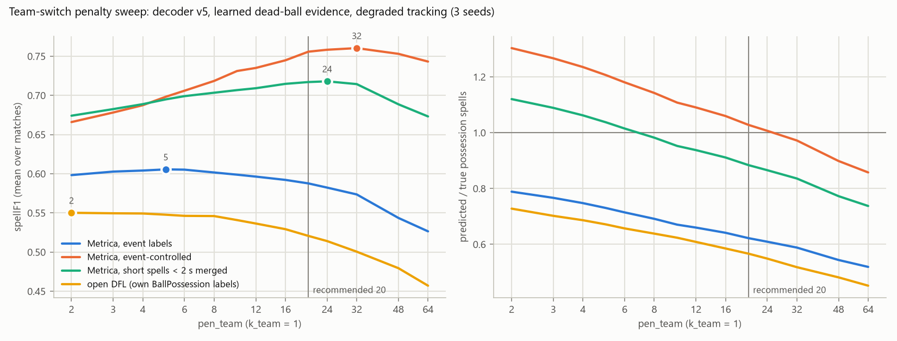

# Metrica örnek maçlarıyla takım-geçiş cezası (`pen_team`) kalibrasyonu

*20 Ekim 2026 · kod: `src/metrica_sample.py`, `src/metrica_calibration.py` (yeni; mevcut dosyalara dokunulmadı) ·
ham çıktılar: `reports/metrica_sweep.txt|.json`, `reports/metrica_barath_v5_pen_team.txt`,
grafikler `reports/metrica_pen_team_{v5,dflcv}_{model,oracle}.png`*

> **Veri politikası.** Metrica örnek verisi ve açık DFL verisi kısıtsız; bunların ham olaylarına bakıldı.
> BAR-ATH tarafında yalnızca toplu istatistik üretildi (possession sayısı / süre özetleri, public-pencere
> skorları ve sayıları). `model_v5.py` değiştirilmedi.

## Özet

- **Öneri: `model_v5` için `pen_team = 20` (k_team = 1; makul aralık 16–24).** Şu anki 8, DFL'nin
  sık dönen etiketine göre seçilmiş bir önsel tahmindi. Metrica kalibrasyonu, gerçek GT'ye en çok benzeyen
  konvansiyonda bunun ~0.04 spellF1 (resmi gürültü bandı kadar) eksik kaldığını gösteriyor.
- **Etiketler doğrulandı.** Olaylardan türetilen D sınırları, Metrica'nın kendi temiz takip verisindeki
  "top yok" koşularıyla neredeyse kare kare örtüşüyor (medyan sapma +1 / 0 kare). Yani Metrica takibinin
  ölü-top bayrağı olay akışından geliyor. Possession bayrağının da aynı kaynaktan gelmesi muhtemel.
- **Konvansiyon belirleyici.** Ham olay etiketi (son kontrol olayının takımı) maç başına 382 spell üretiyor
  (6.6/canlı dk, medyan 4.4 sn). Bu, DFL (8.3/dk, 3.7 sn) ile public pencere (4.2/dk, 7.6 sn) arasında
  kalıyor; public pencere bu konvansiyonda 5 dakikalık pencerelerin alt %3'ünde. Resmi tanımı ("kontrolsüz
  dokunuş / kontrol gelmeyen hava topu possession değiştirmez") olaylara uygulayan **olay-kontrollü**
  konvansiyon 231 spell/maç, 4.0/dk, ort. 15.0 sn veriyor. Public pencere bu konvansiyonda tipik
  (hız 49. yüzdelik).
- **Tarama (v5 dekoder, öğrenilmiş ölü-top kanıtı, 3 maç × 3 bozulma tohumu):**
  - ham olay etiketinde en iyi `pen_team` 5 (3–8 arası 0.005 içinde),
  - olay-kontrollüde 32 (20–32 düz),
  - DFL'nin kendi etiketinde 2.

  Kontrollü konvansiyonda 20, 8'i 9/9 eşli koşuda +0.037 geçiyor. Ham olay konvansiyonu doğru çıkarsa 20'nin
  maliyeti −0.014. 20, beş konvansiyon üzerinde en kötü durum pişmanlığını en aza indiren değer.
- **BAR-ATH kontrolü (toplu):**
  - v5 `pen_team=20` ile tam maçta 218 possession (4.13/canlı dk, medyan 9.7 sn) üretiyor. Bu, olay-kontrollü
    konvansiyonun (4.0/dk) ve public pencerenin (4.2/dk) hızıyla uyumlu. 8 ise 261 (4.9/dk) üretiyor.
  - Uyarı: 17 possession'lık public pencerede spellF1 8'de 0.566, 16+'da 0.444–0.448. Bu fark, pencerede
    tahmini spell'in 12'den 8–10'a inmesi ve ortalama ~2–3 eşleşmenin kaybı demek. Resmi doküman bu pencerede ayar yapmayı
    açıkça yanlış seçime götüren bir yol olarak gösteriyor. Yine de elle etiketlenmiş doğrulama seti
    (yol haritası #2) bu kararı netleştirecek ilk yer.

## 1. Veri ve lisans

| | |
|---|---|
| Kaynak | github.com/metrica-sports/sample-data, commit `e706dd5` (2021-04-15) → `external_data/metrica/` (gitignore'lu) |
| İçerik | Game 1–2: CSV takip (ev/dep. ayrı) + CSV olaylar; Game 3: FIFA EPTS takip + metadata XML + JSON olaylar (CARRY olayı yalnız burada). 25 fps, 105 × 68 m, **düzeltilmiş (temiz)** takip, olaylar takiple kare-senkron |
| Lisans | Repoda LICENSE dosyası yok. README "Legal stuff": *verinin sorumlu kullanılması* ve *kamuya açık kullanımda kaynağın belirtilmesi* isteniyor. → Veri repoya konmuyor/dağıtılmıyor; teknik dokümanda "Metrica Sports sample data (github.com/metrica-sports/sample-data)" kaynak olarak anılmalı |
| İndirme | `.venv/Scripts/python.exe -I src/metrica_sample.py download` (sabit commit, ~185 MB) |

`metrica_sample.parse(g)` → `dfl.parse()` ile aynı düzen: `h{1,2}_players (n, slot, 3)` [x, y normalize, hız m/s],
`h{1,2}_ball (n, 4)` [x, y, hız, z = NaN], `_team`, `_gk` (Game 3'te metadata, Game 1–2'de takımın en derin
oyuncusu), `_labels` (0 H / 1 A / 2 D), `_n0`. Önbellek: `cache/metrica/`.

## 2. Olaylardan H/A/D etiketi

- **D**: ölü-top tetikleyicisinden bir sonraki yeniden başlamaya kadar.
  - Tetikleyiciler: BALL OUT (bitiş karesi = top çizgiyi geçtiği an), SHOT …-OUT / …-GOAL (bitiş), FAULT RECEIVED
    ve CHALLENGE …-FAULT-… (başlangıç), BALL LOST / PASS + OFFSIDE / FORCED / HAND BALL / END HALF (bitiş).
  - Yeniden başlama: SET PIECE (RETAKEN hariç) ve **GOAL KICK alt tipli her olay**. Bu veride aut atışları
    SET PIECE değil, PASS / BALL LOST / BALL OUT olarak kodlanıyor.
  - Tetikleyicisiz bir yeniden başlamada D, önceki aksiyonun bitişinden başlatılıyor (6 yarıda 54 kez).
  - Devre başlangıcı öncesi ve END HALF sonrası D.
- **H/A**: son kontrol olayının (SET PIECE, PASS, CARRY, RECOVERY, SHOT, BALL LOST başlangıç kareleri)
  takımı. CHALLENGE, BALL OUT ve FAULT RECEIVED possession değiştirmiyor; sahipsiz top son sahibinde kalıyor.

**Doğrulama: D, Metrica'nın kendi takibindeki ölü-top işaretiyle örtüşüyor.**
- Temiz örnek takipte top, olay-türevli canlı karelerin %98.6–99.8'inde, ölü karelerin ise yalnız %0.5–16'sında
  var. Metrica takibi top ölüyken topu boş bırakıyor.
- 304 iç D segmentinde:
  - D içindeki "top yok" payının medyanı 0.997 (p10 0.943),
  - D başlangıcı ile "top yok" koşusunun başlangıcı arasındaki medyan fark **+1 kare** (%88'i ±5 kare içinde),
  - D bitişinde **0 kare** (%92'si ±5 kare içinde).
- D → canlı geçişlerinin 288/309'u (%93) bir SET PIECE ya da aut atışı karesinde. Bunların 39'unda olay
  dosyası aut atışıyla aynı kareye bir RECOVERY yazıyor.

**Possession konvansiyonları** (GT'nin "possession sahibi" bayrağı örnek veride yok; bu yüzden aralık
taranıyor):

| ad | tanım |
|---|---|
| `events` | yukarıdaki ham kural: her RECOVERY / tek dokunuş possession değiştirir |
| `tau1/2/3` | bir önceki takımın spell'ini izleyen (araya D girmeyen) ve 1/2/3 sn'den kısa spell önceki takıma verilir |
| `ctrl` (olay-kontrollü) | **resmi tanımın olaylara uygulanışı**: rakibin spell'ini izleyen spell, ancak içinde tamamlanmış PASS ya da SHOT varsa veya takım topu ≥1 sn tuttuysa (≥1 sn sonra başlayan BALL LOST/CARRY ya da ≥1 sn süren CARRY) possession değişimi sayılır. Aksi halde (tek dokunuşluk RECOVERY, hemen kaybedilen kafa/blok, kontrol gelmeyen hava topu) önceki takıma verilir. Ölü toptan sonraki spell her zaman korunur. Süre eşiği 0.5 / 1 / 2 sn için sonuç 233 / 231 / 224 spell/maç; eşik belirleyici değil. Zamana dayalı tanım bilinçli: CARRY yalnız Game 3'te var ve "kısa bir CARRY" kontrol sayılınca Game 3 tek başına 381 spell veriyordu |

## 3. Possession-spell istatistikleri

| set | konvansiyon | spell/maç | canlı dk başına | medyan sn | ort. sn | < 2 sn | < 1 sn | D seg./maç | D payı |
|---|---|---|---|---|---|---|---|---|---|
| Metrica game 1 | events | 381 | 7.17 | 3.92 | 8.37 | 0.252 | 0.126 | 105 | 0.450 |
| Metrica game 2 | events | 359 | 6.54 | 4.56 | 9.17 | 0.304 | 0.128 | 106 | 0.417 |
| Metrica game 3 | events | 405 | 6.23 | 4.64 | 9.63 | 0.272 | 0.116 | 104 | 0.322 |
| **Metrica, 3 maç** | events | 382 | 6.62 | 4.40 | 9.06 | 0.275 | 0.123 | 105 | 0.396 |
| **Metrica, 3 maç** | tau1 | 320 | 5.56 | 6.20 | 10.80 | 0.153 | 0.006 | 105 | 0.396 |
| **Metrica, 3 maç** | tau2 | 269 | 4.66 | 8.50 | 12.88 | 0.041 | 0.007 | 105 | 0.396 |
| **Metrica, 3 maç** | tau3 | 231 | 4.01 | 10.72 | 14.98 | 0.043 | 0.009 | 105 | 0.396 |
| **Metrica, 3 maç** | **ctrl** | 231 | 4.01 | 10.28 | 14.98 | 0.061 | 0.013 | 105 | 0.396 |
| açık DFL, 7 maç | BallPossession | 437 | 8.30 | 3.68 | 7.23 | 0.300 | 0.125 | 102 | 0.448 |
| BAR-ATH public pencere (5 dk) | GT | 17 | 4.23 | 7.56 | 14.19 | 2/17 | 1/17 | 4 | 0.196 |

(`ctrl` maç bazında: 225 / 215 / 253 spell, 4.24 / 3.92 / 3.89 canlı dk başına.)

**Public pencere hangi konvansiyona benziyor?** Metrica etiketlerinden kaydırmalı 5 dakikalık pencereler alındı
(30 sn adım, konvansiyon başına 516 pencere). Public penceredeki değerin bu dağılımdaki yüzdeliği:

| konvansiyon | spell hızı | medyan süre | < 2 sn payı | hız ≤ public **ve** <2 sn payı ≤ public olan pencere payı |
|---|---|---|---|---|
| events | 8 | 84 | 8 | 0.027 |
| tau1 | 17 | 65 | 42 | 0.122 |
| tau2 | 30 | 41 | 87 | 0.287 |
| tau3 | 48 | 19 | 85 | 0.444 |
| **ctrl** | **49** | 20 | 75 | **0.422** |

Ham olay konvansiyonunda public pencere uç bir pencere; `ctrl`'de ise tipik. Çekinceler:
- 17 possession az.
- Barça'nın oyun stili de spell'leri uzatabilir.
- Metrica devrelerinin ilk 5 dakikası ham etiketle 14–32 spell veriyor; 16 ve 20 spell'lik açılışlar var.

Bu yüzden bu bulgu konvansiyonu kanıtlamıyor, `ctrl`'e ağırlık veriyor.

## 4. `pen_team` taraması

**Kurulum.**
- Zincir: temiz Metrica takibi → `sim.degrade` (3 tohum) → `mlfeat` → DFL'de eğitilmiş modeller
  (`cache/dfl/models_all.pkl`, `train_dfl.predict_proba`) → `train_dfl.emissions` (temp 1/1, yani k_team = 1)
  → `train_dfl.decode_block` → maç başına `train_dfl.spell_score`. Sonuçlar 3 maçın ortalaması, her maç
  3 tohumun ortalaması.
- Dekoder ayarları:
  - **v5**: v5'in kalıtımla aldığı pen_dead = 30, min_poss = 8, min_dead = 50.
  - **dflcv**: DFL CV'nin seçtiği 32 / 5 / 25.
- Ölü-top kanıtı:
  - **model**: DFL ölü-top modeli,
  - **oracle**: gerçek D (yalnız takım kararını izole etmek için).
- Aynı tarama DFL'nin out-of-fold olasılıklarında da koşuldu.
- Bozulmuş Metrica'da kare kalitesi:
  - canlı/ölü doğruluğu 0.949, canlı karelerde takım doğruluğu 0.919,
  - top kayıp oranı canlıda 0.22, ölüde 0.98. DFL eğitim verisinde bu oranlar 0.26 / 0.67; ölü-top ipucu
    Metrica'da daha kolay, oracle koşusu bunu sınırlıyor.



**spellF1, v5 dekoder, öğrenilmiş ölü-top kanıtı** (kalın = sütunun en iyisi):

| pen_team | events | tau1 | tau2 | tau3 | ctrl | DFL | tahmin / gerçek spell (events) |
|---|---|---|---|---|---|---|---|
| 2 | 0.5982 | 0.6501 | 0.6741 | 0.6573 | 0.6659 | **0.5502** | 301 / 382 |
| 3 | 0.6027 | 0.6566 | 0.6825 | 0.6688 | 0.6781 | 0.5495 | 293 / 382 |
| 4 | 0.6041 | 0.6606 | 0.6888 | 0.6786 | 0.6875 | 0.5492 | 285 / 382 |
| 5 | **0.6056** | 0.6640 | 0.6949 | 0.6872 | 0.6982 | 0.5477 | 279 / 382 |
| 6 | 0.6052 | **0.6663** | 0.6990 | 0.6953 | 0.7060 | 0.5462 | 273 / 382 |
| 8 *(şimdiki)* | 0.6016 | 0.6644 | 0.7034 | 0.7066 | 0.7184 | 0.5460 | 264 / 382 |
| 10 | 0.5988 | 0.6645 | 0.7067 | 0.7143 | 0.7311 | 0.5409 | 256 / 382 |
| 12 | 0.5963 | 0.6626 | 0.7091 | 0.7190 | 0.7350 | 0.5365 | 252 / 382 |
| 16 | 0.5921 | 0.6589 | 0.7147 | 0.7288 | 0.7448 | 0.5292 | 245 / 382 |
| **20 *(öneri)*** | 0.5877 | 0.6554 | 0.7170 | 0.7370 | 0.7558 | 0.5207 | 237 / 382 |
| 24 | 0.5823 | 0.6507 | **0.7179** | 0.7412 | 0.7582 | 0.5140 | 233 / 382 |
| 32 | 0.5736 | 0.6431 | 0.7144 | **0.7497** | **0.7603** | 0.5005 | 225 / 382 |
| 48 | 0.5436 | 0.6120 | 0.6886 | 0.7430 | 0.7530 | 0.4795 | 208 / 382 |
| 64 | 0.5265 | 0.5941 | 0.6731 | 0.7356 | 0.7432 | 0.4571 | 198 / 382 |

**Sağlamlık: en iyi değer [en iyiden ≤ 0.005 uzaktaki aralık].**

| ayar | events | tau1 | tau2 | tau3 | ctrl | DFL |
|---|---|---|---|---|---|---|
| v5, model | 5 [3–8] | 6 [5–12] | 24 [16–32] | 32 [32] | 32 [20–32] | 2 [2–8] |
| v5, oracle | 5 [3–8] | 6 [5–12] | 24 [16–32] | 48 [32–48] | 48 [24–48] | 2 [2–4] |
| dflcv, model | 5 [3–8] | 6 [5–12] | 24 [16–32] | 32 [32] | 32 [20–32] | 2 [2–8] |
| dflcv, oracle | 5 [3–8] | 6 [5–12] | 24 [16–32] | 48 [32–48] | 48 [24–48] | 2 [2–5] |

- Maç bazında en iyiler (v5, model): events 4 / 10 / 5, ctrl 32 / 24 / 24, tau2 20 / 24 / 16.
- Dekoder ayarı ve ölü-top kanıtının kalitesi optimumu değiştirmiyor. Optimumu belirleyen, possession
  konvansiyonu.

**Eşli farklar, pen_team 8'e göre** (aynı tohum × maç, 9 koşu; ortalama, sd, kazanılan koşu):

| | 6 | 12 | 16 | 20 | 24 | 32 |
|---|---|---|---|---|---|---|
| events | +0.0036 (0.005, 8/9) | −0.0053 (2/9) | −0.0095 (0/9) | −0.0140 (0.009, 1/9) | −0.0193 (0/9) | −0.0280 (0/9) |
| ctrl | −0.0125 (0/9) | +0.0166 (9/9) | +0.0263 (9/9) | **+0.0373 (0.010, 9/9)** | +0.0398 (9/9) | +0.0419 (9/9) |
| tau2 | −0.0044 (3/9) | +0.0058 (8/9) | +0.0113 (9/9) | +0.0136 (7/9) | +0.0146 (6/9) | +0.0110 (6/9) |

**Pişmanlık analizi** (v5, model; pişmanlık = konvansiyonun en iyi spellF1'i − o pen_team'in spellF1'i):

| pen_team | 5 | 8 | 12 | 16 | **20** | 24 | 32 |
|---|---|---|---|---|---|---|---|
| events | 0.000 | 0.004 | 0.009 | 0.013 | 0.018 | 0.023 | 0.032 |
| tau1 | 0.002 | 0.002 | 0.004 | 0.007 | 0.011 | 0.016 | 0.023 |
| tau2 | 0.023 | 0.015 | 0.009 | 0.003 | 0.001 | 0.000 | 0.004 |
| tau3 | 0.063 | 0.043 | 0.031 | 0.021 | 0.013 | 0.009 | 0.000 |
| ctrl | 0.062 | 0.042 | 0.025 | 0.016 | 0.005 | 0.002 | 0.000 |
| **en kötü durum** | 0.063 | 0.043 | 0.031 | 0.021 | **0.018** | 0.023 | 0.032 |
| beklenen, eşit önsel | 0.030 | 0.021 | 0.016 | 0.012 | **0.009** | 0.010 | 0.012 |
| beklenen, ctrl-ağırlıklı (.5 ctrl) | 0.041 | 0.028 | 0.019 | 0.013 | 0.008 | **0.007** | 0.008 |
| beklenen, public-pencere ağırlıklı | 0.047 | 0.032 | 0.021 | 0.014 | 0.007 | 0.006 | **0.004** |

Oracle ölü-top kanıtında tablo aynı yönde; en kötü durum yine 20'de en küçük. Sadece ham olay konvansiyonuna
inanılırsa doğru değer 5–6. Diğer her ağırlıklandırmada 20–32.

## 5. BAR-ATH aktarım kontrolü (yalnız toplu istatistik)

**Takım modelinin güveni.** `model_v5`'in canlı karelerinde medyan |logit p_home| 2.93 ve p > 0.9 payı 0.61.
Bozulmuş Metrica'da bu değerler 3.52 ve 0.70. BAR-ATH'ta model biraz daha az emin; aynı ceza BAR-ATH'ta
biraz daha fazla yumuşatma demek.

**v5, tam maç ve public pencere, `pen_team`'e göre:**

| pen_team | possession | canlı dk başına | medyan sn | ort. sn | < 2 sn | public spellF1 | public macroF1 | public tahmin/gerçek |
|---|---|---|---|---|---|---|---|---|
| 4 | 305 | 5.77 | 6.48 | 10.40 | 0.157 | 0.5548 | 0.9023 | 14/17 |
| 6 | 282 | 5.33 | 7.06 | 11.25 | 0.117 | 0.5548 | 0.9023 | 14/17 |
| 8 *(şimdiki)* | 261 | 4.94 | 8.08 | 12.15 | 0.077 | 0.5655 | 0.9010 | 12/17 |
| 12 | 252 | 4.77 | 8.36 | 12.59 | 0.063 | 0.5655 | 0.9010 | 12/17 |
| 16 | 228 | 4.31 | 8.98 | 13.91 | 0.035 | 0.4444 | 0.8957 | 10/17 |
| **20** | 218 | 4.13 | 9.70 | 14.54 | 0.023 | 0.4480 | 0.8854 | 8/17 |
| 24 | 209 | 3.96 | 10.12 | 15.15 | 0.005 | 0.4480 | 0.8854 | 8/17 |
| 32 | 201 | 3.82 | 10.56 | 15.71 | 0.005 | 0.4480 | 0.8854 | 8/17 |

**Aktarım için iki ölçüt aynı sonuca varıyor.**
- *Aynı ceza:* ctrl'de 20–32. BAR-ATH'ta model daha az emin olduğundan bu aralığın alt ucu (~20) daha uygun.
- *Aynı çözülmüş hız:* Metrica'da ctrl optimumunda (pen 24–32) dekoder maç başına 225–233 spell üretiyor,
  yani 3.9–4.0/canlı dk. BAR-ATH'ta aynı hız pen ≈ 22–30'da elde ediliyor (20'de 4.13, 24'te 3.96,
  32'de 3.82).
- Ham olay konvansiyonunda ise iki ölçüt 5–10 diyor. Metrica optimumu 5'te 279 spell, yani 4.84/dk;
  BAR-ATH'ta bu hız 8 ile 10 arasında.

**Public pencere çelişkisi.** 16+ değerlerinde v5 bu pencerede 12 yerine 8–10 spell üretiyor ve IoU
eşikleri ortalamasında ~2–3 eşleşme kaybediyor. 17 possession'da bu 0.12 spellF1 demek. Resmi EVALUATION.md'ye göre bu pencerede
"bir possession spellF1'i ~6 puan oynatıyor", bootstrap aralığı ~0.27–0.62. Bu sinyal ham olay
konvansiyonuyla uyumlu ama zayıf. Kararı değiştirecek kanıt elle etiketlenmiş doğrulama setinden gelmeli.

## 6. Öneri

1. `model_v5` için **`pen_team = 20`** (k_team = 1, diğer dekoder ayarları aynı). Uygulamak için
   `make_submission.py --params '{"pen_team": 20}'` ya da DEFAULT'ta 8 → 20 değişikliği (bu oturumda
   yapılmadı). Gerekçe:
   - GT'nin resmi tanımı ve public pencere istatistikleri kontrollü-possession konvansiyonuna işaret ediyor.
     Bu konvansiyonda optimum 20–32.
   - 20, beş konvansiyon üzerinde en kötü durum pişmanlığını en aza indiriyor (≤ 0.018).
   - Ham olay konvansiyonu doğru çıkarsa kayıp 0.014 (gürültü bandının altında). Kontrollü konvansiyon
     doğruysa kazanç +0.037 (9/9).
2. **8'e dönme ya da 12'de durma koşulu.** Elle etiketlenmiş 20–30 dakikalık BAR-ATH doğrulama seti
   (`tools/labeler.html`) tek dokunuşların / kazanılan hava toplarının possession değiştirdiğini gösterirse
   (yani ham olay benzeri bir GT çıkarsa) 5–8 doğru aralık. Orta yol olarak 12:
   - public pencereyi hiç değiştirmiyor (12/17, 0.5655),
   - ctrl'de +0.017 (9/9) kazandırıyor, ham olayda −0.005 kaybettiriyor.
3. **DFL-tuned 2–4 bu GT için uygun değil.** DFL'nin bayrağı çok sık dönüyor (8.3/dk). 2–4 yalnız ham
   olay konvansiyonunda en iyiye yakın (≤ 0.007). tau2/tau3/ctrl'de 0.03–0.09 geride.

## 7. Sınırlamalar ve sonraki adımlar

- Örnek verilerde Metrica'nın possession bayrağı yok. Konvansiyon olaylardan kuruldu. D tarafı takiple
  doğrulandı; possession tarafı yalnız resmi tanım + 17 possession'lık public pencere ile destekleniyor.
- 3 anonim maç (lig/seviye bilinmiyor). Barça'nın stili possession'ları uzatıyor olabilir.
- `sim.degrade` gerçek BAR-ATH hatalarının hepsini taklit etmiyor (izlerin takım karışması, yanlış top
  tespitleri). Temiz Metrica verisinde top ölüyken zaten yok, bu yüzden ölü-top ipucu Metrica'da BAR-ATH'tan
  daha güçlü; oracle koşusu bu farkı sınırlıyor.
- Yan bulgu (ayrı iş): `sim.degrade` canlı oyunda top kaybını hedef %12 yerine fiilen %22 (Metrica) / %26
  (DFL eğitim verisi) üretiyor. Sebep: ölü topta başlayan boşluklar (medyan 10.7 sn) sonraki canlı oyuna
  taşıyor. Game 1 / 1. yarıda bu taşma canlı karelerin %23–34'ünü kaplıyor. Kalibrasyon döngüsü yalnız
  canlıda başlayan boşlukları küçültebiliyor (%2–5'e iniyor), taşmayı düzeltemiyor. DFL modelleri bu yüzden
  BAR-ATH'tan daha zor bir top-kaybı rejiminde eğitilmiş olabilir.
- Resmi baseline'ların tam maç skorları GT possession sayısını anlamlı sınırlamıyor (yalnız n_gt ≥ 83).

## 8. Yeniden üretim

```bash
.venv/Scripts/python.exe -I src/metrica_sample.py download     # veri (sabit commit)
.venv/Scripts/python.exe -I src/metrica_sample.py stats        # spell istatistikleri (events)
.venv/Scripts/python.exe -I src/metrica_calibration.py build   # bozulma + öznitelik + olasılıklar (~2.5 dk)
.venv/Scripts/python.exe -I src/metrica_calibration.py sweep   # tarama -> reports/metrica_sweep.*  (~4 dk)
.venv/Scripts/python.exe -I src/metrica_calibration.py tables  # bu rapordaki tablolar
.venv/Scripts/python.exe -I src/metrica_calibration.py paired 8
.venv/Scripts/python.exe -I src/metrica_calibration.py regret
.venv/Scripts/python.exe -I src/metrica_calibration.py windows # public pencere vs 5 dk pencereler (toplu)
.venv/Scripts/python.exe -I src/metrica_calibration.py barath  # v5 x pen_team, yalnız toplu
.venv/Scripts/python.exe -I src/metrica_calibration.py plot 20
```

Tüm adımlar deterministik (sabit tohumlar; LightGBM `deterministic=True`).
