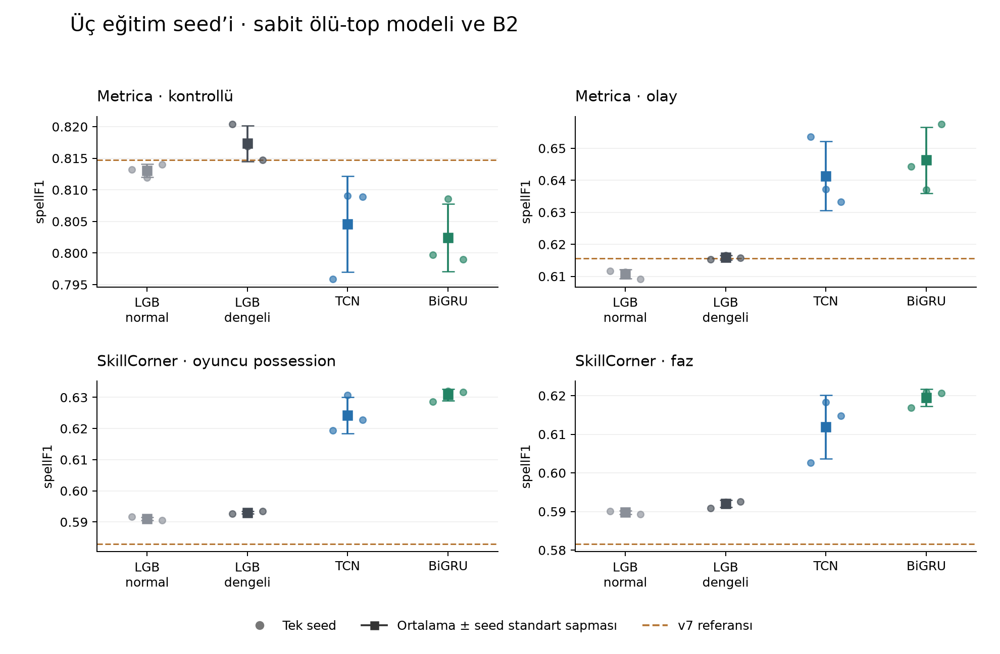

# Üç seed ve dengeli LightGBM kontrolü — 24 Ekim 2026

> **25 Ekim güncellemesi:** Gerçek BAR-ATH verisiyle açık bölüm ölçüldü:
> v7 0.6519, dengeli LightGBM 0.6667, BiGRU 0.7770±0.0080.
> [Ayrı public değerlendirme raporu](../barath_public/SONUC.md). Aşağıdaki
> dış veri sonuçları değişmedi; gizli tam-maç skoru hâlâ bilinmiyor.

**SkillCorner kazanımının büyük kısmı kaynak dengelemesiyle açıklanmıyor.**
Kaynakları 50:50 yapmak LightGBM'ye küçük, belirsiz bir kazanç sağlıyor;
TCN/BiGRU dengeli kontrolün de belirgin üzerinde. **Metrica-kontrollüde durum
tersi: dengeli LightGBM daha yüksek ortalamaya sahip.** Önceki tek seed'in
Metrica sonucunu genel bir üstünlük olarak yorumlamamak gerekiyor.

## Üç seed sonucu

Skor, sabit learned-D ve B2 ile maç ortalaması **spellF1**. Gösterim
**ortalama ± seed örnek standart sapması**; ensemble sonucu değildir.
Normal LGB, önceki DFL+PFF kontrollü LightGBM düzeninin yeni üç seed ile
tekrarıdır; v7/DFL-only ile karıştırılmamalıdır.

| Dış test | Normal LGB | Dengeli LGB | TCN | BiGRU |
|---|---:|---:|---:|---:|
| Metrica kontrollü | 0.8130 ± 0.0011 | **0.8173 ± 0.0028** | 0.8046 ± 0.0076 | 0.8024 ± 0.0053 |
| Metrica olay | 0.6107 ± 0.0014 | 0.6159 ± 0.0007 | 0.6414 ± 0.0107 | **0.6463 ± 0.0104** |
| SkillCorner oyuncu possession | 0.5911 ± 0.0005 | 0.5930 ± 0.0004 | 0.6243 ± 0.0058 | **0.6308 ± 0.0019** |
| SkillCorner faz | 0.5898 ± 0.0004 | 0.5920 ± 0.0009 | 0.6119 ± 0.0082 | **0.6195 ± 0.0023** |

Karşılaştırma için önceki sabit v7 skorları sırasıyla **0.8147 / 0.6155 /
0.5829 / 0.5816**, önceki tek-seed PFF LightGBM skorları **0.8144 / 0.6100 /
0.5913 / 0.5897**. Bu sabit referanslar yeni seed ortalamasına katılmadı.

## Kaynak dengelemesi ve ek model katkısı

Aynı seed'in iki LightGBM modeli arasında **yalnız satır ağırlıkları değişir**.
Normal → dengeli LGB kaynak ağırlıklandırmasının doğrudan etkisidir.
Dengeli LGB → sıra modeli, kaynaklar eşitken kalan ek farktır.

| Dış test | Dengeleme: dengeli − normal LGB | TCN − dengeli LGB | BiGRU − dengeli LGB |
|---|---:|---:|---:|
| Metrica kontrollü | +0.0043 | −0.0127 | −0.0149 |
| Metrica olay | +0.0051 | +0.0255 | +0.0304 |
| SkillCorner oyuncu possession | +0.0020 | **+0.0313** | **+0.0378** |
| SkillCorner faz | +0.0022 | **+0.0199** | **+0.0275** |

SkillCorner oyuncu-possession için seed ve maç belirsizliğini birlikte
örnekleyen eşli %95 bootstrap aralıkları:

- Kaynak dengelemesi **+0.0020 [−0.0029,+0.0070]**: küçük nokta tahmini;
  belirgin kazanç kanıtı değil.
- TCN'nin dengeli LGB üzerine katkısı **+0.0313 [+0.0221,+0.0401]**.
  Seed başına **19/20, 20/20, 20/20** maç iyileşti.
- BiGRU'nun dengeli LGB üzerine katkısı **+0.0378 [+0.0311,+0.0443]**.
  **Her üç seed'de de 20/20 maç** iyileşti. Bunlar 60 bağımsız maç değildir.

BiGRU'nun normal LGB'ye toplam +0.0397 farkı, yaklaşık **+0.0020 kaynak
dengeleme +0.0378 ek model düzeni katkısı** olarak ayrılıyor (yuvarlama farkı
olabilir). Bu aritmetik ayrım, kalan payın saf zamansal mimari nedensel etkisi
olduğunu kanıtlamaz: sinir ağları pencere örneklemesi, normalizasyon ve zaman
örnekleme hızı bakımından da LGB'den farklıdır. Ancak **salt kaynak dengelemesi
SkillCorner kazanımını açıklamaya yetmiyor**.

Metrica-kontrollüde dengeleme farkının aralığı [−0.0003,+0.0096] ile sıfırı
içerir. TCN − dengeli LGB aralığı [−0.0270,+0.0028], BiGRU aralığı
**[−0.0278,−0.0021]**. BiGRU'nun kontrollü konvansiyondaki kaybı özellikle
önemli. Üç maçlık Metrica üzerinde çıkarımlar sınırlı tutulmalı.

Metrica olay etiketlerinde ise BiGRU'nun dengeli LGB'ye farkı +0.0304,
aralığı [+0.0041,+0.0521]. Etiket tanımı değişince sonuç yönünün değişmesi
yarışmanın GT konvansiyonunu netleştirmenin önemini koruyor.

## Seed kararlılığı ve önceki sonucun düzeltilmesi

SkillCorner-pp BiGRU seed skorları **0.6286, 0.6320, 0.6318**; TCN skorları
**0.6194, 0.6308, 0.6227**. BiGRU bu deneyde daha kararlı. Faz etiketlerinde
de BiGRU SS=0.0023, TCN SS=0.0082.

Önceki 20261024 seed'inde Metrica-kontrollü TCN **0.8168**, BiGRU **0.8120**
idi. Üç yeni seed ortalaması **0.8046 / 0.8024**. Önceki "v7 seviyesinde"
izlenimi özellikle bu konvansiyonda seed'e duyarlıydı; yeni ortalama bu
yorumu zayıflatıyor. Buna karşılık SkillCorner kazanımı yeni seedlerde de
korundu. En iyi seed seçilmedi ve hiçbir seed dışarı atılmadı.

## Uygulanan protokol

- **20261025, 20261026, 20261027** ile 6 sinir ağı ve 6 LightGBM eğitildi.
  Önceki seed ortalamaya dahil değil.
- TCN/BiGRU: önceki eğitim içi seçimden **64 kanal, dropout .15, lr .001,
  11 epoch** sabit. Başlangıç ağırlıkları/dropout/pencere çekilişleri seed ile
  değişir; scaler bütün modellerde aynı. Tüm **7 DFL + 64 PFF** kullanılır.
- LightGBM: aynı **5.892.500 satır, 172 özellik, 400 ağaç**. DFL satır sayısı
  553.084 (%9.39), PFF 5.339.416. Dengeli ağırlıklar DFL **5.32695**, PFF
  **0.55179**; iki kaynağın toplam ağırlığı 50:50, ortalama ağırlık 1.
- Ölü-top modeli, B2, etiket konvansiyonları ve dış maçlar sabit. Oracle-D
  tanıları da [ayrıntılı tabloda](RESULTS.md) var. Dış sonuçlarla ayar seçilmedi.
- Metrica üç maç, SkillCorner 20 maç. Aralıklar 10.000 eşli seed×maç bootstrap
  tekrarından; üç seed ile keşifsel belirsizlik özetleridir. Çoklu karşılaştırma
  düzeltmesi yapılmadı.

**Karar:** SkillCorner benzeri veride BiGRU güçlü ve bu üç seed içinde kararlı
aday. Metrica-kontrollü possession'da dengeli LightGBM daha uygun görünüyor.
Bu kanıtlarla BAR-ATH için koşulsuz model değişimi yapılmadı. Saf zaman bağlamı
katkısını ayırmanın sonraki kontrolü, aynı sinir ağı eğitim düzenindeki zamansız
bir ağ/bağlam ablasyonu olabilir; mevcut dış testlerde yeni ayar araması değil.

## Çıktılar ve kontroller

- Modeller: `cache/seed_balance_v1/{tcn,bigru,lgb_balanced,lgb_unbalanced}_s{seed}.{pt,txt}`.
- **29 test geçti.** Model/scaler/seed/parametre ve olasılık dosyaları denetlendi.
  Her mimarinin üç ağırlık durumu ve üç seed tahmini birbirinden farklı.
- **96 yeni + 16 sabit referans = 112 değerlendirme hücresi**, 64 eşli fark.
  Farkların toplamsal ayrışımı sayısal olarak doğrulandı.
- Büyük dosyalar `D:\barca` altında kaldı. BAR-ATH skoru veya yeni submission yok.

[Tüm skorlar ve aralıklar](RESULTS.md) · [Yöntem ve komutlar](METODOLOJI.md) ·
[Ağırlık denetimi](weights.json) · [Doğrulama](verification.json) ·
[Test günlüğü](tests.log) · [Seed grafiği](seed_comparison.png)
